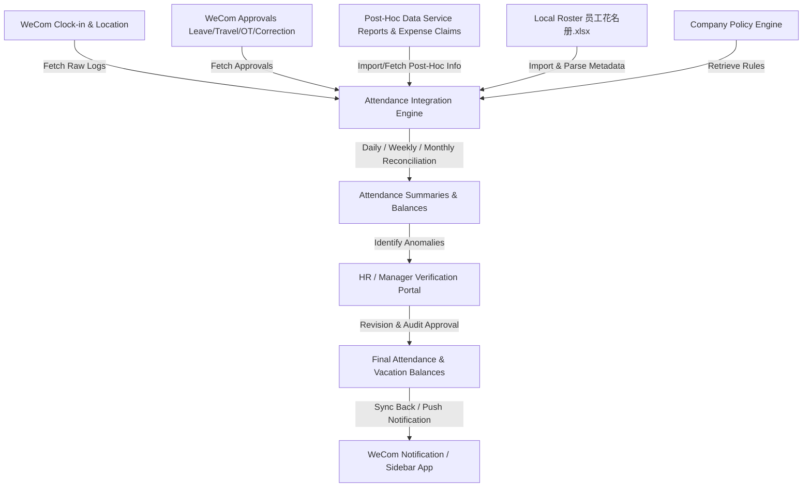

# 产品需求文档 (PRD)
## 项目: WeCom Attendance & Leave Audit Integration System (企业微信考勤与请假审计集成系统)

---

## 1. 产品概述

### 1.1 目标
本系统的目标是基于企业微信 (WeCom) 并结合本地员工主数据，构建一个统一、自动化且高度可靠的**企业微信考勤与请假审计集成系统 (WeCom Attendance & Leave Audit Integration System)**。系统将汇总多渠道打卡日志 (常规、外勤、出差)，与企业微信内的审批单据 (请假、出差、加班、外出、补卡)、后置关联导入的业务数据 (如服务报告、出差报销单) 以及本地 [员工花名册.xlsx](file:///Users/john/Desktop/wecom_addon_dev/员工花名册.xlsx) 进行多维度的关联勾稽与交叉审计，自动匹配员工企业微信 UserID 与电子邮箱，并在日/周/月审计发现异常时自动发送提醒邮件给对应员工，同时抄送给指定的管理人员。

### 1.2 解决的痛点
1. **数据孤岛 (Data Silos)**：打卡数据、请假审批和出差记录分散在企业微信各个应用模块，且与后置的实际工作凭证（如服务报告、出差报销单）及 HR 掌握 of 员工花名册主数据缺乏联动，导致每月的人工核对工作量极大。
2. **对账不精准 (Reconciliation Inaccuracies)**：难以将打卡日志与请假审批进行精准匹配，导致出现“在假但打卡”或“缺勤且无审批”等异常。
3. **复杂的调休假计算 (Compensatory Leave Math)**：需要人工跟踪加班转化为调休假的过程、监控失效日期 (例如 3 个月的有效期) 并防止余额出现负数。
4. **缺少审计痕迹 (Lack of Audit Trails)**：HR 在审核期间对考勤异常所做的修改很少记录日志，带来了透明度和合规性风险。

---

## 2. 用户角色与审计画像

| 角色 | 核心目标 | 关键权限 / 操作 |
| :--- | :--- | :--- |
| **Employee (员工)** | 查看个人考勤；申请补卡；监控剩余假期余额。 | - 查看个人每日/月度考勤状态。 - 提交补卡申请 (Punch Correction) 并说明理由。 - 查看剩余年假和调休假余额并接收异常提醒邮件。 |
| **Department Manager (部门主管)** | 监控团队考勤；确认异常；审批补卡操作。 | - 查看部门考勤看板。 - 审核并批准团队成员的补卡申请。 - 审核团队加班工时并批准请假申请。 |
| **HR Manager (HR主管)** | 审计全公司考勤；执行考勤政策；管理考勤调整；冻结月度薪酬数据。 | - 审计并修改任何员工的考勤记录。 - 执行全局的公司考勤规则和请假政策。 - 手动覆盖计算结果，并填写强制性审计备注。 - 冻结/锁定月度考勤数据，并触发报表导出和最终确认。 |
| **Company Executive (高管)** | 分析组织级的合规性；审查成本趋势 (加班、请假)。 | - 对公司范围的看板拥有只读权限。 - 查看加班成本趋势、缺勤率和政策绕过日志并接收关键考勤异常及调休催用抄送邮件。 |

---

## 3. 核心工作流与业务规则

### 3.1 数据接入与集成流

### 3.2 考勤匹配规则 (数据勾稽关系)
员工的每个日历天都会与以下逻辑进行匹配，以确定其**每日考勤状态 (Daily Attendance Status)**：
1. **标准工作日 (Standard Working Day)**：要求有上班打卡 (Start-of-Shift clock-in) 和下班打卡 (End-of-Shift clock-in)。
2. **请假 (Leave)**：如果存在有效的请假审批，对应时段将被标记为“请假”(带薪/无薪)。在此期间检测到的任何打卡都将触发警告：*"在批准的请假期间检测到打卡。"*
3. **出差 (Business Trip)**：如果存在出差审批，则免除在办公室的标准打卡要求。
4. **外勤打卡 (Outdoor Clock-in)**：如果登记了外勤打卡，系统会将其与已批准的外勤任务或拜访客户记录进行交叉比对。如果未找到对应的审批，将标记为 *"未审批的外勤打卡。"*
5. **加班 (Overtime)**：只有当同时存在已批准的加班申请 (Overtime Request) **以及**显示延长工时的对应打卡日志时，才会计算加班时间。加班工时以批准工时和实际打卡工时中的较小值为准。系统会在月度审计时引入后置的**服务报告 (Service Reports)** 进行交叉核验，确认该时段确实发生了客户服务或相应工作任务。若服务报告中填写的工时或日期与加班申请/打卡记录不匹配，系统会将其标记为“加班凭证异常”并路由至 HR 审核。

### 3.3 请假与调休假 (倒休) 规则
- **年假 (Annual Leave)**：根据工龄按月累积或按年发放。标准失效日期为 12 月 31 日。
- **调休假 (Compensatory Leave) 与加班分级补偿规则**：
  - **前置加班申请硬性约束 (Pre-emptive Overtime Rule)**：所有加班申请必须在加班发生前通过企业微信发起并审批完成。系统核算引擎会自动忽略和拦截任何在加班发生之后才发起的后补加班申请，此类后补申请无法转换为调休假，也不计入法定加班工资核算。
  - **普通双休日加班 (Weekend Overtime)**：产生调休假，计算规则为 1 小时加班 = 1 小时调休假。
  - **法定节假日加班 (Statutory Holiday Overtime)**：**严禁计入调休假余额**。系统会自动拦截将此类加班转为调休假的操作。法定节假日的加班工时将作为“法定加班工资工时”单独核算，由 HR 导出报表，统一按劳动法规定发放加班工资（如 300% 薪资）。
  - **调休假快速消耗政策**：为避免员工长期累积大额调休假余额，系统建议调休假在加班后**尽快使用**。推荐在加班完成后的 **7 天内** 完成调休（包括出差期间的在途加班调休及办公加班调休）。
  - **调休催用提醒机制**：调休工时产生后，若未被及时申请使用，系统会启动**三阶段自动催用邮件提醒**：
    - 加班完成 **7 天后** 仍未调休，向员工发送第一阶段催用提醒。
    - 加班完成 **15 天后** 仍未调休，向员工发送第二阶段催用提醒。
    - 加班完成 **30 天后 (1 个月)** 仍未调休，向员工发送第三阶段催用提醒。
    - 催用邮件发给员工本人的同时，必须**抄送（CC）**给管理与项目监督组（**王晓**、**薛蕾**、**徐宏玮**、**杨丽丽**、**孔紫初**、**王楠**），以便相关负责人及时调整项目资源和审批工作安排。

### 3.4 大交通及在途时间审计 (Travel Transit Time Auditing)
- **大交通申报 (Main Transportation Declaration)**：员工在申请出差时，必须填写主要交通工具 (机票、火车等) 的起点和终点，包括出发时间和到达时间。
- **在途时间计算 (Transit Time Calculation)**：
  - **公式**：`Transit Time = Arrival Time - Departure Time`。
  - **在途考勤判定 (Attendance Policy)**：
    1. *工作日在途*：如果出差在途时间发生在正常工作时间 (如工作日 9:00 - 18:00) 内，则审计为正常出勤工时。
    2. *非工作日/夜间在途*：如果在途时间发生在周末、法定节假日或非工作时间，系统会计算“在途工时”，并应用公司政策奖励 (例如，将周末在途每 1 小时转换为 0.5 小时或 1 小时的调休假，或者记录用于差旅津贴发放)。
- **数据勾稽验证 (Cross-Checking)**：
  - 系统验证在途时间是否限制在整个出差审批的开始和结束日期范围内。
  - 在异常情况下 (例如，出差开始时间早于审批时间，或在途时间超过标准航班/火车时长)，系统会在 HR 门户上进行标记，以便进行收据/车票审计。
- **报销单据交叉核验 (Expense Claims Reconciliation)**：在月度终审时，系统需要获取或导入企业微信审批关联的 **出差报销单 (Travel Expense Claims)**。系统将自动比对：
  1. 报销单中的大交通发票时间（机票、火车票）是否与出差申请的在途时间相符。
  2. 报销单中的差旅天数、报销金额等信息是否与出差审批及实际考勤记录吻合。
  如果存在虚报、漏报或时间冲突（例如，报销了非出差期间的交通费，或报销天数多于实际出差天数），考勤系统将自动标记该记录并发出警告。

### 3.5 考勤审计周期与提醒机制 (Auditing Frequencies & Cycle)
为了兼顾考勤的即时提醒和某些业务凭证（服务报告、报销单）的后置延迟性，系统采用**日/周/月三级审计与提醒机制**：
1. **日周期 (Daily Basic Audit)**：
   - **触发时间**：每日上午 09:00。
   - **审计对象**：昨日（T-1）的考勤打卡、外出、标准班次状态。
   - **机制**：检测是否存在漏打卡、迟到、早退、未经批准的外勤打卡等基础异常。
   - **提醒**：向考勤异常的员工发送个人**异常提醒电子邮件**。该邮件需**同时发送/抄送**给管理与财务监督组（**王晓**、**薛蕾**、**徐宏玮**、**杨丽丽**），以便各方对前一日的考勤异动保持知情。
2. **周周期 (Weekly Adjustment Audit)**：
   - **触发时间**：每周一上午 10:00。
   - **审计对象**：上周（W-1）的整周考勤数据。
   - **机制**：审计整周内的请假、出差等时段与打卡记录的匹配度。修正日审计因流程延迟造成的误差。
   - **提醒**：若周审计结束后，仍存在本周内未解决的异常项目，系统将自动向对应员工发送周度考勤异动提醒邮件，并**抄送**给管理人员（**王晓**、**薛蕾**、**徐宏玮**、**杨丽丽**）。
3. **月周期 (Monthly Final Evaluation & Audit)**：
   - **触发时间**：每月 5 日。
   - **审计对象**：上月（M-1）整月的考勤、假期余额以及后置凭证。
   - **机制**：
     - **后置数据交叉比对**：将整月的考勤记录、加班打卡、出差打卡，与后置提交的**服务报告 (Service Reports)** 和**出差报销单 (Travel Expense Claims)** 进行深度勾稽审计。
     - **异常终审与人工调整**：HR 针对交叉比对后依然存在的顽固异常（如报销冲突、无服务报告的加班等）进行人工复核，并在系统记录审计痕迹（填入 Mandatory Reason）。
     - **余额更新与归档封账**：系统最终核算该月应扣减的年假、加班产生的调休假，更新 `vacation_balances`。HR 确认无误后执行“月度封账”，封账后历史数据不可更改。
     - **提醒**：完成归档后，系统生成月度异常汇总，向未通过月度对账的员工发送月度考勤异常终审邮件，并**抄送**给管理人员（**王晓**、**薛蕾**、**徐宏玮**、**杨丽丽**），同时生成 Excel 报表发送至四位管理人员邮箱。

### 3.6 员工花名册映射与电子邮件记录 (Roster Mapping & Email Recording)
系统需要将本地主数据与企业微信用户对应，以获取员工的正式联系方式（电子邮箱）：
1. **数据源定位**：系统定期读取存放在 `/Users/john/Desktop/wecom_addon_dev/员工花名册.xlsx` 的 Excel 数据。
2. **读取字段**：包含 `姓名`、`岗位`、`签约公司`、`入职时间`。
3. **企业微信匹配**：系统调用企业微信 OpenAPI 抓取企业成员，根据 `姓名` 进行对齐，并获取其电子邮箱 `email`，写入 `employees` 数据库表中。
4. **管理人员与项目经理白名单 (Admin & PM Whitelist)**：
   - 系统中配置以下六位监督及项目负责人，作为考勤异常和催用调休邮件的必达抄送（CC）接收者：
     - **王晓** (Accounting / 会计, Pomeroy Tech)
     - **薛蕾** (Finance Manager / 财务经理, Pomeroy Tech)
     - **徐宏玮** (General Manager / 总经理, Pomeroy Tech)
     - **杨丽丽** (General Manager / 总经理, Wien Sci Tech)
     - **孔紫初** (Project Manager / 项目经理, Wien Sci Tech)
     - **王楠** (Project Manager / 项目经理, Pomeroy Tech)

### 3.7 法定节假日日历与加班提示机制 (Statutory Holiday Calendar & Overtime Warnings)
系统必须建立符合中国劳动政策和公司合规流程的日历体系与加班核销证据链：
1. **法定节假日手动录入与年度提醒**：
   - **手动维护**：去除了任何节假日外部 API 接口。每一年的法定公休日、国家调休放假计划、以及因调休而需要补班的周末（调班补班工作日）完全由总经理 **徐宏玮** 登录系统后台进行录入和年度维护。
   - **年度提醒定时任务**：在每年的最后一天（12 月 31 日上午 10:00），系统自动向总经理 **徐宏玮** 的邮箱发送年度提醒邮件，提示其录入下一年度的国家法定节假日与调班调休计划。
2. **加班申请与审批的强提示机制**：
   - 当员工在企业微信中发起加班申请，或者主管/HR 审批该加班申请时，若所选的加班日期处于“国家法定节假日”内，系统将触发**强提示预警**，要求相关角色点击确认：
     > **“提示：当前申请加班的日期 [具体日期] 为国家法定节假日。请确认现场是否确实有加班的必要性，并确保已取得客户的明确要求或具备充分的现场工作开展条件。”**
   - 并在页面显著位置提示：“加班审批不代表工时最终核算。工时核算将采用后置复合审计程序，需提供客户签字的服务报告等材料。”
3. **加班必要性分类定义**：
   员工在发起加班申请时，必须在表单中选择并阐述以下必要性类别：
   - **客户紧急要求 (Customer Urgent Request)**：客户明确要求现场提供紧急技术支持或服务。
     - *后置凭证要求*：必须上传能够证明该要求的明确书面记录（如微信群聊沟通截屏、客户电子邮件、或现场项目经理统一签发的通知单等）。
   - **项目进度关键节点 (Critical Milestone)**：项目执行过程中处于关键路径上的任务，如果不在周末或工作时间外加班将直接导致项目整体延期。
     - *后置凭证要求*：需详细写明无法在正常工作时间内完成该工作的具体原因。
   - **突发故障/系统恢复 (Emergency Recovery)**：现场发生重大系统崩溃、设备损坏或安全事故，需紧急抢修恢复运行。
   - **自主工作安排 (Autonomous Task with Onsite Conditions)**：员工自主根据工作安排申请加班。
     - *前置条件承诺与主管确认*：必须详细阐述加班理由，并确认加班时现场是否具备开工条件（如是否有施工方、工程师配合；若因对方不配合导致无法施工，或现场不具备施工条件的，严禁申请加班，严禁在现场等待、闲置等情况申请加班）。
4. **加班与差旅后置复合审计凭证链 (Post-Hoc Compound Verification Chain)**：
   在月度终审时，系统对所有打卡形成的加班工时及出差天数执行复合审计，必须同时满足以下条件链，否则标记异常并由 HR 否决：
   - **打卡一致性**：加班或出差期间在常规或外勤 GPS 点进行打卡，打卡时间覆盖加班/工作时间。
   - **现场工作日报 (Field Work Daily Report)**：出差员工或项目现场工程师在出差/现场加班期间，**必须每日提交企业微信现有的《现场工作日报》**。日报中必须上传**现场/办公室水印区域照片**（水印必须包含不可修改的真实时间戳与 GPS 物理定位，证明每日确实在现场工作）。
   - **现场服务报告 (Service Report)**：在项目现场提供工程或技术服务的，必须在项目结束时上传带有客户现场代表手写签字（及盖章）的正式纸质《现场服务报告》照片或扫描件，同时报告中也必须附加包含**现场/办公室水印区域照片**。
   - **必要性辅证材料**：如果是客户要求，需附加聊天截屏或客户确认邮件。

---

## 5. 边界情况与详细解决方案

### 5.1 历史数据追溯与严格补卡策略 (Retroactive Adjustments & Strict Missing Clock-In Policy)
* **问题**：员工在 6 月 28 日获得了请假批准，但该审批直到 7 月 7 日才最终完成，此时 6 月份的考勤月度已经封账并处理用于计算薪资。
* **解决方案**：
  - **历史数据追溯 (Audit Trail)**：系统阻止对已锁定月份进行自动重新计算。必须由 HR 发起正式的“追溯调整”(补卡/补假申诉)。其差额将作为当前开放月份的薪水调整项进行应用。
  - **极严补卡审核 (Strict Correction Policy)**：由于系统在连接到办公室 Wi-Fi/蓝牙时会自动登记签到，因此补卡申请（漏打卡补登记）需要：
    1. 详细的书面理由，解释手机/系统未能同步的原因。
    2. 附带**客观证据** (例如，只允许从企业微信水印相机实时拍照上传的带有真实时间、物理定位和办公室环境的水印照片、访客记录或主管签字的确认书)。
    3. 多级审批流：员工 -> 部门主管 -> HR 主管。HR 拥有最终审计否决权。

### 5.2 审批单据冲突/重叠 (Overlapping Approvals)
* **问题**：员工拥有 7 月 10 日至 7 月 15 日的出差审批，但同时又提交了 7 月 12 日的病假申请。
* **解决方案**：
  - **优先级矩阵 (Priority Matrix)**：请假申请覆盖出差审批。
  - 在 7 月 12 日，系统将该时间记为“病假”，并从“出差”时长中扣除。
  - 系统自动向主管发送通知：*"已解决重叠审批：7月12日病假优先于出差。"*

### 5.3 跨天班次与夜班 (Cross-Day Shifts & Night Shifts)
* **问题**：物流或 IT 支持部门员工会上夜班 (例如，当天 20:00 至次日 04:00)。
* **解决方案**：
  - 打卡日志映射到**班次 (Shifts)**，而不是自然日历天。
  - 周二 04:05 的下班打卡被归于周一的夜班。
  - 班次定义必须支持“最大跨天边界”(例如，超出日历午夜最多 6 小时的时间仍归于前一天的班次)。

### 5.4 地理编码与出差围栏审计 (Address-to-GPS Geocoding & Travel Buffer)
* **问题**：
  - 员工在申请出差或外勤任务时，输入的是文本地址 (例如，“北京市丰台区玉泉营街道纪家庙155号”)。
  - 系统必须验证外勤签到是否与这些目的地匹配，这需要从这些地址映射出精确的 GPS 坐标。
* **解决方案**：
  - **时间范围起效 (Temporal Geofence Activation)**：GPS 地理围栏严格绑定在出差或外勤任务的批准时间段内。
  - **地理编码与地址联想 API 集成 (Tencent Map POI Search)**：集成位置引擎调用 **腾讯地图 WebService API / JS API**。
    - **手动“搜索/定位”按钮触发模式 (Button-Triggered Search)**：为了最大程度降低网络消耗和服务器压力，系统采用手动触发方式。员工在输入框中打字时，前端不发起任何请求；仅当员工输入完毕并**手动点击输入框旁的“搜索/定位”按钮**时，系统才发送一条 API 请求获取候选匹配列表并提取 GPS 坐标。
    - **前端防抖与节流限制**：为防止多次连击造成并发重复调用，前端实施 500ms 的防抖（Debounce）与 1 秒内单次点击节流（Throttle）机制，杜绝异常流量冲击。
    - **格式对齐**：腾讯地图使用 GCJ-02 坐标系，与企业微信原生的签到 GPS 坐标完美匹配，防止发生偏移计算错误。
  - **100米高精度围栏 (Precise 100m Geofencing)**：
    - **标准半径**：标准审计地理围栏半径设为 **100 米**。
    - **审计缓冲区 (100米 - 500米)**：如果员工的签到偏差在 100 米到 500 米之间，系统不会将其标记为缺勤。相反，它会将记录标记为 *"需人工审核"* 并路由给部门主管审批。任何超过 500 米的偏差都将被标记为 *缺勤/无效位置*。

---

## 6. 验证与同步到企业微信

1. **员工通知**：每周向企业微信发送“考勤汇总卡片”。员工点击即可查看其日志。
2. **异议申诉**：员工有 3 个工作日的时间在企业微信上点击“申诉/Appealing”。
3. **考勤报表导出与确认**：已确认、无争议的月度考勤指标 (出勤天数、请假、加班工时、调休假变动) 将以结构化报表 (如 Excel/CSV) 导出，供 HR 导入薪水系统或进行后续薪资结算，并通过企业微信推送员工确认确认单。
