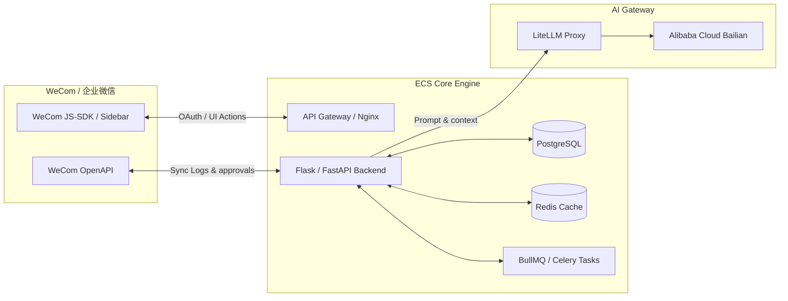

# 软件需求规格说明书 (SRS)
## 项目: WeCom Attendance & Leave Audit Integration System (企业微信考勤与请假审计集成系统)

---

## 1. 引言

### 1.1 目的
本文件规定了企业微信考勤与请假审计集成系统 (WeCom Attendance & Leave Audit Integration System) 的软件需求。它提供了技术定义、系统架构、数据库 Schema、API 接口需求和功能规格，以指导开发人员进行系统实现。

### 1.2 系统上下文
该系统作为一个部署在阿里云 ECS 实例上的安全中间件层。它协调企业微信 API、本地数据库、本地花名册数据以及后置关联导入的业务数据（如服务报告、现场工作日报、出差报销单），利用 LiteLLM 进行智能异常审计和工作流任务的处理。

---

## 2. 系统架构与数据流

### 2.1 组件图


---

## 3. 数据模型与数据库 Schema

为了实现精准的跟踪、审计和余额计算，本地 PostgreSQL 数据库应实现以下关系 Schema：

### 3.1 `employees` (员工表)
存储考勤人员基础信息及对应联系邮箱（包含花名册和企业微信匹配属性）。
```sql
CREATE TABLE employees (
    id SERIAL PRIMARY KEY,
    employee_code VARCHAR(50), -- 内部员工工号 (选填)
    wecom_userid VARCHAR(100) UNIQUE NOT NULL,  -- 企业微信 UserID
    name VARCHAR(100) NOT NULL, -- 员工中文姓名
    email VARCHAR(255), -- 电子邮件地址（通过企业微信接口获取）
    company VARCHAR(200), -- 签约公司名称（来自花名册）
    role VARCHAR(100), -- 岗位岗位（来自花名册）
    department_id VARCHAR(50),
    hire_date DATE, -- 入职时间（来自花名册）
    status VARCHAR(20) DEFAULT 'active', -- active (在职), resigned (离职)
    created_at TIMESTAMP DEFAULT CURRENT_TIMESTAMP
);
```

### 3.2 `attendance_logs` (原始打卡日志表)
存储从企业微信获取的原始打卡记录。
```sql
CREATE TABLE attendance_logs (
    id SERIAL PRIMARY KEY,
    wecom_userid VARCHAR(100) NOT NULL,
    clock_time TIMESTAMP NOT NULL,
    clock_type VARCHAR(20) NOT NULL, -- 'start_shift', 'end_shift', 'outdoor', 'trip'
    location_name TEXT,
    latitude NUMERIC(9, 6),
    longitude NUMERIC(9, 6),
    device_id VARCHAR(100),
    source VARCHAR(20) NOT NULL, -- 'wecom', 'manual'
    raw_payload JSONB,
    created_at TIMESTAMP DEFAULT CURRENT_TIMESTAMP,
    FOREIGN KEY (wecom_userid) REFERENCES employees(wecom_userid)
);
```

### 3.3 `approvals` (审批单据表)
存储企业微信中同步的请假、出差、加班、补卡等审批表单，并新增加班必要性及前置凭证的存储。
```sql
CREATE TABLE approvals (
    id SERIAL PRIMARY KEY,
    approval_no VARCHAR(100) UNIQUE NOT NULL, -- 企业微信审批单号
    wecom_userid VARCHAR(100) NOT NULL,
    approval_type VARCHAR(50) NOT NULL, -- 'leave', 'business_trip', 'overtime', 'punch_correction'
    sub_type VARCHAR(50), -- 'sick_leave' (病假), 'annual_leave' (年假), 'compensatory_leave' (调休)
    start_time TIMESTAMP NOT NULL,
    end_time TIMESTAMP NOT NULL,
    duration_hours NUMERIC(5, 2) NOT NULL,
    status VARCHAR(20) NOT NULL, -- 'pending', 'approved', 'rejected'
    reason TEXT, -- 申请事由说明
    overtime_necessity VARCHAR(50), -- 加班必要性类别: 'customer' (客户要求), 'milestone' (关键节点), 'emergency' (突发抢修), 'autonomous' (自主安排)
    evidence_url TEXT, -- 客户要求凭证图片/邮件的存储链接（针对客户要求的加班）
    work_conditions_confirmed BOOLEAN DEFAULT FALSE, -- 自主加班是否确认现场具备开工配合条件
    raw_payload JSONB,
    created_at TIMESTAMP DEFAULT CURRENT_TIMESTAMP,
    FOREIGN KEY (wecom_userid) REFERENCES employees(wecom_userid)
);
```

### 3.3.1 `travel_transit_details` (出差大交通明细表)
从出差单中解析出的具体交通行程，用于核算在途工时。
```sql
CREATE TABLE travel_transit_details (
    id SERIAL PRIMARY KEY,
    approval_no VARCHAR(100) NOT NULL, -- 关联 approvals.approval_no
    transport_type VARCHAR(20) NOT NULL, -- 'flight', 'train', 'bus', 'car'
    departure_city VARCHAR(100) NOT NULL,
    arrival_city VARCHAR(100) NOT NULL,
    departure_time TIMESTAMP NOT NULL,
    arrival_time TIMESTAMP NOT NULL,
    transit_duration_hours NUMERIC(5, 2) NOT NULL, -- 在途工时：(arrival_time - departure_time)
    policy_credit_hours NUMERIC(5, 2) DEFAULT 0.0, -- 转为调休假的时数
    created_at TIMESTAMP DEFAULT CURRENT_TIMESTAMP,
    FOREIGN KEY (approval_no) REFERENCES approvals(approval_no) ON DELETE CASCADE
);
```

### 3.3.2 `field_work_reports` (现场工作日报表)
存储从企业微信获取的员工提交的现有《现场工作日报》数据（包含现场环境水印照链接）。
```sql
CREATE TABLE field_work_reports (
    id SERIAL PRIMARY KEY,
    report_no VARCHAR(100) UNIQUE NOT NULL, -- 企业微信日报日志单号
    wecom_userid VARCHAR(100) NOT NULL,
    report_date DATE NOT NULL, -- 日报提交/工作日期
    work_summary TEXT, -- 今日工作内容
    next_day_plan TEXT, -- 明日计划
    watermark_image_url TEXT, -- 现场环境水印照存储链接（企业微信后台强制实时拍照生成）
    raw_payload JSONB,
    created_at TIMESTAMP DEFAULT CURRENT_TIMESTAMP,
    FOREIGN KEY (wecom_userid) REFERENCES employees(wecom_userid)
);
```

### 3.3.3 `service_reports` (服务报告表)
存储员工提交的与客户现场服务关联的《现场服务报告》，包含客户手写签字盖章照片。
```sql
CREATE TABLE service_reports (
    id SERIAL PRIMARY KEY,
    report_no VARCHAR(100) UNIQUE NOT NULL, -- 服务报告单号
    wecom_userid VARCHAR(100) NOT NULL,
    report_date DATE NOT NULL, -- 服务开展日期
    service_hours NUMERIC(4, 2) NOT NULL, -- 服务工时
    customer_name VARCHAR(200) NOT NULL, -- 客户名称
    is_customer_signed BOOLEAN DEFAULT FALSE, -- 是否有客户现场代表手写签字
    signature_image_url TEXT, -- 签字版纸质服务报告电子照片/扫描件文件链接
    site_watermark_image_url TEXT, -- 现场办公室环境水印佐证照文件链接
    work_summary TEXT, -- 工作摘要
    raw_payload JSONB,
    created_at TIMESTAMP DEFAULT CURRENT_TIMESTAMP,
    FOREIGN KEY (wecom_userid) REFERENCES employees(wecom_userid)
);
```

### 3.3.4 `travel_expense_claims` (出差报销单表)
存储员工报销出差交通、住宿等费用的单据，作为出差真实性的后置审计凭证。
```sql
CREATE TABLE travel_expense_claims (
    id SERIAL PRIMARY KEY,
    claim_no VARCHAR(100) UNIQUE NOT NULL, -- 报销单号
    approval_no VARCHAR(100) NOT NULL, -- 关联的出差审批单 approvals.approval_no
    wecom_userid VARCHAR(100) NOT NULL,
    claim_date DATE NOT NULL,
    total_amount NUMERIC(10, 2) NOT NULL,
    transit_expense NUMERIC(10, 2) DEFAULT 0.0, -- 交通费金额
    accommodation_expense NUMERIC(10, 2) DEFAULT 0.0, -- 住宿费金额
    expense_details JSONB, -- 包含发票日期、具体行程明细等
    created_at TIMESTAMP DEFAULT CURRENT_TIMESTAMP,
    FOREIGN KEY (approval_no) REFERENCES approvals(approval_no) ON DELETE CASCADE,
    FOREIGN KEY (wecom_userid) REFERENCES employees(wecom_userid)
);
```

### 3.4 `daily_attendance` (日考勤明细表)
系统逐日计算后合成的每日出勤结果。
```sql
CREATE TABLE daily_attendance (
    id SERIAL PRIMARY KEY,
    wecom_userid VARCHAR(100) NOT NULL,
    attendance_date DATE NOT NULL,
    shift_name VARCHAR(50), -- 班次名称
    first_clock_in TIMESTAMP, -- 首次上班打卡时间
    last_clock_out TIMESTAMP, -- 末次下班打卡时间
    status VARCHAR(50) NOT NULL, -- 'normal', 'late', 'early_leave', 'absent', 'leave', 'business_trip'
    is_anomaly BOOLEAN DEFAULT FALSE,
    anomaly_reason TEXT,
    overtime_hours NUMERIC(4, 2) DEFAULT 0.0,
    leave_hours NUMERIC(4, 2) DEFAULT 0.0,
    has_service_report BOOLEAN DEFAULT FALSE, -- 该日加班是否有现场服务报告支撑
    has_daily_report BOOLEAN DEFAULT FALSE,   -- 该日出差现场是否提交了现场工作日报
    has_expense_claim BOOLEAN DEFAULT FALSE,  -- 该日出差是否已关联报销单
    is_locked BOOLEAN DEFAULT FALSE, -- 是否已封账
    created_at TIMESTAMP DEFAULT CURRENT_TIMESTAMP,
    updated_at TIMESTAMP DEFAULT CURRENT_TIMESTAMP,
    UNIQUE (wecom_userid, attendance_date),
    FOREIGN KEY (wecom_userid) REFERENCES employees(wecom_userid)
);
```

### 3.5 `vacation_balances` (假期余额管理表)
管理员工的年假及调休假余额。
```sql
CREATE TABLE vacation_balances (
    id SERIAL PRIMARY KEY,
    wecom_userid VARCHAR(100) NOT NULL,
    leave_type VARCHAR(50) NOT NULL, -- 'annual' (年假), 'compensatory' (调休假)
    total_granted NUMERIC(5, 2) NOT NULL,
    total_used NUMERIC(5, 2) DEFAULT 0.0,
    remaining NUMERIC(5, 2) GENERATED ALWAYS AS (total_granted - total_used) STORED,
    created_at TIMESTAMP DEFAULT CURRENT_TIMESTAMP,
    updated_at TIMESTAMP DEFAULT CURRENT_TIMESTAMP,
    FOREIGN KEY (wecom_userid) REFERENCES employees(wecom_userid)
);
```

### 3.5.1 `compensatory_leave_details` (调休工时明细流水表)
具体记录每一笔加班产生的调休假，以便根据加班日期进行时间间隔提醒。
```sql
CREATE TABLE compensatory_leave_details (
    id SERIAL PRIMARY KEY,
    wecom_userid VARCHAR(100) NOT NULL,
    accrual_date DATE NOT NULL, -- 加班发生日期/产生日期
    total_hours NUMERIC(5, 2) NOT NULL, -- 产生的调休工时
    used_hours NUMERIC(5, 2) DEFAULT 0.0, -- 已使用的调休工时
    is_fully_used BOOLEAN DEFAULT FALSE, -- 是否已完全被使用
    created_at TIMESTAMP DEFAULT CURRENT_TIMESTAMP,
    FOREIGN KEY (wecom_userid) REFERENCES employees(wecom_userid)
);
```

### 3.6 `national_holidays` (国家法定节假日日历表)
存储手动录入的每年的法定节假日和调班日，不使用外部 API。
```sql
CREATE TABLE national_holidays (
    id SERIAL PRIMARY KEY,
    holiday_date DATE UNIQUE NOT NULL, -- 放假或调班的具体日期
    day_type VARCHAR(20) NOT NULL, -- 'holiday' (法定节假日-需支付法定加班费), 'workday' (调班工作日-按常规工作日审计)
    description VARCHAR(100), -- 节假日名称描述（如 '端午节', '国庆调休上班'）
    created_at TIMESTAMP DEFAULT CURRENT_TIMESTAMP
);
```

### 3.7 `audit_logs` (人工修改审计日志表)
记录 HR 在审计界面上手动调整考勤或假期余额的所有历史痕迹。
```sql
CREATE TABLE audit_logs (
    id SERIAL PRIMARY KEY,
    operator_userid VARCHAR(100) NOT NULL, -- HR 操作人 UserID
    target_userid VARCHAR(100) NOT NULL, -- 目标员工 UserID
    target_date DATE NOT NULL,
    modified_table VARCHAR(50) NOT NULL, -- 'daily_attendance', 'vacation_balances'
    before_value JSONB NOT NULL,
    after_value JSONB NOT NULL,
    justification TEXT NOT NULL, -- 强制性修改原由说明
    created_at TIMESTAMP DEFAULT CURRENT_TIMESTAMP
);
```

---

## 4. 接口与数据源集成规范

### 4.1 企业微信 OpenAPI 集成与表单映射
系统与以下企业微信 API 进行对接：
1. **获取打卡数据 API** (`/cgi-bin/checkin/getcheckindata`)：每日获取原始打卡记录。
2. **获取审批申请详情 API** (`/cgi-bin/oa/getapprovaldetail`)：获取请假、加班、出差等审批表单。
3. **获取部门成员详情 API** (`/cgi-bin/user/list`)：获取企业微信组织内的全量成员列表（包含 `name`、`userid`、`email`）。
4. **获取工作汇报数据 API** (`/cgi-bin/oa/getreportdata`)：通过企业微信日志汇报接口定时获取员工提交的《现场工作日报》数据（包含 `watermark_image_url`）。

### 4.2 腾讯地图 WebService API 集成 (关键词联想输入与定位)
用于出差、外出审批单中，对输入的目标地点进行手动搜索确认并获取 GCJ-02 定位坐标。
- **接口名称**：关键词输入提示 API
- **请求地址**：`https://apis.map.qq.com/ws/place/v1/suggestion`
- **请求方式**：GET
- **核心请求参数**：
  - `key`：系统绑定的腾讯地图应用开发密钥（Tencent Map Developer Key）。
  - `keyword`：输入框中的地点/客户中文关键词。
  - `region`：检索限制城市范围（默认全国）。
  - `output`：返回格式，固定为 `json`。
- **调用控制流（防抖与手动触发）**：
  1. 页面表单初始化时载入防抖和节流拦截器。
  2. 员工输入文字时，前端不发起网络查询。
  3. 当员工点击输入框右侧的“**搜索定位**”图标（手动触发）时，系统异步发出 GET 请求：
     - 若 QPS 超出限制（并发限制为 5次/秒），触发前端节流，提示“操作过快，请稍后再试”。
  4. 腾讯地图返回候选列表，包含：`title`（地点名）、`address`（地址描述）、以及包含 `lat`（纬度）和 `lng`（经度）的 `location` 结构。
  5. 员工点击确认某一条目，前端将 `lat` 和 `lng` 写入审批单数据结构（对应 `approvals.latitude` 和 `longitude`），提交至后端数据库作为考勤地理围栏的中心点坐标。

### 4.3 本地员工花名册解析与用户映射
系统定期读取位于本机的 Excel 花名册数据并与企业微信成员对齐绑定。
- **文件路径**：`/Users/john/Desktop/wecom_addon_dev/员工花名册.xlsx`。
- **数据结构**：数据位于 `Sheet1`，数据行从 **Row 6** 开始，包含以下关键列的提取与对应关系：
  - 第3列 (Column C): `姓名` -> 对应企业微信用户的中文名 `name`。
  - 第6列 (Column F): `岗位` -> 映射至 `employees.role`。
  - 第7列 (Column G): `签约公司` -> 映射至 `employees.company`。
  - 第8列 (Column H): `入职时间` -> 映射至 `employees.hire_date`。

---

## 5. 功能需求与算法逻辑

### 5.1 日考勤提醒算法 (Daily Basic Audit)
- **触发周期**：每日上午 09:00 (Cron: `0 9 * * *`)
- **审计范围**：昨日 (T-1) 考勤数据。
- **算法步骤**：
  1. 获取打卡和审批单据，检测漏打卡、外勤无批示等异常。
  2. 若判定为异常，写入 `daily_attendance` 表并将 `is_anomaly` 置为 `TRUE`。
  3. **邮件提醒触发**：
     - 发送 SMTP 邮件，收件人为该员工邮箱，**抄送**四位管理人员。

### 5.2 调休假累积与催用提醒算法 (Compensatory Leave Accrual & Alerts Engine)
- **触发周期**：每日上午 08:00 (Cron: `0 8 * * *`)
- **算法步骤**：
  1. **累积逻辑**：在月度审计将双休日加班确认无误后，系统将工时写入 `compensatory_leave_details`（调休明细表），并累加到 `vacation_balances`。
  2. **催用催告检测**：
     - 扫描 `compensatory_leave_details` 表中所有 `is_fully_used = FALSE`（尚未消耗完毕）的记录。
     - 计算当前日期与产生日期之间的天数差：`days_diff = CURRENT_DATE - accrual_date`。
     - 根据天数差触发邮件发送任务：
       - 若 `days_diff = 7`：向员工发送**第一阶段催用提醒邮件**。
       - 若 `days_diff = 15`：向员工发送**第二阶段催用提醒邮件**。
       - 若 `days_diff = 30`：向员工发送**第三阶段催用提醒邮件**。
     - **邮件接收人与抄送组**：
       - 接收人：员工本人邮箱。
       - 抄送（CC）列表：查询 `SELECT email FROM employees WHERE name IN ('王晓', '薛蕾', '徐宏玮', '杨丽丽', '孔紫初', '王楠')`。将四位核心高管及两位项目经理（孔紫初、王楠）全部设为抄送。

### 5.3 月度终审与交叉审计及加班复合凭证链算法
- **触发周期**：每月 5 日凌晨 01:00 (Cron: `0 1 5 * *`)
- **审计范围**：上月 (M-1) 整月的考勤数据及后置凭证。
- **算法步骤**：
  1. **日历类型校验与加班分流**：
     - 对于 M-1 月中核算出的所有加班工时，首先查询 `national_holidays` 表核验对应日期。
     - 若 `SELECT count(*) FROM national_holidays WHERE holiday_date = :date AND day_type = 'holiday'` 大于 0，该日期属于国家法定节假日。系统自动将其标记为“法定加班工时”，**不计入任何调休假余额**。
     - 若属于普通周末加班，进入“加班复合凭证审计流程”。
  2. **加班后置复合凭证审计流程**：
     - 验证加班时段的打卡日志范围完整覆盖。
     - 查询 `service_reports` 获取该日的现场服务报告：
       - 检查是否 `is_customer_signed = TRUE` 且 `signature_image_url` 上传，且 `site_watermark_image_url` 附带现场照片。若缺失，标记为考勤异常并阻断调休假生成。
     - 若加班申请中 `overtime_necessity = 'customer'`，核对是否提供了 `evidence_url`（微信截图/邮件）。
     - 若为 `autonomous`（自主加班），核对主管对于现场具备工期和开工条件的确认状态。
     - 校验不通过则将 `daily_attendance.is_anomaly` 置为 `TRUE`。
  3. **出差人员每日工作日报审计**：
     - 针对 M-1 月中所有处于 `business_trip` 状态的员工及日期，系统验证其在 `field_work_reports` 中的提交状态。
     - 执行查询：`SELECT count(*) FROM field_work_reports WHERE wecom_userid = :userid AND report_date = :attendance_date AND watermark_image_url IS NOT NULL`。
     - 如果 count 为 0，表明该出差日**未提交《现场工作日报》或未在日报中拍照上传现场环境水印照**。
     - 系统自动将该日的 `daily_attendance.is_anomaly` 置为 `TRUE`，在 `anomaly_reason` 中记录 *"出差日重度缺失现场工作日报或环境水印照片"*，同时更新 `has_daily_report = FALSE`。
  4. **月度异常通知与报告推送**：
     - 对月度对账中存在异常（如加班凭证缺失、出差日报漏报等）的记录，向受影响员工发送邮件，抄送六位管理及项目负责人。
     - 自动向 **王晓、薛蕾、徐宏玮、杨丽丽** 发送全公司上月度考勤异常及汇总 Excel 报表附件。

### 5.4 总静理日历录入提醒任务 (GM Holiday Calendar Alert)
- **触发时间**：每年的最后一天（12 月 31 日）上午 10:00 (Cron: `0 10 31 12 *`)
- **算法逻辑**：
  - 同步向总经理 **徐宏玮** 的邮箱发送年度日历维护通知邮件。

---

## 6. 非功能需求

### 6.1 安全性
- 所有敏感凭证 (API 密钥、SQL 数据库密码、加密 Token) 必须存储在环境变量中，严禁硬编码。
- 针对企业微信的回调实现 AES-256 解密。
- 邮件发送使用 SMTP over TLS 加密通信。
