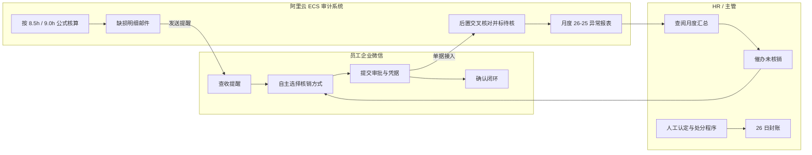
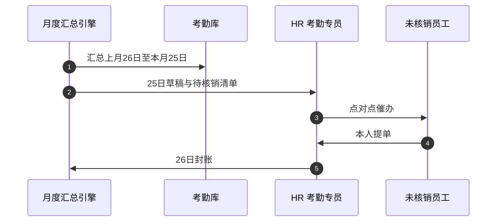

# 考勤候补核销规范、多源交叉验证防套利与月度 HR 审计催办机制

> **版本**：V2.3（实施草案，服从《考勤管理制度》）  
> **适用主体**：北京帕莫瑞科技有限公司 / 维恩科仪（北京）机械自动化设备有限公司  
> **核心原则**：**系统自动核算与邮件提醒 + 员工企微自主确认核销 + 后置交叉核对 + 月度 HR 催办封账**  
> **效力**：本文件不创设解除劳动合同或扣薪规则。处分、累计异常与解除一律走《考勤管理制度》第 3.1.5.5、3.1.5.6 条及第五章程序。  
> **关联文档**：
> - [企业微信 OpenAPI 考勤与假勤数据提取及交互能力清单](./企业微信OpenAPI数据提取与交互能力清单.md)
> - [阿里云 ECS 考勤审计服务部署与企业微信 API 自动化对接指南](./阿里云ECS考勤审计服务部署与企业微信API自动化对接指南.md)
> - [多模态考勤硬件集成、LLM智能审计与监控核对技术方案](./多模态考勤硬件集成、LLM智能审计与监控核对技术方案.md)（预研，不作为现行规范）

---

## 目录
- [一、候补核销核心原则与权责边界](#一候补核销核心原则与权责边界)
  - [1.1 核心设计理念：系统不代办，员工必确认](#11-核心设计理念系统不代办员工必确认)
  - [1.2 考勤管理三方权责划分](#12-考勤管理三方权责划分)
- [二、体验与风控：制度底线不可让](#二体验与风控制度底线不可让)
- [三、每日工时缺损自动邮件提醒与员工自助核销（T+1）](#三每日工时缺损自动邮件提醒与员工自助核销t1)
  - [3.1 每日 T-1 日审与缺额核算](#31-每日-t-1-日审与缺额核算)
  - [3.2 自动提醒邮件](#32-自动提醒邮件)
  - [3.3 员工自主核销通道](#33-员工自主核销通道)
- [四、多场景交叉验证（后置待核，不自动否决）](#四多场景交叉验证后置待核不自动否决)
  - [4.1 本地外勤](#41-本地外勤)
  - [4.2 因公出差](#42-因公出差)
  - [4.3 病假凭据](#43-病假凭据)
  - [4.4 漏打卡与补卡](#44-漏打卡与补卡)
  - [4.5 加班调休](#45-加班调休)
  - [4.6 客观故障申诉](#46-客观故障申诉)
- [五、虚假申报：证据固定与制度程序](#五虚假申报证据固定与制度程序)
- [六、月度汇总审计与 HR 催办（26–25 周期）](#六月度汇总审计与-hr-催办2625-周期)
- [七、相关制度索引](#七相关制度索引)

---

## 一、候补核销核心原则与权责边界

### 1.1 核心设计理念：系统不代办，员工必确认

1. **系统定位**：记录轨迹、按制度 3.1.1 计算应出勤与缺损、交叉提示异常、发邮件催办。
2. **严禁自动代扣代办**：不得擅自扣年假 / 调休，不得自动定性请假类型，不得自动解除劳动合同。
3. **员工确认**：缺额核销须本人在企微提交审批（调休、年假、事假、病假、外勤凭证补卡或故障申诉）。
4. **HR 封账兜底**：薪资周期截止前，HR 对未核销名单点对点催办。

### 1.2 考勤管理三方权责划分

---

## 二、体验与风控：制度底线不可让

可以降低摩擦，但**不能改写**已签收制度：

| 场景 | 员工端（制度要求） | 后端 | 不可写成 |
| :--- | :--- | :--- | :--- |
| 办公室坐班 | 园区 100m 定位 **+ 人脸**；8:30–18:30（顺延至 19:00）开口打卡 | 动态 8.5h / 9.0h；Wi-Fi / 门禁仅旁证 | 免人脸、免拍照、Wi-Fi 单独生效 |
| 本地外勤 | 事前审批（紧急每月 ≤2 次）；GPS + 水印照片 + 人脸 | 日报 / 位置偏差标「待核」 | 免自拍、自动秒批、500m 自动否决 |
| 出差 | 站点与现场**里程碑打卡**；三项合一 | 客票核定在途；≤2h 不计调休 | 枢纽免打卡 |
| 坐班漏卡 | 原则上不走遗忘补卡；故障核销或假勤冲抵（被动抵扣每月 ≤4h） | 监控仅争议抽查、人工调阅 | 每月 3 次遗忘补卡 + AI 秒批 |
| 加班换调休 | 30 分钟实质性劳动；1:1 入池 | 交叉提示，主管确认入账 | 未确认的 16h 月上限自动入账 |

---

## 三、每日工时缺损自动邮件提醒与员工自助核销（T+1）

### 3.1 每日 T-1 日审与缺额核算

1. **执行时刻**：每日 01:30 拉取 T-1 打卡与已通过审批单。
2. **有效打卡截断**：
   - 上班时刻早于 08:30 的，起算时刻取 **08:30**；
   - 无加班单时，下班时刻晚于 18:30 的，日常工时截到 **18:30**；已触发 9.0h 的截到 **19:00**。
3. **应出勤跨度**：
   - 默认 **8.5 小时**（上班打卡起算点 + 8.5h）；
   - 审计或主管确认「午间用餐 + 工位小憩累计满 1 小时」的，改为 **9.0 小时**。
4. **判定**：
   - 跨度满足应出勤（已扣已通过假勤）→ `NORMAL`；
   - 实际**工作时长**（跨度减去午休）**不足 4 小时**且无请假 → `ABSENT` 预警（制度 3.1.5.2），不由系统直接定性旷工处分；
   - 已满 4 小时但不足 8 小时实际工作，或跨度不足 8.5h / 9.0h → `PENDING_RECONCILIATION`。
5. **10:00 的正确用法**：`NORMAL` 的判定条件是「区间内打卡且跨度满 8.5h / 9.0h」；数学上这与「10:00 前到岗」等价（18:30 − 8.5h = 10:00），但引擎**必须按公式判定**而不是写死 10:00，否则 9.0h 顺延日与请假顺延（10:00 + N）会算错。注意：上午请假 N 小时只顺延**到岗截止**（应出勤跨度同步减 N），**下班截断点不变**——第 2 条的 18:30 / 19:00 封顶恒定生效，晚到者无法靠晚走补时长，缺额一律进入核销流程。

### 3.2 自动提醒邮件

每日 08:30 前发给缺损员工，抄送直属主管。正文须写清：上班打卡、下班打卡、起算 / 截断后跨度、应出勤 8.5h 或 9.0h、缺额小时、核销路径，并写明被动抵扣每月 4 小时上限。

最终确认为无酬缺勤的，扣减按制度 3.2.4 公式：**缺勤扣减金额 = 月基本工资 ÷ 21.75 天 ÷ 8 小时 × 实际缺勤小时数**（月基本工资指合同约定固定月薪，不含浮动绩效与补贴）。邮件与月度对账单引用同一公式，禁止另行口径。

坐班遗忘补卡**不要**写进默认指引；改为故障申诉或调休 / 年假 / 事假 / 病假。外勤漏卡可指引凭证补卡。

### 3.3 员工自主核销通道

| 序号 | 实际情况 | 单据 | 规则 |
| :---: | :--- | :--- | :--- |
| 1 | 有调休额度 | 调休假 | 按小时抵扣；计入当月被动抵扣则受 4h 上限 |
| 2 | 用年假 | 年假 | 同上 |
| 3 | 就医 | 病假 | 须挂号单 / 病历等；AI 只预检，人批 |
| 4 | 私事 | 事假 | 据实扣薪或按制度核算 |
| 5 | 外勤 / 出差漏打卡 | 补卡（凭证） | 行程单、客票或现场水印照片；坐班遗忘驳回 |
| 6 | 系统 / 硬件故障 | 客观异常申诉 | HR 据实核销，不计入违规累计 |

紧急事后补办（外出 / 出差 / 加班）每人每月 **≤2 次**，经理 24 小时确认 + HR 复核。

---

## 四、多场景交叉验证（后置待核，不自动否决）

### 4.1 本地外勤

- 位置控件坐标用于事后比对，**不预设制度电子围栏**。
- 须现场水印照片 + 人脸 + GPS。
- 距离明显偏离或驻留极短：标 `LOCATION_REVIEW`，推主管，**不自动改出勤结论**。
- 同时段公司 Wi-Fi / 门禁命中：标冲突待核，**不**由系统直接定性「虚假外出」。

### 4.2 因公出差

- **必须**在机场 / 车站 / 客户现场做里程碑定位打卡（制度 4.2）。
- 客票用于核定在途：≤2h = 0；2–4h = 0.5 天；>4h = 1 天。
- 调休充值须主管 / HR 核准后再调接口。
- 现场服务报告与日报交叉提示，缺签字走售后 3.3 替代证明，不因缺一份签字否定真实出勤。

### 4.3 病假凭据

- OCR / LLM **辅助**提取就诊人、医院、日期，供 HR 核对。
- 不得仅凭模型结论自动批准病假；发票查验如不具备接口条件则人工核验。

### 4.4 漏打卡与补卡

- 坐班：关闭遗忘补卡；故障走 4.6。
- 外勤补卡通道可设过去 1 天、每月 3 次。
- 监控：仅争议个案、最小时间窗、内网调阅、**人工**比对。禁止全员自动抽帧，禁止把人脸图发到公有云。

### 4.5 加班调休

- 紧迫性 + 实质交付物交叉提示。
- 入账须主管确认。不设未确认的 16 小时月上限自动截断（若日后写入制度再改引擎）。

### 4.6 客观故障申诉

- 可对比同网段同时段他人打卡成功率，作为**旁证**。
- 门禁记录可佐证，**无门禁不得作为拒绝核销的唯一理由**（制度 2.2.5）。

---

## 五、虚假申报：证据固定与制度程序

### 5.1 证据链

冲突数据（轨迹、单据、日报）写入 `audit_logs`，供 HR 使用。LLM 说明只是辅助，**不具备单独处分效力**。

### 5.2 追责必须走制度

1. **定位 / 人脸造假**：须 IT 排除设备故障、信号漂移后，才可按第五章一次性红线路径；排查期间不计入「累计打卡异常 6 次」。
2. **累计打卡异常 / 怠于履职**：书面警告阶梯、逐次签认、工会事先通知（制度 3.1.5.6、第五章）。
3. 系统**不得**自动下发解除决定，**不得**把一般核销不符直接标成「严重旷工 + 绩效最低档 + 解聘」。

---

## 六、月度汇总审计与 HR 催办（26–25 周期）

与 ECS 部署指南对齐，**不再使用自然月末 / 次月 3 日**另一套口径。

1. **核算周期**：上月 26 日 至 本月 25 日。  
2. **草稿**：每月 25 日晚生成《月度考勤审计草稿》。  
3. **催办**：封账前由 HR 点对点沟通；员工本人提单，禁止代办代扣。  
4. **封账**：每月 26 日 HR 确认后锁定，禁止静默重算。  
5. **仍未核销**：经沟通后由员工补提假期；无额度则按制度作无酬缺勤。拒不配合须书面催告并走制度认定，系统不自动标旷工处分。

---

## 七、相关制度索引

- 《考勤管理制度》PMR-HR-AT-2026-001（2026-08-21）第 2–6 章  
- 《企业微信打卡及请假说明》（制度附录；冲突时以制度为准）  
- 《差旅管理制度》第 3.5、4 章  
- 《售后服务工程师行为准则》第 3 章  
- [企业微信 OpenAPI 开发者文档](https://developer.work.weixin.qq.com/document/path/90213)
