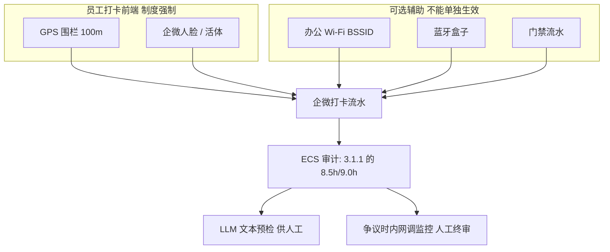
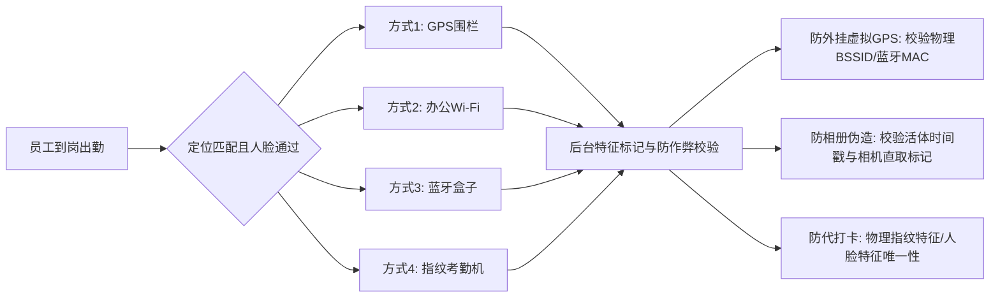
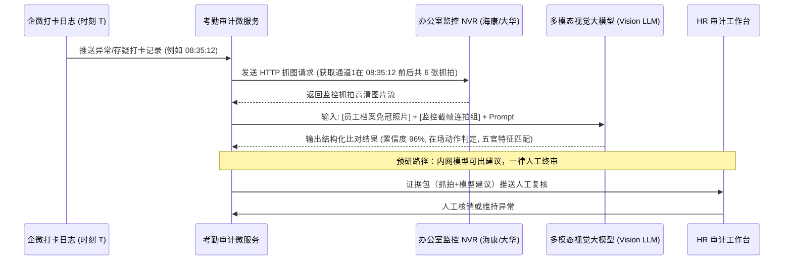
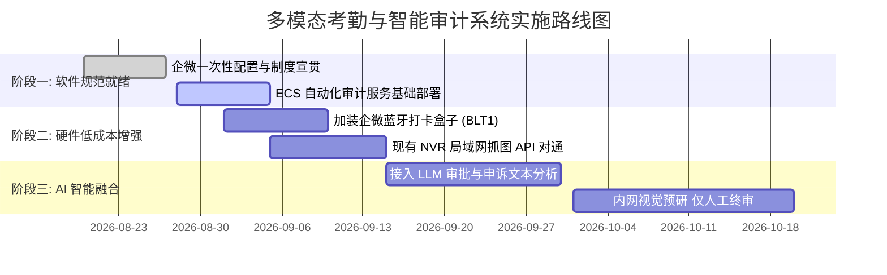

# 多模态考勤硬件集成、LLM智能审计与监控核对技术方案

> **文档版本**：V1.1（预研 / 技术方案，**不是**现行考勤规范）  
> **适用主体**：北京帕莫瑞科技有限公司 / 维恩科仪（北京）机械自动化设备有限公司  
> **效力**：本文只讨论可选技术增强。坐班生效要件仍是《考勤管理制度》的 **GPS 定位匹配 + 人脸识别**。Wi-Fi / 蓝牙 / 门禁不能替代人脸。监控比对不得外发公有云，不得按模型置信度自动核销出勤。

---

## 目录
- [一、方案概述与设计哲学](#一方案概述与设计哲学)
- [二、多模态打卡方式企微集成与防套利矩阵](#二多模态打卡方式企微集成与防套利矩阵)
  - [2.1 五类打卡方式技术原理与配置](#21-五类打卡方式技术原理与配置)
  - [2.2 硬件选型与企业微信生态打通](#22-硬件选型与企业微信生态打通)
  - [2.3 强制人脸定位与辅助因子](#23-强制人脸定位与辅助因子)
- [三、LLM 在每日考勤审计中的智能研判场景](#三llm-在每日考勤审计中的智能研判场景)
  - [3.1 非结构化请假单据与就医证明语义核验](#31-非结构化请假单据与就医证明语义核验)
  - [3.2 现场技术服务报告与出差日志比对](#32-现场技术服务报告与出差日志比对)
  - [3.3 考勤异常申诉理由客观性推理与分类](#33-考勤异常申诉理由客观性推理与分类)
- [四、监控系统（NVR）与 Vision LLM 图像识别自动核对体系](#四监控系统nvr与-vision-llm-图像识别自动核对体系)
  - [4.1 NVR 技术原理与现有监控系统兼容性评估](#41-nvr-技术原理与现有监控系统兼容性评估)
  - [4.2 Vision LLM 全自动图像识别与比对工作流](#42-vision-llm-全自动图像识别与比对工作流)
  - [4.3 全自动核销与人机协同裁决分级机制](#43-全自动核销与人机协同裁决分级机制)
  - [4.4 Python 工程实现范例（NVR 抓图 + 视觉模型比对）](#44-python-工程实现范例nvr-抓图--视觉模型比对)
- [五、法律合规、员工隐私与证据链固定](#五法律合规员工隐私与证据链固定)
  - [5.1 生物识别与《个人信息保护法》合规](#51-生物识别与个人信息保护法合规)
  - [5.2 监控调阅最小必要原则与程序正当性](#52-监控调阅最小必要原则与程序正当性)
- [六、分阶段实施路线图与落地建议](#六分阶段实施路线图与落地建议)

---

## 一、方案概述与设计哲学

现行制度底线：**定位匹配 + 人脸** 必须同时满足。Wi-Fi / 蓝牙 / 门禁只作辅助旁证。LLM / 监控只辅助 HR，**不能**自动核销或自动处分。



---

## 二、多模态打卡方式企微集成与防套利矩阵

### 2.1 五类打卡方式技术原理与配置

> **注意**：下表描述的是企业微信产品的技术能力。现行制度下，坐班打卡的**生效要件是定位匹配 + 人脸**；Wi-Fi、蓝牙即使在企微后台可配置为打卡方式，也只能作为辅助校验因子，「连上即打」不构成合规出勤记录。

| 打卡方式 | 技术原理与载体 | 员工使用体验 | 企业微信后台配置方法 |
| :--- | :--- | :--- | :--- |
| **1. GPS 电子围栏** | 手机 GPS/北斗卫星定位 + 基站辅助定位 | 手机进入办公区 100 米范围内即可打卡 | `打卡方式` → 添加打卡地点：`纪家庙双创产业园（100米）` |
| **2. 办公 Wi-Fi**（仅辅助） | 校验手机当前连接路由器的物理 MAC 地址（BSSID） | 连接办公 Wi-Fi 降低定位漂移误伤 | `打卡方式` → 添加办公 Wi-Fi 名称及路由器 BSSID |
| **3. 蓝牙打卡**（仅辅助） | 低功耗蓝牙（BLE iBeacon）广播信号感应 | 靠近大门/前台 5–10 米感应，作在场旁证 | `打卡方式` → 添加蓝牙打卡设备（BLT1 等） |
| **4. 手机人脸识别** | 企微 APP 调用手机前置摄像头进行 3D 活体人脸比对 | 手机打卡时对准面部完成活体扫描（点头/眨眼） | `更多设置` → 开启“每次人脸识别”与“真人验证” |
| **5. 硬件指纹/门禁机** | 光学/半导体指纹传感器硬件采集生物特征 | 进门按手指或刷脸过闸机，无需掏出手机 | 企微管理员扫描考勤机屏幕二维码直接绑定入企微组织架构 |

---

### 2.2 硬件选型与企业微信生态打通

为避免自建私有硬件通信网关带来的高昂开发与维护成本，**全部硬件优先选用“企业微信互联认证”生态设备**：

1. **蓝牙打卡盒子**：
   - **选型推荐**：腾讯官方认证蓝牙打卡器（如 BLT1 或标准企微蓝牙盒子），单价约 50–150 元；
   - **部署方式**：无需插网线，纽扣电池供电可工作 1–2 年，直接贴在前台或办公室大门旁，企微管理员用手机扫码添加即可生效。
2. **指纹/人脸考勤门禁一体机**：
   - **选型推荐**：海康威视（Hikvision）企微版考勤机、中控智慧（ZKTeco）企微版指纹机、魔点人脸门禁；
   - **打通机制**：设备接入局域网 Wi-Fi 或网线后，管理员在企业微信「管理后台」→「硬件设备」中扫码添加，员工指纹/人脸数据自动与企业微信通讯录 `userid` 绑定。员工在机器上按指纹后，**打卡数据毫秒级自动回传至企微云端，API 统一拉取**。

---

### 2.3 强制人脸定位与辅助因子



- **员工日常使用**：
  - 坐班必须 **GPS 围栏内 + 人脸**。手机没电时可用已绑定的企微考勤机刷脸，仍须落入制度认可的生物识别通道，不能用「只连 Wi-Fi」代替。Wi-Fi / 蓝牙仅降低定位漂移误伤，**单独命中不生效**。
- **后台组合防套利（强风控）**：
  1. **防虚拟定位外挂**：虚拟定位软件只能修改 GPS 坐标，**无法伪造局域网物理 Wi-Fi 路由器的 BSSID 与蓝牙物理广播信号**。若系统检测到 GPS 在公司但 Wi-Fi 与蓝牙均未命中，标记为重点核验特征；
  2. **防相册照片伪造**：企微开启“真人活体验证”及“禁止相册上传”，杜绝使用他人静态照片打卡；
  3. **防指纹套/代刷**：选用半导体活体指纹传感器，杜绝硅胶指纹套代打卡。

---

## 三、LLM 在每日考勤审计中的智能研判场景

在阿里云 ECS 审计后台中，大语言模型（LLM）充当 **“智能考勤风控 Copilot”**，专门处理多源非结构化文本的深度理解与推理：

### 3.1 非结构化请假单据与就医证明语义核验
- **场景**：员工申请病假并上传了医院门诊挂号单、就诊病历或发票照片；
- **LLM 处理**：
  - 提取病历图片中的关键信息：就诊医院名称、科室、就诊日期、建议休息天数；
  - 自动推理：病历开具日期是否与请假申请时段完全重合、病假建议是否支持所申请的天数；
  - 输出结构化审计结论，辅助 HR 快速放行合法病假。

### 3.2 现场技术服务报告与出差日志比对
- **场景**：售后服务工程师申请出差补贴与周末在途调休，提交了现场工作报告或日报；
- **LLM 处理**：
  - 读取《现场技术服务报告》拍照件中的工作记录、客户单位名称、现场故障现象、调试结果与客户现场负责人签字盖章；
  - 交叉核验：出差申请单中的项目名称、企微里程碑外勤打卡 GPS 地点与服务报告内容是否三者一致，防范未去现场虚报出差。

### 3.3 考勤异常申诉理由客观性推理与分类
- **场景**：员工因打卡异常提交申诉说明（如“因客户现场为保密车间，手机被统一收纳存放且机房有信号屏蔽，故无法打卡...”）；
- **LLM 处理**：
  - 分析申诉文本的因果逻辑，结合该员工当天是否有已通过的《出差申请单》或客户现场拍照；
  - 自动归类为：`[客观技术原因-建议据实核销]`、`[突发紧急业务-建议补录手续]` 或 `[主观疏漏-不予核销]`，大幅减轻 HR 人工研判负担。

---

## 四、监控系统（NVR）与 Vision LLM 图像识别自动核对体系

### 4.1 NVR 技术原理与现有监控系统兼容性评估

#### 1. NVR 是什么？
**NVR（Network Video Recorder，网络硬盘录像机）** 是企业机房或弱电箱中集中连接监控摄像头（IPC）、对视频流进行 24 小时存储与管理的核心录像主机（国内海康威视、大华、宇视等品牌占绝大多数）。

#### 2. 现有监控系统是否需要升级？
- **结论：绝大多数情况下完全不需要更换硬件或采购第三方商业软件！**
- **技术原因**：
  1. 近 10 年内的网络监控 NVR 均内置了国际标准 **ONVIF 协议**、**RTSP 视频流传输协议** 以及厂商标准 **HTTP ISAPI 抓图接口**；
  2. 只要 NVR 接入公司局域网并分配了内网 IP（如 `192.168.1.200`），外部程序即可直接通过简单的 HTTP 请求或 RTSP 流实时抓取指定通道、指定时刻的高清截帧。

---

### 4.2 Vision LLM 全自动图像识别与比对工作流

> **现行口径**：监控只在**个案争议**时调阅，时间窗尽量小（打卡前后数分钟）。视觉模型若做预研，必须在**公司内网**推理，**禁止**把档案照或监控帧发到公有云。模型结论只供 HR 参考，**不得**按置信度自动核销。



---

### 4.3 全自动核销与人机协同裁决分级机制

为兼顾**自动化运营效率**与**法律合规正当程序**，系统采用两级裁决机制：

| 判定层级 | 触发条件 | 处置方式 | 业务与法律保障 |
| :--- | :--- | :--- | :--- |
| **预研建议（不自动生效）** | 个案争议且已履行最小必要调阅 | 内网模型可输出「建议核销 / 建议复核」 | 不得写进现行 SOP 作为自动通过条件 |
| **现行唯一生效路径** | 任何监控比对或疑似代打卡 | **HR / 主管人工复核**；处分走制度第 5 章程序 | 解除、扣薪、书面警告必须人工决定并完成签认 / 工会通知 |

---

### 4.4 Python 工程实现范例（NVR 抓图 + 视觉模型比对）

以下为部署在局域网内用于监控抓图与 Vision LLM 比对的核心 Python 实现代码：

```python
import base64
import httpx
from datetime import datetime

# 1. 向现有海康/大华 NVR 发送 HTTP 请求抓取指定摄像头高清单帧图片
def capture_nvr_snapshot(nvr_ip: str, channel_id: int, auth_user: str, auth_pass: str) -> bytes:
    """调用 NVR 标准 ISAPI / HTTP 接口抓取当前画面截图"""
    url = f"http://{nvr_ip}/ISAPI/Streaming/channels/{channel_id}01/picture"
    response = httpx.get(url, auth=(auth_user, auth_pass), timeout=5.0)
    if response.status_code == 200:
        return response.content
    raise RuntimeError(f"NVR 抓图失败，状态码: {response.status_code}")

# 2. 调用多模态视觉模型（Vision LLM）执行人脸与在场识别
def verify_attendance_with_vlm(
    employee_name: str,
    id_photo_bytes: bytes,
    cctv_snapshot_bytes: bytes,
    checkin_time_str: str
) -> dict:
    """使用多模态大模型对比员工底库照片与监控截帧"""
    id_b64 = base64.b64encode(id_photo_bytes).decode("utf-8")
    cctv_b64 = base64.b64encode(cctv_snapshot_bytes).decode("utf-8")

    prompt = f"""
    你是一个企业安全与考勤审计视觉分析专家。
    【任务】：比对【图1：员工档案标准照】与【图2：公司门禁监控抓拍图】。
    【核验目标】：员工姓名：{employee_name}，打卡时间：{checkin_time_str}。
    【要求】：
    1. 判断图2中是否存在与图1同一人的面部五官与体态特征；
    2. 输出 JSON 格式，必须包含字段：
       - is_matched (boolean): 是否确认为同一人
       - confidence (float): 匹配置信度 (0.00 至 1.00)
       - analysis (string): 面部特征、衣着或出入动作详细推理分析
       - recommendation (string): AUTO_PASS (置信度>=0.9) 或 MANUAL_REVIEW
    """

    # 预研：只允许调用公司内网 / 私有化视觉接口。禁止把人脸与监控帧发往公有云。
    client = httpx.Client(timeout=30.0)
    response = client.post(
        "http://127.0.0.1:8080/v1/chat/completions",
        headers={"Authorization": "Bearer LOCAL_VISION_TOKEN"},
        json={
            "model": "gpt-4o",
            "messages": [
                {
                    "role": "user",
                    "content": [
                        {"type": "text", "text": prompt},
                        {"type": "image_url", "image_url": {"url": f"data:image/jpeg;base64,{id_b64}"}},
                        {"type": "image_url", "image_url": {"url": f"data:image/jpeg;base64,{cctv_b64}"}}
                    ]
                }
            ],
            "response_format": {"type": "json_object"}
        }
    )
    return response.json()["choices"][0]["message"]["content"]
```

---

## 五、法律合规、员工隐私与证据链固定

### 5.1 生物识别与《个人信息保护法》合规
1. **单独同意原则**：依据《个人信息保护法》第 28、29 条，指纹与人脸属于敏感个人信息。公司在《员工手册》及民主协商《规章制度收到确认书》中已明确收集目的仅用于**考勤管理与物理门禁通行**，获得员工单独书面授权；
2. **数据私有化与非外泄**：员工指纹特征码与监控抓拍原始数据存储在公司内部 NVR 与受控私有数据库中，严禁商业外泄。

### 5.2 监控调阅最小必要原则与程序正当性
1. **严禁全天候监视**：监控调阅**仅限于考勤打卡存疑时的微小时间窗口（如打卡时刻前后 2–3 分钟）**，严禁对员工工位进行全天候窥探；
2. **处分程序法定**：当 AI 识别发现代打卡等严重作弊违纪时，HR 须向员工出示完整多源证据链（企微日志、GPS 坐标、监控截图），听取员工陈述申辩后，依法送达书面处分决定。

---

## 六、分阶段实施路线图与落地建议



1. **第一步（零硬件成本）**：立即生效现有的 8:30–18:30 弹性打卡规则与企微手机拍照活体验证，运行 ECS 审计服务；
2. **第二步（百元级低成本）**：采购 1–2 个企微蓝牙盒子贴在大门，杜绝虚拟定位；打通局域网 NVR 的抓图网络端口；
3. **第三步（预研，须单独评估个保合规后才能试点）**：内网视觉模型只出建议，HR 终审；禁止公有云外发与自动核销。
