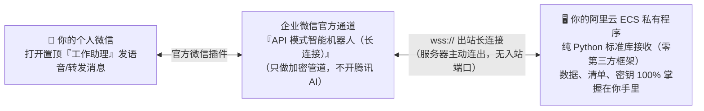

# 01｜需求定义与日常场景（PRD v3.0）

| 项 | 内容 |
| :--- | :--- |
| 文档版本 | v3.0（极简独立与企业 OneDrive 版） |
| 更新日期 | 2026-11-17 |
| 状态 | 实施方案基线 |
| 关联文档 | [总览 README](../README.md) · [02-架构与SQLite/OneDrive](02-整体架构与SQLite清单及OneDrive归档设计.md) · [03-分拣工作流与确认](03-AI分拣工作流与确认机制.md) · [04-阿里云部署与防外泄](04-阿里云部署与分阶段实施路线.md) |

---

## 一、 核心痛点与系统边界

使用人日常同时管理产品研发（光谱仪、质谱仪、锅炉光纤测温、校准仪等）、项目交付、采购供应链、销售报价及三家公司（北京帕莫瑞、维恩科仪北京/香港）日常运营，存在三个长期痛点：

1. **信息入口极度分散**：关键沟通、附件报价单、技术参数变化散落在**个人微信聊天**与**工作邮箱**里；同时开车、开会、出差时随时冒出的**业务/研发想法**，记在备忘录或直接忘掉。
2. **缺少轻量可管理的清单归集**：「想法」「马上要做的待办」「等别人回复的事」「在途项目近况」混在一起，事后要靠人脑翻聊天记录和邮件搜索。
3. **文档散落、找不到最新版**：微信群里的 PDF、Excel 报价、现场照片、邮箱里的原厂规格书，时间一久就过期失效或找不着存哪了。

**本系统的定位与边界（100% 服务个人、彻底解耦 ERP）**：
- 本系统只做你的**私人 AI 幕僚（个人第二大脑）**，**不连接、不写入公司多人使用的 Odoo 19**。
- 你只需要做**一个动作——把消息/语音/文件丢给微信里的私人助理（工作邮箱全自动后台收）**，系统自动完成整理：
  - **管「事」**：归入四大轻量化清单，并自动渲染为 Markdown 看板；
  - **管「文」**：重命名分类直接写入你的**企业 Office 365 OneDrive 隔离目录**，自动同步到办公室和家里的 Mac；
  - **管「查」**：随时在微信里带页码出处追问任何历史对话、邮件和 PDF 内页细节。

---

## 二、 先看清本质：这里说的“机器人”是什么？

这里提到的“机器人”**不是**腾讯自带的公共 AI，也**不是**市面上第三方的聊天机器人 SaaS 平台，而是**「官方加密传声筒 + 你自己阿里云服务器上的私有 Python 程序」**的组合：

- **手机端表现**：你在自己的企业微信后台创建一个「智能机器人」，选择 **API 模式（长连接）**，可见范围只选你自己 1 人，再扫描企业微信的「微信插件」二维码。从此你的个人微信列表里会多出一个置顶联系人「工作助理」。
- **安全实质**：选了 API 模式后，腾讯侧**不调用任何腾讯 AI，也不做业务存储**，只负责把你在个人微信里发给它的内容原封不动加密送达你的阿里云 ECS；建议最干净的做法是用你个人手机号另建一个**仅你 1 人的专属企业微信主体**，与公司员工使用的企业微信彻底隔开（详细防外泄机制见 [04-阿里云部署与分阶段实施路线.md](04-阿里云部署与分阶段实施路线.md) 第 2 节）。

---

## 三、 三大零负担信息入口

| 入口 | 收集方式 | 系统预处理规则 |
| :--- | :--- | :--- |
| **1. 微信聊天记录与文件** | 在个人微信中将客户/供应商/同事聊天记录（**合并转发**或**逐条转发**）、图片、PDF、Office 文档、语音直接发给置顶的「工作助理」；紧随其后可补发一句说明（支持 `备注：...` 前缀，也支持自然语言补充）。 | • 官方通道不违规抓取他人未转发会话（零封号风险）； • 连续逐条转发开启 **60 秒静默缓冲合并**（可配置，发 `好了` 立即结束等待）； • 语音直接取官方转写文本； • 若消息带 **`密：`** 前缀，**完全跳过云端大模型**直接按指示直存 OneDrive（或转交本地离线算力）； • 附件先落 ECS 临时缓存秒级提取文本入 FTS5 检索库，确认后上传企业 OneDrive 并清本地大文件缓存。 |
| **2. 随时随地个人想法** | 对微信「工作助理」按住发一段语音，或发几句脑暴文字（如“我刚想到……”）。 | • 无需手动打标签或选模板； • 若与已有项目/产品有关联，自动关联到项目文件夹；同时全部记入 **`03_想法与孵化池.md`**，绝不污染当日紧急待办。 |
| **3. 工作邮箱与附件（第二阶段）** | 后台定时任务通过企业 Office 365 **Microsoft Graph `Mail.Read`**（或标准 **只读 IMAP**）增量拉取新邮件及附件（客户询盘、海外原厂技术通知、供应商报价、合同扫描件）。 | • 物理上只授予只读收信权限，**绝不配发信权限（无 `Mail.Send`/SMTP）**； • 纯代码过滤验证码、账单推送、群发营销广告； • 邮件线程按 `Message-ID` / `In-Reply-To` 去重并串联同一往来； • 邮件正文 + 附件全文进入与微信完全一致的百炼分拣流水线，生成预览卡推到微信确认。 |

> **第一阶段上线必测项（微信通道实测 T1–T3）**：
> - **T1**：个人微信多选消息「合并转发」给机器人时，服务端能否直接拿到完整结构体、原发送人及时间；
> - **T2**：多选「逐条转发」时消息到达间隔分布（用于校准静默缓冲时间，默认 60 秒）；
> - **T3**：逐条转发夹带图片、PDF 时到达顺序是否一致，以及机器人单条回复最大字数与发送整理文件能力。

---

## 四、 四大轻量化清单模型（SQLite 维护 → OneDrive 自动渲染）

彻底摒弃复杂的 ERP 流程与 20 多张关系表，所有从微信、语音、邮件里提炼出来的“事与想法”，全部由本地轻量 SQLite 管理，并在每次更新后自动渲染成 **4 份整洁的 Markdown 清单**写入 OneDrive `00_我的四大清单/` 目录（Mac 上用 Obsidian 或文本编辑器打开即可直接查看与检索）：

| 清单文件（自动更新） | 对应类型 | 管什么 & 怎么用 |
| :--- | :--- | :--- |
| **`01_今日与行动待办.md`** | `project_action` / `next_action` | 明确“谁、在何时前、做什么”的具体动作（含归属项目名、截止日、来源日期）。每天早/晚推到微信，回 `完成 2` 即标完成，已完成的自动沉底归档。 |
| **`02_在途项目总览.md`** | `projects` 字典聚合视图 | 汇总所有进行中的研发/交付项目：客户、一句话最新近况、未完成待办数、以及跳转该 OneDrive 项目文件夹的相对链接，打开即见全局。 |
| **`03_想法与孵化池.md`** | 💡 `idea` | 收录路上闪念、工艺设想、新商机苗头，分 4 栏状态：`闪念收集` / `调研评估` / `准备立项` / `留存参考`。每周五晚简报单独附一段回顾，成熟了再决定是否正式进公司 Odoo 立项。 |
| **`04_等待他人清单.md`** | ⏳ `waiting_for` | 记录“等客户确认技术协议”“等供应商周五报交期”“等财务核对付款”等事项（写明对方、承诺日），到期未反馈在每日简报置顶提醒催办。 |

---

## 五、 四个核心日常使用场景演示

### 场景 1：开车/走路突发灵感——微信发语音记想法
- **你对「工作助理」按住语音说**：“我刚想到，锅炉光纤测温那个机架式仪表，机箱可以让做质谱仪外壳那家供应商顺便评估一下能不能通用。”
- **机器人几秒后回你一张预览卡**：
  > **确认 #104｜💡 想法孵化 + 行动待办**
  > - **归属项目**：`锅炉光纤测温研发`（关联产品线：`质谱仪外壳`）
  > - **写入 `03_想法与孵化池.md`**：`[调研评估]` 评估机架式仪表与质谱仪机箱结构通用化方案
  > - **写入 `01_今日与行动待办.md`**：找质谱仪外壳供应商询通用机箱可行性与报价（负责人：本人）
  > - **想法笔记写入 OneDrive**：`04_想法与行业参考/20261117_机架仪表与质谱仪机箱通用设想.md`
  >
  > 回复 `1` 确认写入 ｜ `2` 仅存想法池不建待办 ｜ `改：...`
- **结果**：你回 `1`，本地清单与 OneDrive 文档同步更新，你回到 Mac 前打开 Obsidian 就能看到整理好的条理笔记。

### 场景 2：邮箱收到原厂英文技术邮件与 PDF（全自动免手动转发）
- **后台捕获**：系统自动拉取到一封来自国外原厂的技术通报邮件，带附件 `Calibration_Spec_2026.pdf`（12 页）。
- **AI 自动读取邮件与 PDF 原文后推到你微信**：
  > **确认 #105｜📧 新邮件分拣（含 1 份 PDF）**
  > - **核心摘要**：原厂通知高温段补偿系数由 `0.012` 修订为 `0.0095`（见 PDF 第 4 页），建议下批出货前切换。
  > - **识别到参数修订（对照历史）**：原记录（2026-09-10）为 `0.012`，本次更新为 `0.0095`（旧记录保留留痕）
  > - **OneDrive 拟归档**：`02_产品与研发/LubeSense/01_规格书与原厂资料/20261117_LubeSense_校准规范2026.pdf`（附带中文摘要 `.md`）
  > - **写入 `01_今日与行动待办.md`**：核对并更新 LubeSense 高温段补偿系数
  >
  > 回复 `1` 确认归档并建待办 ｜ `2` 仅归档文档到 OneDrive ｜ `改：...`
- **结果**：PDF 自动按中文命名躺在你的企业 OneDrive 产品研发文件夹里并秒同步到 Mac，第 4 页参数变化已被全文索引。

### 场景 3：微信里多选转发客户沟通 + 报价单
- **操作**：多选客户王经理的 6 条微信聊天 + 1 份 `报价单V3.xlsx` 转发给「工作助理」，紧接着发一句：`备注：帕莫瑞签，周五前定稿发他`。
- **处理**：机器人静默收齐 6 条 + 附件 + 备注，合并为 1 张预览卡：识别出客户与项目、将文件重命名为 `20261117_某某科技二期_报价单V3.xlsx` 归入 OneDrive `01_项目归档/某某科技二期/02_报价合同与商务/`，并写入 `01_今日与行动待办.md`（周五截止）与项目沟通纪要 `.md`。

### 场景 4：随时追问历史与每日早晚简报
- **随时在微信提问**：
  - *“上个月跟某某科技谈二期，报价和付款条件最后是怎么定的？原文件放哪了？”*
  - AI 结合 SQLite 清单与按页全文索引，回答时**必须附出处**（如：*“总价 XX 万，见 2026-10-28 邮件附件《某某报价V3.pdf》第 3 页；如与 10-20 口头版本不一致会同时列出双方原话并标注未定冲突”*），并直接给出该文件在 OneDrive 里的准确路径；查无记录则直说查不到，严禁编造。
- **每日简报（工作日 08:30 / 18:00 可配置）**：
  - 汇总：逾期/今日行动待办、今日到期等待他人催办项、今日已写入 OneDrive 的新增文档列表、未裁决冲突提示；每周五晚附加本周「💡 想法孵化池」回顾。

---

## 五、 成功与验收标准

1. **原件零丢失**：发给机器人的任何消息/语音/文件以及拉取的业务邮件，先存入 OneDrive `00_原件收件箱/`，分析失败或放弃归档均不丢原件。
2. **一卡确认无负担**：每条片段/邮件只出 **1 张预览卡**，回复 `1` 即完成本地清单更新、Markdown 看板渲染与 OneDrive 文件归档（支持高把握模式 B 自动归档 + 24 小时内 `撤销`）。
3. **四大清单与 OneDrive 目录即开即用**：Mac 打开 Finder 或 Obsidian 即见最新四大 `.md` 清单与完整分类文档，不依赖任何第三方 ERP 界面。
4. **数字与出处 100% 保真**：PDF 内页数字、金额、交期、料号提取与问答必须原文出现并带页码/消息序号出处，绝不幻觉捏造。
5. **核心机密严防外泄**：满足“空壳传声筒 + `密：` 前缀跳过云端大模型 + OneDrive 沙箱目录最小权限 + 物理无外发能力 + 凭证不进 Git”全部安全红线。
