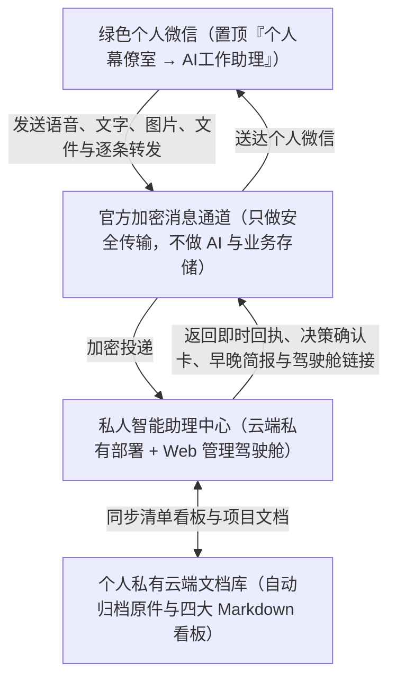

# 01｜产品需求定义与日常使用场景（PRD v3.3）

| 项 | 内容 |
| :--- | :--- |
| 文档版本 | v3.4（v3.0 单脑自然交互 + 任务来源标记版） |
| 更新日期 | 2026-11-25 |
| 状态 | 线上运行基线 |
| 关联文档 | [总览 README](../README.md) · [02-技术栈与存储架构设计](02-技术栈与存储架构设计.md) · [04-AI分拣工作流与确认机制](04-AI分拣工作流与确认机制.md) · [05-阿里云部署与分阶段实施路线](05-阿里云部署与分阶段实施路线.md) |

---

## 一、 核心痛点、产品边界与“董事长助理”定位

使用人日常同时统筹多家企业的全面工作时，面临四大痛点：

1. 信息入口极度分散：关键沟通、附件报价单、技术参数变化散落在个人微信聊天与工作邮箱；路上随时冒出的业务或研发想法容易遗忘。
2. 缺少轻量可管理的清单与优先级：想法、行动待办、等待他人回复、在途项目近况混杂，难以一眼分清轻重缓急。
3. 文档散落且缺少纵深查证：微信和邮件里的 PDF、Excel 报价单、原厂规格书不仅需要自动归档，更需要在后续追问时交叉比对历史纪要、精确核算表格并给出页码出处。
4. 缺少全局排期与周期掌控：每天事情很多，但说不清未来几天哪些时段排期过于密集、哪些在途事项拖了多久才完成、某个项目卡在外部等待到底拖了几天。

产品定位与边界：
- 私人幕僚独立边界：100% 服务你个人，所有清单台账、项目档案与云端看板均为个人私有，不混入公司多人 ERP 系统。
- 懂项目管理的总经理助理 / 董秘定位：专注于专业项目管理与档案督办——当你提出要做市场调研、商务推进或技术评估时，助理负责把“要做什么、期望完成时间、需要开什么会、联系什么人、调阅哪些资料”结构化记录下来并纳入周期跟踪与提醒闭环，不越位替你执行具体的市场调研或代写业务报告；同时提供内部档案按页查证与 Web 驾驶舱复盘。

---

## 二、 使用入口与交互形态

系统在你常用的绿色个人微信内提供日常唯一主力入口，背后由你的私有云服务器与私有云盘支撑，不依赖第三方公共 AI 机器人，也不在本地电脑占盘存储：

交互入口说明：
- 日常唯一主入口（个人幕僚室 → AI工作助理）：可在 iPhone 微信首页直接置顶，一站式收发语音（发送后 1 秒内收到到达回执，后台自动转写语音内容）、文字、图片、PDF/Excel 文档、多选「逐条转发」（连续转发多条消息时自动合并为一次处理），以及接收早晚简报和驾驶舱登录验证码。
- 「个人幕僚室」与「AI工作助理」的关系与多助理扩展能力：
  - 「个人幕僚室」相当于你的私人专属企业空间（外层容器，负责在个人微信首页置顶占位），而「AI工作助理」是空间内负责项目管理与档案督办的 1 号专属助理窗口；
  - 未来如有需要，可以在「个人幕僚室」内继续增设多个不同职能的助理窗口（例如专门负责联网搜集公开市场报告的“外勤调研助理”），每个助理窗口消息互不混杂、权限各自独立隔离；
  - 从日常使用效率出发，高频项目管理建议保持 1 个主力窗口（AI工作助理）即可，仅在需要物理隔离权限或完全不同工作流时再增设第 2 个助理。
- 备用客服通道（微信「客服消息」盒子内）：平时无需打开；仅当在微信内需要将几十条群聊记录打包成一张「合并转发」卡片一次发给助理时使用（日常用「逐条转发」发给主入口效果完全一样）。
- 权限边界：仅限你本人单人可用，外部人员无法触达或查看任何数据。

---

## 三、 三大零负担信息入口（功能规则）

| 信息入口 | 用户操作方式 | 业务处理与安全规则 |
| :--- | :--- | :--- |
| 1. 微信聊天记录与文件 | 在个人微信中将客户/供应商/同事聊天记录（多选「逐条转发」，或通过备用通道发「合并转发」）、图片、PDF、Excel/Word 文档、语音直接发给置顶的「AI工作助理」；可随手附一句说明。 | • 连续逐条转发自动开启短时静默合并（发送「好了」可立即结束等待，整批只回一次到达提示）； • 语音自动转为文字后参与理解与建单； • 收到的附件先落入原始收件箱备份，提取文本供后续检索，不占用本地电脑磁盘。 |
| 2. 随时随地个人想法与工作交办 | 对微信「AI工作助理」按住发一段语音，或发几句脑暴/交办文字（如“我刚想到……”或“我要做个市场调研……”）。 | • 纯灵感或初步构想自动记入 03_想法与孵化池.md，绝不混入当日紧急行动待办； • 若明确属于待推进工作（如做市场调研、找人沟通、约会评审），只记录目标事项、期望完成时间、干系人、会议及待查资料清单，不自动联网代做调研。 |
| 3. 工作邮箱与附件 | 后台定时增量读取指定往来公司的邮件与附件（当前白名单锁定：奥地利 V&F、德国 Tera、B&D，可在配置中随时增删公司名或域名）。 | • 仅具备只读收信能力，物理上绝不具备对外发信能力； • 未命中白名单公司的日常邮件、广告、验证码一律直接跳过； • 命中的邮件内容仅作为待审外部信息提取要点并生成确认卡，严防恶意指令越权。 |

---

## 四、 四大轻量化清单体系

所有从微信、语音、邮件里提炼出来的“事与想法”，均统一维护并在每次变更后自动重绘为 4 份带 P0 / P1 / P2 动态优先级的云端 Markdown 看板（外加个人规则库）：

| 清单名称 | 适用事项类型 | 管理内容与日常用法 |
| :--- | :--- | :--- |
| 01_今日与行动待办.md | 项目行动 / 下一步行动 | 明确“谁、在何时起止、计划或实耗跨度天数、做什么”，自动标出 P0 / P1 / P2 优先级。支持在微信发 开始 N / 完成 N 打卡。 |
| 02_在途项目总览.md | 在途项目汇总视图 | 汇总所有在途研发与交付项目：所属业务板块、计划起止周期、事项完成统计、最新进展与云端项目文件夹直达链接。 |
| 03_想法与孵化池.md | 想法与灵感 | 收录路上闪念、研发工艺设想、新商机苗头，分 4 栏状态管理：闪念收集 / 调研评估 / 准备立项 / 留存参考。每周五晚简报提醒回顾。 |
| 04_等待他人清单.md | 外部卡点等待 | 记录“等客户确认技术协议”“等供应商报交期”等外部依赖（写明对方、已等待跨度天数、承诺日），临期或超期在简报置顶列为 P0 催办。 |

---

## 五、 周期跨度管理与项目管理驾驶舱（核心功能）

为了让助理真正达到董事长/总经理幕僚水准，不用手动填表也能掌握事务周期与全局节奏，产品内置以下两项核心功能：

### 5.1 日历周期跨度追踪（不猜工时，零手动填表）

1. 只记录真实的日历起止周期与完成跨度天数，不靠 AI 猜测不准的个人小时数：
   - 计划日历周期：每件事项记录计划启动日与目标完成日（例如等供应商打样周期 10 天），据此计算计划跨度天数并提醒临期节点。
   - 实际完成跨度：从实际启动或建单日到微信打卡完成经历的日历天数，真实反映事务推进耗时；仅当本人明确口头指定具体小时数时才附带记录。
   - 业务板块分类：固定归入 产品研发 / 客户销售 / 项目交付 / 采购供应链 / 公司治理与人事 / 个人思考 六大板块，用于复盘精力分布。
2. 排期避让与每日主动盘点闭环：
   - 新建待办前自动查询未来 7～14 天每日已排期事项数量与时间跨度，建议合理的起止日期，避免把非紧急事项堆叠在已经排满的工作日。
   - 决策卡发出后，如果觉得日期不合适，直接回复自然语言修改（如 改：排到下周一到周三）。
   - 记录起点：微信回复 开始 3、在驾驶舱标记「进行中」，或默认以建单日作为起点；
   - 每日主动盘点刷新（避免忘记打卡导致跨度失真）：每天傍晚 18:00 简报自动汇总「进行中、今日到期及已超期」事项，在微信主动向你确认进度；你只需回一句自然语言（如 #3 做完了，#5 开始了，#7 改到下周一），系统即批量封口计算实际完成跨度天数、刷新未完排期，并沉淀至同类事项周期基准。

### 5.2 董事长项目管理驾驶舱（手机与电脑双端 Web 看板）

提供独立专属的加密网页驾驶舱（https://assistant.fire-matrix.com），针对手机微信内顺手查阅与电脑大屏深度复盘做了双端无缝适配：

1. 双端无感安全登录：
   - 手机微信内直开：在微信对助理发 看板 或点击每日简报底部链接，系统返回固定驾驶舱链接，在微信内置浏览器直接打开；首次用 6 位验证码登录后，本机 180 天内免密直开。
   - 电脑大屏登录：浏览器打开网址后，点击发送 6 位登录码到个人微信（或输入预设口令），校验后保持本机 180 天免重复登录。
2. 响应式双布局与四大核心视图：
   - 手机竖屏模式：自动切换为底部导航与单栏卡片流，单手即可点选修改起止日期、标记完成或将想法转为立项，无需左右横滑宽表。
   - 电脑宽屏模式：支持以下四大视图一键切换，所有网页端改动实时生效并同步刷新云端 Markdown 看板：
     1. 主表格分组看板（Main Table）：按在途行动、外部等待、想法池、已完成分组展示，支持行内修改状态、优先级、业务板块、起止日期及跨度天数展示，每条任务自动标注来源彩色徽标（`微信` / `邮件` / `驾驶舱`）并支持顶部按来源一键筛选，想法可一键转为正式项目待办。
     2. 交互式甘特图与周期追踪（Gantt & Timeline）：21 天滚动时间轴，支持鼠标直接横向拖拽调整起止日期，一眼看清延期风险与外部卡点跨度。
     3. 日程排期负载视图（Schedule Load）：展示未来 7 天每日排期事项密度（轻松 / 适中 / 拥挤），点击某天即可查看当日排期明细。
     4. 管理驾驶舱分析（Analytics）：展示平均完成跨度天数、整体完成率、外部卡点数量、各业务板块事务占比、板块完成进度与在途项目总表。
3. v3.0 自然语言交互升级：
   - 无需死背口令，直接用自然中文说「目标截止时间暂定本周五，之后可以确认落盘了」即可一步完成改卡与落盘；说「把 #1 截止改到下周三，给 #2 写个评价推进太慢，#3 完成了」可在一轮内批量办完；日常单任务确认卡极致精简，不重复念摘要、不出现技术黑话。

---

## 六、 四个典型日常场景演示

### 场景 1：路上语音交办专项任务或想法 → 董秘拆解项目管理要素与排期
- 你按住微信语音说：“下月底前我们要完成一次华东热电行业的锅炉测温市场调研，下周先约销售部王经理和研发李工开个碰头会，另外帮我记着联系一下苏州老客户张总了解需求，先看看去年那份行业报价汇总。”
- 助理按专业项目管理视角拆解记录，返回 1 张决策确认卡（不替你去网上做调研，而是把事、人、会、资料和期限管起来）：
  > 确认 #104｜📋 项目管理拆解 + 周期排期建议
  > - 归属项目 / 板块：华东热电市场调研（客户销售）
  > - 写入 01_今日与行动待办.md (P1)：与销售部王经理、研发李工召开市场调研启动碰头会，并同步调阅去年行业报价汇总
  > - 写入 04_等待他人清单.md / 干系人：联系苏州老客户张总了解今年测温改造需求
  > - 计划周期：会议与资料准备建议排在下周（跨度 5 天），总目标截止日锁定下月底
  >
  > 回复 1 确认落盘 ｜ 2 仅存想法不建待办 ｜ 改：...

### 场景 2：供应商突发延期 → 多跳查旧账、预警撞期并推荐备选
- 你转发供应商王总的一条微信：“张总抱歉，高温探头这批货源材料卡了，交期得往后推两周，看看你们能不能启用上次聊过的备选厂家？”
- 助理检索历史档案并交叉核算节点后返回 1 张幕僚决策卡：
  > 确认 #105｜⚠️ 交期延期风险预警 + 历史备选方案召回
  > - 影响项目 / 周期变更：某某热电锅炉测温交付（原交期 11-25 → 顺延 14 天至 12-09，紧贴 12-10 厂内联调节点，存在重大撞期风险）
  > - 历史备选线索（出自 2026-09-14 会议纪要第 2 页）：曾接触 苏州某某光电（历史参考报价 XX 元/支，常规货期 10 天）
  > - 拟建 P0 行动待办：今日立即联系 苏州某某光电 确认现货与加急交期
  > - 计划周期：今日 11-17 立即启动（11-17 ~ 11-20，跨度 4 天）
  > - 文档更新：追加进云端私有库 01_项目归档/某某热电交付/00_项目沟通与纪要.md
  >
  > 回复 1 确认执行 ｜ 改：...

### 场景 3：收到新版 Excel 报价单或原厂英文 PDF → 精确核算与带页码问答
- 发来新版 报价单V4.xlsx 或邮箱拉取英文原厂 Calibration_Spec_2026.pdf：系统自动做逐行报价差异与含税总额精算，或按页精读英文 PDF 找出参数变化（例如第 4 页补偿系数由 0.012 改为 0.0095），确保全部数字与页码出自原文与核算结果，并自动规范重命名归入云端私有库。

### 场景 4：早晚简报主动盘点与驾驶舱复盘
- 微信早 08:30 / 晚 18:00 自动推送简报：早上列出今日优先事项、外部卡点与平均完成跨度；傍晚 18:00 额外附带「今日进度盘点清单」（进行中 / 今日到期 / 已超期），主动向你确认哪些做完了、哪些需要顺延；你只需回复一句 #3 做完了，#5 开始了 即可批量刷新状态与完成跨度天数。周五晚附「💡 想法孵化池」回顾；在微信内随时发送 开始 2、完成 2、负荷 或 看板，也可带页码追问历史档案细节。

---

## 七、 产品成功与验收标准

1. 入口极轻、不丢原件：所有收到的消息与文件均先备份进入个人私有云端收件箱，分析失败或取消建单均不丢原件；不占用本地电脑磁盘。
2. 查证可靠、数字零编造：多跳关联召回、日期推算与 Excel 表格对比均经过严格复核，回答与决策卡中的所有数字、型号与页码均有明确内部档案出处。
3. 周期管理闭环可用：每条待办均附带计划日历起止周期，支持微信 开始 N / 完成 N 打卡及每日傍晚主动进度盘点批量闭环，自动计算实际完成跨度天数；Web 驾驶舱支持表格、甘特图拖拽排期、日程负载与板块统计。
4. 一卡确认零负担：每件事凝聚为 1 张高密度幕僚决策卡，支持一键确认或自然语言微调，高把握常规归档支持 24 小时内 撤销。
5. 核心机密严防外泄：满足单人白名单隔离、仅限指定公司白名单只读收信、无任何对外发信能力以及驾驶舱强鉴权全部安全要求。
