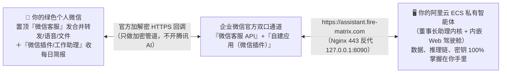

# 01｜需求定义、自动工时评估与驾驶舱场景（PRD v3.2）

| 项 | 内容 |
| :--- | :--- |
| 文档版本 | v3.2（董事长助理开工基线版） |
| 更新日期 | 2026-11-17 |
| 状态 | 定稿基线，可直接进入阶段一开发 |
| 关联文档 | [总览 README](../README.md) · [02-架构与世纪互联OneDrive](02-整体架构与SQLite清单及OneDrive归档设计.md) · [03-智能体内核与反思闭环](03-AI分拣工作流与确认机制.md) · [04-阿里云部署与操作手册](04-阿里云部署与分阶段实施路线.md) |

---

## 一、 核心痛点、系统边界与“董事长助理”定位

使用人日常同时统筹**北京帕莫瑞、维恩科仪（北京）、维恩科仪（香港）**的产品研发（光谱仪、质谱仪、锅炉光纤测温、校准仪等）、项目交付、采购供应链、销售报价及公司治理，面临四大痛点：

1. **信息入口极度分散**：关键沟通、附件报价单、技术参数变化散落在**个人微信聊天**与**工作邮箱**；路上随时冒出的**业务/研发想法**容易遗忘。
2. **缺少轻量可管理的清单与优先级**：想法、行动待办、等待他人回复、在途项目近况混杂。
3. **文档散落且缺少纵深查证**：微信和邮件里的 PDF、Excel 报价单、原厂规格书不仅要自动归档，更需要 AI 交叉比对历史纪要、精确核算表格并带页码回答。
4. **缺少全局工作量与周期掌控（v3.2 核心升级）**：每天事情很多，但说不清“哪天已经超载排满了”“这周真正花在研发 vs 销售 vs 琐事上的精力各占多少小时”“某个项目卡在外部等待到底拖了几天”。

**v3.2 的核心定位**：
- **私人幕僚独立边界**：100% 服务你个人，**不连接、不写入公司多人使用的 Odoo 19**；四大清单与排期台账存于本地 SQLite，正式文档与看板自动写入 **Wissentek 世纪互联版企业 OneDrive** 私有库。
- **董事长 / 总经理助理级水准**：不再只是被动记录员，而是在发出确认卡前，**先自主查清全部历史、评估个人净工时与日历周期、检测当日负荷是否超载、用确定性工具精算日期/表格、必要时脱敏调研、并由独立审计模型挑刺把关**；同时通过内嵌 Web 驾驶舱帮你从项目管理角度复盘自己的时间与工作流。

---

## 二、 通信本质：这里说的“机器人”是什么？

这里提到的“机器人”**不是**腾讯自带的公共 AI，也**不是**市面上第三方的聊天机器人 SaaS 平台，而是**「官方加密传声筒 + 你自己阿里云服务器上的私有智能体程序」**的组合：

- **手机端表现**：你日常**完全留在绿色「个人微信」里**：把已启用的 **「微信客服（`AI_assistant客服`）」** 置顶在首页接收各类群聊「合并转发」、语音、PDF 与 Excel；同时由你已关注的 **「微信插件 + 自建应用（`工作助理`）」** 全天候不受 48 小时限制推送早晚简报与驾驶舱链接（实机核查与接入细节见 [07-企业微信机器人设置核查与个人微信接入实操手册.md](07-企业微信机器人设置核查与个人微信接入实操手册.md)）。
- **安全实质**：腾讯侧不开 AI、不做业务存储，且微信客服代码层严格锁死仅你本人 1 个 `external_userid` 白名单；后台大脑与数据全在你的阿里云 ECS 与 Wissentek 世纪互联云端私有库中（**不在你本地 Mac 存盘占空间**）。

---

## 三、 三大零负担信息入口

| 入口 | 收集方式 | 系统预处理与护栏规则 |
| :--- | :--- | :--- |
| **1. 微信聊天记录与文件** | 在个人微信中将客户/供应商/同事聊天记录（**合并转发**或**逐条转发**）、图片、PDF、Excel/Word 文档、语音直接发给置顶的「工作助理」；可随手补一句 `备注：...` 或自然语言说明。 | • 连续逐条转发开启 **60 秒静默缓冲合并**（发 `好了` 立即结束等待）； • 语音直接取官方转写文本； • 若消息带 **`密：`** 前缀，**代码硬拦截跳过全部云端模型与外部搜索**，直接落盘世纪互联 OneDrive（或可选转交本地 Mac Studio 离线模型）； • 附件先落 ECS 临时缓存秒级提取文本入本地检索库，传上 OneDrive 校验无误后立即清理本地大文件。 |
| **2. 随时随地个人想法** | 对微信「工作助理」按住发一段语音，或发几句脑暴文字（如“我刚想到……”）。 | • 自动记入 **`03_想法与孵化池.md`**，绝不污染当日紧急行动待办； • 涉及新器件/新工艺/市场空白且未标 `密：` 时，智能体可自动触发**脱敏外部并发调研**，生成《初步调研简报.md》一并归入 OneDrive。 |
| **3. 工作邮箱与附件（第二阶段）** | 后台通过世纪互联 **Microsoft Graph `Mail.Read`**（或只读 IMAP）增量拉取新邮件及附件。 | • 物理上只有只读权限，**绝不配发信权限（无 `Mail.Send`/SMTP）**； • 代码过滤广告、验证码、系统通知； • 邮件正文与附件均用 `[UNTRUSTED_EXTERNAL_DATA]` 隔离包裹并禁用高危执行工具，防御提示词注入。 |

> **第一阶段上线必测项（微信通道实测 T1–T3）**：
> - **T1**：个人微信多选消息「合并转发」给机器人时，服务端能否直接拿到完整结构体、原发送人及时间；
> - **T2**：多选「逐条转发」时消息到达间隔分布（用于校准静默缓冲时间，默认 60 秒）；
> - **T3**：逐条转发夹带图片、PDF 时到达顺序是否一致，以及机器人单条回复最大字数与发送长摘要文件能力。

---

## 四、 四大轻量化清单模型（SQLite 维护 → 世纪互联 OneDrive 自动渲染）

所有从微信、语音、邮件里提炼出来的“事与想法”，由本地轻量 SQLite 管理，并在每次写入后自动渲染为 **4 份带 `P0 / P1 / P2` 动态优先级与工时标注的 Markdown 看板**（外加个人规则库），写入 Wissentek 世纪互联 OneDrive 私有库 `00_我的四大清单/` 目录：

| 清单文件（自动更新） | 对应类型 | 管什么 & 怎么用 |
| :--- | :--- | :--- |
| **`01_今日与行动待办.md`** | `project_action` / `next_action` | 明确“谁、在何时起止、占多少净工时、做什么”的具体动作，由 **Ch.20 动态优先级引擎**标出 `P0 / P1 / P2`。支持微信 `开始 N` / `完成 N 1.5h` 打卡。 |
| **`02_在途项目总览.md`** | `projects` 字典聚合视图 | 汇总所有在途研发/交付项目：客户、计划起止周期、累计已投工时/预计总工时、一句话近况、卡点提醒，以及跳转 OneDrive 项目文件夹的链接。 |
| **`03_想法与孵化池.md`** | 💡 `idea` | 收录路上闪念、研发工艺设想、新商机苗头，分 4 栏状态：`闪念收集` / `调研评估` / `准备立项` / `留存参考`。每周五简报提醒回顾。 |
| **`04_等待他人清单.md`** | ⏳ `waiting_for` | 记录“等客户确认技术协议”“等供应商报交期”等外部依赖（写明对方、等待天数、承诺日），到期未回在简报置顶列为 `P0` 催办。 |

---

## 五、 自动工时评估、排期建模与董事长项目管理驾驶舱（v3.2 新增）

为了让机器人达到董事长/总经理助理的水准，让你不用手动填工时表也能从项目管理角度掌控自身工作量与节奏，系统内置以下两项核心机制：

### 5.1 三维工时与周期自动评估模型（零手动填表）

1. **严格分离「个人净投入工时」与「日历跨度周期」**：
   - **个人净投入工时 (`estimated_hours` / `actual_hours`，单位：小时)**：这件事需要**消耗你本人多少小时精力**（例如：审一份 20 页锅炉测温技术协议预估 `1.5h`；打一个确认电话 `0.3h`）。
   - **日历跨度周期 (`planned_start_at` → `planned_end_at` / `actual_start_at` → `actual_end_at`)**：这件事在日历上从哪天启动、到哪天交付（例如：等供应商打样周期 `10 天`，但占用你本人净投入工时仅验收那 `0.5h`）。
   - **业务精力板块 (`work_domain`)**：固定归入 `产品研发` / `客户销售` / `项目交付` / `采购供应链` / `公司治理与人事` / `个人思考`，供后续统计老板时间到底花在哪儿。
2. **AI 自动预估 + 负荷避让 + 微信打卡自校准**：
   - 入库时，`qwen3.8-max` 调用 `check_workload_and_schedule` 查询你未来 7～14 天的每日已排净工时与过往同类任务实际平均耗时，在决策卡中自动建议起止日期与预计小时数，**自动避开已排满（如超过 `DAILY_CAPACITY_HOURS=6.0h`）的工作日**；
   - 你觉得预估不准，在卡片回复时顺带提一句（如 `改：这个半小时够了，排周五`）即可；
   - 执行时，微信回复 **`开始 3`** 自动记录 `actual_start_at`，回复 **`完成 3 1.5h`**（或只回 `完成 3` 按预估入账）自动记录 `actual_end_at` 与 `actual_hours`，并将真实耗时沉淀回历史校准库，越用估得越准。

### 5.2 同进程内嵌「董事长项目管理驾驶舱 Web App」

不外挂吃内存且不符合个人视角的重型开源项目管理软件，而是在阿里云 ECS 同一个 Python 服务内直接挂载一套轻量 **FastAPI + ECharts/甘特图 Web 驾驶舱**（直连同一 `app.db`，零延迟提供实时交互），并针对**手机微信内顺手查阅**与**家里/办公室电脑大屏复盘**做好双端无缝兼容：

1. **独立已备案 HTTPS 子域名承载（微信内一点直开不拦截）**：在主域名下启用独立子域名 **`https://assistant.fire-matrix.com`**（Nginx 443 端口反向代理至本机 `127.0.0.1:8090`），既零干扰 `www.fire-matrix.com` / `wechat.fire-matrix.com` 存量站点，又不弹微信外部风险拦截提示——点击简报或回复里的链接直接在微信内置浏览器丝滑打开。
2. **双端无感安全登录（告别手机小屏输长密码）**：
   - **📱 手机微信内直开（Magic Link）**：在微信对助理发 `看板` 或点每日简报底部的驾驶舱链接，后台当场签发一枚**5 分钟单次有效加密魔法链接**，一点即自动登录并在微信浏览器内种下 30 天安全凭证（`HttpOnly; Secure` Cookie），别人拿到过期链接也打不开；
   - **💻 电脑大屏浏览器登录**：收藏网址到电脑书签，首次打开点「发送 6 位登录码到我的微信」（或输预设强口令），手机微信秒收验证码填入即可记住本机 30 天。
3. **响应式双布局（Responsive UI，同一网址自动适配）**：
   - **手机竖屏模式（微信内置浏览器）**：自动切换为**底部四格大按钮（`今日负荷` · `项目进度` · `四大清单` · `精力统计`）+ 单栏卡片流与竖向进度条**，单手点选改起止日期、改工时、标完成或将想法转立项，免左右横滑宽表；
   - **电脑宽屏模式（Safari / Chrome 大屏）**：一屏同时铺开下列四大分析与操作视图：
     1. **🔥 个人负荷热力图（每日净工时预算）**：展示本周及未来两周每日 `estimated_hours` 总和，超过每日容量红线标红预警并提示可顺延的 `P2` 任务；
     2. **📊 精力投向结构分析**：按周/月/季度统计各业务板块与单个项目的真实工时占比与预估偏差率；
     3. **📅 交互式项目甘特图与周期追踪**：横向时间轴支持鼠标直接拖拽调整起止周期，一眼看清外部 `Waiting For` 卡点天数与延期红线；
     4. **🗂️ 四列拖拽看板**：网页端调整工时/排期或将「💡 想法池」拖拽立项后，实时更新 SQLite 并自动重绘世纪互联 OneDrive 里的 `.md` 清单。

---

## 六、 四个升级版日常场景演示

### 场景 1：路上语音记研发想法 → 自动脱敏调研 + 预估调研耗时
- **你按住微信语音说**：“我刚想到，锅炉光纤测温那个机架式仪表，机箱可以让做质谱仪外壳那家供应商顺便评估一下能不能通用，另外查一下市场上 2U 工业机箱抗电磁干扰一般做到什么标准。”
- **内部执行后发来 1 张决策卡**：
  > **确认 #104｜💡 想法归集 + 脱敏调研初稿 + 工时建议**
  > - **归属项目 / 板块**：`锅炉光纤测温研发`（`产品研发`）
  > - **写入 `03_想法与孵化池.md`**：`[调研评估]` 评估 2U 机架仪表与质谱仪机箱结构通用化
  > - **写入 `01_今日与行动待办.md` (`P1`)**：找质谱仪外壳供应商询通用机箱可行性与报价
  > - **排期与工时评估**：建议 `11-18 ~ 11-20`（日历 3 天）｜预计占您净工时：**`0.5h`**（周三负荷 `4.2h/6.0h`，可排入）
  > - **已生成调研简报（世纪互联 OneDrive）**：`04_想法与行业参考/20261117_2U工业机箱通用化与EMI标准初探.md`
  >
  > 回复 `1` 确认落盘 ｜ `2` 仅存想法不建待办 ｜ `改：...`

### 场景 2：供应商突发延期 → 多跳查旧账、算周期撞期风险并推荐备选
- **你转发供应商王总的一条微信**：“张总抱歉，高温探头这批货源材料卡了，交期得往后推两周，看看你们能不能启用上次聊过的备选厂家？”
- **内部多跳查证后发来 1 张幕僚决策卡**：
  > **确认 #105｜⚠️ 交期延期风险预警 + 历史备选方案召回**
  > - **影响项目 / 周期变更**：`某某热电锅炉测温交付`（原交期 `11-25` → 顺延 14 天至 **`12-09`**，紧贴 `12-10` 厂内联调节点，存在重大撞期风险！）
  > - **历史备选线索（出自 2026-09-14 会议纪要第 2 页）**：曾接触 `苏州某某光电`（历史参考报价 `XX 元/支`，常规货期 `10 天`）
  > - **拟建 `P0` 行动待办**：今日立即联系 `苏州某某光电` 确认现货与加急交期
  > - **排期与工时评估**：今日 `11-17` 立即启动（周期 `11-17 ~ 11-20`）｜预计占您净工时：**`1.0h`**
  > - **文档更新**：追加进世纪互联 OneDrive `01_项目归档/某某热电交付/00_项目沟通与纪要.md`
  >
  > 回复 `1` 确认执行 ｜ `改：...`

### 场景 3：收到新版 Excel 报价单或原厂英文 PDF → 工具精算逐行对比
- 发来新版 `报价单V4.xlsx` 或邮箱拉取英文原厂 `Calibration_Spec_2026.pdf`：智能体调用 Python `analyze_excel_quote` 做逐行 Diff 与含税总额精算（或按页精读英文 PDF 第 4 页发现补偿系数由 `0.012` 改为 `0.0095`），经 `deepseek-v4-pro` 核验所有数字均 100% 出自原文与工具结果，自动重命名归入 Wissentek 世纪互联 OneDrive 云端私有库（**纯云端留存，不占你本地 Mac 硬盘**）。

### 场景 4：早晚简报（含每日净工时负荷）与驾驶舱复盘
- **微信早 08:30 / 晚 18:00 简报**：列出今日待办（按 `P0/P1/P2` 分组并标出预计净工时，如 `今日已排净工时 5.2h / 6.0h`）、超时未回的 `Waiting For` 事项、今日完成与实际耗用工时统计、周五晚附「💡 想法孵化池」回顾；支持在微信随时发送 `开始 2`、`完成 2 1.2h` 或 `负荷`。
- **打开内嵌驾驶舱网页**：随时从项目维度、甘特时间轴和工时结构视角复盘一周/一月工作量，或在微信里带页码出处随时追问任何历史细节。

---

## 七、 成功与验收标准

1. **外围极轻、不丢原件**：不连 Odoo；所有收到的消息与文件先入 Wissentek 世纪互联 OneDrive `00_原件收件箱/`，分析失败或放弃均不丢原件。
2. **真·高智商推理与工具精算**：多跳关联召回、日期推算、Excel 表格对比和脱敏外搜由确定性工具链与思考模型协同完成，**数字与出处 100% 保真**，经异构 Critic 审计后才呈递确认卡。
3. **自动时间与工时可用**：每条待办均自动附带「日历起止周期」与「个人净投入工时」，支持 `开始 N` / `完成 N [耗时]` 微信打卡；内嵌驾驶舱可准确展示每日负荷、精力占比与项目甘特图。
4. **一卡确认无负担**：每件事凝聚为 **1 张高密度幕僚决策卡**（支持高把握场景模式 B 自动入库 + 24 小时内 `撤销`）。
5. **核心机密严防外泄**：满足“企微空壳传声筒 + `密：` 前缀跳过云端大模型 + 世纪互联 `Sites.Selected` 私有库隔离 + 驾驶舱走 Nginx 已备案 HTTPS 与微信单次魔法链接/6位验证码强鉴权及 `fail2ban` 防爆破 + 物理无外发能力”全部安全红线。
