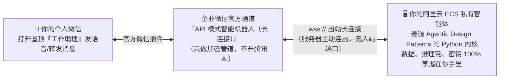

# 01｜需求定义与日常场景（PRD v3.1）

| 项 | 内容 |
| :--- | :--- |
| 文档版本 | v3.1（外轻内重 · Agentic Design Patterns 标准内核版） |
| 更新日期 | 2026-11-17 |
| 状态 | 实施方案基线 |
| 关联文档 | [总览 README](../README.md) · [02-架构与SQLite/OneDrive](02-整体架构与SQLite清单及OneDrive归档设计.md) · [03-智能体内核与反思闭环](03-AI分拣工作流与确认机制.md) · [04-阿里云部署与防外泄](04-阿里云部署与分阶段实施路线.md) |

---

## 一、 核心痛点、系统边界与“参谋长”定位

使用人日常同时管理产品研发（光谱仪、质谱仪、锅炉光纤测温、校准仪等）、项目交付、采购供应链、销售报价及三家公司（北京帕莫瑞、维恩科仪北京/香港）日常运营，面对三大痛点：

1. **信息入口极度分散**：关键沟通、附件报价单、技术参数变化散落在**个人微信聊天**与**工作邮箱**里；同时开车、开会、出差时随时冒出的**业务/研发想法**，记在备忘录或直接忘掉。
2. **缺少轻量可管理的清单与优先级**：想法、紧急行动、等待他人回复、在途项目近况混杂，需要能自动梳理、发现阻塞风险并排出轻重缓急。
3. **文档散落且缺少纵深查证**：微信和邮件里的 PDF、Excel 报价单、原厂规格书，不仅要按固定目录存好，更需要 AI 能在几秒内交叉比对历史纪要、精确核算表格数据并给出带出处的判断。

**v3.1 的核心定位**：
- **外围边界保持极简隔离**：100% 服务你个人，**不连接、不写入公司多人使用的 Odoo 19**；四大清单由轻量 SQLite 管理并同步渲染到你的企业 OneDrive 隔离目录。
- **内部智能体升级为“会思考、能深潜、善精算的参谋长”**：不再只是被动把你发的文字抄进文件，而是在发来确认卡之前，**先自主检索全部历史、用工具算清日期和表格数字、必要时做脱敏外部调研、并由独立审计模型挑刺把关**，最后只给你呈上一张一针见血的决策卡。

---

## 二、 通信本质：这里说的“机器人”是什么？

这里提到的“机器人”**不是**腾讯自带的公共 AI，也**不是**市面上第三方的聊天机器人 SaaS 平台，而是**「官方加密传声筒 + 你自己阿里云服务器上的私有智能体程序」**的组合：

- **手机端表现**：在企业微信后台创建「智能机器人」并选 **API 模式（长连接）**，可见范围只选你自己 1 人，再用个人微信扫码关注「微信插件」。从此你的个人微信聊天列表里多出一个置顶联系人「工作助理」。
- **安全实质**：选 API 模式后，腾讯侧**不调用腾讯 AI，也不做业务存储**，只做加密透传；建议用个人手机号另建一个**仅你 1 人的专属企业微信主体**，与公司员工的企业微信彻底分开（详见 [04-阿里云部署与分阶段实施路线.md](04-阿里云部署与分阶段实施路线.md) 第 2 节）。

---

## 三、 三大零负担信息入口

| 入口 | 收集方式 | 系统预处理与护栏规则 |
| :--- | :--- | :--- |
| **1. 微信聊天记录与文件** | 在个人微信中将客户/供应商/同事聊天记录（**合并转发**或**逐条转发**）、图片、PDF、Excel/Word 文档、语音直接发给置顶的「工作助理」；可随手补一句 `备注：...` 或自然语言说明。 | • 连续逐条转发开启 **60 秒静默缓冲合并**（发 `好了` 立即结束等待）； • 语音直接取官方转写文本； • 若消息带 **`密：`** 前缀，**代码硬拦截跳过全部云端模型与外部搜索**，直接落盘 OneDrive（或可选转交本地 Mac Studio 离线模型）； • 附件先落 ECS 临时缓存秒级提取文本入本地检索库，传上 OneDrive 校验无误后立即清理本地大文件。 |
| **2. 随时随地个人想法** | 对微信「工作助理」按住发一段语音，或发几句脑暴文字（如“我刚想到……”）。 | • 自动记入 **`03_想法与孵化池.md`**，绝不污染当日紧急行动待办； • 涉及新器件/新工艺/市场空白且未标 `密：` 时，智能体可自动触发**脱敏外部并发调研**，帮你生成一篇《初步调研简报.md》一并归入 OneDrive。 |
| **3. 工作邮箱与附件（第二阶段）** | 后台通过企业 Office 365 **Microsoft Graph `Mail.Read`**（或只读 IMAP）增量拉取新邮件及附件。 | • 物理上只有只读权限，**绝不配发信权限（无 `Mail.Send`/SMTP）**； • 代码过滤广告、验证码、系统通知； • 邮件正文与附件均用**数据隔离标签**包裹，并禁用高危执行工具，彻底防御外部邮件隐藏的“提示词注入”攻击。 |

> **第一阶段上线必测项（微信通道实测 T1–T3）**：
> - **T1**：个人微信多选消息「合并转发」给机器人时，服务端能否直接拿到完整结构体、原发送人及时间；
> - **T2**：多选「逐条转发」时消息到达间隔分布（用于校准静默缓冲时间，默认 60 秒）；
> - **T3**：逐条转发夹带图片、PDF 时到达顺序是否一致，以及机器人单条回复最大字数与发送长摘要文件能力。

---

## 四、 四大轻量化清单模型（SQLite 维护 → OneDrive 自动渲染）

所有从微信、语音、邮件里提炼出来的“事与想法”，由本地轻量 SQLite 管理，并在每次写入后自动渲染为 **4 份带 `P0 / P1 / P2` 动态优先级的 Markdown 看板**（外加 1 份个人规则库），写入企业 OneDrive `00_我的四大清单/` 目录：

| 清单文件（自动更新） | 对应类型 | 管什么 & 怎么用 |
| :--- | :--- | :--- |
| **`01_今日与行动待办.md`** | `project_action` / `next_action` | 明确“谁、在何时前、做什么”的具体动作，由 **Ch.20 动态优先级引擎**按「截止紧迫度 × 项目重要度 × 是否阻塞后续任务」标出 `P0 / P1 / P2`。微信回 `完成 2` 即同步勾掉。 |
| **`02_在途项目总览.md`** | `projects` 字典聚合视图 | 汇总所有进行中的研发/交付项目：客户、一句话最新进展、未完成待办数、卡点提醒，以及跳转对应 OneDrive 项目文件夹的相对链接。 |
| **`03_想法与孵化池.md`** | 💡 `idea` | 收录路上闪念、研发工艺设想、新商机苗头，分 4 栏状态：`闪念收集` / `调研评估` / `准备立项` / `留存参考`。AI 自动补充的调研简报会直接链接在条目旁；每周五简报提醒回顾。 |
| **`04_等待他人清单.md`** | ⏳ `waiting_for` | 记录“等客户确认技术协议”“等供应商周五报交期”等外部依赖（写明对方、承诺日），到期未回在简报置顶列为 `P0` 催办。 |

---

## 五、 四个升级版日常场景演示（体现强推理与工具调用）

### 场景 1：路上语音记研发想法 → 自动脱敏调研并产出初步简报
- **你对「工作助理」按住语音说**：“我刚想到，锅炉光纤测温那个机架式仪表，机箱可以让做质谱仪外壳那家供应商顺便评估一下能不能通用，另外查一下市场上 2U 工业机箱抗电磁干扰一般做到什么标准。”
- **内部推理与工具流**：
  1. `qwen3.8-max` 先调本地混合检索查出 `锅炉光纤测温研发` 与 `质谱仪外壳供应商` 历史记录；
  2. 对“2U 工业机箱 EMI 防护标准”触发**脱敏外部并发检索工具**（前置护栏自动剥离公司名与项目细节，仅发公开工业标准关键词给 Metaso + Serper）；
  3. 闭卷汇总外部标准与本地供应商背景，`deepseek-v4-pro` 审计确认无虚构数据后，发来 **1 张预览卡**：
  > **确认 #104｜💡 想法归集 + 自动形成调研初稿**
  > - **归属项目**：`锅炉光纤测温研发`（关联供应商：`质谱仪外壳供应商`）
  > - **写入 `03_想法与孵化池.md`**：`[调研评估]` 评估 2U 机架仪表与质谱仪机箱结构通用化
  > - **写入 `01_今日与行动待办.md` (`P1`)**：找质谱仪外壳供应商询通用机箱可行性与报价
  > - **已为你生成调研简报**：`04_想法与行业参考/20261117_2U工业机箱通用化与EMI标准初探.md`（附 IEC/GB 公开标准要点）
  >
  > 回复 `1` 确认落盘 ｜ `2` 仅存想法不建待办 ｜ `改：...`

### 场景 2：供应商突发延期 → 自主多跳查旧账、算日程冲突并推荐备选方案
- **你转发供应商王总的一条微信**：“张总抱歉，高温探头这批货源材料卡了，交期得往后推两周，看看你们能不能启用上次聊过的备选厂家？”
- **内部多跳工具动作（无需你开口问）**：
  1. 调 `hybrid_search("王总 高温探头")` 锁定对应项目和原定交期 `11月25日`；
  2. 调 `calc_business_date("2026-11-25", "+14d")` 精确推算出新交期为 `12月9日`，与 `02_在途项目总览` 里的 `12月10日厂内联调` 仅差 1 天，识别为**重大延期风险**；
  3. 调 `read_doc_pages` 翻出 9 月份会议纪要第 2 页记录的备选厂家信息（`苏州某某光电`，当时报价 `XX 元/支`、货期 `10 天`）；
  4. 发来一张直接能拍板的幕僚决策卡：
  > **确认 #105｜⚠️ 交期延期风险预警 + 历史备选方案召回**
  > - **影响项目**：`某某热电锅炉测温交付`（原交期 `11月25日` → 推迟至 `12月9日`，紧贴 `12月10日` 联调节点！）
  > - **历史备选线索（出自 2026-09-14 会议纪要第 2 页）**：曾接触 `苏州某某光电`（历史参考报价 `XX 元/支`，常规货期 `10 天`）
  > - **拟建 `P0` 行动待办**：今日立即联系 `苏州某某光电` 确认现货与加急交期；同步更新供应商交期记录为 `12月9日`
  > - **文档更新**：追加进 `01_项目归档/某某热电交付/00_项目沟通与纪要.md`
  >
  > 回复 `1` 确认执行 ｜ `改：...`

### 场景 3：收到新 Excel 报价单或原厂英文 PDF → 工具精算逐行对比
- **你发来一份新版 `报价单V4.xlsx`（或邮箱自动拉取英文原厂 `Calibration_Spec_2026.pdf`）**：
  - 智能体不靠大模型心算，而是调用 **Python `analyze_excel_quote` 沙箱工具**与上月 `报价单V3.xlsx` 做**逐行 Diff 对比与含税总额精算**（或按页精读英文 PDF 第 4 页发现高温补偿系数由 `0.012` 改为 `0.0095`），经 `deepseek-v4-pro` 核验所有数字均 100% 出自原文与工具结果后，直接把变动明细高亮在预览卡里，确认后按规范中文命名存入 OneDrive 并同步到你的 Mac。

### 场景 4：基于 Ch.20 动态优先级的早晚简报与 Agentic RAG 深度问答
- **早 08:30 / 晚 18:00 简报**：自动重算所有未完成待办与等待他人事项的动态权重（`P0` 逾期或卡住总装/交付 → `P1` 本周到期 → `P2` 常规推进），把真正最要紧的前 3 件事放在最前面；每周五晚附加本周「💡 想法孵化池」回顾。
- **随时深度追问**：你问*“去年底和今年初某型号传感器改过几次参数？每次为什么改、最新报价单在 OneDrive 哪？”*，智能体通过 `Agentic RAG` 工具循环翻出完整时间线与 PDF 页码，严格带出处回答，存在未决矛盾必同时列出双方原话。

---

## 六、 成功与验收标准

1. **外围极轻、不丢原件**：不连任何外部 ERP；所有收到的消息与文件先入 OneDrive `00_原件收件箱/`，分析失败或放弃均不丢原件。
2. **真·高智商推理与工具精算**：跨聊天/邮件/文档的关联召回、日期推算、Excel 表格对比和脱敏外搜由确定性工具链与思考模型协同完成，**数字与出处 100% 保真**，经异构 Critic 审计后才呈递确认卡。
3. **一卡确认无负担**：每件事凝聚为 **1 张高密度幕僚决策卡**（支持高把握场景模式 B 自动入库 + 24 小时内 `撤销`）。
4. **四大清单与 OneDrive 目录即开即用**：Mac 打开 Finder 或 Obsidian 即见最新 `P0–P2` 清单与完整分类文档。
5. **核心机密严防外泄**：满足“空壳传声筒 + `密：` 前缀跳过云端大模型 + OneDrive 沙箱目录最小权限 + 防邮件提示词注入 + 物理无外发能力”全部安全红线。
