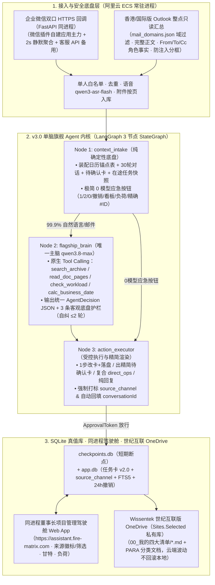

# 02｜技术架构、技术栈选型与存储归档设计（Tech Spec v3.4 · Model-First）

| 项 | 内容 |
| :--- | :--- |
| 文档版本 | v3.4（v3.0 单脑旗舰 Agent + `source_channel` 来源标记更新版） |
| 更新日期 | 2026-11-25 |
| 关联文档 | [总览 README](../README.md) · [01-需求定义与日常场景](01-需求定义与日常场景.md) · [04-AI分拣工作流与确认机制](04-AI分拣工作流与确认机制.md) · [05-阿里云部署与分阶段实施路线](05-阿里云部署与分阶段实施路线.md) · [debug_records/03](../debug_records/03-v3.0大模型优先架构重构方案.md) |

---

## 一、 核心技术栈选型总览

| 分层 | 技术选型 | 说明与选型依据 |
| :--- | :--- | :--- |
| 运行时与包管理 | Python 3.12+ / uv / systemd | 单进程常驻服务（`wechat-agent.service`），低内存占用于阿里云 ECS 2 核 4G 实例。 |
| Web 服务与反代 | FastAPI + Uvicorn（`127.0.0.1:8090`） + Nginx（443 HTTPS） | 同进程承载企业微信加解密回调、REST API 与 Web 驾驶舱静态前端；Nginx 启用独立子域名 `assistant.fire-matrix.com`。 |
| 智能体编排内核 | LangGraph 极简三节点有界状态图 + SqliteSaver | **`context_intake` → `flagship_brain`（自纠 ≤2 轮） → `action_executor`**，彻底移除脆弱多节点传话链。 |
| 大模型与语音网关 | 阿里云百炼 `DashScopeLLMGateway`（OpenAI 兼容接口） | **单一旗舰主脑 `qwen3.8-max`**（备选 `qwen-max`）负责全部自然语言理解、原生工具调用与结构化决策；语音转写使用 `qwen3-asr-flash`；每 8 轮后台语义摘要使用 `qwen3.8-flash`（不阻塞主回复）。**主流程 0 次小模型路由、0 次二审大模型。** |
| 本地持久化与检索 | SQLite（WAL 模式） + FTS5 trigram 全文索引 | `checkpoints.db` 存短期断点；`app.db` 存三层长期记忆、v2.0 扁平任务卡（含 `source_channel`、`timeline`、`comments`、`ceo_evaluation`）、跨度基线与成本台账。 |
| 文档解析 | PyMuPDF / openpyxl / python-docx / 安全递归 ZIP | 附件秒级按页提取纯文本入 FTS5；损坏/加密/未知二进制文件优雅降级占位，原件 100% 备份云端。 |
| 云端文档存储 | 21Vianet 世纪互联 Microsoft Graph API（MSAL） | 中国大陆世纪互联端点（`microsoftgraph.chinacloudapi.cn`），应用权限锁定 `Sites.Selected`（仅限私有文档库 `chairman-vault`），负责全部文件归档与 5 份 `.md` 看板同步。 |
| 企业邮件读取 | 香港 / 国际版 Microsoft 365 Graph API（Outlook） | 国际版端点（`login.microsoftonline.com` / `graph.microsoft.com`），独立凭据与 `Mail.Read` 物理只读权限；域名热配置于 `config/mail_domains.json`（区分内部域名与外部合作域名），提取完整 `body`（2500 字上限）与 `From/To/Cc` 事实。 |
| 前端驾驶舱 UI | 原生 HTML5 / CSS3 / Vanilla JS 单页应用（Executive Work OS） | 零构建依赖、同进程直出静态资源；支持主表格、21 天拖拽甘特图、日程负载、板块统计、任务来源徽标与来源下拉筛选（`微信`/`邮件`/`驾驶舱`）及移动端自适应。 |
| 安全与鉴权 | 企微单人白名单 + 固定驾驶舱链接 + 6 位 OTP + HttpOnly Cookie + fail2ban | 6 位验证码登录后 Cookie 180 天有效；外部邮件元数据置于 `[SYSTEM_TRUSTED_MAIL_META]`，正文包裹 `[UNTRUSTED_EXTERNAL_DATA]` 防提示词注入；落盘强制 `ApprovalToken` 验签。 |

---

## 二、 五项关键架构选型与减法决策

我们在外围基础设施和硬编码规则上坚持极简原则，把思考能力彻底交还给旗舰大模型：

### 2.1 为什么在 v3.0 废弃「小模型路由 + 20 条正则 + 二审大模型」？（方案 A 核心变革）
1. **消除多节点传话失真**：旧版 v2.0 经过 `qwen3.8-flash` 分诊 → `react_investigator` → `producer_drafter` → `deepseek-v4-pro` 异构审计，不仅耗时飙升至 25～40 秒，还频繁发生状态字段覆写与上下文失明（详见 [调试档案 #01](../debug_records/01-2026-11-25-五彩湾DCS任务修改截止日被清空与啰嗦故障复盘.md)）。
2. **释放旗舰模型原生自然语言与复合执行力**：单一 `qwen3.8-max` 直接阅读完整上下文与确定性《本周/下周日历锚点表》，原生理解任意自然中文并可一次完成多步复合操作（如“目标截止暂定本周五，之后确认落盘了”一步完成改卡+原子落盘，或一句话同时改 3 个任务）。
3. **只保留 4 块极简确定性安全底盘**：安全门禁、原子账本与 24h 撤销、客观事实供给（日历表+邮件完整正文+3 条客观硬护栏）、以及极简卡片排版器——代码绝不越权干预语义理解。

### 2.2 为什么彻底砍掉 Odoo 19 MCP 对接？
1. **省掉脆弱联调**：管理个人“四大清单”本身很轻，绑定重型 ERP 属于过度设计。
2. **CEO 私人台账与公司多人系统物理隔离**：微信碎片、CEO 主观评价、商业底价与未成熟想法绝不进公司共享 ERP；待成熟后再单独进 Odoo 立项。
3. **纯云端文件夹可读性极强（零本地占盘）**：直接存入世纪互联 OneDrive 标准分类文件夹，网页端与驾驶舱随时清晰可读。

### 2.3 为什么直接写入 Wissentek 世纪互联版 Office 365 OneDrive（纯云端不落本地）？
1. **纯国内高速链路 + 数据不出境**：认证（`login.chinacloudapi.cn`）与 Graph API（`microsoftgraph.chinacloudapi.cn`）均在境内，访问稳定高速。
2. **纯云端集中存储 + 版本兜底**：省掉自建 OSS 与本地同步盘，自带文件历史版本与 93 天回收站。
3. **邮件与网盘分租户/分端点物理隔离**：文档存世纪互联 OneDrive（`Sites.Selected` 仅限 `chairman-vault`）；邮件读香港/国际版 Outlook（`Mail.Read` 物理只读）。

### 2.4 为什么不套 OpenClaw / Hermes，而用专用状态图内核？
1. 我们需要“严守规矩的 PMO 档案秘书”，物理上不开放 Shell 终端或对外发信工具，彻底杜绝外部邮件提示词注入触发越权操作。
2. 所有写库与写云盘必经 `ApprovalToken` 审批门禁，并保留 24 小时完整撤销快照。

### 2.5 为什么项目管理驾驶舱采用同进程内嵌自建？
1. **省内存**：相比 Plane/OpenProject 空载吃掉 2.5～3.5 GB 内存，同进程 FastAPI + 原生静态前端仅额外占用 20～40 MB。
2. **零同步延迟**：网页端与微信端共享同一份 SQLite `app.db`，网页改完立刻生效并异步重绘 OneDrive 看板。

---

## 三、 v3.0 极简技术架构全景图



---

## 四、 SQLite 双文件与核心表结构（`data/app.db` + `data/checkpoints.db`）

整个系统在本地只维护两个轻量化 SQLite 文件（开启 WAL 模式）：

1. **`data/checkpoints.db`**：由 LangGraph `SqliteSaver` 管理短期会话断点。
2. **`data/app.db`**：承载长期语义记忆、项目目录、扁平任务卡（含来源标记与时间轴）及操作撤销快照：

| 核心表名 | 核心字段与设计 | 工程作用 |
| :--- | :--- | :--- |
| `raw_sources` + `sources_fts` | `source_type`、`external_msg_id`、`sender`、`raw_text`、`extracted_pages_json`、`onedrive_archive_path` | 原件防丢与 FTS5 trigram 按页全文检索；大附件传完 OneDrive 即清本地缓存。 |
| `projects` | `name`、`aliases_json`、`work_domain`、`status`、`planned_start_date`、`target_end_date`、`onedrive_folder` | 项目字典与甘特周期汇总。 |
| `list_items` | `list_type`、`project_id`、`work_domain`、`title`、`owner`、`assignee`、`external_partner`、`deliverable`、`milestone_stage`、`blocker_note`、`source_channel`（`wechat`/`outlook`/`web`）、`planned_start_at`、`planned_end_at`、`actual_start_at`、`actual_end_at`、`priority`、`status`、`timeline_json`、`comments_json`、`ceo_evaluation_json`、`mail_conversation_ids_json` | 一张表统一承载扁平单层任务卡 1～7 栏、来源标记、沟通时间轴、微软邮件会话号自动串线与 24h 撤销快照。 |
| `pending_proposals` | `thread_id`、`proposal_json`、`source_ids_json`、`pending_files_json`、`status` | 暂存待董事长确认的提案卡，支持自然语言改卡、1 步改卡并落盘、确认或作废。 |
| `conversation_turns` + `episode_summaries` | 真实用户对话与卡片回执、跨天滚动语义摘要 | 保持跨天记忆连续（外部批量邮件原文绝不污染 `user` 对话历史）。 |
| `undo_snapshots` / `seen_external_ids` / `mail_watermarks` / `model_calls` | 24h 撤销快照、消息/邮件幂等去重、邮箱整点水位、模型调用成本与耗时台账 | 支撑原子撤销、防重拉丢信与耗时可观测性。 |

---

## 五、 世纪互联 OneDrive 私有库结构（`chairman-vault`）

```text
Wissentek 私有库 (chairman-vault)/
├── 00_我的四大清单/                         ← 每次落盘、打卡或驾驶舱修改后自动重绘覆盖
│   ├── 00_我的个人规则库.md
│   ├── 01_今日与行动待办.md                 # 含 P0–P2、来源标签[微信]/[邮件]/[驾驶舱]与日历起止周期
│   ├── 02_在途项目总览.md
│   ├── 03_想法与孵化池.md
│   └── 04_等待他人清单.md
├── 00_原件收件箱/                           ← 所有收到消息与附件的原始备份（按月，永不改写）
├── 01_项目归档/<项目简称>/                  ← 00_项目沟通与纪要.md + 01_报价合同与商务/ + 02_技术方案与现场/
├── 02_产品与研发/<产品简称>/
├── 03_公司运营/
└── 04_想法与行业参考/
```

---

## 六、 v3.0 精简模块化代码结构

```text
wechat_AI_assistant/
├── config/
│   └── mail_domains.json     # 邮件内部域名(internal_domains)与外部合作域名(partner_domains)热配置
├── src/wechat_assistant/
│   ├── config.py             # 配置加载、assert_no_secrets_leaked、DashScopeLLMGateway（主备切换+JSON自愈）
│   ├── schemas.py            # 🔴 红区契约：AgentDecision（统一决策）、TriageProposal、TaskFieldUpdate/NoteAppend/StatusChange
│   ├── context_assembler.py  # 4 层上下文装配 + 历史文档/对话 FTS5 双路检索
│   ├── graph.py              # v3.0 单脑旗舰三节点 StateGraph（context_intake → flagship_brain → action_executor）+ 日历锚点表 + 精简排版器
│   ├── prompts/
│   │   └── system_prompts.py # 🔴 红区提示词：FLAGSHIP_BRAIN_PROMPT（唯一主脑指令）+ EPISODE_SUMMARY_PROMPT
│   ├── nodes/
│   │   └── critic_rules.py   # 🔴 红区极简 3 条客观护栏（objective_proposal_guard：合法日期/Outlook抄送锁/非日期数字保真）
│   ├── tools/
│   │   ├── memory_tools.py   # search_archive / read_doc_pages / trace_timeline（只读）
│   │   ├── schedule_tools.py # calc_business_date / check_workload_and_schedule（确定性排期与工作日）
│   │   ├── guard.py          # 🔴 红区落盘门禁：ApprovalToken HMAC 验签与 before_tool_callback
│   │   └── onedrive_tools.py # 世纪互联 OneDrive 分片上传与 5 份 Markdown 看板渲染
│   ├── intake/
│   │   ├── wecom_gateway.py  # 企微双通道验签解密、单人白名单、2s 聚合、语音转写与推送
│   │   └── mail_poller.py    # 香港 Outlook 整点只读汇总、角色推断、完整正文提取与可信/不可信物理分框
│   ├── storage/
│   │   ├── extractors.py     # PDF / Word / Excel / CSV / ZIP 安全按页提取与损坏兜底
│   │   └── db.py             # SQLite 全量表结构、无损迁移、source_channel、原子落盘与 24h 撤销
│   └── web/
│       ├── app.py            # FastAPI 入口、12s/25s 心跳、早晚简报、整点邮件调度、驾驶舱 REST API
│       └── static/index.html # 董事长项目管理驾驶舱单页应用（含来源徽标与来源筛选）
├── debug_records/            # 调试复盘与避坑方法论（🗣️白话 + 🤖技术双视角）
├── TDD_record/               # 全周期防串谋 TDD 验收记录（00～08）
└── tests/                    # 116 条防串谋自动化单测 + scripts/replay_golden_traces.py（14 条黄金实弹轨迹）
```
