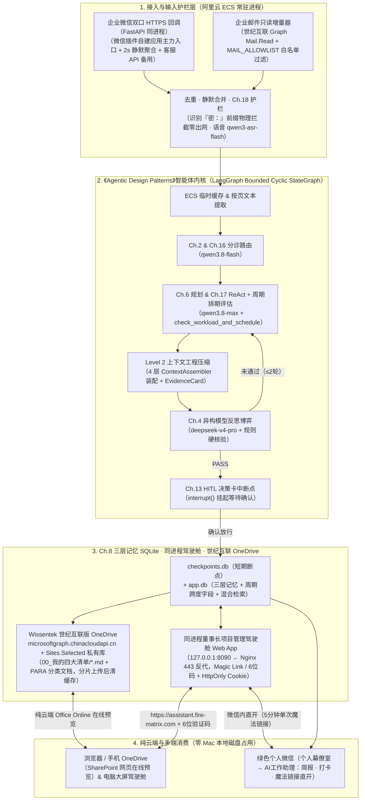

# 02｜技术架构、技术栈选型与存储归档设计（Tech Spec v3.3）

| 项 | 内容 |
| :--- | :--- |
| 文档版本 | v3.3（技术栈与存储实现规范版） |
| 更新日期 | 2026-11-18 |
| 关联文档 | [总览 README](../README.md) · [01-产品需求与日常场景](01-需求定义与日常场景.md) · [03-智能体内核与反思闭环](03-AI分拣工作流与确认机制.md) · [04-阿里云部署与操作手册](04-阿里云部署与分阶段实施路线.md) |

---

## 一、 核心技术栈选型总览

| 分层 | 技术选型 | 说明与选型依据 |
| :--- | :--- | :--- |
| 运行时与包管理 | Python 3.12+ / uv / systemd | 单进程常驻服务（wechat-agent.service），低内存占用于阿里云 ECS 2 核 4G 实例。 |
| Web 服务与反代 | FastAPI + Uvicorn（127.0.0.1:8090） + Nginx（443 HTTPS） | 同进程同时承载企业微信加解密回调、REST API 与 Web 驾驶舱静态前端；Nginx 启用独立子域名 assistant.fire-matrix.com，零干扰存量站点。 |
| 智能体编排内核 | LangGraph Bounded Cyclic StateGraph + AsyncSqliteSaver | 自研《Agentic Design Patterns》状态图内核，支持工具调用、反思闭环（最多 2 轮）与 HITL interrupt() 断点持久化。 |
| 大模型与语音网关 | 阿里云百炼 DashScopeLLMGateway（OpenAI 兼容接口） | 分诊路由与轻推理使用 qwen3.8-flash / qwen-plus；复杂规划使用 qwen3.8-max；异构审计 Critic 使用 deepseek-v4-pro；语音转写使用 qwen3-asr-flash。 |
| 本地持久化与检索 | SQLite（WAL 模式） + FTS5 trigram 全文索引 | checkpoints.db 存短期断点；app.db 存三层长期记忆、清单排期、跨度基线与成本台账，零外部数据库运维负担。 |
| 文档解析与精算 | PyMuPDF / openpyxl / python-docx | 附件秒级按页提取纯文本入 FTS5；Excel 报价单走确定性工具 analyze_excel_quote 逐行 Diff 与含税精算。 |
| 云端存储与邮件 | 21Vianet Microsoft Graph API（MSAL Client Credentials） | 世纪互联中国区端点，应用权限锁定 Sites.Selected（仅限私有库）与 Mail.Read（白名单公司只读增量拉取）。 |
| 前端驾驶舱 UI | 原生 HTML5 / CSS3 / Vanilla JS 单页应用（Executive Work OS） | 零构建依赖、同进程直出静态资源；支持主表格、21 天拖拽甘特图、日程负载与板块统计四大视图及移动端自适应。 |
| 安全与鉴权 | 企业微信单人白名单 + 密：硬件拦截 + 魔法链接 / 6 位 OTP + HttpOnly Secure Cookie + fail2ban | 魔法链接 5 分钟单次有效；Cookie 30 天有效；外部邮件正文统一包裹 [UNTRUSTED_EXTERNAL_DATA] 防提示词注入。 |

---

## 二、 四项关键架构选型与减法决策

我们在外围基础设施上坚持极简原则，在内核智能体与董事长管理视角上做满配：

### 2.1 为什么彻底砍掉 Odoo 19 MCP 对接？
1. 省掉脆弱联调：通过 MCP 驱动 Odoo 需要维护多公司 company_id、必填字段校验、沙箱与生产库切换；管理“四大清单”本身很轻，绑定重型 ERP 属于过度设计。
2. CEO 私人台账与公司多人系统物理隔离：微信碎片、邮件摘要、未成熟想法和商业底价不进公司员工共享的 ERP，从根上消除权限误配泄密风险；待想法成熟后再单独进 Odoo 立项。
3. 纯云端文件夹可读性极强（零本地占盘）：相比 Odoo 底层把附件转成哈希黑盒，直接存入世纪互联 OneDrive 标准分类文件夹，在浏览器网页端（SharePoint / OneDrive / Office Online）与驾驶舱直链里随时清晰可读。

### 2.2 为什么直接写入 Wissentek 世纪互联版 Office 365 OneDrive（纯云端不落本地）？
1. 纯国内高速链路 + 数据不出境：世纪互联运营版（21Vianet）的认证（login.chinacloudapi.cn）与 Graph API（microsoftgraph.chinacloudapi.cn）均部署在中国大陆境内，阿里云 ECS 访问稳定高速，核心商业文档完全留在国内合规环境。
2. 纯云端集中存储（零本机硬盘占用）+ 版本兜底：省掉自建阿里云 OSS 与 Syncthing，也不在本地 Mac 安装或同步 OneDrive 占用硬盘空间；通过网页端 chairman-vault（Office Online 直接在线看 PDF/Excel/Word/Markdown）以及驾驶舱链接随时多端查阅，自带文件历史版本与 93 天双层回收站。
3. 一套应用打通“收邮件 + 写网盘”：Wissentek 世纪互联 Office 365 Entra 后台注册 1 个内部应用即可兼顾只读收信（Mail.Read）与私有文档库归档，并在 mail_poller.py 中通过 MAIL_ALLOWLIST（当前为 V&F、Tera、B&D）过滤非关注邮件。

### 2.3 为什么不套 OpenClaw / Hermes，而用自研《Agentic Design Patterns》专用内核？
1. 我们要“严守规矩的档案秘书”，不是“拿终端钥匙的自由跑腿工”：OpenClaw 与 Hermes 擅长给大模型开放 Bash 终端自由探索；但在处理微信静默合并、密： 物理拦截、数字 100% 保真、1 卡确认才落盘等确定性约束时，专用状态图更稳定可控。
2. 严防外部邮件提示词注入（Prompt Injection）：专用内核物理上不提供 Shell 与任意外发工具，外部邮件即使隐藏恶意指令也无法越权外传本地文件。
3. “内账秘书”与“外勤跑腿”物理分家：本系统专职内部机密、四大清单、周期管理与 OneDrive 归档；未来若需要联网搜公开资料写临时脚本，可另起独立实例隔离运行。

### 2.4 为什么项目管理驾驶舱采用同进程内嵌自建，而不外挂 Plane / OpenProject 等重型开源项目？
1. 保护 2 核 4G 服务器资源：Plane、OpenProject 等开源项目往往需要额外跑 PostgreSQL、Redis、RabbitMQ 等多容器，空载就吃掉 2.5～3.5 GB 内存；同进程内嵌 FastAPI + 原生静态 Work OS 前端仅额外占用约 20–40 MB 内存。
2. 零同步延迟、零接口维护：Web 驾驶舱直接读写同一份 SQLite app.db，在网页上拖拽调整甘特排期或把想法转正立项，无需跨服务 API 同步，当场生效并立即触发重绘 OneDrive 的 Markdown 看板。
3. 视角精准贴合个人幕僚需求：摒弃团队级“指派审批”和繁琐工时填报，聚焦“日历起止周期、实际完成跨度天数（actual_span_days）、每日排期密度与外部等待卡点天数”。

---

## 三、 四积木与同进程驾驶舱技术架构图



---

## 四、 极简 SQLite 双文件承载 Ch.8 三层记忆、周期跨度与混合检索

整个系统在本地只维护两个轻量化 SQLite 文件（开启 WAL 模式），拒绝重造 20 张表迷你 ERP：

### 4.1 短期会话与断点记忆 (data/checkpoints.db)
- 由 LangGraph AsyncSqliteSaver 管理。挂起发出决策卡后，无论隔几小时回复或中途重启 ECS，均从断点原位恢复，已执行的模型调用和工具结果零重跑。

### 4.2 长期三类记忆、周期跨度与混合检索 (data/app.db — 3+1 张核心表)

| 记忆维度 | 承载表名 | 核心字段与设计 | 工程作用 |
| :--- | :--- | :--- | :--- |
| 长期语义记忆<br>（记事实与原件） | raw_sources<br>+ sources_fts（FTS5 trigram）<br>+ 可选向量列 | id、source_type、external_msg_id、sender、raw_text、content_hash、is_confidential、onedrive_raw_path、onedrive_archive_path、extracted_pages_json（按页文本）、embedding（可选轻量向量） | 防丢与 Ch.14 混合检索：同时支持字面 FTS5 trigram 与可选向量语义召回；大体积附件传完 OneDrive 即删 ECS 本地缓存，仅留纯文本索引。 |
| 长期项目字典<br>+ 项目周期汇总 | projects | id、name、aliases_json、category（project/product/operation）、work_domain、status、planned_start_date、target_end_date、total_estimated_hours、total_actual_hours、onedrive_folder、latest_brief、updated_at | 全局项目目录地图 + 甘特图项目级起止周期与事项进度聚合统计。 |
| 四合一动态清单<br>+ 周期跨度与撤销 | list_items | id、list_type（project_action/next_action/idea/waiting_for）、project_id、work_domain、title、owner、planned_start_at、planned_end_at、actual_start_at、actual_end_at、estimated_hours（默认 0.0，仅显式指定时写入）、actual_hours、priority（P0/P1/P2）、priority_score、status、stage、relation_note、source_ids_json、onedrive_doc_paths_json、undo_snapshot_json | 一张表统一承载四大清单与日历周期：根据 planned_start_at ～ planned_end_at 计算 planned_span_days，完成打卡时根据 actual_start_at（或建单日）～ actual_end_at 计算 actual_span_days；支持 Ch.20 动态优先级计算与 24h 内 撤销 快照回滚；同步渲染 OneDrive 5 份 .md 看板。 |
| 情景与程序性记忆<br>（记纠偏、跨度基线与规矩） | memory_rules | id、memory_kind（episodic_case 纠偏样例 / procedural_rule 个人铁律 / span_baseline 同类完成跨度基线）、trigger_tags_json、rule_text、correction_count、status | 既记分类与工作偏好（纠正 2 次自动提议升格为个人规则），也沉淀各类事项的实际完成跨度天数基线，形成历史周期参照。 |

> 外加轻量 model_calls 排错与成本台账表（记录节点耗时、Token 成本及反思批注，默认 30 天滚动清理）以及 auth_tokens 鉴权表（5 分钟单次魔法链接与 6 位 OTP 验证码）。

---

## 五、 Wissentek 世纪互联版企业 OneDrive 直写与 Sites.Selected 隔离

### 5.1 关键修正：为什么必须用 Sites.Selected 私有文档库，而不用 AppFolder？
- 官方边界核实：微软在个人消费版 OneDrive 中提供 Files.ReadWrite.AppFolder 沙箱权限，但企业版 Office 365（含 Wissentek 世纪互联运营版）并不支持 Files.ReadWrite.AppFolder。
- Wissentek 世纪互联版标准最小权限方案 —— Sites.Selected 独立私有文档库：
  1. 在 Wissentek 世纪互联 M365 中新建 1 个仅你本人可见的私有 SharePoint 站点/文档库（chairman-vault）；
  2. 在世纪互联 Entra 门户注册内部应用，赋予 Graph Application 权限 Sites.Selected（绝不申请全租户的 Sites.ReadWrite.All 或 Files.ReadWrite.All）；
  3. 由管理员通过 Graph API 仅把这 1 个私有库（MS_SITE_ID）的 write 权限授予该应用；
  4. 效果：程序在微软底层完全碰不到 Wissentek 组织里任何其他部门或同事的文件；服务端用 Client Credentials 7×24 自动换取令牌免人工登录；通过网页端 Add shortcut to OneDrive -> My files 绑定后，整个分类库与四大 .md 清单随时在浏览器在线打开，不在本地 Mac 占磁盘。

### 5.2 世纪互联中国区端点与异步分片上传
- 世纪互联专属端点：
  - 认证授权端点：https://login.chinacloudapi.cn/{TENANT_ID}
  - Microsoft Graph 端点：https://microsoftgraph.chinacloudapi.cn/v1.0
- 本地秒收 + 异步分片上传：收到附件先落 ECS /opt/wechat-agent/tmp_cache/ 秒级提取文本写入 SQLite FTS5，并在 2～3 秒内返回决策卡；确认写入后后台将小于 4 MB 文件直传、将大于等于 4 MB 大文件调用 createUploadSession 分片断点上传至 /sites/{MS_SITE_ID}/drive/root:/...，核对云端 eTag/size 后立即删除 ECS 本地大文件缓存，确保系统盘永不写满。

### 5.3 私有库下的统一文件夹结构（纯云端 Markdown / Office Online 原生可读）

```text
Wissentek 私有库 (chairman-vault)/
├── 00_我的四大清单/                         ← 每次入库、打卡或驾驶舱修改后自动重绘覆盖
│   ├── 00_我的个人规则库.md                 # 已确认的程序性记忆规则与跨度基线（Ch.8）
│   ├── 01_今日与行动待办.md                 # 含 P0–P2、日历起止周期与计划/实耗跨度天数（Ch.20）
│   ├── 02_在途项目总览.md                   # 项目起止周期、事项完成统计、近况与直达链接
│   ├── 03_想法与孵化池.md                   # 闪念收集 / 调研评估 / 准备立项 / 留存参考
│   └── 04_等待他人清单.md                   # 外部依赖、已等待跨度天数与承诺日
├── 00_原件收件箱/                           ← 所有收到消息与附件的原始备份（按月，永不改写）
├── 01_项目归档/<项目简称>/                  ← 00_项目沟通与纪要.md + 01_报价合同与商务/ + 02_技术方案与现场/
├── 02_产品与研发/<产品简称>/                ← 00_研发动态与参数演变.md + 01_规格书与原厂资料/ + 02_设计BOM与测试/
├── 03_公司运营/                             ← 01_采购与供应商/ + 02_财务税务与法务/ + 03_人事招聘与制度/ + 04_IT与内部系统/
└── 04_想法与行业参考/                       ← 脑暴长文、脱敏调研简报、绝密直存文档
```

> 正式归档文件一律重命名为 YYYYMMDD_<项目或对象简称>_<原文件名>；重名自动加 _v2，不覆盖旧文件。

---

## 六、 模块化工程代码结构（含同进程 Web 驾驶舱）

```text
wechat_AI_assistant/
├── src/wechat_assistant/
│   ├── config.py             # 配置加载（含 MAIL_ALLOWLIST）、CostLedger、assert_no_secrets_leaked、DashScopeLLMGateway
│   ├── schemas.py            # WorkflowState、EvidenceCard、TriageProposal（计划起止周期）、CriticVerdict
│   ├── graph.py              # LangGraph 有界闭环 StateGraph 装配、ContextAssembler 与 SqliteSaver 断点恢复
│   ├── nodes/                # guardrail_router、react_investigator、context_compactor、
│   │                         # producer_drafter、heterogeneous_critic、hitl_gate、atomic_executor
│   ├── tools/                # 四大受控幕僚工具箱 + Ch.18 before_tool_callback 拦截器
│   │   ├── memory_tools.py   # hybrid_search、read_doc_pages、trace_timeline
│   │   ├── schedule_tools.py # calc_business_date、check_workload_and_schedule（排期密度与周期校核）
│   │   ├── calc_tools.py     # analyze_excel_quote（报价单逐行 Diff 与含税精算）
│   │   ├── search_tools.py   # 脱敏前置拦截器 + Metaso/Serper/Jina 异步并发外搜
│   │   └── onedrive_tools.py # 世纪互联 Graph Sites.Selected 读写、分片上传与四大清单渲染
│   ├── web/                  # 同进程内嵌 FastAPI 董事长项目管理驾驶舱（Executive Work OS 前端 + 微信魔法链接/6位验证码鉴权）
│   ├── intake/               # 自建应用 HTTPS 回调与 2s 静默聚合（主力）、客服 API sync_msg（备用）、Graph Mail/IMAP 白名单只读拉取器
│   ├── storage/              # SQLite 3+1 表、FTS5 索引、PDF/Office 按页提取、跨度计算与基线沉淀
│   └── prompts/              # 节点提示词版本包（严禁含真实密钥、私有 URL 或商业底数）
└── tests/
    ├── unit/                 # 数字保真、Excel Diff、邮箱白名单、上下文连续召回与路径安全单测
    ├── trajectory/           # Ch.19 Mock 工具轨迹评测（Trajectory Eval）
    └── regression/           # LLM-as-a-Judge 黄金回归测试集
```
