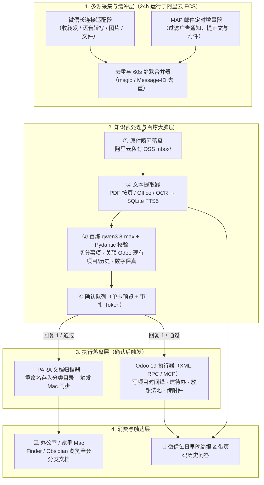

# 02｜整体架构、Odoo 19 映射与文档归档设计

| 项 | 内容 |
| :--- | :--- |
| 文档版本 | v2.0（统一幕僚版） |
| 更新日期 | 2026-11-16 |
| 关联文档 | [总览 README](../README.md) · [01-需求定义与日常场景](01-需求定义与日常场景.md) · [03-分拣工作流与确认](03-AI分拣工作流与确认机制.md) · [04-阿里云部署与实施](04-阿里云部署与分阶段实施路线.md) |

---

## 一、 技术路线与选型决策

### 1.1 为什么不把“境外 Grok Bot 直连 Odoo”作为主力？

在构思阶段曾评估过“直接用 xAI Grok Bot 挂载 MCP 操作 Odoo”，经核查存在三个工程硬伤，因此不作为主方案：

1. **网络与数据合规不匹配**：你的核心需求明确采用**阿里云百炼（`qwen3.8-max`）**，且企微/个人微信网关、工作邮箱与阿里云 Odoo 19 全部部署在国内节点。把公司报价单、合同、研发参数绕道境外模型 API，既受跨境链路延迟与阻断风险影响，也不利于商业资料隔离。
2. **缺少转发合并缓冲**：微信多选“逐条转发” 8 条消息时，通用 Bot 会触发 8 次独立对话并连发 8 条回复，必须有一个前置网关做 **60 秒防抖合并 + `备注：` 注入**。
3. **ERP 写入安全边界**：通用 Bot 的 Tool Calling 如果没有强制**“先出预览卡 + 一次性审批 Token + 人确认后才写库”**的硬件级门禁，一旦模型理解偏差，就会直接污染生产环境 Odoo 数据。

### 1.2 推荐的“最小自研 + 复用现成底座”路线

采用 **「开源 IM 网关 / 官方微信通道 + 轻量 Python 幕僚编排 + 已有 `mcp-odoo-server` 安全写库内核」**，砍掉 80% 重复造轮子工作：

- **微信接入层（二选一，均不碰第三方破解协议）**：
  - **方案 A（最稳企业级推荐）：企业微信「智能机器人长连接」+「微信插件」**  
    主动建一条出站 WebSocket 连往企业微信服务器，**无需公网域名与端口**，通过“微信插件”置顶在你的个人微信“我的企业”里使用，官方通道永不掉线、零封号风险（可复用或参考开源网关如 `LangBot` / `AstrBot` 的企微适配器，或极简 Python WebSocket 客户端）。
  - **方案 B（个人微信原生好友体验）：`OpenClaw` + 腾讯官方 `@tencent-weixin/openclaw-weixin` 插件**  
    通过官方扫码绑定个人微信，对话入口就在个人微信主列表里；同样可把大模型接口指向阿里云百炼并挂载本地 MCP/HTTP 服务。
- **Odoo 执行层（直接复用桌面既有资产）**：
  - 复用你本机已有工作区 `AI_agents_routine_jobs/ECS_Aliyun_odoo19_agent/mcp-odoo-server` 的成熟设计：**统一 XML-RPC 客户端 + SQLite 一次性审批 Token（预览 → 确认 → 防重放执行）+ 只追加脱敏审计日志**，以及 `project_PLM_odoo19` 已验证的 `project.project`、`project.task`、`mrp.eco`、`ir.attachment` 封装方法，补齐活动与 Chatter 接口即可。

---

## 二、 四层极简系统架构



---

## 三、 阿里云 Odoo 19 业务映射设计

### 3.1 两套 Odoo 的定位边界（以你的既有规划为准）

你在 `office_odoo19_guidance/办公室Odoo19需求.md` 中区分了**公网个人 PLM/项目系统**（`https://erp.wissentek.com` / `erp.palmarytech.com`，目前供本人管项目和产品 PLM）与**办公室全员多公司 Odoo**（三家公司独立核算并对接金蝶）。
- **第一/二阶段默认对接**：公网运行的 **Odoo 19 PLM & 项目管理库**（先在 `prod_sandbox_demo` 沙箱库完成全流程测试，再切生产库 `wissentek` / `palmary_prod`）。
- **权限隔离**：使用专用 Agent 账号与 API Key，并强制走“先预览确认、再消费一次性 Token 执行”机制，绝不绕过确认直接批量改库。

### 3.2 信息到 Odoo 19 核心模型的精确映射

| 微信/邮件/闪念中的内容 | Odoo 19 目标模型 | 写入动作与关键字段 | 说明 |
| :--- | :--- | :--- | :--- |
| **正式项目进度、客户沟通纪要** | `project.project` + `mail.message` | 通过 `message_post` 追加到对应项目的 Chatter 时间线，注明来源（微信/邮件/语音）与原件日期 | 不乱建新项目，优先匹配已有项目；新项目仅在确认卡里由你拍板创建 |
| **项目内执行待办** | `project.task` | 在目标 `project_id` 下新建或更新任务：`name`、`user_ids`、`date_deadline`、`description`（附原文摘录与文档链接） | 你在微信回 `完成 N` 时，直接把对应任务切到 `Done` 阶段 |
| **催款 / 催交期 / 跟进日程** | `mail.activity` | 挂在对应 `crm.lead`、`sale.order`、`purchase.order` 或 `project.task` 下，设 `date_deadline` 和活动类型 | 天然汇入 Odoo 右上角今日待办与每日微信简报 |
| **独立零散待办（无项目归属）** | `project.task`（个人 To-Do） | 创建无 `project_id` 的私人待办任务，归属本人账号 | 适配 Odoo 19 原生 To-Do 视图，不污染业务项目看板 |
| **💡 个人想法与灵感闪念** | `project.project`（专用看板 **`CEO 想法与孵化池`**） | 在该专属项目下建 `project.task`，阶段分为 4 列：<br/>`闪念收集` → `调研评估` → `转正式立项` → `留存参考` | **核心创新**：灵感随手入池不丢、不打扰当日紧急工作，转正时直接修改 `project_id` 迁入正式研发/交付项目 |
| **⏳ 等待他人回复（Waiting For）** | `project.task` / `mail.activity` | 打标签 `等待外部`，记录对方联系人、承诺日期与催办节点 | 到期未闭环时每日简报置顶提醒 |
| **产品技术参数变更 / 工艺调整** | `product.template` + `mrp.eco`（PLM） | 对已有研发产品（如 12 款核心自研产品）提出参数修订，确认后创建或更新 ECO 工程变更单草稿 | 完整保留旧参数与修订依据（来自哪封邮件第几页） |
| **客户/供应商/售后工单** | `res.partner` / `crm.lead` / `purchase.order` / `helpdesk.ticket` | 新客户需求入商机，售后故障单直建服务单，附件同步挂载 | — |

---

## 四、 三合一文档分类存储与 Mac 同步设计

解决“文件存在哪儿、怎么自动分好类、电脑怎么直接看、微信怎么搜内页”四个问题：

### 4.1 统一物理存储分工

| 层级 | 存储位置 | 存什么 & 怎么防丢 |
| :--- | :--- | :--- |
| **1. 全量原件保险箱** | **阿里云同地域私有 OSS Bucket**（如呼和浩特/华北区域） | 收到微信文件、语音、图片或邮件附件**瞬间**按 `inbox/YYYY-MM/<sha256前8位>_<原文件名>` 无损存入（开启标准低频/归档生命周期，年成本极低），彻底避免撑爆 ECS 的 60GB 系统盘。 |
| **2. PARA 自动分类文档库** | **阿里云 ECS `/opt/wechat-agent/archive/` + OSS 镜像** | 经你确认后，系统按规范**自动重命名**为 `YYYYMMDD_<项目或对象简称>_<原文件名>`，放入固定的四层分类树（见下节）；同时自动附带一份 AI 提取的 `摘要.md`（适合 Obsidian 直接打开阅读）。 |
| **3. Odoo 单据正式附件** | **Odoo 19 `ir.attachment`** | 属于某张任务、项目、商机或 ECO 的正式文件（PDF/Excel/Word/图片，建议 `< 20 MB`），确认后同步上传挂载至 Odoo 对应单据附件栏；超大视频或图纸在 Odoo 中写入 OSS 私有签名访问链接。 |
| **4. 轻量全文检索索引** | **ECS 本地 SQLite FTS5 (`trigram`)** | 存储每条消息原文、邮件摘要、以及 PDF/Word/Excel/图片 OCR **按页切片的纯文本**，实现毫秒级跨微信+邮件+文档内页问答。 |

### 4.2 PARA 四大分类目录结构（唯一物理树，绝不乱开目录）

```text
文档库根目录 (archive/)
├── 00_原件收件箱/                      # 暂存未归类/放弃整理的片段原文与索引链接
├── 01_项目归档/                        # 客户交付 & 工程项目（例：某某二期/、Boiler_FBG_交付/）
│   └── <项目简称>/
│       ├── 01_沟通纪要与决策/          # 按日期生成的微信/邮件整理 Markdown
│       ├── 02_报价合同与商务/          # 报价单、合同扫描件、付款节点文件
│       └── 03_交付技术与现场/          # 方案、图纸、现场安装照片、验收单
├── 02_产品与研发/                      # 按核心产品线（例：气体校准仪/、LubeSense/、PEMSense质谱仪/）
│   └── <产品简称>/
│       ├── 01_规格书与原厂资料/        # 英文原厂 Datasheet、校准规范
│       ├── 02_设计BOM与图纸/           # 原理图、结构变更说明
│       └── 03_研发实验与测试报告/
├── 03_公司运营/                        # 跨公司公共职能，不按单个项目拆
│   ├── 01_采购与供应商/                # 供应商名录、框架协议、询价对比
│   ├── 02_财务税务与法务/              # 发票合规、银行、审计、合同模板
│   ├── 03_人事招聘与制度/              # 简历筛选、面试记录、公司规章
│   └── 04_IT与内部系统/                # 阿里云 ECS、Odoo、网络拓扑、账号台账
└── 04_想法与行业参考/                  # 脑暴长文整理、行业白皮书、竞品动态（可直接用 Obsidian 打开）
```

### 4.3 电脑本地同步（Mac 无缝看文件）

在阿里云 ECS 与你的办公室/家里 Mac 之间部署 **Syncthing（走你现有的 Tailscale 加密内网通道）** 或定时 `rclone` 单向镜像，只同步 `archive/` 分类后的纯净文档目录（约几百 MB～数 GB）：
- 你在 Mac 上打开 **Finder** 或 **Obsidian**，所有昨天客户微信发来的报价单、凌晨邮箱收到的原厂 PDF、今天路上口述的想法笔记，已经自动重命名并躺在了 `01_项目归档` / `02_产品与研发` / `04_想法与行业参考` 文件夹里，**完全离线可用、随时搜索编辑**。
