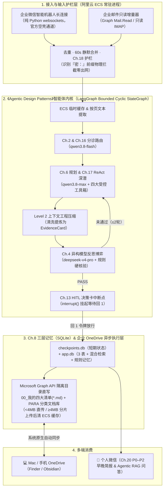

# 02｜整体架构、三层记忆 SQLite 与企业 OneDrive 归档设计

| 项 | 内容 |
| :--- | :--- |
| 文档版本 | v3.1（外轻内重 · Agentic Design Patterns 标准内核版） |
| 更新日期 | 2026-11-17 |
| 关联文档 | [总览 README](../README.md) · [01-需求定义与日常场景](01-需求定义与日常场景.md) · [03-智能体内核与反思闭环](03-AI分拣工作流与确认机制.md) · [04-阿里云部署与防外泄](04-阿里云部署与分阶段实施路线.md) |

---

## 一、 三项核心架构减法与边界决策

为了让系统既皮实好维护、又拥有顶尖的推理和执行能力，我们在外围基础设施上坚持做减法，在内核智能体上做加法：

### 1.1 为什么彻底砍掉 Odoo 19 MCP 对接？
1. **省掉脆弱联调**：通过 MCP 驱动 Odoo 需要维护多公司 `company_id` 约束、必填字段校验、沙箱与生产库切换；而管理“四大清单”本身是极轻任务，绑定重型 ERP 属于过度设计。
2. **CEO 私人台账与公司多人系统物理隔离**：微信碎片、邮件摘要、未成熟战略想法和商业底价不进公司员工共享的 ERP，从根上消除权限误配泄密风险；等某个构想孵化成熟，再正式在 Odoo 立项派给团队。
3. **文件存真实目录可读性极强**：Odoo 底层附件是以哈希值存进黑盒目录；直接写入企业 OneDrive 标准分类文件夹，在 Mac Finder / Obsidian 里永远直接可读。

### 1.2 为什么直接写入企业 Office 365 OneDrive（替代阿里云 OSS + Syncthing）？
1. **零额外存储与同步软件**：通过 Microsoft Graph API 写入后，你办公室与家里的 Mac（Finder / Obsidian）、Windows 和手机 OneDrive App **原生自动实时同步**。
2. **自带版本历史与回收站兜底**：企业版 OneDrive 原生提供 `1 TB+` 空间、文件历史版本（Version History）和 93 天双层回收站，自动重绘覆盖清单或移动文件也不怕误操作。
3. **一套应用打通“收邮件 + 写网盘”**：若主力工作邮箱同在企业 Office 365（Exchange Online）下，微软后台 1 个应用即可同时实现只读收信（`Mail.Read`）与隔离目录写文件，免去传统 IMAP 密码。

### 1.3 为什么不套 OpenClaw / Hermes，而用自研《Agentic Design Patterns》专用内核？
1. **我们要“严守规矩的档案秘书”，不是“拿终端钥匙的自由跑腿工”**：OpenClaw 与 Hermes 的设计强项是给大模型开放 Bash 终端、文件任意读写和浏览器自动化去自由探索；但在处理微信转发静默合并、`密：` 物理拦截、数字 100% 保真、1 张预览卡确认才落盘等确定性约束时，用自由循环很容易跳步或格式走样。
2. **严防外部邮件提示词注入（Prompt Injection）**：第二阶段系统会自动读取外部发来的邮件和 PDF。如果底层运行带裸 Shell 权限的通用框架，恶意邮件中的隐藏指令可能诱导 Agent 越权读本地文件甚至外传；我们的专用内核**物理上不提供 Shell 与任意外发工具**，从架构上封死攻击面。
3. **“内账秘书”与“外勤跑腿”物理分家**：本系统（1 号专车）专职内部机密、四大清单与 OneDrive 归档；未来若想在微信里指挥 AI 联网搜公开文献、写临时脚本，再单独起一个完全不挂载企业邮箱和机密网盘的 Hermes 实例（2 号外勤助手）即可。

---

## 二、 四积木与认知闭环全景图



---

## 三、 极简 SQLite 单文件承载 Ch.8 三层记忆 + Ch.14 混合检索

不造 20 张表迷你 ERP，整个系统在本地只维护两个轻量化 SQLite 文件（开启 WAL 模式）：

### 3.1 短期会话与断点记忆 (`data/checkpoints.db`)
- 由 **LangGraph `AsyncSqliteSaver`** 原生管理，自动保存每一步图执行状态。
- 当智能体给你发出 1 张预览卡调用 `interrupt()` 暂停后，就算过 5 小时你才回复 `1` 或 `改：...`，甚至中间重启过 ECS 服务，系统也能按线程 ID 从断点**原位精准恢复**，前面已经跑过的工具调用和大模型推理**零重复消耗**。

### 3.2 长期三类记忆与混合检索 (`data/app.db` — 仅 3+1 张极简核心表)

严格对照《Agentic Design Patterns》第 8 章（记忆管理）与第 14 章（知识检索）：

| 记忆维度 | 承载表名 | 核心字段与设计 | 工程作用 |
| :--- | :--- | :--- | :--- |
| **长期语义记忆**<br>（记事实与原件） | **`raw_sources`**<br/>+ **`sources_fts`**（FTS5 `trigram`）<br/>+ 可选向量列 | `id`、`source_type`、`external_msg_id`（幂等去重）、`sender`、`raw_text`、`content_hash`（SHA-256）、`is_confidential`（`密：` 标记）、`onedrive_raw_path`、`onedrive_archive_path`、`extracted_pages_json`（按页纯文本）、`embedding`（可选轻量向量） | **防丢与 Ch.14 混合检索（Hybrid Search）**：同时支持字面 `FTS5 trigram`（精确查型号/金额/简称）与可选语义向量召回（解决“换了一种说法没提原名也能查到”）；大体积附件传完 OneDrive 即删本地缓存，ECS 只留文本索引。 |
| **长期项目字典** | **`projects`** | `id`、`name`（标准名）、`aliases_json`（简称/别名）、`category`（project/product/operation）、`status`、`onedrive_folder`、`latest_brief`、`updated_at` | 充当《Agentic Design Patterns》里的全局“目录地图（Repo Map）”，避免把同一项目建出多个重复目录。 |
| **四合一动态清单**<br/>+ 事务撤销 | **`list_items`** | `id`、`list_type`（`project_action` / `next_action` / `idea` / `waiting_for`）、`project_id`、`title`、`owner`、`due_date`、`priority`（`P0`/`P1`/`P2`）、`priority_score`、`status`、`stage`、`relation_note`（修订/冲突留痕）、`source_ids_json`、`onedrive_doc_paths_json`、`undo_snapshot_json` | 一张表统一管理四大清单，支持 **Ch.20 动态优先级计算**与 **Ch.12 24 小时内 `撤销` 快照回滚**；每次更新自动渲染为 OneDrive 4 份 `.md` 看板。 |
| **情景与程序性记忆**<br/>（记纠偏与规矩） | **`memory_rules`** | `id`、`memory_kind`（`episodic_case` 情景纠偏示例 / `procedural_rule` 个人铁律）、`trigger_tags_json`、`rule_text`、`correction_count`、`status`（`proposed` / `confirmed`） | **越用越聪明的核心**：你每次在卡片上提的修改意见记一条情景示例；同类纠偏累计 2 次经你确认后升格为**个人程序性规则**（同步导出到 OneDrive `00_我的四大清单/00_我的个人规则库.md`），以后自动注入提示词上下文。 |

> 外加轻量的 `model_calls` 排错与成本台账表（记录每次节点耗时、Token 成本及反思意见，默认 30 天滚动清理）。

---

## 四、 企业 Office 365 OneDrive 直写与沙箱隔离设计

### 4.1 权限最小化：硬件级锁死在专属目录（严禁 `Files.ReadWrite.All`）

| 授权模式 | 微软 Graph 权限范围 | 隔离效果与适用场景 |
| :--- | :--- | :--- |
| **模式 1（最简单，个人沙箱推荐）** | `Files.ReadWrite.AppFolder` + `offline_access`（若同租户收邮件可加 `Mail.Read`） | **硬件级沙箱隔离**：微软接口在物理上把程序锁死在 `/应用/AI幕僚归档库/` 单个文件夹内（`/me/drive/special/approot`），你 OneDrive 里的其他全部工作文件夹连目录名都读不到。 |
| **模式 2（独立站点库，纯后台免交互）** | `Sites.Selected`（Application 权限） | 管理员新建 1 个仅你可见的私有 SharePoint 文档库，并仅把该库的 `write` 权限赋给应用，采用 Client Credentials 7×24 自动换取令牌，永不掉授权。 |

### 4.2 国际版/世纪互联切换 & 适配 2Mbps 带宽的异步分片上传
- **双环境切换**：通过 `MS_CLOUD_ENV=global|china_21vianet` 一键切换 `graph.microsoft.com` 与 `microsoftgraph.chinacloudapi.cn`。
- **异步分片上传不卡微信**：由于 ECS `firematrix` 带宽为 `2 Mbps`（约 `250 KB/s`），收到大附件时先落本地 `/opt/wechat-agent/tmp_cache/` 秒级提取文本建索引并发送微信决策卡；确认后后台任务按文件大小分流（`< 4 MB` 单次 `PUT`，`>= 4 MB` 走 `createUploadSession` 断点分片上传），校验云端 `eTag`/`size` 一致后立即清理本地大文件缓存。

### 4.3 OneDrive 隔离目录下的完整文档树（Obsidian 原生友好）

```text
OneDrive 隔离专属目录/
├── 00_我的四大清单/                         ← 每次入库后自动重绘覆盖，Mac/手机即开即看
│   ├── 00_我的个人规则库.md                 # 已确认的程序性记忆规则（Ch.8）
│   ├── 01_今日与行动待办.md                 # 含 P0 / P1 / P2 动态优先级分组（Ch.20）
│   ├── 02_在途项目总览.md                   # 各项目近况 + 卡点风险 + 目录相对链接
│   ├── 03_想法与孵化池.md                   # 闪念收集 / 调研评估 / 准备立项 / 留存参考
│   └── 04_等待他人清单.md                   # 外部依赖对象、承诺日与催办状态
├── 00_原件收件箱/                           ← 所有收到消息与附件的原始备份（按月，永不改写）
├── 01_项目归档/<项目简称>/                  ← 00_项目沟通与纪要.md + 01_报价合同与商务/ + 02_技术方案与现场/
├── 02_产品与研发/<产品简称>/                ← 00_研发动态与参数演变.md + 01_规格书与原厂资料/ + 02_设计BOM与测试/
├── 03_公司运营/                             ← 01_采购与供应商/ + 02_财务税务与法务/ + 03_人事招聘与制度/ + 04_IT与内部系统/
└── 04_想法与行业参考/                       ← 脑暴长文、脱敏调研简报、绝密直存文档（Obsidian 直接阅读）
```

> 正式归档文件一律重命名为 **`YYYYMMDD_<项目或对象简称>_<原文件名>`**；重名自动加 `_v2`，不覆盖旧文件。

---

## 五、 模块化工程代码结构（对齐工作区 `bfbg_workflow` 标准）

复用你在 `Boiler_FBG_Product_RD_Workflow/agentic_workflow/src/bfbg_workflow/` 已沉淀的清晰工程规范，本项目代码包规划如下：

```text
wechat_assistant/
├── src/wechat_assistant/
│   ├── config.py             # 配置加载、CostLedger 成本账本、Secret Guard 防泄密断言、
│   │                         # DashScopeLLMGateway（三档异构路由 + 主备回退 + JSON 语法自愈修复）
│   ├── schemas.py            # WorkflowState、EvidenceCard、TriageProposal、CriticVerdict 等 Pydantic 契约
│   ├── graph.py              # LangGraph 有界闭环 StateGraph 装配与 SqliteSaver 持久化断点恢复
│   ├── nodes/                # guardrail_router、react_investigator、context_compactor、
│   │                         # producer_drafter、heterogeneous_critic、hitl_gate、atomic_executor
│   ├── tools/                # 四大受控幕僚工具箱 + Ch.18 before_tool_callback 拦截器
│   │   ├── memory_tools.py   # hybrid_search、read_doc_pages、trace_timeline
│   │   ├── calc_tools.py     # calc_business_date、analyze_excel_quote（精确日期与 Excel 逐行 Diff）
│   │   ├── search_tools.py   # 脱敏拦截器 + Metaso/Serper/Jina 异步并发外搜
│   │   └── onedrive_tools.py # Microsoft Graph 隔离目录读写、分片上传与四大清单 Markdown 渲染
│   ├── intake/               # 企微长连接 websockets 接收器、60s 静默合并器、Graph Mail/IMAP 只读拉取器
│   ├── storage/              # SQLite 3+1 表初始化、FTS5 索引、文档按页解析（PDF/Office/OCR）
│   └── prompts/              # 节点提示词版本包（不含任何真实密钥、私有 URL 或商业底数）
└── tests/
    ├── unit/                 # 数字保真核验、Excel Diff、脱敏护栏与路径安全单测
    ├── trajectory/           # Ch.19 Mock 工具轨迹评测（Trajectory Eval）
    └── regression/           # LLM-as-a-Judge 黄金回归测试集
```
