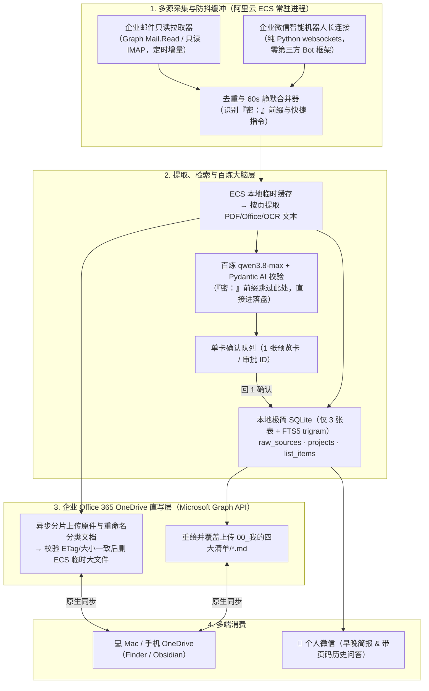

# 02｜整体架构、极简 SQLite 清单与企业 OneDrive 归档设计

| 项 | 内容 |
| :--- | :--- |
| 文档版本 | v3.0（极简独立与企业 OneDrive 版） |
| 更新日期 | 2026-11-17 |
| 关联文档 | [总览 README](../README.md) · [01-需求定义与日常场景](01-需求定义与日常场景.md) · [03-分拣工作流与确认](03-AI分拣工作流与确认机制.md) · [04-阿里云部署与防外泄](04-阿里云部署与分阶段实施路线.md) |

---

## 一、 核心架构减法决策

相比初版（自造 20 张表迷你 ERP）与 v2.0（对接 Odoo 19 + 阿里云 OSS + Syncthing），v3.0 做了两次彻底的工程减法，把系统裁剪到**4 块核心积木**：

### 1.1 为什么彻底砍掉 Odoo 19 MCP 对接？
1. **省掉最重的联调与维护成本**：通过 MCP 驱动 Odoo 需要维护 XML-RPC 会话、多公司 `company_id` 隔离、必填字段校验、沙箱与生产切换。而管理“四大清单”本身是极轻的任务，用重型 ERP 接口去写私人待办和随手想法属于过度设计。
2. **天然实现 CEO 私人台账与公司员工系统的物理隔离**：微信聊天、邮件摘要、未成熟战略想法和商业底价属于私人幕僚数据，不进多人 ERP 就绝无权限配置疏漏被同事看到的可能；等某项构想孵化成熟需要派给团队执行时，再单独在 Odoo 立项即可。
3. **文档存真实文件夹比存 Odoo 附件黑盒好得多**：Odoo 附件在底层会被转为哈希文件藏在数据卷里，离开系统无法直接浏览；直接存入企业 OneDrive 标准分类文件夹，十年后不依赖任何 AI 程序也能在电脑上直接打开。

### 1.2 为什么直接写入企业 Office 365 OneDrive（替代阿里云 OSS + Syncthing）？
1. **跨端原生同步，省掉自建同步盘**：经 Microsoft Graph API 写入你的企业 OneDrive 后，你办公室和家里的 **Mac（Finder 侧边栏）**、Windows 与手机 OneDrive App 会自动同步。在 Mac 上直接用 **Obsidian** 打开该同步文件夹，4 份 `.md` 清单和全部分类文档实时可见。
2. **自带企业级容灾与历史回退**：企业版 OneDrive 提供 `1 TB+` 空间、**文件历史版本（Version History）** 和 **93 天双层回收站**，更新同名清单或移动文件时天然留底，无需自建备份链路。
3. **有机会一套凭据打通“收邮件 + 写网盘”**：如果你的主力工作邮箱也在同一套企业 Office 365（Exchange Online）下，在微软后台注册 **1 个内部自用应用** 即可同时拥有只读拉信（`Mail.Read`）与隔离目录写文件能力，免去传统 IMAP 密码管理。
4. **按需安全分享给同事**：整个归档目录默认仅你个人可见；某个项目文件夹需要发给工程师或财务时，在 Mac Finder 里右键点 OneDrive 共享即可。

---

## 二、 四积木系统架构与数据流



---

## 三、 极简 3 表 SQLite 数据设计（只管索引与清单，拒绝重造 20 表 ERP）

整个服务端本地只需维护 **1 个 SQLite 数据库文件**（开启 WAL 模式与 `FTS5 trigram` 全文索引），彻底避免过度设计：

| 表名 | 存什么（核心字段） | 职责说明 |
| :--- | :--- | :--- |
| **`raw_sources`**<br/>（含虚表 **`sources_fts`**） | `id`、`source_type`（wechat/voice/email）、`external_msg_id`（唯一去重键）、`sender`、`raw_text`、`content_hash`（SHA-256）、`is_confidential`（密级标记）、`onedrive_raw_path`、`onedrive_archive_path`、`extracted_pages_json`（按页文本）、`created_at` | **防丢与全文搜内页**：存消息原文与附件提取出的按页纯文本。大体积附件上传 OneDrive 校验通过后即从 ECS 本地删除，SQLite 只保留纯文本与 OneDrive 路径映射，既不占空间又能毫秒检索 PDF 第几页。 |
| **`projects`** | `id`、`name`（标准名）、`aliases_json`（简称/别名列表）、`category`（`project` 项目 / `product` 产品 / `operation` 运营）、`status`（active / paused / archived）、`onedrive_folder`、`latest_brief`、`updated_at` | **轻量项目/产品字典**：让 AI 每次分拣时知道你手里当前有哪些在途项目与核心产品，不会把“帕莫瑞二期”和“某某二期”拆成两个重复文件夹。 |
| **`list_items`** | `id`、`list_type`（`project_action` / `next_action` / `idea` / `waiting_for`）、`project_id`、`title`、`owner`、`due_date`、`status`（pending / open / done / ignored / cancelled）、`stage`（想法池四阶段）、`relation_note`（修订/冲突留痕）、`source_ids_json`、`onedrive_doc_paths_json`、`undo_snapshot_json`、`created_at`、`updated_at` | **四合一清单总表**：一条表统一管理全部四个清单。每次状态变动保留 `undo_snapshot_json`，支持 24 小时内一句 `撤销` 一键回滚；写入后由代码重新渲染为 4 份 Markdown 上传 OneDrive。 |

> 说明：外加一张轻量的 `model_calls` 排错日志表（仅在发生纠偏时记录上下文与提示词版本，默认 30 天滚动清理，支持离线回归评估）。

---

## 四、 企业 Office 365 OneDrive 直写与沙箱隔离设计

### 4.1 权限最小化：严禁全盘读写，硬件级锁死在专属目录

绝不向 AI 助理申请租户级或用户全盘读写权限（严禁 `Files.ReadWrite.All`），必须二选一：

| 授权模式 | 微软 Graph 权限范围 | 隔离效果与适用场景 |
| :--- | :--- | :--- |
| **模式 1（最简单，推荐个人使用）：应用专属沙箱目录** | `Files.ReadWrite.AppFolder` + `offline_access`（若同租户收邮件可加 `Mail.Read`） | **硬件级沙箱隔离**：授权后会在你的企业 OneDrive 下生成唯一隔离根目录 `/应用/AI幕僚归档库/`（endpoint `/me/drive/special/approot`）。程序在微软底层**完全看不到你 OneDrive 里的任何其他工作文件夹**，零误删风险。首次需完成一次设备码/OAuth 授权并用 `refresh_token` 持久化续期。 |
| **模式 2（独立站点库，纯后台免交互）** | `Sites.Selected`（Application 权限） | 在企业 Office 365 建一个仅你 1 人有权限的私有 SharePoint 文档库，管理员在后台只把这 1 个库的 `write` 权限赋给该应用。采用 Client Credentials 自动换取 Token，7×24 无人值守永不掉授权。 |

### 4.2 国际版与世纪互联中国版适配

在配置文件中通过 `MS_CLOUD_ENV` 一键切换接口端点（两者在阿里云国内 ECS 均可通过 HTTPS 正常访问）：
- **国际版（Global）**：认证 `https://login.microsoftonline.com` · Graph `https://graph.microsoft.com/v1.0`
- **世纪互联中国版（21Vianet）**：认证 `https://login.chinacloudapi.cn` · Graph `https://microsoftgraph.chinacloudapi.cn/v1.0`

### 4.3 适配 ECS `2 Mbps` 带宽的「本地秒收 + 后台异步分片上传」机制

阿里云 `firematrix` 实例公网带宽为 `2 Mbps`（约 `250 KB/s`），为保证**微信不卡顿**且 **60G 云盘永不写满**：
1. **接收即本地缓存与索引**：收到微信附件或拉取到邮件附件后，先落入 ECS `/opt/wechat-agent/tmp_cache/`；在本地毫秒级提取 PDF/Office 纯文本写入 SQLite FTS5，并在 **2～3 秒内** 发出微信预览卡。
2. **后台队列稳健上传 OneDrive**：
   - `00_原件收件箱/` 原件与确认后的正式归档文件由后台 `asyncio` 上传队列推往 OneDrive；
   - 文件 `< 4 MB` 直接单次 `PUT .../content` 写入；文件 `>= 4 MB`（最大支持上百 MB 合同扫描包或视频）自动调用微软 Graph **`createUploadSession`** 进行分片断点续传（如每片 `3.2 MB`，断线重传不浪费流量）。
3. **校验清理**：收到 Graph 返回的 `200/201` 且核对云端 `size` / `eTag` 无误后，立即自动清理 ECS `/opt/wechat-agent/tmp_cache/` 中的该附件实体，ECS 本地只留极轻的 SQLite 文本索引。

### 4.4 OneDrive 隔离目录下的统一文件夹结构（Obsidian 原生友好）

```text
OneDrive 隔离专属目录/
├── 00_我的四大清单/                         ← 每次入库或标完成后自动全量重绘覆盖，Mac/手机随时看
│   ├── 01_今日与行动待办.md
│   ├── 02_在途项目总览.md
│   ├── 03_想法与孵化池.md
│   └── 04_等待他人清单.md
├── 00_原件收件箱/                           ← 所有收到消息与附件的无损原始备份（按月）
│   └── 2026-11/
│       └── 20261117_0931_<sha8>_<原文件名>
├── 01_项目归档/                             ← 客户交付与重点工程项目
│   └── <项目简称>/
│       ├── 00_项目沟通与纪要.md             ← 按时间倒序追加每次微信/邮件摘要与原话出处
│       ├── 01_报价合同与商务/
│       └── 02_技术方案与现场/
├── 02_产品与研发/                           ← 按产品线（如 气体校准仪/、LubeSense/、质谱仪/）
│   └── <产品简称>/
│       ├── 00_研发动态与参数演变.md         ← 参数修订历史表（含出处页码）
│       ├── 01_规格书与原厂资料/
│       └── 02_设计BOM与测试/
├── 03_公司运营/                             ← 跨公司固定职能分类
│   ├── 01_采购与供应商/
│   ├── 02_财务税务与法务/
│   ├── 03_人事招聘与制度/
│   └── 04_IT与内部系统/
└── 04_想法与行业参考/                       ← 脑暴整理长文、行业报告、绝密直存文档（Obsidian 直接阅读）
```

> **统一重命名规范**：归入 `01–04` 正式分类目录的附件一律规范重命名为 **`YYYYMMDD_<项目或对象简称>_<原文件名>`**；遇到同名文件自动加序号（`_v2`），绝不静默覆盖旧文件；同时依托 OneDrive 自带的历史版本机制保留修改轨迹。
