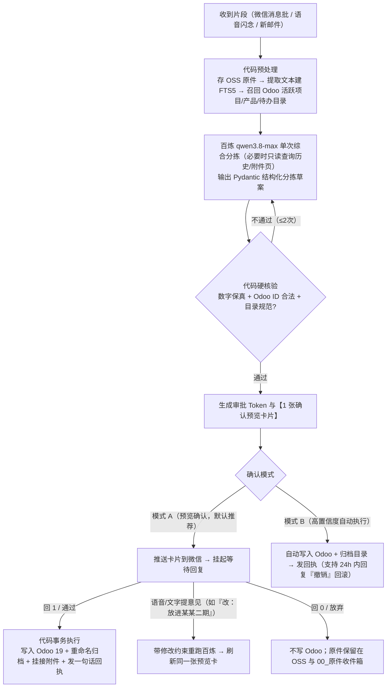

# 03｜AI 分拣工作流、硬核验与极简确认机制

| 项 | 内容 |
| :--- | :--- |
| 文档版本 | v2.0（统一幕僚版） |
| 更新日期 | 2026-11-16 |
| 关联文档 | [总览 README](../README.md) · [01-需求定义与日常场景](01-需求定义与日常场景.md) · [02-架构与Odoo19归档](02-整体架构与Odoo19及文档归档设计.md) · [04-阿里云部署与实施](04-阿里云部署与分阶段实施路线.md) |

---

## 一、 核心工程原则：代码与模型的清晰分工

延续原设计体系经过验证的最佳实践——**答案取决于字面的交给代码，答案取决于意思的交给百炼 `qwen3.8-max`，模型只做只读查询与结构化判断，绝不让模型直接写数据库或直接操作文件**。

| 职责类别 | 谁执行 | 具体任务 |
| :--- | :--- | :--- |
| **确定性事务** | 纯 Python 代码 | `msgid` / 邮件 `Message-ID` 去重；60 秒静默缓冲合并；原件写入 OSS 并计算 SHA-256；PDF/Office 文字按页提取；快捷指令精确匹配（`1`/`通过`/`完成 N`/`撤销`/`查 ...`）；生成一次性审批 Token；写入 Odoo 19 与文件重命名归档。 |
| **语义理解与分拣** | 百炼 `qwen3.8-max`（Pydantic AI 结构化输出） | 判断片段是“工作内容 / 个人想法 / 追问历史 / 对当前卡片修改”；把混合消息拆分为多件独立事项；匹配已有 Odoo 项目/产品/客户；识别新旧内容是补充、修订还是矛盾；草拟待办、重命名文件名与分类路径。 |
| **硬核验兜底** | 纯 Python 代码核验器 | **数字保真**（提取输出中的所有金额、日期、料号、比例，必须在原文/邮件/附件或你的补充备注中出现）；**编号存在性**（引用的 Odoo 项目 ID、任务 ID、附件页码必须来自本次召回或工具结果）；**路径合法性**（目标归档路径必须落在 PARA 四大固定根目录下）。校验不通过触发 `ModelRetry` 回灌错误让模型重做（最多 2 次）。 |

---

## 二、 分拣流水线：从收到消息到落盘



### 为什么把原方案的“5 次确认”压缩成“1 张确认预览卡”？

1. **体验不打断**：日常在外面跑客户时，连发 5 次“通过”根本无法持续使用。把「切分、关联项目、分类归档、待办草稿、文档命名」一次性汇总在一张不超过 10 行的紧凑卡片里，**看一眼回个 `1` 就结束**。
2. **安全不打折**：因为仍然卡在写入 Odoo 与正式目录之前的“一次性审批 Token”门禁前，模型把客户认错或把交期听偏，你直接回一句语音或文字修正即可重算，不会污染正式 ERP。
3. **渐进放权**：等跑顺 2～4 周后，你可以选择切到 **模式 B**：模型把握度高（例如明确归属已有项目、无参数冲突）的条目**自动归档入库并给你发一条简短回执**；只有出现“新建项目、参数与历史冲突、低置信度”时才弹窗停下来问你。

---

## 三、 百炼分拣输出契约（核心数据结构）

模型每次分析片段或邮件，通过 Pydantic 强类型模型返回以下关键字段（保证代码可稳定消费）：

```python
# 概念契约示意（实际代码以 schemas.py 为准）
class TriageItem(BaseModel):
    title: str                        # 简短事项标题（<= 24字）
    bucket: Literal["project_update", "todo", "idea", "waiting_for", "reference_only"]
    para_domain: Literal["01_项目归档", "02_产品与研发", "03_公司运营", "04_想法与行业参考"]
    odoo_project_id: int | None       # 必须来自本次召回的 Odoo 活跃项目 ID；新建填 None
    proposed_new_project: str | None  # 仅确需新立项时提出名称
    odoo_partner_name: str | None     # 客户或供应商标准名称
    odoo_product_name: str | None     # 关联产品（如 气体校准仪、LubeSense）
    relation_to_history: Literal["new", "supplement", "revision", "conflict"]
    conflict_or_revision_quote: str | None  # 若为修订/冲突，必须附带新旧双方原话子串
    summary: str                      # 2~3 句摘要（数字 100% 忠于原文）
    todo_draft: TodoDraft | None      # 标题、负责人、截止日、依据原文子串
    file_renames: list[FilePlan]      # 每个附件的新文件名与目标 PARA 相对路径
    confidence: float                 # 0.0 ~ 1.0
    uncertain_note: str | None        # 拿不准的原因（会高亮在预览卡里）
```

---

## 四、 微信端常用快捷指令（纯代码毫秒响应）

除自然语言对话外，以下短指令由接入层直接精确匹配执行（不额外消耗模型推理时间）：

| 你发给机器人的消息 | 系统动作 |
| :--- | :--- |
| `1` / `通过` / `确认` / `OK` | 确认执行当前等待中的预览卡片（写入 Odoo 19 + 移动/同步文档） |
| `2` | 仅归档文档到分类目录，不在 Odoo 创建待办/任务 |
| `0` / `放弃` | 取消本次写入（原件仍保留在 OSS 和收件箱） |
| `改：<修改意见>` 或直接语音/文字说错哪了 | 按你的最新指示重新生成本张预览卡片（例如：`改：这是气体校准仪的，放研发目录`） |
| `好了` / `完` | 立即结束逐条转发的 60 秒等待缓冲，马上开始分析 |
| `撤销` | 撤回最近 24 小时内最后一次确认写入（删除或归档新建的 Odoo 任务、还原文档路径，原件不删） |
| `完成 <编号>` / `忽略 <编号>` | 将今日简报或待办列表里的第 N 条待办在 Odoo 中直接标为已完成或取消 |
| `查 <客户/项目/产品名>` | 毫秒返回该对象在 Odoo 中的最新进度、未完成待办、最近 5 份归档文件清单 |
| `想法池` | 列出 Odoo `CEO 想法与孵化池` 中当前处于「闪念收集」「调研评估」的条目 |

---

## 五、 跨微信、邮件与 PDF 内页的历史问答机制

当你在微信里问一个复杂问题（例如：“*查一下去年底和今年初关于某项目高温传感器的报价和材质修改记录，原文件在哪里？*”）：

1. **第 0 层召回**：代码先查出相关 Odoo 项目卡片、产品卡片和近期摘要卡，避免让模型盲目搜索。
2. **模型按需深查（只读工具循环，上限 10 次）**：
   - 查 Odoo 项目/任务/Chatter 历史；
   - 查本地 SQLite FTS5 全文索引命中相关微信片段、邮件正文和附件；
   - 遇到数十页的 PDF 合同或规格书，调用按页阅读工具定位到具体第几页。
3. **带出处作答 + 冲突提示**：
   - 每条结论必须标注**来源类型、日期、文件名/邮件主题与页码**；
   - 若历史记录里存在未解决的参数冲突或报价前后不一致，**强制同时列出新旧双方原话**供你判断；
   - 实在没记录过的事，强制输出“未查到相关记录”，绝不允许模型脑补。
4. **长回答输出文件**：若对比表格或汇总超过 500 字，自动生成一份清晰的 `.md` 总结文档同步进目录并按微信端能力直接发送或推摘要。
