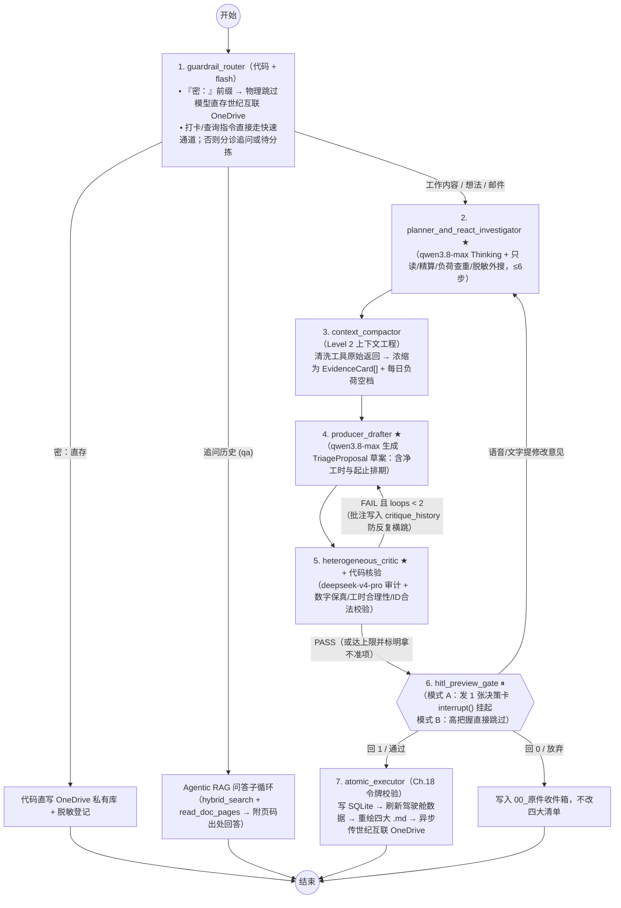

# 03｜基于《Agentic Design Patterns》的智能体内核、工具箱与排期反思闭环

| 项 | 内容 |
| :--- | :--- |
| 文档版本 | v3.2（董事长助理开工基线版） |
| 更新日期 | 2026-11-17 |
| 模式规范源 | [agentic_design_patterns](../../agentic_design_patterns/全书摘要分册/README.md)（Antonio Gulli 全书 21 模式体系） |
| 关联文档 | [总览 README](../README.md) · [01-需求定义与日常场景](01-需求定义与日常场景.md) · [02-架构与世纪互联OneDrive](02-整体架构与SQLite清单及OneDrive归档设计.md) · [04-阿里云部署与操作手册](04-阿里云部署与分阶段实施路线.md) |

---

## 一、 与《Agentic Design Patterns》核心模式的 1:1 严格映射

本系统外围保持极简（单机 3+1 表 SQLite + 世纪互联 OneDrive），**智能体内核 100% 严格遵循《Agentic Design Patterns》的工业级模式组合**：

| 模式章节 | 本系统中的精确工程实现 | 解决的实际问题 |
| :--- | :--- | :--- |
| **Ch.1 提示词链 & Level 2 上下文工程** | 拆分为「探索查证 → 证据压缩 → 起草（含工时排期）→ 审计 → 执行」强类型 Pydantic 链；`context_compactor` 把工具原始长输出清洗为精简 `EvidenceCard` | 克服单次大 Prompt 的指令忽略与注意力过载，保证推理专注度 |
| **Ch.2 路由 (Routing)** | **混合两级路由**：① 规则路由（`1`/`撤销`/`开始 N`/`完成 N`/`负荷`/`密：` 在接入层亚毫秒直达）；② 轻量模型路由（`qwen3.8-flash` 分诊意图） | 确定性指令与打卡零延迟零费用；模糊长文本不误判 |
| **Ch.3 并行化 (Parallelization)** | 脱敏外部情报工具支持 `asyncio` 并发扇出（`Metaso + Serper + Jina Reader`），汇聚节点严格遵守**「闭卷防幻觉铁律」** | 外部技术调研提速 3 倍，汇总绝不脑补上游未提供的数据 |
| **Ch.4 反思 (Reflection)** | **异构 Producer-Critic 闭环**：`qwen3.8-max` 起草提案，`deepseek-v4-pro` 独立审计（含工时合理性与数字核验）并保存历次批注记忆（上限 2 轮） | 打破同模型自审盲区，拦截漏拆待办、错误工时估算与数字偏差 |
| **Ch.5 工具使用 & Ch.17 PALMs/ReAct** | `qwen3.8-max` 开启显式 Thinking + ReAct 循环；日期排期冲突、Excel 报价单对比与工时负荷核算全部交给 Python 沙箱工具（**PALMs**） | 彻底杜绝大模型心算算术错误或把外部等待天数当成本人净工时 |
| **Ch.6 规划 & Ch.11 目标清单** | `investigator` 按信息缺口自主规划 1～6 步查询顺序；Critic 依据预设 **SMART 质量核对清单**给出 `PASS / FAIL` 布尔判定 | 复杂消息会自动查清历史前因后果与备选方案，达到董事长助理水准 |
| **Ch.8 记忆管理 (Memory)** | 短期：`SqliteSaver`；长期语义：`raw_sources` + OneDrive；长期情景：纠偏 Few-Shot 与**同类工时校准基准**；长期程序性：`memory_rules` | 越用越懂你的分类习惯，也越估越准你的真实工作速度 |
| **Ch.12 异常处理与恢复** | `DashScopeLLMGateway`（指数退避重试 + 主备回退 + JSON 语法自愈修复）+ `undo_snapshot_json` 事务回滚 | 接口抖动或畸形 JSON 自动自愈；入库错误 24 小时内一句 `撤销` 完整回滚 |
| **Ch.13 人在回路 (HITL → HOTL)** | LangGraph `interrupt()` 发出 **1 张含排期与工时的幕僚决策卡**（模式 A）；跑顺后可切为策略内自动入库（模式 B） | 兼顾零负担体验与高准确度 |
| **Ch.14 智能体化检索 (Agentic RAG)** | `hybrid_search`（FTS5 字面 + 可选向量）+ `read_doc_pages` 按页精读 + **源时效验证与新旧冲突调解** | 换说法不带原名也能找回旧事，新旧报价冲突必列双方原话 |
| **Ch.16 资源感知优化** | 三档异构模型路由（`flash` 分诊 / `max` 主推 / `deepseek-v4-pro` 审计）+ `CostLedger` 成本遥测账本 | 高算力留给深度思考与审计，日常指令毫秒级响应 |
| **Ch.18 护栏与安全模式** | **`密：` 前缀物理拦截**、外部邮件 `[UNTRUSTED_EXTERNAL_DATA]` 隔离包裹、**`before_tool_callback` 令牌拦截器**、零 Shell/零发信最小权限 | 彻底防御恶意邮件提示词注入与越权外泄 |
| **Ch.19 评估与监控** | Mock 工具**轨迹评估（Trajectory Eval）**+ 数字/工时单测 + `LLM-as-a-Judge` 黄金集，可选对接本地私有 `agentic_observability_hub` | 改提示词或升级模型先跑自动化回归，不退步再上线 |
| **Ch.20 优先级排序** | 早晚简报与驾驶舱动态计算「截止紧迫度 × 项目重要度 × 是否卡住他人」排出 `P0 / P1 / P2`，并结合每日 `6.0h` 容量红线排期 | 确保卡脖子事项与当日重点永远清晰 |

---

## 二、 LangGraph 有界闭环状态图（Bounded Cyclic `StateGraph`）

所有非确定性短指令的消息、语音想法与邮件，收齐后进入 `StateGraph(WorkflowState)`，状态持久化于 `checkpoints.db`：



---

## 三、 四大受控幕僚工具箱（Sandboxed Executive Toolset）

所有工具严格划分为 **1～3 组只读/精算/脱敏工具（推理阶段自主调用）** 与 **第 4 组写入执行工具（受 `before_tool_callback` 令牌硬拦截）**：

| 工具箱分组 | 工具名称 | 底层实现与能力 | 安全边界（Ch.18 护栏） |
| :--- | :--- | :--- | :--- |
| **1. 全景记忆与文档深潜** | `hybrid_search`<br/>`read_doc_pages`<br/>`list_onedrive_tree`<br/>`trace_timeline` | FTS5 `trigram` + 可选向量混合召回；PDF/Excel 按页切片精确读取；列出世纪互联私有库目录；拉取项目与参数演变时间线 | 100% 只读，分页与字数上限受控 |
| **2. 排期负荷、日期与报价精算沙箱** | `check_workload_and_schedule`<br/>`calc_business_date`<br/>`analyze_excel_quote` | 查询本人未来 7～14 天每日已排净工时负荷与过往同类真实耗时基准（`effort_baseline`）；Python 推算相对工作日与项目撞期；用 `openpyxl` 精算 Excel 新旧报价单逐行 Diff 与含税总价 | 纯确定性 Python 函数执行，**无 `eval`/无系统命令** |
| **3. 脱敏外部情报并发检索** | `search_public_tech_intel` | 复用工作区 `Metaso + Serper + Jina Reader` 异步并发查询公开器件规格与行业标准（可配 `EXTERNAL_SEARCH_ENABLED=false` 关闭） | **前置脱敏过滤器**：禁止包含客户全称、内部代号与报价金额；汇聚节点严格闭卷汇总 |
| **4. 清单与世纪互联 OneDrive 执行工具** | `propose_list_mutations`<br/>`compose_markdown_brief`<br/>`organize_onedrive_files` | 更新 SQLite 清单与驾驶舱状态、重绘四大 `.md`；调用 `microsoftgraph.chinacloudapi.cn` 在 `MS_SITE_ID` 私有库内建目录、重命名、分片上传并留存 `undo_snapshot_json` | **`before_tool_callback` 门禁**：未持有确认令牌物理拒绝执行；限死在 `MS_SITE_ID` 单个私有库内 |

---

## 四、 异构反思契约与工时排期结构（`qwen3.8-max` × `deepseek-v4-pro`）

### 4.1 主笔草案核心契约（新增工时与排期字段）

```python
# 概念契约示意（实际代码以 schemas.py 为准）
class TriageItem(BaseModel):
    title: str                        # 简短事项标题（<= 24字）
    list_type: Literal["project_action", "next_action", "idea", "waiting_for", "reference_only"]
    work_domain: Literal["产品研发", "客户销售", "项目交付", "采购供应链", "公司治理与人事", "个人思考"]
    para_domain: Literal["01_项目归档", "02_产品与研发", "03_公司运营", "04_想法与行业参考"]
    project_id: int | None
    proposed_new_project: str | None
    planned_start_date: str | None    # YYYY-MM-DD（结合当前负荷空档建议）
    planned_end_date: str | None      # YYYY-MM-DD（日历截止/跨度结束）
    estimated_hours: float            # 仅估算消耗董事长本人的净投入工时（小时，如 0.5, 1.5）
    waiting_target: str | None        # waiting_for 时填写等待对象
    relation_to_history: Literal["new", "supplement", "revision", "conflict"]
    conflict_or_revision_quote: str | None
    summary: str                      # 2~3 句摘要（数字 100% 忠于原文）
    file_plans: list[FilePlan]
    confidence: float
    uncertain_note: str | None
```

### 4.2 独立异构 Critic（`deepseek-v4-pro`）审计维度
除了代码层确定性检查数字保真（100% 出自原文/工具结果）与 ID/路径合法性外，独立 Critic 模型逐项核验：
1. **隐含承诺不遗漏**：口头说的“下周再核对”“找备选问问”是否漏建行动待办或等待清单？
2. **工时与日历周期不混为一谈（v3.2 重点）**：如果一件事主要是“等供应商打样 10 天”，`planned_start`～`planned_end` 跨度是 10 天，但占用董事长本人的 `estimated_hours` 绝不能写 `80h`，只能写沟通与验收所需的 `0.5h`；同时检查排期是否把某天负荷推超阈值。
3. **冲突与风险必高亮**：交期顺延是否撞上已有项目里程碑？新报价/参数是否与历史矛盾而未列双边原文？
4. **防外行挑刺改坏**：Critic 禁止凭空臆改数字，批评必须给出具体缺失项或工具查证依据；微小措辞差异直接放行 `PASS`。

---

## 五、 微信端快捷指令（含工时打卡）与 Agentic RAG 问答

### 5.1 接入层纯代码毫秒响应指令
| 你发给「工作助理」的消息 | 系统动作 |
| :--- | :--- |
| `1` / `通过` / `确认` / `OK` | 签发执行令牌，写入 SQLite（含排期工时）、更新驾驶舱、重绘世纪互联 OneDrive 四大 `.md` 与归档文件 |
| `2` | 仅归档文档到世纪互联 OneDrive 分类目录，不在四大清单里新增待办 |
| `0` / `放弃` | 取消本次写入（原件保留在 `00_原件收件箱/`） |
| `改：<意见>` 或直接语音/文字提意见 | 带你的约束重算（例如：`改：这个半小时够了，排周五`） |
| `密：<说明>` | **绝密直通**：跳过全部云端模型与外搜，直接存进世纪互联 OneDrive 指定目录 |
| `开始 <编号>` | 立即记录第 N 条待办的 `actual_start_at` 为当前时间，状态切为进行中 |
| `完成 <编号>` 或 `完成 <编号> <耗时h>` | 标完成第 N 项（例：`完成 3 1.5h`），写入实际停止时间与真实耗时并同步校准后续工时预估，自动重绘 OneDrive 看板 |
| `忽略 <编号>` / `撤销` | 忽略待办，或利用 `undo_snapshot_json` 回滚 24 小时内最后一次确认写入 |
| `看板` / `负荷` / `排期` | 秒回本周每日已排净工时负荷（如 `周二 5.2/6h · 周三 6.5/6h(超载)`），并当场签发 1 个 **5 分钟单次有效加密魔法链接**，微信内点击直接免输密码打开驾驶舱 |
| `查 <关键词>` / `想法池` | 秒回项目/产品近况、待办与 OneDrive 路径，或列出想法池当前条目 |

### 5.2 自然语言历史追问（Ch.14 Agentic RAG）
提问（如*“上个月某客户报价和昨天邮件这版差在哪？原文件在哪个目录？”*）走 **混合检索 → 源时效验证 → 按页精读/Excel 精算 → 冲突检查** 闭环，严格附带文件名、日期、页码与 OneDrive 路径，存在未裁决矛盾同时列出双方原话，绝不编造。
