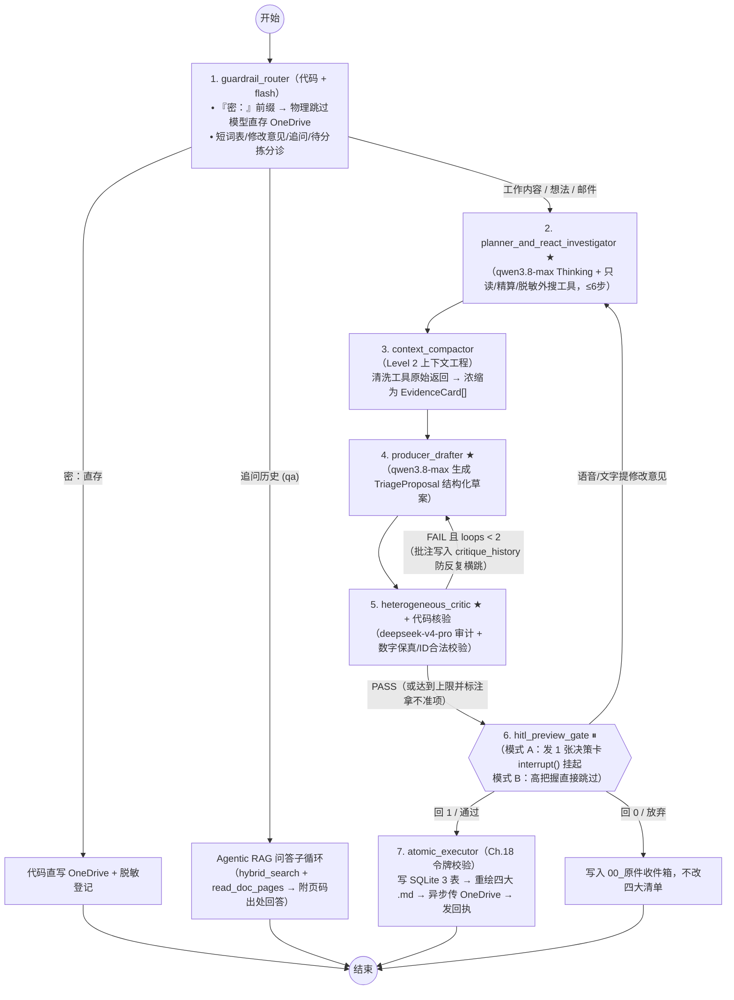

# 03｜基于《Agentic Design Patterns》的智能体内核、工具箱与反思闭环

| 项 | 内容 |
| :--- | :--- |
| 文档版本 | v3.1（外轻内重 · Agentic Design Patterns 标准内核版） |
| 更新日期 | 2026-11-17 |
| 模式规范源 | [agentic_design_patterns](../../agentic_design_patterns/全书摘要分册/README.md)（Antonio Gulli 全书 21 模式体系） |
| 关联文档 | [总览 README](../README.md) · [01-需求定义与日常场景](01-需求定义与日常场景.md) · [02-架构与SQLite/OneDrive](02-整体架构与SQLite清单及OneDrive归档设计.md) · [04-阿里云部署与防外泄](04-阿里云部署与分阶段实施路线.md) |

---

## 一、 与《Agentic Design Patterns》核心模式的 1:1 严格映射

本系统虽以外部基础设施极简（3 表 SQLite + OneDrive）著称，但**智能体内核 100% 严格遵循《Agentic Design Patterns》的工业级模式组合（Pattern Composition）**：

| 模式章节 | 本系统中的精确工程实现 | 解决的实际问题 |
| :--- | :--- | :--- |
| **Ch.1 提示词链 & Level 2 上下文工程** | 拆分为「探索查证 → 证据压缩 → 起草 → 审计 → 执行」强类型 Pydantic 链；`context_compactor` 节点把原始工具日志清洗为精简 `EvidenceCard` | 克服单次大 Prompt 的指令忽略与注意力过载，绝不把几十页垃圾原文直接塞给下游节点 |
| **Ch.2 路由 (Routing)** | **混合两级路由**：① 规则路由（`1`/`通过`/`撤销`/`完成 N`/`密：` 在接入层亚毫秒直达）；② 轻量模型路由（`qwen3.8-flash` 分诊意图并动态选择分支） | 确定性指令零延迟零费用；模糊自由文本不误判 |
| **Ch.3 并行化 (Parallelization)** | 脱敏外部情报工具支持 `asyncio` 并发扇出（`Metaso + Serper + Jina Reader`），汇聚节点强制遵守**「严格闭卷防幻觉铁律」** | 调研产品标准/器件参数时速度提升 3 倍，汇总绝不脑补上游未提供的结论 |
| **Ch.4 反思 (Reflection)** | **异构 Producer-Critic 闭环**：`qwen3.8-max` 起草提案，`deepseek-v4-pro` 独立审计（配合规则校验）并保存历次批注记忆防止反复横跳（上限 2 轮） | 打破单一模型“自己批自己考卷”的同源盲区与迎合偏见，拦截漏拆待办与数字偏差 |
| **Ch.5 工具使用 & Ch.17 PALMs/ReAct** | `qwen3.8-max` 开启显式 Thinking + ReAct 循环；所有日期推算、Excel 报价单对比与含税计算交给 Python 沙箱工具（**PALMs 程序辅助**） | 彻底杜绝大模型心算算术错误或搞错工作日日期 |
| **Ch.6 规划 & Ch.11 目标清单** | `investigator` 根据片段缺口自主规划 1～5 步查询顺序；Critic 依据预设 **SMART 质量核对清单**给出 `PASS / FAIL` 布尔判定 | 复杂消息（如供应商改交期）会自动顺藤摸瓜查历史和备选方案，不被动照抄 |
| **Ch.8 记忆管理 (Memory)** | 短期：`SqliteSaver` 检查点；长期语义：`raw_sources` + OneDrive；长期情景：历史纠偏 Few-Shot；长期程序性：`memory_rules` 个人铁律 | 越用越懂你的分类习惯，同类问题纠正两次即永久记住 |
| **Ch.12 异常处理与恢复** | `DashScopeLLMGateway`（指数退避重试 + 主备模型回退 + JSON 截断/控制字符自愈修复）+ `undo_snapshot_json` 事务回滚 | 接口抖动或畸形 JSON 自动自愈；入库错误 24 小时内一句 `撤销` 完整回滚 |
| **Ch.13 人在回路 (HITL → HOTL)** | LangGraph `interrupt()` 暂停发出 **1 张高密度幕僚决策卡**（模式 A）；跑顺后可切为策略边界内自动入库、仅异常弹窗的 HOTL（模式 B） | 兼顾零负担体验与 ERP 级写入安全 |
| **Ch.14 智能体化检索 (Agentic RAG)** | `hybrid_search`（FTS5 字面 + 可选向量语义）+ `read_doc_pages` 按页精读 + **源时效性验证与新旧冲突调解** | 换说法不带原名也能找回旧事，新旧报价冲突必列双边原话 |
| **Ch.16 资源感知优化** | 三档异构模型路由（`flash` 分诊 / `max` 主推 / `deepseek-v4-pro` 审计）+ `CostLedger` 成本遥测账本 | 把高算力留给复杂判断，日常固定指令和分诊毫秒级响应 |
| **Ch.18 护栏与安全模式** | **`密：` 前缀物理拦截**、外部邮件数据隔离包裹、**`before_tool_callback` 写令牌拦截器**、Pydantic + 数字保真输出过滤、**零 Shell/零发信最小权限** | 即使遭遇恶意邮件提示词注入，也绝无越权破坏或对外泄密通道 |
| **Ch.19 评估与监控** | Mock 工具**轨迹评估（Trajectory Eval）**+ 数字保真单元测试 + `LLM-as-a-Judge` 黄金集回归，可选对接本地私有 `agentic_observability_hub` | 改提示词或升级模型先跑自动化回归，不退步再上线 |
| **Ch.20 优先级排序** | 早晚简报与清单渲染前按「截止紧迫度 × 项目重要度 × 是否阻塞后续节点」动态计算 `P0 / P1 / P2` 分数 | 确保逾期风险和卡脖子事项永远排在第一屏 |

---

## 二、 LangGraph 有界闭环状态图（Bounded Cyclic `StateGraph`）

所有非确定性短指令的消息、语音想法与邮件，收齐后进入 `StateGraph(WorkflowState)`，状态持久化于 `checkpoints.db`：

> **Level 2 上下文工程铁律（写在代码里，不靠模型自觉）**：
> - `investigator` 在多轮查询期间哪怕翻看了 20 页 PDF 和 15 条历史记录，进入 `producer_drafter` 之前必须经过 `context_compactor` 清洗：只保留**带编号与页码的 `EvidenceCard` 列表**、匹配到的 `projects` 字典子集、以及关联的个人规则（`memory_rules`），保证模型在起草和审计时注意力高度聚焦、准确率拉满。

---

## 三、 四大受控幕僚工具箱（Sandboxed Executive Toolset）

严格贯彻**“强执行工具 + 最小权限护栏”**，所有工具分为 **1～3 组只读/精算/脱敏工具（推理阶段自主调用）** 与 **第 4 组写入执行工具（受 `before_tool_callback` 令牌硬拦截）**：

| 工具箱分组 | 工具名称 | 底层实现与能力 | 安全边界（Ch.18 护栏） |
| :--- | :--- | :--- | :--- |
| **1. 全景记忆与文档深潜** | `hybrid_search` `read_doc_pages` `list_onedrive_tree` `trace_timeline` | FTS5 `trigram` + 可选向量混合召回；PDF/Excel 按页切片精确读取；列出 OneDrive 沙箱目录；拉取某项目/参数全演变链 | 100% 只读，单次返回有分页与字数上限，超限翻页 |
| **2. 精确计算与表格分析沙箱** | `calc_business_date` `analyze_excel_quote` | Python 计算相对日期/工作日/交期冲突；用 `openpyxl` 精确解析新旧 Excel 报价单逐行价格、数量、含税总价 Diff | 纯确定性 Python 函数执行，**无 `eval`/无系统命令执行** |
| **3. 脱敏外部情报并发检索** | `search_public_tech_intel` | 复用工作区 `Metaso + Serper + Jina Reader` 异步并发查询公开器件规格、行业标准或厂家背景（可配 `EXTERNAL_SEARCH_ENABLED=false` 全局关闭） | **前置脱敏过滤器**：校验查询词不含客户全称、内部项目代号与报价金额；汇聚节点严格闭卷汇总 |
| **4. 清单与 OneDrive 执行工具** | `propose_list_mutations` `compose_markdown_brief` `organize_onedrive_files` | 生成四大清单与项目纪要 `.md`；调用 Microsoft Graph API 在隔离目录下新建子目录、规范重命名、分片上传并记录 `undo_snapshot_json` | **`before_tool_callback` 门禁**：必须持有有效确认令牌（模式 A 经你回 `1` 签发，或模式 B 经规则置信度门禁签发），否则物理拒绝执行；限死在 OneDrive 沙箱根目录内 |

---

## 四、 异构反思契约：主笔模型 vs. 独立审计模型（Ch.4）

沿用《Agentic Design Patterns》第 4 章中经过深入验证的**「生成与审计职责分离（`qwen3.8-max` × `deepseek-v4-pro`）」**机制，避免单一模型自审盲区：

1. **代码硬核验（确定性第一关）**：
   - 核对输出中的所有数字（金额、百分比、交期、料号）是否 100% 出现在输入原文或第 1/2 组工具返回结果中；
   - 核对引用的 `project_id`、清单项 ID、文件页码是否存在；
   - 核对目标 OneDrive 路径是否严格落在 `01_项目归档`～`04_想法与行业参考` 下。
2. **独立异构 Critic 模型审计（`deepseek-v4-pro`，备 `qwen3.8-max`）**：
   - 输出强类型 `CriticVerdict(passed: bool, checklist_failures: list[str], fix_instructions: str)`，逐项对照以下 5 条质量标尺审查：
     1. **隐含承诺不遗漏**：对方或本人说的“下周再核对”“找备选问问”是否漏建了行动待办或等待清单？
     2. **风险与冲突必高亮**：推迟交期是否撞上既有项目节点？新参数/报价是否与历史记录矛盾而未列双边原文？
     3. **精算优先原则**：遇到金额、日期差、表格对比时，Producer 是否老实采用了工具算出的结果，而不是自己瞎猜？
     4. **防止外行改坏（防过拟合挑刺）**：Critic 禁止凭空主观臆断修改数字或项目名，每一条批评必须给出明确缺失点或工具查出的反证；若只是文风措辞微瑕，直接判定 `PASS` 不浪费往返。
   - **累积反思记忆**：每次被打回重做，把 `critique_history` 全部传入下一轮，避免 `Producer` 在两版错误之间来回横跳。

---

## 五、 微信端常用快捷指令与 Agentic RAG 问答

### 5.1 接入层纯代码毫秒响应指令
| 你发给「工作助理」的消息 | 系统动作 |
| :--- | :--- |
| `1` / `通过` / `确认` / `OK` | 签发执行令牌，原子写入 SQLite、重绘 OneDrive 四大清单 `.md`、异步归档附件 |
| `2` | 仅将文档写入 OneDrive 分类目录，不在四大清单里新增待办 |
| `0` / `放弃` | 取消本次写入（原件保留在 OneDrive `00_原件收件箱/`） |
| `改：<意见>` 或直接语音/文字提意见 | 带你的约束重新触发内核调查与草案生成，刷新同一张预览卡 |
| `密：<说明>` | **绝密直通**：跳过全部云端模型与外搜，直接存进 OneDrive 指定目录 |
| `好了` / `完` | 立即结束逐条转发 60 秒等待，马上开工分析 |
| `撤销` | 回滚 24 小时内最后一次确认写入（利用 `undo_snapshot_json` 还原 SQLite 与 OneDrive 文件） |
| `完成 <编号>` / `忽略 <编号>` | 标完成/忽略清单第 N 项，并自动重算 `P0–P2` 更新 OneDrive 看板 |
| `查 <关键词>` / `想法池` | 秒回该主题近况、待办与 OneDrive 路径，或列出想法池当前待调研项 |

### 5.2 自然语言历史追问（Ch.14 Agentic RAG）
当你在微信提问（如*“上个月某客户那版报价和昨天邮件这版差在哪？付款条款分别怎么写的？”*）：
- `investigator` 自动走 **混合检索召回 → 源时效性验证 → `read_doc_pages` / `analyze_excel_quote` 跨文档精读对比 → 冲突检查** 闭环；
- 输出必须满足：**每个数据带文件名+页码/日期出处**、未裁决冲突同时列出双方原话、查不到直说查不到；超过 500 字的对比总结自动写一份 `.md` 存进 OneDrive `04_想法与行业参考/` 并给你发摘要与路径。
