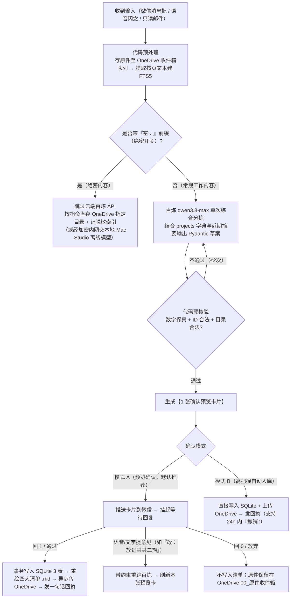

# 03｜AI 分拣工作流、密级拦截与极简确认机制

| 项 | 内容 |
| :--- | :--- |
| 文档版本 | v3.0（极简独立与企业 OneDrive 版） |
| 更新日期 | 2026-11-17 |
| 关联文档 | [总览 README](../README.md) · [01-需求定义与日常场景](01-需求定义与日常场景.md) · [02-架构与SQLite/OneDrive](02-整体架构与SQLite清单及OneDrive归档设计.md) · [04-阿里云部署与防外泄](04-阿里云部署与分阶段实施路线.md) |

---

## 一、 核心工程原则：代码与模型的清晰分工

坚持一条黄金法则：**答案取决于字面的交给纯 Python 代码，答案取决于意思的交给百炼 `qwen3.8-max`；模型只做只读查询与结构化判断，绝不让模型直接写数据库或直接操作 OneDrive 文件**。

| 职责类别 | 谁执行 | 具体任务 |
| :--- | :--- | :--- |
| **确定性事务与拦截** | 纯 Python 代码 | `msgid` / 邮件 `Message-ID` 去重；60 秒静默缓冲合并；**`密：` 前缀密级拦截**；附件临时落盘与 PDF/Office 按页提取；快捷指令精确匹配（`1`/`通过`/`完成 N`/`撤销`/`查 ...`）；写入 SQLite、重绘四大 `.md` 清单并调用 Microsoft Graph 分片上传 OneDrive。 |
| **语义理解与分拣** | 百炼 `qwen3.8-max`（Pydantic AI 结构化输出） | 判断片段是“工作/想法归档”还是“追问历史/修改当前卡片”；把混合消息拆分为多件独立事项；匹配 SQLite `projects` 字典里的已有项目或产品；识别新旧内容是补充、修订还是矛盾；草拟待办、重命名文件名与 OneDrive 分类路径。 |
| **硬核验兜底** | 纯 Python 代码核验器 | **数字保真**（提取输出中的所有金额、日期、料号、比例，必须在原文/邮件/附件或你的备注中出现）；**编号存在性**（引用的项目 ID、清单项 ID、附件页码必须来自本次召回或工具结果）；**路径合法性**（目标 OneDrive 路径必须落在 PARA 固定根目录下，禁止路径穿越）。校验不过自动 `ModelRetry` 回灌错误让模型重做（最多 2 次）。 |

---

## 二、 分拣流水线：含「`密：` 前缀零出网」双通道



### 为什么把原初版的“5 次确认”压缩成“1 张确认预览卡”？
- **不打断工作节奏**：把「切分、归属项目、放入哪个清单、文档重命名与 OneDrive 路径」汇总在一张不超过 10 行的紧凑卡片里，**瞄一眼回个 `1` 就落盘**。
- **错误先拦在门外**：只要你没回 `1`，模型就算把客户简称或交期猜偏，也不会写进你的正式清单和分类文件夹，直接回一句语音或文字即可重算。
- **可平滑放权到模式 B**：跑顺 2～4 周后，可将“明确归属已有项目且无参数冲突”的高置信度条目切为自动入库、仅发简短回执，出现“新建项目 / 修订冲突 / 置信度不足”时才停下来问你。

---

## 三、 百炼分拣输出契约（核心数据结构）

模型每次分析片段或邮件，通过 Pydantic 强类型结构返回结果，确保下游代码 100% 确定性写入：

```python
# 概念契约示意（实际代码以 schemas.py 为准）
class TriageItem(BaseModel):
    title: str                        # 简短事项标题（<= 24字）
    list_type: Literal[
        "project_action",             # 归属具体项目的行动/进展
        "next_action",                # 独立行动待办
        "idea",                       # 放入 03_想法与孵化池.md
        "waiting_for",                # 放入 04_等待他人清单.md
        "reference_only",             # 仅归档文档/纪要，不建待办
    ]
    para_domain: Literal["01_项目归档", "02_产品与研发", "03_公司运营", "04_想法与行业参考"]
    project_id: int | None            # 必须来自本次召回的 SQLite projects 表；建议新建填 None
    proposed_new_project: str | None  # 仅确需新开项目/产品文件夹时提出名称
    idea_stage: Literal["闪念收集", "调研评估", "准备立项", "留存参考"] | None
    waiting_target: str | None        # 若为 waiting_for，注明在等谁/何事
    due_date: str | None              # YYYY-MM-DD，必须有原文或备注依据
    due_derived_from: str | None      # 截止日期对应的原文子串
    relation_to_history: Literal["new", "supplement", "revision", "conflict"]
    conflict_or_revision_quote: str | None  # 修订或矛盾时，必须附带新旧双方原文子串
    summary: str                      # 2~3 句摘要（数字 100% 忠于原文）
    file_plans: list[FilePlan]        # 每个附件的新文件名与目标 OneDrive 相对路径
    confidence: float                 # 0.0 ~ 1.0
    uncertain_note: str | None        # 拿不准的原因（会高亮在预览卡里）
```

---

## 四、 微信端常用快捷指令（纯代码毫秒响应）

除自然语言对话外，以下短指令由接入层精确匹配执行，不经过大模型：

| 你发给「工作助理」的消息 | 系统动作 |
| :--- | :--- |
| `1` / `通过` / `确认` / `OK` | 确认执行当前等待中的预览卡（写入 SQLite、重绘四大 `.md` 清单、上传 OneDrive 分类目录） |
| `2` | 仅将附件/摘要归档到 OneDrive 分类目录，不在四大清单里新增待办 |
| `0` / `放弃` | 取消本次写入（原件仍保留在 OneDrive `00_原件收件箱/`） |
| `改：<修改意见>` 或直接语音/文字说错哪了 | 按你的最新指示重算本张预览卡（例：`改：这是气体校准仪的，放研发目录`） |
| `密：<分类或目录说明>`（随消息或文件发出） | **绝密拦截**：跳过云端百炼 API，直接加密存入 OneDrive 指定文件夹并做脱敏登记 |
| `好了` / `完` | 立即结束逐条转发的 60 秒等待缓冲，马上开始分析 |
| `撤销` | 撤回最近 24 小时内最后一次确认写入（利用 `undo_snapshot_json` 回滚 SQLite 并恢复 OneDrive 文件状态） |
| `完成 <编号>` / `忽略 <编号>` | 将今日简报或待办清单第 N 项标为已完成/忽略，并自动更新 OneDrive `01_今日与行动待办.md` |
| `查 <客户/项目/产品名>` | 秒回该主题的最新近况、未完成待办、最近 5 份 OneDrive 归档文件路径 |
| `想法池` | 列出 `03_想法与孵化池.md` 中处于「闪念收集」「调研评估」的条目 |

---

## 五、 跨微信、邮件与 PDF 内页的历史问答机制

当你在微信里问一个复杂问题（例如：“*查一下去年底和今年初关于某项目高温传感器的报价和材质修改记录，原文件在 OneDrive 哪个文件夹？*”）：

1. **第 0 层召回**：代码先查 SQLite `projects` 字典、`list_items` 与近期摘要卡，避免模型盲目搜索。
2. **模型按需深查（只读工具循环，上限 10 次）**：
   - 搜索 SQLite `sources_fts` 全文索引命中相关微信片段、邮件正文与 PDF 提取文本；
   - 对几十页的长 PDF，调用按页读取工具（`get_source_page` / `read_long`）精确定位到具体第几页。
3. **带出处作答 + 冲突必提**：
   - 每个核心结论必须注明**来源类型、日期、文件名/邮件主题与页码**，并附上对应的 **OneDrive 相对路径**；
   - 若历史记录中存在未裁决的参数冲突或报价前后不一致，**强制同时列出新旧双方原文**；
   - 查无记录时强制输出“未查到相关记录”，严禁编造数字或文件名。
4. **长回答生成笔记**：若整理对比超过 500 字，自动生成一份 `.md` 专题整理写入 OneDrive `04_想法与行业参考/` 并在微信返回要点摘要与路径。
