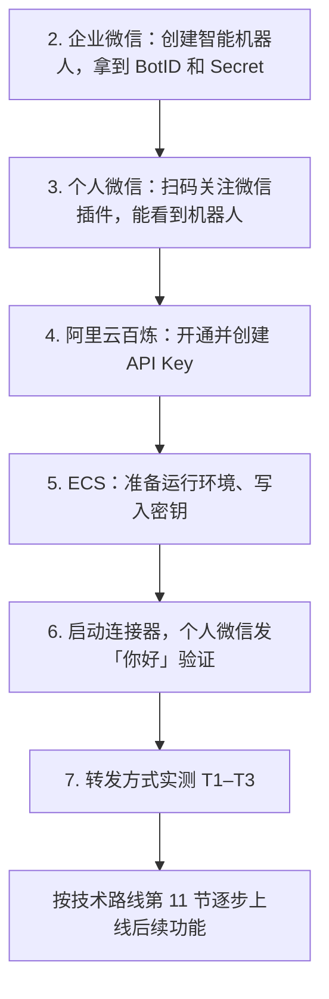

# 部署实施：微信、企业微信、阿里云百炼与 ECS 上要做的事

| 项 | 内容 |
| :--- | :--- |
| 文档 | 部署实施手册 |
| 版本 | 0.1 |
| 日期 | 2026-10-31 |
| 依据 | [01-需求说明.md](01-需求说明.md) 0.7、[02-技术路线.md](02-技术路线.md) 0.7、[04-工作流总览.md](04-工作流总览.md) 至 [10-历史检索与上下文.md](10-历史检索与上下文.md) |
| 状态 | 草案，按步骤执行并逐项打勾 |

本文按「在哪里操作」分节，说明部署时每一处要做什么。执行顺序见第 1 节。

服务器的实例编号、IP、SSH 端口等连接信息记在工作区根目录的 `.env.ecs`（本地文件，不进 Git），本文不重复写。所有密钥、密码只放在 `.env.ecs` 和服务器上的环境文件里。

## 修订记录

| 版本 | 日期 | 修订内容 |
| :--- | :--- | :--- |
| 0.1 | 2026-10-31 | 首版：部署目标定为阿里云 ECS `firematrix` |

## 1. 总体顺序



| 步骤 | 在哪里做 | 谁来做 | 产出 |
| :--- | :--- | :--- | :--- |
| 2 | 企业微信管理后台 | 本人（需要管理员权限） | BotID、长连接 Secret |
| 3 | 个人微信 | 本人 | 个人微信里能打开机器人 |
| 4 | 阿里云百炼控制台 | 本人 | 百炼 API Key |
| 5 | ECS | 本人或 agent | 程序目录、环境文件、系统服务 |
| 6–7 | 个人微信 + ECS | 本人 + agent | 收发验证、T1–T3 实测记录 |

第 6 步通过之前，不接模型（技术路线第 9 节）。

## 2. 企业微信里要做的事

### 2.1 选定企业

- [ ] 确认用哪个企业微信企业来创建机器人：
  - 公司企业允许你（管理员）创建 API 模式的智能机器人：直接用公司企业。
  - 不允许或不想和公司组织混用：用手机号另注册一个只给本人用的企业微信（个人可免费注册）。
- [ ] 登录企业微信管理后台：<https://work.weixin.qq.com/>（用管理员身份扫码）。

### 2.2 创建智能机器人

- [ ] 在管理后台找到「智能机器人」（不同版本位置可能在「应用管理」或「协作」下，以后台实际为准），新建一个机器人。
- [ ] 名称建议：`工作助理`；头像随意。
- [ ] 模式选择 **API 模式**，接入方式选择 **长连接**（不是回调 URL）。
- [ ] 记下 **BotID** 和 **长连接 Secret**。注意它和回调模式的 Token、EncodingAESKey 不是同一个东西。
- [ ] **可见范围只选本人**，不要加其他成员或部门。

> [!CAUTION]
> BotID 和 Secret 不要发到微信群、不要写进文档或 Git。只在第 5.5 步写进 ECS 上的环境文件。

### 2.3 开启微信插件

- [ ] 管理后台进入「我的企业 → 微信插件」。
- [ ] 找到「邀请关注」二维码，保存下来，供第 3 步用个人微信扫描。

## 3. 个人微信里要做的事

### 3.1 关注并找到机器人

- [ ] 用个人微信扫描第 2.3 步的「邀请关注」二维码，按提示关注。
- [ ] 在个人微信的通讯录 → 「我的企业」里找到这个企业，再找到「工作助理」机器人。
- [ ] 把机器人会话**置顶**，以后转发时好找。

### 3.2 第一次发消息（第 6 步时做）

- [ ] 给机器人发「你好」。机器人要先收到你的消息，以后才能主动给你推每日清单。
- [ ] 确认机器人回复「已收到」。

### 3.3 转发方式实测（第 7 步时做）

在任意一个工作会话里准备 5–8 条消息（含一张图片、一个文件），按下表各做一次，把结果交给 agent 从服务器日志里核对，填进本表：

| # | 操作 | 结果（实测后填写） |
| :--- | :--- | :--- |
| T1 | 长按 → 多选 → **合并转发** 给机器人 | 是否收到：　；能否拿到每条原文：　；是否带原发送人和时间：　 |
| T2 | 长按 → 多选 → **逐条转发** 给机器人 | 每条间隔约：　秒；是否带原发送人：　 |
| T3 | 逐条转发里夹带图片、文件 | 是否按顺序到达：　 |

结论（实测后填写）：首选转发方式 ＿＿＿＿，片段静默时间取 ＿＿ 秒。

### 3.4 日常用法（上线后）

| 想做的事 | 在机器人会话里怎么做 |
| :--- | :--- |
| 记一段对话 | 多选后转发给机器人（按 3.3 的结论选合并或逐条） |
| 补充说明 | 转发完 60 秒内发一句，最好以「备注：」开头，例如「备注：这是 A 项目的，交期要催」 |
| 马上结束这一段 | 发「好了」 |
| 分错段了 | 发「拆开」或「并到上一段」 |
| 分错领域了 | 发「改成 产品研发」或「3 改成 人事行政」 |
| 标记待办 | 发「完成 3」或「忽略 3」 |
| 查某个客户或项目 | 发「查 某某科技」 |

## 4. 阿里云百炼里要做的事

- [ ] 用阿里云账号登录百炼控制台：<https://bailian.console.aliyun.com/>，地域选 **华北 2（北京）**。
- [ ] 首次使用时按提示开通百炼服务，确认计费方式（按量，按 Token 计费）。
- [ ] 在模型列表确认 `qwen3.8-max` 可用。
- [ ] 创建 **API Key**，名称建议 `wechat-agent`，记下。
- [ ] 可选：在费用中心设置**消费预警**（例如每月 50 元），防止异常调用。

> [!NOTE]
> ECS 在呼和浩特，百炼用北京地域，走公网调用即可，不需要同地域。按技术路线第 7 节的估算，每月文字量很小，费用以百炼价格页为准。

## 5. 阿里云 ECS 上要做的事

部署目标：ECS `firematrix`（Ubuntu 24.04，2 核 4 GB，2 Mbps 固定带宽，60 GB 系统盘）。连接信息见 `.env.ecs`。

### 5.1 先确认现状，不影响已有服务

这台机器上已经跑着 FireMatrix 官网（Nginx + PM2 进程 `firematrix-web`，端口 3000，目录 `/var/www/firematrix`）。本项目是一个独立的后台进程，**不需要 Nginx、不占用任何端口、不需要改安全组**：它主动连出企业微信和百炼，不接受外部连入。

- [ ] SSH 登录后先看一遍现状，记下结果：

```bash
uptime; free -h; df -h /
timedatectl | grep "Time zone"
python3 --version
pm2 list            # 确认 firematrix-web 在运行
ss -tlnp            # 看已占用的端口
```

- [ ] 确认根分区剩余空间 ≥ 20 GB。

### 5.2 先做安全整改（强烈建议在部署前完成）

> [!WARNING]
> 这台 ECS 的 root 密码以明文形式提交在 GitHub 私有仓库 `firematrix_web_aliyun_ecs` 的 `.env.local` 和 `deployment/deploy.py` 里，同一仓库还提交了 `.env.tokens`（含 GitHub / GitLab Token）。凡是能访问这个仓库的人或 Token 都能看到。本项目要在这台机器上存客户和公司内部的对话，应先整改。

- [ ] 在本机生成专用 SSH 密钥，并加到 ECS：

```bash
ssh-keygen -t ed25519 -f ~/.ssh/id_ed25519_firematrix -C "firematrix"
ssh-copy-id -i ~/.ssh/id_ed25519_firematrix.pub -p <ECS_SSH_PORT> root@<ECS_HOST>
ssh -i ~/.ssh/id_ed25519_firematrix -p <ECS_SSH_PORT> root@<ECS_HOST>   # 确认能免密登录
```

- [ ] 修改 root 密码（`passwd`），新密码只记在本机 `.env.ecs` 或密码管理器里。
- [ ] 在 GitHub 上撤销（revoke）`firematrix_web_aliyun_ecs/.env.tokens` 里出现过的 GitHub Token 和 GitLab Token，重新生成。
- [ ] 把 `firematrix_web_aliyun_ecs` 的 `deploy.py` 改成从本地 `.env.local` 或 SSH 密钥读取凭据，不再写死密码；把已跟踪的 `.env.local`、`.env.tokens` 从 Git 中移除跟踪（`git rm --cached`）。历史记录里仍然有，所以上面两步「改密码、撤销 Token」不能省。
- [ ] 确认 SSH 密钥登录稳定、`deploy.py` 也改为密钥后，再考虑关闭 SSH 密码登录。**顺序不能反**，否则可能把自己锁在外面；被锁时可用阿里云控制台的「远程连接（VNC）」登录恢复。

### 5.3 时区和基础软件

- [ ] 时区设为北京时间（若 5.1 显示不是）：

```bash
timedatectl set-timezone Asia/Shanghai
```

- [ ] 安装基础软件（Ubuntu 24.04 自带 Python 3.12）：

```bash
apt-get update
apt-get install -y python3-venv python3-pip sqlite3 rsync
```

### 5.4 创建专用用户和目录

本项目不用 root 运行。

```bash
useradd --system --create-home --home-dir /opt/wechat-agent --shell /usr/sbin/nologin wxagent
mkdir -p /opt/wechat-agent/{app,data} /etc/wechat-agent
chown -R wxagent:wxagent /opt/wechat-agent
chmod 750 /opt/wechat-agent /opt/wechat-agent/data
```

| 路径 | 放什么 |
| :--- | :--- |
| `/opt/wechat-agent/app` | 程序代码 |
| `/opt/wechat-agent/data` | SQLite 数据库、`inbox/` 原件库和 `archive/` 归档目录（技术路线第 8 节）。`inbox/` 与 `archive/` 必须在同一文件系统上，归档用硬链接指向原件 |
| `/etc/wechat-agent/env` | 密钥和配置 |

### 5.5 写入密钥和配置

- [ ] 创建 `/etc/wechat-agent/env`，只有 root 和 wxagent 能读：

```bash
install -m 640 -o root -g wxagent /dev/null /etc/wechat-agent/env
nano /etc/wechat-agent/env
```

内容模板（变量名以实际代码为准，实施时同步更新本节）：

```text
WECOM_BOT_ID=<第 2.2 步的 BotID>
WECOM_BOT_SECRET=<第 2.2 步的长连接 Secret>
DASHSCOPE_API_KEY=<第 4 步的百炼 API Key>
DASHSCOPE_BASE_URL=https://dashscope.aliyuncs.com/compatible-mode/v1
QWEN_MODEL=qwen3.8-max
DATA_DIR=/opt/wechat-agent/data
TZ=Asia/Shanghai
SEGMENT_QUIET_SECONDS=60
DAILY_DIGEST_TIME=18:00
DISK_ALERT_PERCENT=80
```

### 5.6 部署代码

ECS 在国内，直接从 GitHub 拉代码经常超时。代码从本机推上去：

```bash
# 在本机工作区根目录执行
rsync -az --delete --exclude '.git' --exclude 'data/' --exclude '.env*' \
  -e "ssh -i ~/.ssh/id_ed25519_firematrix -p <ECS_SSH_PORT>" \
  ./ root@<ECS_HOST>:/opt/wechat-agent/app/
ssh -i ~/.ssh/id_ed25519_firematrix -p <ECS_SSH_PORT> root@<ECS_HOST> \
  'chown -R wxagent:wxagent /opt/wechat-agent/app'
```

- [ ] 首次部署后创建虚拟环境并安装依赖（依赖清单在代码完成后确定）：

```bash
sudo -u wxagent python3 -m venv /opt/wechat-agent/venv
sudo -u wxagent /opt/wechat-agent/venv/bin/pip install -r /opt/wechat-agent/app/requirements.txt
```

`--exclude 'data/'` 和 `--exclude '.env*'` 保证本机的测试数据和密钥文件不会被推上去，服务器上的数据也不会被 `--delete` 删掉。

### 5.7 注册为系统服务

- [ ] 创建 `/etc/systemd/system/wechat-agent.service`（启动命令以实际代码入口为准）：

```ini
[Unit]
Description=WeChat work-communication agent
After=network-online.target
Wants=network-online.target

[Service]
User=wxagent
Group=wxagent
WorkingDirectory=/opt/wechat-agent/app
EnvironmentFile=/etc/wechat-agent/env
ExecStart=/opt/wechat-agent/venv/bin/python -m wechat_agent
Restart=always
RestartSec=10
NoNewPrivileges=true
ProtectSystem=strict
ReadWritePaths=/opt/wechat-agent/data
PrivateTmp=true

[Install]
WantedBy=multi-user.target
```

- [ ] 启动并设为开机自启：

```bash
systemctl daemon-reload
systemctl enable --now wechat-agent
systemctl status wechat-agent
journalctl -u wechat-agent -f      # 看实时日志，应看到「订阅成功」
```

`Restart=always` 加 `RestartSec=10` 满足技术路线的「断线后按间隔重连，不紧循环」；只注册一个服务，保证只有一个连接器实例。

### 5.8 备份

- [ ] 备份目标：**待定**（办公室电脑 / NAS / 同地域 OSS）。确定后补充本节。
- 临时做法：从本机定期拉取一份增量副本（只传新增文件，2 Mbps 带宽下流量很小）：

```bash
rsync -azH -e "ssh -i ~/.ssh/id_ed25519_firematrix -p <ECS_SSH_PORT>" \
  root@<ECS_HOST>:/opt/wechat-agent/data/ ~/wechat-agent-backup/
```

`-H` 保留硬链接：归档目录里的附件是指向 `inbox/` 原件的硬链接（技术路线 8.2），不加 `-H` 会在备份里存两份。

- [ ] SQLite 数据库备份前用 `sqlite3 <库文件> ".backup <备份文件>"` 生成一致的副本，不直接复制正在写入的库文件。
- [ ] 本地备份目录不要放在任何 Git 工作区或公共网盘同步目录里。

### 5.9 磁盘与到期提醒

- [ ] 程序在每日清单里检查根分区使用率，超过 `DISK_ALERT_PERCENT`（默认 80%）时提醒。
- [ ] ECS 到期时间见 `.env.ecs`（2027-11-13）。在阿里云控制台开启自动续费，或在到期前一个月手动续费，否则机器人会停止。

## 6. 上线验证

按技术路线第 11 节逐步推进，每步通过再进行下一步。部署层面先确认这几项：

| # | 检查 | 方法 | 通过 |
| :--- | :--- | :--- | :--- |
| 1 | 服务在运行，开机自启 | `systemctl is-enabled wechat-agent && systemctl is-active wechat-agent` | [ ] |
| 2 | 长连接订阅成功 | `journalctl -u wechat-agent` 有订阅成功记录 | [ ] |
| 3 | 收发正常 | 个人微信发「你好」，收到回复；数据库有一条记录 | [ ] |
| 4 | 重复回调不重复入库 | 日志中同一 `msgid` 只处理一次 | [ ] |
| 5 | 断线能自动恢复 | `systemctl restart wechat-agent` 后再发一条，仍能收到 | [ ] |
| 6 | 已有官网不受影响 | `pm2 list` 中 `firematrix-web` 仍在运行，网站可访问 | [ ] |
| 7 | 日志不含正文和密钥 | 抽查 `journalctl` 输出 | [ ] |
| 8 | 密钥不在 Git 里 | 本机工作区 `git grep -n -i -e secret -e api_key` 无真实值 | [ ] |
| 9 | T1–T3 实测完成 | 第 3.3 节表格已填写 | [ ] |

## 7. 日常运维

| 要做的事 | 命令 |
| :--- | :--- |
| 看运行状态 | `systemctl status wechat-agent` |
| 看最近日志 | `journalctl -u wechat-agent -n 200` |
| 重启 | `systemctl restart wechat-agent` |
| 更新代码 | 本机执行 5.6 的 `rsync`，再 `systemctl restart wechat-agent` |
| 改配置（如静默时间、清单时间） | 编辑 `/etc/wechat-agent/env`，再重启 |
| 看磁盘 | `df -h /`；`du -sh /opt/wechat-agent/data/*` |
| 浏览存档 | `ls /opt/wechat-agent/data/archive/<日期>/<领域>/`，或用 5.8 拉到本机查看 |
| 更换 Secret / API Key | 在企业微信或百炼后台重新生成，更新环境文件后重启；旧值立即作废 |

## 8. 待定事项

| 事项 | 当前状态 |
| :--- | :--- |
| 用公司企业微信还是另注册一个 | 待本人确认（第 2.1 节） |
| 备份目标 | 待定（第 5.8 节） |
| 程序入口、依赖清单、环境变量名 | 代码完成后回填第 5.5–5.7 节 |
| 安全整改（第 5.2 节） | 待执行，建议部署前完成 |

