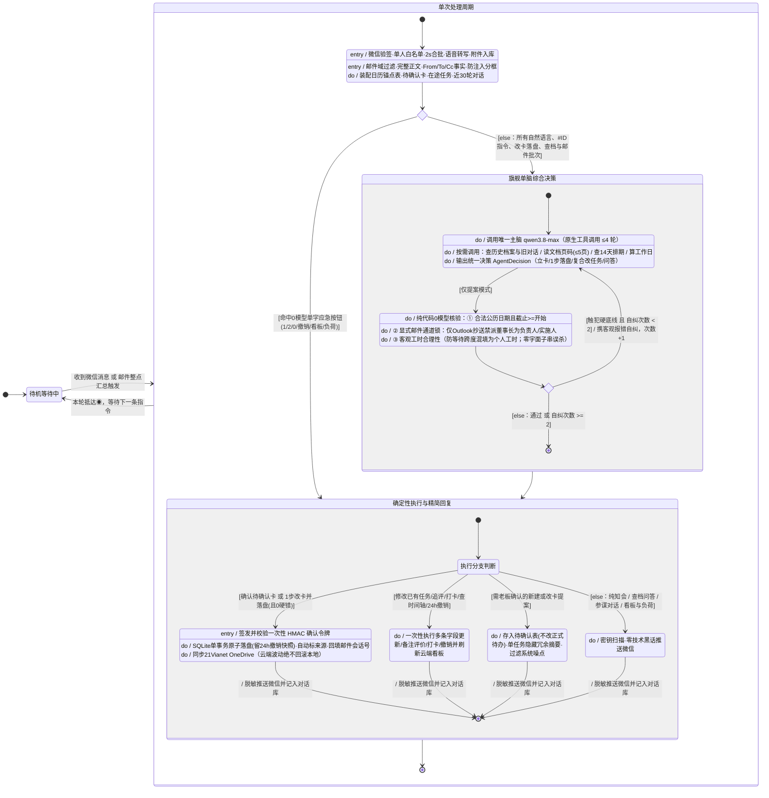

# 04｜v3.0 单脑旗舰智能体工作流、安全底盘与确认机制

| 项 | 内容 |
| :--- | :--- |
| 文档版本 | v5.0（v3.0 单脑旗舰 Agent · Model-First 方案 A · OMG UML 2.5 状态机标准版） |
| 更新日期 | 2026-11-25 |
| 全景图纸 | [04-AI分拣工作流全景图_A0.drawio](04-AI分拣工作流全景图_A0.drawio) · [04-AI分拣工作流全景图_A0.png](04-AI分拣工作流全景图_A0.png)（严格遵循 OMG UML 2.5 状态机图标准，由 `scripts/gen_workflow_drawio.py` 确定性生成） |
| 架构决策源 | [debug_records/03-v3.0大模型优先架构重构方案.md](../debug_records/03-v3.0大模型优先架构重构方案.md)（董事长拍板方案 A） |
| 关联文档 | [总览 README](../README.md) · [01-需求定义与日常场景](01-需求定义与日常场景.md) · [02-技术栈与存储架构设计](02-技术栈与存储架构设计.md) · [09-路由器意图规范与异常处理机制](09-路由器意图规范与异常处理机制.md) · [10-代码阅读顺序与流程图对照审核指南](10-代码阅读顺序与流程图对照审核指南.md) |

---

## 零、 一句话看懂 v3.0 架构为什么比旧版更快、更聪明、更稳

- **旧版 v2.0 的教训**：一条消息要经过“小模型路由 → 20 条死正则 → 查证 → 主推模型 → 第二个异构审计模型 → 打回重写”，既慢（25～40 秒），又容易在传话中丢失您最新补充的修改意见（例如“暂定本周五，之后确认落盘”被二审当成造假抹掉）。
- **v3.0（方案 A）的核心变革**：**“动脑子的事 100% 交给 1 个旗舰大脑（`qwen3.8-max`）一口气办完，代码只守 4 块硬安全底盘”**：
  1. **只保留 3 个极简核心状态节点**：① 上下文装配与事实供给 → ② 旗舰单脑推理（含原生工具调用与 3 条客观硬护栏） → ③ 确定性执行与精简排版；
  2. **0 次小模型路由、0 次二审大模型**：日常响应时间从 25～40 秒压降到 **5～8 秒**；
  3. **把客观事实直接贴在大脑桌上**：开工前先由 Python 生成精确的《本周/下周日历锚点表》（昨天、今天周几、明天、本周一~日、下周一~日），连同完整待确认卡、在途任务清单与最近对话一次性喂齐，绝不考大模型心算星期几；
  4. **原生支持任意自然中文与一句话办多件事**：您直接说“目标截止时间暂定本周五，之后可以确认落盘了”，大模型一步完成“补全周五日期 + 确认落盘”，无需反复回 `1`。

---

## 一、 OMG UML 2.5 状态机全景图（极简 3 节点主干 + 并发伴随区）

---

## 二、 4 块极简确定性安全底盘 vs. 旗舰大脑职责边界

| 层级 | 执行性质 | 负责什么 | 严禁越权做什么 |
| :--- | :--- | :--- | :--- |
| **底盘 1｜安全与接入隔离** | 纯代码（+ 语音 ASR） | 企微 AES 验签与单人白名单、2 秒逐条合批、香港 Outlook 物理只读与域过滤、`[SYSTEM_TRUSTED_MAIL_META]` 与 `[UNTRUSTED_EXTERNAL_DATA]` 物理分框、`ApprovalToken` 落盘验签、外发零密钥扫描 | 绝不猜用户口语意图，不把外部邮件长正文塞入 `user` 聊天记忆 |
| **底盘 2｜账本、来源与撤销** | 纯代码 | SQLite 单事务原子落盘、24 小时 `undo_snapshots` 一键撤销、幂等 `task_timeline`、120 位微软 `conversationId` 自动回填、强制打标 `source_channel`（`wechat`/`outlook`/`web`）、OneDrive 5 份 `.md` 看板异步同步（云端 503 不回滚本地） | 未经董事长授权或未过客观护栏绝不写入正式任务库 |
| **底盘 3｜客观事实供给与 3 条纯客观硬护栏** | 纯代码 | 每轮注入显式 `Asia/Shanghai` 时区的《本周/下周日历锚点表》、完整待确认卡与在途任务快照；`objective_proposal_guard` 仅校验 3 条绝对客观硬底线（非法/倒挂日期、显式通道锁定的 Outlook 仅抄送禁派老板、外部等待跨度混填为超大工时）；大模型 503 断网时仅提供单字 0 模型应急按钮（`1`/`2`/`0`/`撤销`/`看板`/`负荷`） | **绝不写自然语言/口语正则**；**绝不误杀**“昨天/本周五”相对日期、合法汇总/换算数字与微信交办 |
| **底盘 4｜极简排版器** | 纯代码 | 按统一模板渲染决策卡：单任务微信卡自动隐藏重复长摘要、过滤无意义系统出处、严格输出干净自然中文 | 绝不把内部自纠过程或英文字段名（如 `planned_end_at`、`cc_observer`）印给老板 |
| **唯一大脑｜旗舰模型（`qwen3.8-max`）** | 旗舰大模型（Native Tool Calling） | 读懂任意自然中文与邮件往来；按需调用 4 个只读工具（`search_archive` / `read_doc_pages` / `check_workload_and_schedule` / `calc_business_date`）；一次性决定立卡、1 步改卡落盘、复合改已有任务、闭卷查档问答或参谋对话 | 绝不代发外部邮件/微信、绝不编造文档页码、绝不越界代干具体业务活（纯 PMO 定位） |

---

## 三、 旗舰大脑原生工具箱（全部只读且有界，最多 4 轮调用）

在 `flagship_brain` 节点内，`qwen3.8-max` 可按需自主调用以下 4 个纯确定性只读工具（写库/改任务动作统一收口在 `AgentDecision` 中交由 `action_executor` 受控执行）：

| 工具名 | 用途 | 安全与耗时约束 |
| :--- | :--- | :--- |
| `search_archive` | 检索本地历史 PDF/Word/Excel 附件与跨天旧对话（FTS5 trigram） | 100% 只读，返回精简片段与出处 |
| `read_doc_pages` | 按 `source_id` 与页码范围精确读取原件指定页 | 100% 只读，分页与字数硬上限 |
| `check_workload_and_schedule` | 查询未来 14 天每日已排期事项数量与拥挤日期（≥5 项标拥挤） | 纯 SQLite 统计，不猜工时 |
| `calc_business_date` | 基于起始日期精确推算 N 个工作日后的公历日期 | 纯 Python 日历计算，零幻觉 |

---

## 四、 典型高频交互方式（自然说话就行，也能一键应急）

| 您在微信里怎么说 | v3.0 实际怎么处理 |
| :--- | :--- |
| 「杨丽丽在联系五彩湾电厂提供 DCS 文件，昨天开始联系的，还不知道什么时候回复」 | 旗舰大脑查日历锚点表算出昨天日期、正确设负责人=董事长/实施人=杨丽丽；未指定截止时间时自动默认设为**任务建立后 3 个工作日**（自动跳过周末），不再弹出「缺少目标截止时间」提醒，5~8 秒出精简确认卡 |
| 「目标截止时间可以暂定本周五，之后可以确认落盘了」 | 旗舰大脑查日历锚点表算出本周五精确日期，输出 `mode="propose" + confirm_and_commit=True`，经客观护栏与 `ApprovalToken` 验签后 **1 步直接落盘** |
| 「把 #1 截止改到下周三，给 #2 加个评价：推进偏慢，#3 已经完成了」 | 旗舰大脑输出 `mode="direct_ops"`，一次性把字段修改、CEO 评价与完工打卡全部执行完毕并刷新云端看板 |
| 「关于前放原理图那个任务，我刚想到要核对 4P 端子封装，帮我记条备注」/「看一下 #1 的所有备注和日志」 | 旗舰大脑自动从在途任务快照匹配目标 `task_id`，直接走 `direct_ops.note_appends(kind="comment")` 按 `YYYY-MM-DD HH:MM` 逐条追加（不建重复卡，也不覆盖旧备注），并可在微信用 `view_timeline_ids` 或在 Dashboard 右侧抽屉随时完整回查 |
| 「确认 #2 和 #3」/「作废 #2」/「把确认卡 #2 的截止日改成周五」 | **方案 A 多确认卡并行队列**：通过 `target_proposal_ids` 批量/定点确认或作废，通过 `replace_proposal_id` 仅修订指定旧卡而不影响队列中的其它卡片；单发 `1` / `0` 仍默认处理最新一张并附带剩余队列提示 |
| 「`1` / `2` / `0` / `撤销` / `看板` / `负荷`」 | 命中 0 模型单字离线应急按钮，**<0.2 秒直通执行**，即使百炼 API 断网也 100% 可用 |
| 「`#1 还没做完，#2 等明天再开始`」「`#1 截止改到本周五`」「`评价 #1：...`」「`查 #1 沟通记录`」 | **全部交旗舰大脑自然理解**（0 条死正则截胡）：准确识别否定句不误改库、查日历锚点算准相对日期、按字段精准隔离 CEO 评价/补充备注/进展时间轴 |

---

## 五、 独立并发伴随机制与任务日志双入口实现（UML 2.5 正交区域 B）

与主对话完全隔离并发运行，互不阻塞：
1. **长耗时进度心跳（`run_turn_with_heartbeat`）**：任一轮处理超过 12 秒首次播报当前节点（`1/3 正在装配上下文` / `2/3 正在由旗舰大脑思考并规划方案` / `3/3 正在执行操作并整理回复`），此后每 25 秒一次，结束即刻销毁；v3.0 常规 5～8 秒直出，极少触发心跳打扰。
2. **工作日早晚简报（`08:30` / `18:00`）**：每 30 秒看表，周一至周五准点推送在途进度（附 `[微信]`/`[邮件]`/`[驾驶舱]` 来源标签）、临期提醒与 18:00 进度盘点。
3. **工作日整点邮件汇总（`08:30` 补夜间周末 + `09:00–21:00` 每小时）**：
   - 仅读取 `config/mail_domains.json` 白名单内往来邮件，抽取完整正文与 `From/To/Cc` 角色事实，严格按 [邮件汇总模板.md](../report_templates/邮件汇总模板.md) 逐封渲染 **6 要素**（标题/时间、精简发件人、主送、抄送、主要内容、建议处理），老会话自动绑定已有任务卡并追加时间轴，新事合批生成独立任务卡（全部强制打标 `source_channel="outlook"`，邮件批次 `max_tokens=3072` 且免冗余工具往返）。
   - **方案 A 多确认卡并行队列**：即使较早的待确认卡尚未回复，也不再阻塞本班立卡或每小时重复推送；新确认卡与旧卡并行保存在 `pending_proposals` 中，收件水位正常前移防重复刷屏，并在新卡底部附 1 行待处理队列提示（若遇百炼 503，则自动降级为确定性 6 要素推送并暂留未读，待下一班补卡）。
   - **微信插件整封原子分页与防丢包（`WeComGateway.send_app_push`）**：严格按单段 `≤1100` 字节且 `≤650` 字符、优先在 `\n\n` **整封邮件边界原子切分**（绝不把同一封邮件拦腰拆成两段），多页自动加 `【i/N】` 页码并以 `0.6s` 间隔推送，彻底消除企微→个人微信插件静默丢包。
4. **每任务逐条日志（双入口互通，数据单一真理源）**：
   - **存储层（`storage/db.py`）**：`list_items.comments`（补充备注/日志）与 `list_items.ceo_evaluation`（CEO 评价）每条均以 `{"date": "YYYY-MM-DD", "timestamp": "YYYY-MM-DD HH:MM", "content": "..."}` 列表追加保存，与 `task_timeline`（往来沟通与阶段进展）共同挂载在对应任务下，永不互相覆盖；
   - **Web 驾驶舱入口（`web/static/index.html` + `POST /api/items/{id}/note`）**：主表格每行任务标题旁与 Schedule Load 视图提供 `💬 日志` 气泡入口（带总条数角标），点击从右侧滑出 **Task Updates Drawer**，支持按「全部 / 备注日志 / 进展往来 / CEO 评价」筛选时间轴，并在顶部快捷输入框按 `Cmd+Enter` 一键追加留档，同时可展开编辑交付成果、实施人、外部协作、阶段与卡点；
   - **微信对话入口（`graph.py` + `system_prompts.py`）**：在 `AI工作助理` 直接发自然中文（带 `#编号` 或只说任务/项目关键词）即可通过 `direct_ops.note_appends` 实时追加备注/进展/评价，或通过 `view_timeline_ids` 一次性回查全部备注、往来与评价，两端数据秒级同步并触发云端 OneDrive 看板刷新。
5. **新任务默认截止时间底盘规则（建立后 3 个工作日）**：
   - `build_calendar_anchor_text`、`FLAGSHIP_BRAIN_PROMPT`、`graph.py` 确定性底盘与 `web/app.py` 驾驶舱建单接口四处对齐：凡未指定截止时间的新任务，统一由 `calc_business_date(base_date, 3)` 自动设为建立日（或未来启动日）后第 3 个工作日（跳过周末），同时清除 `missing_required_fields` 中的 `planned_end_at`，彻底消除无意义的缺失提醒。
6. **每满 8 轮后台滚动摘要**：先同步写关键词兜底摘要，再由守护线程调 `qwen3.8-flash` 升级 ≤600 字中文语义摘要，不阻塞前台回复。
