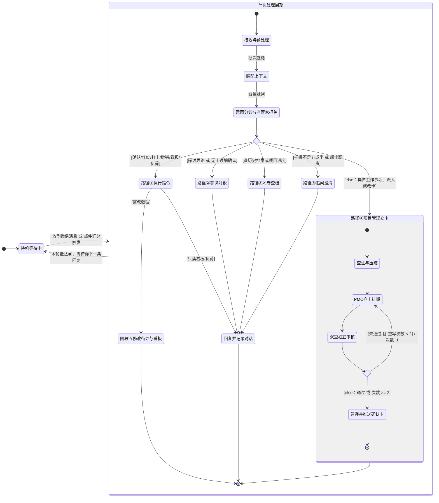

# 04｜智能体工作流、运行方式、硬编码与大模型边界及上下文装配机制

| 项 | 内容 |
| :--- | :--- |
| 文档版本 | v4.0（OMG UML 2.5 状态机标准 · 纯 PMO 纳管与大白话解读版） |
| 更新日期 | 2026-11-25 |
| 全景图纸 | [04-AI分拣工作流全景图_A0.drawio](04-AI分拣工作流全景图_A0.drawio)（严格遵循 OMG UML 2.5 状态机图标准，另有同名 PNG / PDF；由 scripts/gen_workflow_drawio.py 生成） |
| 模式规范源 | [agentic_design_patterns](../../agentic_design_patterns/全书摘要分册/README.md)（Antonio Gulli 全书 21 模式体系） |
| 关联文档 | [总览 README](../README.md) · [01-需求定义与日常场景](01-需求定义与日常场景.md) · [02-技术栈与存储架构设计](02-技术栈与存储架构设计.md) · [05-阿里云部署与分阶段实施路线](05-阿里云部署与分阶段实施路线.md) · [09-路由器意图规范与异常处理机制](09-路由器意图规范与异常处理机制.md) · [10-代码阅读顺序与流程图对照审核指南](10-代码阅读顺序与流程图对照审核指南.md) |

---

## 零、 运行方式：单次处理、跨消息大循环与事件触发

一句话概括：处理一条消息是从开始到结束的单向过程，处理完就结束；整个助理则一直在线，由一条条消息和几个定时器触发，前后多次处理靠数据库串成一个连续的大循环。

### 0.1 单次处理：单向走完，中间只有一个有上限的小回环

- 你发来一条消息（或到点触发一次任务），系统就从阶段一走到某条路径的终点：回复你、发出确认卡，或者执行落盘。走完这次处理就结束了，不会在后台继续转、继续想。
- 单次处理中只有一个回环：路径④（工作交办）里审核不通过会退回重写，最多 2 次，然后一定往下走。这是有上限的小回环，不是无限循环。

### 0.2 跨消息大循环：靠数据库接起来，每转一圈都要等你的下一句话

每次处理虽然结束了，但结果都存进了数据库：对话记录、待确认卡、待办、滚动摘要。下一条消息进来时，阶段二会把这些读出来，所以多次处理看起来是连续的。典型的两个循环：

- 确认卡循环：你发一件事 → 生成确认卡发给你（本次结束） → 你回「1」（新的一次处理） → 执行落盘（结束）。
- 每日盘点循环：18:00 推送盘点清单（本次结束） → 你回「#3 做完了」（新的一次处理） → 更新状态、算出完成跨度（结束）。

这个循环不是系统自己在转，每一圈都由你的下一条消息推动。

### 0.3 整体是等事件触发，不是一直轮询

服务本身 7×24 小时运行，但大部分时间在等，有事才处理。触发来源有三类，只有后两类算轮询：

| 触发方式 | 来源 | 是否轮询 |
| :--- | :--- | :--- |
| 微信推送 | 你发消息，腾讯服务器主动通知 | 否，来一条处理一条 |
| 定时拉取 | 工作日 08:30 补夜间与周末，09:00–21:00 每小时查一次域名名单内的邮件；夜间和周末不查 | 是 |
| 定时器 | 每 30 秒看一次时钟，到 08:30 / 18:00 就发简报 | 是 |

另外有两个附带的定时动作，只在处理过程中出现：某次处理超过 12 秒时，每 25 秒推一次进度心跳；每满 8 轮对话，在后台刷新一次滚动摘要。

### 0.4 打个比方

它像一位坐在办公桌前的秘书：每来一份文件就从头办到尾，办完归档，不会对着空桌子空转；桌上有本记事本（数据库），下一件事来了先翻记事本回忆前因后果；工作日 08:30 把夜里的信一次看完，之后每个整点到 21:00 再看一次，夜间和周末不看信箱；早 08:30、晚 18:00 主动来问你进度；需要你拍板的事，递上去就等你签字，签了才去办。

### 0.5 五条路径各写了什么：都记录对话，只有改待办和看板必须经过阶段五

五条路径处理完都会写数据库，但写的内容不同。所有路径都会把这次对话记下来（这正是下次处理时上下文能接上的原因）；只有“改待办、项目和看板”这一种写入，必须经过阶段五。

| 路径 | 处理完会写入什么 | 是否改待办和看板 |
| :--- | :--- | :--- |
| ① 直接执行 | 待办状态、项目、24 小时撤销快照、5 份看板，外加本次对话记录 | 是，直接进入阶段五 |
| ② 参谋回复 | 本次对话记录（每满 8 轮刷新一次滚动摘要） | 否 |
| ③ 查档问答 | 本次对话记录 | 否，只查不改 |
| ⑤ 请你澄清 | 本次对话记录 | 否 |
| ④ 工作交办 | 消息原文和附件文字（入检索库）、原件备份到 OneDrive 收件箱、待确认卡、本次对话记录 | 暂时不改；你确认后经路径①进入阶段五 |

为什么只有改待办和看板必须走阶段五：

1. ②③⑤ 本来就没有要改的东西：聊天、查资料、请你澄清，都不产生新的待办或进度变化，看板上没有需要更新的内容。
2. ④ 也会到阶段五，只是要等你点头：它生成的方案先存成待确认卡，不直接改你的待办；你回「1 / 好的」后，这条新消息走路径①，再进入阶段五落盘。AI 拆出来的方案可能有错，必须经你确认才写进正式清单。
3. 阶段五是唯一能改正式数据的地方：只有带确认令牌的操作才能写待办、项目和看板，所以任何改动都有你的确认，也都能在 24 小时内撤销。（唯一明文豁免：你本人发出的邮件若 `conversationId` 命中已有在途任务卡，系统免确认追加一条 `mail_out` 只读通信时间轴留痕，绝不改任务状态、截止日或责任人。）

准确地说：①直接进入阶段五，④经你确认后间接进入阶段五，②③⑤不需要进入。

### 0.6 在 UML 2.5 状态机全景图上怎么看

全景图严格遵循国际标准的 **OMG UML 2.5 状态机图**（彻底去除了杂乱的流程图符号，让你一眼看清「系统处在什么状态、遇到什么情况、满足什么条件、下一步跳到哪里」）：

- **实心黑圆 `●`（入口）与牛眼双圆 `◉`（本轮终止）**：整个系统平时停留在左侧 **「待机等待中」** 状态；每来一条微信消息或邮件汇总，就进入「单次处理周期」复合状态，走完任意一条路径到达内部的 **`◉`** 后立即结束本轮并回到「待机等待中」，绝不在后台空转。
- **圆角两栏框（状态）**：上面是状态名称，下面是该状态内执行的确定性动作（`entry /` 进入时动作、`do /` 状态内活动、`exit /` 退出时动作）。数据库读写和发微信都清晰写在对应状态框内，不再用乱线穿插。
- **空心小菱形 `◇`（动态分流点）**：每条引出的箭头都用方括号 `[...]` 写明进入条件，并配有一条 `[else]` 兜底分支，保证任何消息都不会悬空卡死。
- **唯一的受控回环**：路径④审核不通过时，由 `[审核未通过 且 重写次数 < 2] / 重写次数+1` 退回重排，一旦达到 2 次即强制走 `[else]` 出卡并附上「⚠️ 审计待人工复核点」交由你裁决。
- **底部虚线隔开的「正交区域 B」**：表示 12s 进度心跳、早晚简报与邮件汇总、满 8 轮后台摘要升级是**独立并发运行的伴随机制**，不阻塞主对话。

---

## 一、 六个阶段的完整链路

全景图按以下六个阶段绘制。阶段一到阶段五是一次处理的路径（其中阶段五只在你确认后才发生），阶段六是独立运行的定时任务。五条路径处理完都会记录本次对话；只有阶段五能改待办、项目和看板（见 0.5 节）。

1. 阶段一｜接收与预处理（硬编码；只有语音转文字调用模型 qwen3-asr-flash）：
   - 个人微信主入口（个人幕僚室 → AI工作助理，/api/wecom/app/callback）：AES-256-CBC 验签解密 → XML 解析 → 0.5 秒内异步返回到达回执 → 2 秒静默合并连续逐条转发（可选发「好了」立即结束等待）→ 拉取语音调用 qwen3-asr-flash 转写原文。
   - 备用客服通道（/api/wecom/kf/callback）：经 owner_external_userid 单人白名单过滤后，调用 sync_msg() 展开原生「合并转发」卡片。
   - 香港/国际版 O365 Outlook 邮件（mail_poller.py）：工作日 08:30 与 09:00–21:00 按水位只读拉取（含 `From/To/Cc` 与原生会话号 `conversationId`）。域名以 config/mail_domains.json 为准（区分 `internal_domains` 内部域名与 `partner_domains` 外部域名）。同一封只处理一次（seen_external_ids），正文包裹 [UNTRUSTED_EXTERNAL_DATA]，并由硬编码先做 `From/To/Cc` 角色推断（董事长仅在抄送栏时标为 `cc_observer`，绝不当负责人或实施人）。老会话自动绑定已有任务卡并追加时间轴，新事合批生成 1 张独立任务卡；发件命中已有会话号时自动归入该卡时间轴并列在同一条微信里。夜间和周末不拉取。
   - 附件入库与兜底机制（extractors.py）：支持 PDF（按页）、Word（.docx）、Excel（.xlsx/.xlsm）、CSV/TSV/纯文本及 .zip 安全递归解压（限 30 文件/50MB、防路径穿越）；无法解析的格式（.dwg、加密文件、扫描件、未知二进制）只记元数据占位，原件 100% 备份至 21Vianet OneDrive 00_原件收件箱/。
   - 预处理之后没有快捷指令岔路。看板、负荷、撤销、开始 / 完成、1 / 2 / 改：和普通对话一样进入阶段二，由阶段三的路由模型判断。模型把整句认错时，代码会把「看板」「1」「开始 3」「撤销」这类整句改回原意，再进入对应路径。确认、打卡、撤销由路径①交给阶段五；看板和负荷只回复，不改待办。
2. 阶段二｜装配上下文（全部硬编码，不调用模型）：
   - 在调用任何大模型之前，按固定顺序读取数据库里已经写好的内容，拼成提示词：跨天滚动摘要与最近 30 轮对话、待确认卡片、在途项目与待办快照（含自动挂载的项目卡）、历史文档与旧对话检索（详见第三节）。滚动摘要是以前生成后存下来的，这一步只读取，不重新生成。
3. 阶段三｜意图分诊与老管家两道把关（像办公室门口「AI 小秘书 + 铁面老管家」配合）：
   - **进入前快速通道**：如果你只发了一句纯问候（如「你好」「在吗」），且桌上既没有历史聊天也没有待确认卡片，直接回一句问候即可，不浪费大模型；如果是修改旧卡片的内部续跑，直接进路径④。
   - **AI 小秘书初步判断（qwen3.8-flash）**：结合阶段二准备好的背景资料，听懂你的日常口语（比如「好的按这个办」「刚才那个审完了」），把「他/这个/刚才那事」补全成完整意思，决定下一步该进五条路径中的哪一条。
   - **老管家第一道把关「防闯祸安全锁」（纯死规矩，专拦小秘书瞎办事）**：
     - **桌上没单子，不准空气签字**：如果现在根本没有任何待确认卡片，你随口发了一句「好的」或「算了」，老管家直接拦住不让它去碰待办库，改成普通聊天（路径②）。
     - **自己都没听懂（把握不到五成半），不准瞎立项**：比如信号不好只发出去半句「老张下周那个」，小秘书心里没底，老管家直接拦下不准建卡，改去路径⑤先礼貌问清楚。
     - **纯项目管理边界**：系统已彻底移除公网搜索与代算业务报价工具，绝不越界替你干具体业务活。
   - **老管家第二道把关「老板专属死暗号」（一字不差，最高优先级，哪怕大模型断网也能保底生效）**：
     - **只看不改的暗号**：整条微信只发 `看板` / `驾驶舱` / `页面`（给你发网页链接），或 `负荷` / `待办` / `今日待办`（给你列近 3 天日程），绝不改数据。
     - **直接改状态的暗号**：整句只发 `撤销`，或指名道姓发 `开始 3` / `完成 3` / `完成 #3 2h`；当桌上有待确认卡片时，整句发 `1` / `确认`（落盘）、`2` / `仅存想法`（只入想法池）、`0` / `取消` / `放弃`（作废）、或以 `改：` 开头（带意见重排）。
     - **为什么日常口语（「好的」「做完了」「改成下周五」）不放进死暗号？** 因为口语一词多义——例如桌上有确认卡时你先问“明天上午空吗？”，回一句“好的”只是说“知道了”，不是要签字落盘；“做完了”也没带编号。这些必须交给 AI 小秘书看前两句聊天才能准确理解，而死暗号则专门留给你想要“100% 指哪打哪”时使用。
4. 阶段四｜五条处理路径：
   - ① 直接执行（action_shortcut，代码）：确认或作废卡片、开始/完成打卡（支持「#1 做完了，#2 开始了」一句话多条）、撤销，交阶段五执行。
   - ② 参谋回复（conversational_responder，qwen3.8-max）：每条消息只调用一次模型、回复一条，不建待办；能和前文接上，靠的是每次装配的上下文。聊几轮由董事长决定，下一条消息被判为其他意图即切换路径。
   - ③ 查档问答（quick_qa_responder，代码检索 + qwen3.8-max）：先查文档（含当轮随消息发送并前置入库的新附件）和旧对话，再只依据查到的内容回答，必须带出处页码，查不到就说查不到。
   - ④ 项目管理立卡与派单排期（work_triage，纯 PMO 纳管路径，绝不代干具体业务活）：查证（代码查历史文档与 14 天排期密度）→ 压缩（代码）→ 立卡排期（qwen3.8-max，拆出所属项目、事项标题、明确责任人 `owner` 为本人或被委派同事/外部对接人、起止验收日，调用排期与工作日推算工具，不估工时、不代做调研或报价计算）→ 审核（代码核对数字 + deepseek-v4-pro 挑错，不通过最多重写 2 次）→ 出确认卡：醒目展示责任人与周期（若满 2 轮仍有未消解审计疑点一并在卡上标明），待确认卡存入数据库、记录对话、发卡到微信，本次处理结束，等你回复；你确认后经路径①进入阶段五。
   - ⑤ 请你澄清（clarify_or_unsupported，代码）：说明能力边界或追问一个关键细节，不建待办。
   - 共用收尾：②③⑤回复后汇入「记录本次对话」，把你这句话和回复写入对话记录，供下次装配上下文读取，然后本次结束。
5. 阶段五｜你确认后修改待办与看板（atomic_executor，代码）：
   - 唯一能改正式数据（待办、项目、看板）的地方。入口只有路径①：包括你对确认卡的回复、开始 / 完成打卡和撤销。由你的确认或打卡触发：确认卡落盘前 before_tool_callback() 校验 HMAC 一次性令牌，**以本地 SQLite 单事务原子写入为唯一真值保底生效**（留 24 小时撤销快照），随后将附件归档到 OneDrive 对应项目目录并重绘 5 份 .md 看板（即使 OneDrive 瞬时网络波动也不会回滚本地已落盘待办，并如实提示稍后补刷），回复执行结果。Web 驾驶舱直接读同一个数据库。
6. 阶段六｜每日定时任务（独立运行）：
   - 工作日 08:30 早报、18:00 晚间复盘（附「进行中 / 今日到期 / 已超期」进度盘点，写入对话记录方便你直接回复）。邮件另走汇总：08:30 推出夜间与周末积压，09:00–21:00 这一小时有新邮件才推一条；收件合成一张确认卡，发出的信记在同一条里。每满 8 轮对话在后台刷新滚动摘要。到点生成的消息或本时段的邮件，同样从阶段一进入走一遍。
   - 实时进度心跳（run_turn_with_heartbeat）：任一次处理超过 12 秒时推送当前步骤，此后每 25 秒一次，直到出结果。

---

## 二、 逐节点解析：硬编码确定性机制 vs. 大语言模型调用

为了做到“算术、权限、安全与状态绝对可靠，理解、归纳与反思充分发挥模型智能”，系统严格划分了硬编码与 LLM 的职责边界：

| 流程节点 | 执行性质（硬编码 vs LLM） | 具体实现与模型/Prompt | 为什么这样设计（解决什么问题） |
| :--- | :--- | :--- | :--- |
| 1. 接入解码、2s 聚合与语音转写 | 硬编码 + 专用 ASR | wecom_gateway.py + qwen3-asr-flash | 保证 AES 加解密、单人白名单、多条合并与 <0.5s 回执确定性不丢消息。 |
| 2. 邮件域名名单与防注入隔离 | 纯硬编码 | config/mail_domains.json + mail_poller.py | 只处理名单内域名的往来邮件，改名单不用改代码；用 [UNTRUSTED_EXTERNAL_DATA] 防止恶意邮件劫持大模型指令。 |
| 3. 路由之后的执行 | 先经路由模型，整句说错时由代码改回 | graph.py（guardrail_router → 路径①或直接回复） | 不再在阶段一抄近路。看板、负荷、确认、打卡、撤销都先装配上下文再识别；真正改待办的仍是代码。 |
| 4. 上下文装配引擎 | 纯硬编码 | context_assembler.py（ContextAssembler） | 用数据库真值与精确时间差标记拼装上下文，杜绝大模型靠模糊记忆猜测状态。 |
| 5. guardrail_router（分诊路由） | LLM #1 + 硬编码后置护栏 | 模型：qwen3.8-flash（FAST_ROUTER_PROMPT → IntentRoute）+ 刹车与整句词表 | LLM 负责理解口语意图、补全代词与提取检索词；硬编码强制兜底无卡片防误操作，并在路由模型故障时保底放行固定口令。 |
| 6. action_shortcut（卡片确认与批量打卡） | 纯硬编码（0 次 LLM） | graph.py _node_action_shortcut() | 多条进度刷新（如「#1 做完了，#2 开始了」）、开始/完成状态切换与跨度计算必须确定性落库。 |
| 7. conversational_responder（跨轮参谋对话） | LLM #2（每条消息单次调用） | 模型：qwen3.8-max（CONVERSATIONAL_ADVISOR_PROMPT → ConversationalReply） | 每条消息回复一次、不自主多轮；借助装配的上下文接续前文，在已有工作区事实与待确认卡约束下提供参谋探讨。轮数由董事长决定，下一条消息被判为其他意图即切换分支。 |
| 8. quick_qa_responder（闭卷档案问答） | 硬编码检索 + LLM #3 | retrieve_long_horizon_evidence() + qwen3.8-max（QA_GROUNDED_PROMPT → GroundedAnswer） | 硬编码保证精准捞回 FTS5 文档页（含本轮前置入库的新附件）与跨天旧对话；LLM 只基于捞回的证据带页码总结，防编造。 |
| 9. react_investigator（前置查证） | 纯硬编码工具链 | hybrid_search + check_workload_and_schedule | 检索历史档案与未来 14 天每日排期拥挤度，不越界代算业务报价或外网搜索。 |
| 10. context_compactor（证据压缩） | 纯硬编码 | graph.py _node_context_compactor() | 适配 128K 大模型容量，将检索输出规范化为 EvidenceCard[]（文档 <=1000字/条，对话 <=600字/条，附件 <=6000字，最多 12 张）。 |
| 11. producer_drafter（PMO 立卡与排期） | LLM #4 + 排期工具 | 模型：qwen3.8-max（PRODUCER_TRIAGE_PROMPT → TriageProposal）+ check_workload_and_schedule / calc_business_date | 纯项目管理视角：将具体工作拆解为“归属项目、做什么、责任人 `owner`（本人亲办 vs 委派他人/等待外部）、起止日历周期”，不代做业务内容，estimated_hours 默认 0.0。 |
| 12. heterogeneous_critic（双重审计） | 硬编码核验 + LLM #5 | deterministic_critic_check() + deepseek-v4-pro（CRITIC_AUDIT_PROMPT → CriticVerdict） | 硬编码核验数字 100% 保真；异构模型打破同源盲区，抓出漏拆待办、想法混入紧急待办等问题（最多反思 2 轮）。 |
| 13. hitl_preview_gate & atomic_executor | 纯硬编码 | format_decision_card() + before_tool_callback() + apply_proposal_atomic() + OneDrive 同步 | 强制人类确认卡挂起与 HMAC 令牌校验，无令牌物理拒绝写库与写网盘。 |

---

## 三、 上下文装配机制（ContextAssembler）：来源、拼装方式与核心原则

在长时间、不连续的一问一答（如早上发一条语音、中午追问一句“那个怎么样了”、晚上再改日期）中，大模型本身没有长期记忆。系统通过 context_assembler.py 在每次进入路由前硬编码装配以下 4 层上下文：

### 3.1 四大上下文来源与长度预算

1. Layer 1 — 跨天滚动摘要与近期对话流（SQLite episode_summaries + conversation_turns）：
   - 跨天滚动会话摘要：每积累 8 轮新对话，先同步写入一份关键词与关键交办的抽取式摘要（不阻塞回复），再由 qwen3.8-flash 在后台把上一版摘要与新对话合并成语义摘要（进行中项目、已定事项、待跟进人和日期、偏好纠正），失败时保留抽取式摘要，统一存入 episode_summaries 表，每次调用大模型自动置顶注入，解决隔天超出 30 轮原文窗口的记忆断层。
   - 取数范围：按 thread_id='owner' 读取最近 30 轮对话，每轮裁剪为单行 [MM-DD HH:MM] 角色: 内容（<=600 字）。
   - 时间间隔边界标记（CONTINUOUS_GAP_MINUTES = 30 分钟）：
     - 若相邻两轮间隔 > 30 分钟，插入分割线 --- [时间间隔 X · 跨时段对话] ---；
     - 若当前最新输入距上一句 > 30 分钟，在尾部插入 --- [距上一句间隔 X · 请谨慎区分连续追问与全新话题] ---，提醒路由器既能衔接跨天旧话题，又不会把隔了半天的新事误判成上一轮追问。
   - 连续窗口实体锚点：从 <= 60 分钟内的连续对话中提取最多 6 个 topic_tags 作为 anchor_entities。
2. Layer 2 — 待确认提案暂存卡（SQLite pending_proposals，防盲目入库）：
   - 它是什么：当你发消息/文件后，AI 先生成一份提案草案发给你确认；在你回复「1 确认」或「0 取消」之前，这张未正式落盘的卡片暂存在 pending_proposals 表中。
   - 核心作用：让你在微信里不用死记卡片编号，直接自然地说「就按这个办」「把日期改成下周五」「为什么排明天」，AI 能看懂你针对的是哪张尚未落盘的卡片并精准确认、修改或解答追问（且追问不会覆盖掉待确认卡）。
   - 新鲜度判定（FRESH_PENDING_MINUTES = 60 分钟）：<= 60 分钟标为「仍在当前连续讨论窗口内」，> 60 分钟标为「已隔较长时间」，避免过时卡片劫持新对话。
3. Layer 3 — 在途工作区实时真值快照与跨项目自动挂载（SQLite projects + list_items + memory_rules）：
   - 跨项目自动挂载（借鉴 IDE 工作区感知）：当用户输入或近期锚点提及某个项目名或别名时，自动挂载最多 3 张相关项目上下文卡（含板块、起止周期、最新进展与关联待办）。
   - 适配大模型容量：读取最多 30 个在途项目、60 条未完成待办/等待项（含 #ID、优先级、状态、责任人、起止周期）以及 20 条个人规则/跨度基线。
4. Layer 4 — FTS5 全文检索文档与历史对话（retrieve_long_horizon_evidence）：
   - 当进入 quick_qa_responder 或 react_investigator 时触发，按 search_queries → anchor_entities → extract_topic_tags()（含 3–4 字中文滑窗子词）拼装检索词；
   - 双路 FTS5 trigram 召回：SQLite sources_fts 文档按页切片 + conversation_turns_fts 历史对话全文索引（支持短词 LIKE 兜底）。

### 3.2 上下文拼装顺序与四大工程原则

- 路由器标准拼装顺序（render_for_router）：
  【当前时间戳】 → 【跨天滚动会话摘要】 → 【相关项目上下文卡（若命中）】 → 【近期对话流与时间间隔】 → 【当前待确认卡片】 → 【在途项目与待办快照】 → 【用户最新输入】
- 四大核心原则：
  1. 真值优先于记忆：工作区状态、待办编号、起止日期一律从 SQLite 实时装配，不靠对话历史猜现状。
  2. 压缩后喂给主模型：长文档与工具原始输出先经 context_compactor 提炼为 EvidenceCard[] 再喂给 qwen3.8-max，避免上下文膨胀导致指令遗忘。
  3. 闭卷引用约束：所有数字、报价、页码必须能在拼装上下文或确定性工具输出中找到原文出处；查不到时明确回答“未查到”。
  4. 外部不可信数据隔离：邮件正文始终包裹在 [UNTRUSTED_EXTERNAL_DATA] 边界内，绝不与系统提示词或内部规则混淆。

---

## 四、 四大受控幕僚工具箱与反思契约

### 4.1 受控工具箱分组
| 工具箱分组 | 工具名称 | 底层实现与能力 | 安全边界（Ch.18 护栏） |
| :--- | :--- | :--- | :--- |
| 1. 全景记忆与文档深潜 | hybrid_search / read_doc_pages / trace_timeline | FTS5 trigram 混合召回、按页切片精确读取、项目时间线追溯 | 100% 只读，分页与字数上限受控 |
| 2. 排期密度与工作日推算沙箱 | check_workload_and_schedule / calc_business_date | 查询未来 14 天每日排期事项数量、P0 数量与是否拥挤（每日 5 项及以上视为拥挤），返回推荐不拥挤起始日（不估工时）；Python 确定性推算工作日 | 纯确定性 Python 函数，无 eval / 无 Shell / 无外网调用 |
| 3. 清单与世纪互联 OneDrive 执行 | apply_proposal_atomic / upload_and_cleanup_local / sync_all_lists | 单事务原子写入 SQLite 并留存 24h undo_snapshot_json；分片上传至 21Vianet 私有库并重绘 5 份 .md 看板（网盘异常不回滚本地真值） | before_tool_callback HMAC 令牌门禁；限死 MS_SITE_ID 单库 |

### 4.2 异构反思契约与审计底线（qwen3.8-max × deepseek-v4-pro）
1. 数字 100% 保真：TriageProposal 中的金额、型号、日期、页码必须存在于原文或工具输出中，由 deterministic_critic_check() 与 deepseek-v4-pro 双重把关。
2. 周期跨度优先，不猜工时：actions 默认 estimated_hours=0.0，专注规划 planned_start_at ～ planned_end_at 日历起止周期；仅在用户明确指定小时数时记录。
3. 想法与行动隔离：纯粹脑暴放入 idea（03_想法与孵化池.md），不污染今日 P0/P1 行动待办；交办的调研/推进事项只拆解会议、干系人、待查资料与期限。
4. 有界反思上限：Critic 驳回后携带 fix_instructions 回退 producer_drafter 重写，最多循环 2 轮，防止死循环。

---

## 五、 确认、打卡与 18:00 主动盘点闭环

这些话不再在阶段一截走。它们和普通消息一样先装配上下文、再由路由模型判断，然后才执行。

| 发给「AI工作助理」的消息 | 系统动作（全链路表现） |
| :--- | :--- |
| 1 / 好的 / 确认 | 经阶段三认定后，路径①签发 HMAC 令牌，原子落盘 SQLite、上传附件并重绘 21Vianet OneDrive 5 份 .md 看板 |
| 2 | 经阶段三认定后，仅归档文档或存为想法，不建行动待办 |
| 0 / 放弃 / 取消 | 作废当前待确认卡，原件保留在 00_原件收件箱/ |
| 改：<意见> | 携带你的约束进入路径④重算排期或项目归属，生成新版决策卡 |
| 开始 <编号> | 经阶段三认定后，路径①记录 actual_start_at 并切换为进行中，刷新云端看板 |
| 完成 <编号> [耗时h] | 经阶段三认定后，路径①记录 actual_end_at，自动计算 actual_span_days（实际完成跨度天数）并沉淀 span_baseline |
| 批量回复（如 #1 做完了，#2 开始了） | 响应每日 18:00 主动盘点，一句话批量闭合多条事项周期与状态 |
| 撤销 | 经阶段三认定后，路径①在 24 小时内利用 undo_snapshot_json 完整回滚最后一次落盘 |
| 看板 / 负荷 | 经阶段三认定后直接回复驾驶舱链接，或近 3 日日程分布与 Top 待办；不改待办 |
| `评价 #ID：<内容>` | 零模型调用快捷口令：按日期追加董事长主观评价至该任务卡 `7）CEO 评价`（严格私密） |
| `备注 #ID：<内容>` | 零模型调用快捷口令：按日期追加客观技术约束或背景至该任务卡 `6）补充备注（Comments）` |
| `#ID 进展：<内容>` | 零模型调用快捷口令：按时间戳追加进展记录至该任务卡 `2）当前进度与往来沟通` 时间轴 |
| `查 #ID 沟通记录` | 零模型调用快捷口令：拉取该任务卡完整微信与往来邮件时间轴 |

---

## 六、 实时节点阶段汇报与定期心跳保活机制

为了在处理长语音、大附件或多轮反思推理时让你随时知道助理正在做什么、而不是处于假死状态，工作流在 graph.py 与 app.py 中内置了以下三层进度反馈机制：

1. 立即到达回执（<0.5s）：收到微信消息、语音或附件后，接入层第一时间回复“已收到，正在分析处理…”。
2. 各节点实时上报当前阶段（progress_callback）：
   - 1/5 正在装配上下文并识别意图
   - 2/5 正在提取附件文本并检索历史档案与排期（或问答分支：2/2 正在检索历史档案与对话记录并核对页码）
   - 3/5 正在由主推模型起草方案与排期（第 N 轮）
   - 4/5 正在由独立审计模型核验数字与逻辑
3. 智能心跳汇报（run_turn_with_heartbeat，不刷屏、不断联）：
   - 快任务零打扰：如果 12 秒内就完成并返回最终决策卡或回答，直接结束心跳监听，不发多余中间消息；
   - 慢任务定期播报：一旦运行超过 12 秒，立即向个人微信推送一条「仍在处理中（已用时 12s）：当前正在【3/5 正在由主推模型起草方案与排期（第 1 轮）】」，此后只要仍在运行，每 25 秒自动汇报一次当前耗时与所在节点阶段，直到最终结果返回为止。

---

## 七、 Harness Engineering、Loop Engineering 与 ReAct 在本系统中的真实落地情况

1. Harness Engineering（智能体工程外壳与护栏脚手架 — 完整落地）：
   - 接入与防注入外壳：企业微信单人白名单、国际版 O365 公司白名单与 [UNTRUSTED_EXTERNAL_DATA] 隔离包裹。
   - 上下文脚手架：ContextAssembler 4 层装配（滚动摘要 + 30 轮对话 + 待确认卡 + 60 条工作区真值 + FTS5 检索）。
   - 执行门禁与自愈：Pydantic 强类型契约、DashScopeLLMGateway JSON 自愈与主备切换、deterministic_critic_check() 数字保真校验、before_tool_callback() HMAC 令牌门禁、run_turn_with_heartbeat() 实时心跳与 44 条自动化轨迹、回归与审计单测（含索引去重、邮件去重、异常留痕、并发心跳隔离）。
2. Loop Engineering（有界循环工程 — 完整落地）：
   - 异构反思内循环：producer_drafter → heterogeneous_critic（若未通过且 loop_count < 2，携带 fix_instructions 回退重做，严格有界防死循环）。
   - 人机协同与盘点外循环：HITL 确认卡（支持 改：... 重算）、2 秒消息聚合、12s/25s 心跳监控循环与每日 18:00 主动盘点闭环。
3. ReAct（Reasoning + Acting 推理行动交替 — 按节点精确分工）：
   - producer_drafter（qwen3.8-max）启用了原生 Tool-Calling ReAct 循环，可自主调用 check_workload_and_schedule 与 calc_business_date 进行多步排期与工作日推算。
   - 前置查证节点（react_investigator）为了保证 100% 不漏查附件、历史文档与 Excel 报价 Diff 并控制延迟，采用的是确定性硬编码流水线，而非开放式多步自由探索。
