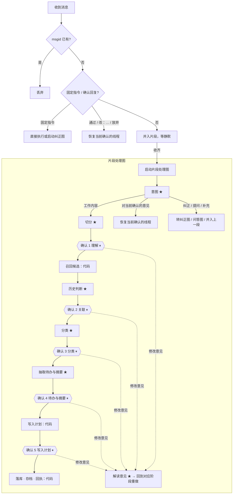

# 工作流总览：用 LangGraph 编排，用 Pydantic AI 做判断

| 项 | 内容 |
| :--- | :--- |
| 文档 | 工作流系列之一 |
| 版本 | 1.4 |
| 日期 | 2026-10-31 |
| 系列 | [04-工作流总览.md](04-工作流总览.md)、[05-片段处理图.md](05-片段处理图.md)、[06-纠正查询与清单.md](06-纠正查询与清单.md)、[07-上下文提示词与核验.md](07-上下文提示词与核验.md)、[08-选型与实施.md](08-选型与实施.md)、[09-对象清单.md](09-对象清单.md)、[10-历史检索与上下文.md](10-历史检索与上下文.md) |
| 依据 | [00-工作流设计系统提示词.md](00-工作流设计系统提示词.md) 0.6、[01-需求说明.md](01-需求说明.md) 0.7、[02-技术路线.md](02-技术路线.md) 0.7 |
| 状态 | 草案，供确认后实施。只做架构设计，不含代码 |

## 修订记录

| 版本 | 日期 | 修订内容 |
| :--- | :--- | :--- |
| 1.4 | 2026-11-01 | 第 6 节指向说明文档 12：LangGraph 与 Pydantic AI 各管一层、怎么配合 |
| 1.3 | 2026-10-31 | 新增 10 历史检索与上下文：每次召回、工具逐层展开、新旧关系五种、上下文上限与压缩；分工表和设计原则相应补充 |
| 1.2 | 2026-10-31 | 新增 09 对象清单：项目、产品对象和文件夹结构清单，数据层负责生成清单视图 |
| 1.1 | 2026-10-31 | 人机交互改为阶段确认：片段处理图分 5 个阶段逐一确认，有意见按意见重做直到通过；原「拿不准时停下问」并入确认 |
| 1.0 | 2026-10-31 | 整套重写。编排改用 LangGraph，模型节点用 Pydantic AI；分析拆成意图、切分、历史判断、分类、抽取五个模型节点；语义判断一律交给模型；拿不准时在流程中途停下问本人；去掉预算与熔断 |

先读这一份。它说明系统分几层、有哪几张图、每张图里哪些是代码哪些是模型，以及为什么这样选框架。主图的逐节点设计在 [05](05-片段处理图.md)，其余几张图在 [06](06-纠正查询与清单.md)，上下文、提示词和核验在 [07](07-上下文提示词与核验.md)，选型细节、数据表和实施步骤在 [08](08-选型与实施.md)。

## 1. 要解决的问题

原方案的分析器是「一段提示词、一次调用、一次 JSON 校验」。它做不好下面这些事，而这些正是本人最在意的：

| # | 做不到的事 | 例子 |
| :--- | :--- | :--- |
| P1 | 判断这件事以前有没有 | 两周前谈过的客户、换了一种说法的同一件事，被当成新的 |
| P2 | 判断一句话是在汇报进展、宣布完成，还是新开一件事 | 「A 项目的方案我发过去了」应该让已有待办变成完成，而不是新建 |
| P3 | 每一步让本人过目，按意见改到满意再往下走 | 原方案一次性出结果直接写库，本人只能事后纠正；「某科技」是不是「某某科技」只能先当新标签存下 |
| P4 | 听懂自然语言的纠正和提问 | 「这是项目交付」「上周和某某谈到哪一步了」只能靠固定指令 |
| P5 | 出错后知道错在哪一步 | 一次调用同时做切分、判断、分类、抽取，分错了说不清是哪一环 |
| P6 | 本人纠正过的事记不住 | 同类内容下次还分错 |

## 2. 分层

```text
┌────────────────────────────────────────────────────────────────────┐
│ 接入层（纯代码，实时）                                                 │
│ 连接器 → 收件库 → 固定指令/确认回复匹配 → 片段器 · 确认队列               │
├────────────────────────────────────────────────────────────────────┤
│ 编排层（LangGraph）                                                  │
│ 片段处理图 · 纠正图 · 问答图 · 规则提议图；每个线程的状态存 SQLite          │
├────────────────────────────────────────────────────────────────────┤
│ 判断层（Pydantic AI，只在图的模型节点里出现）                            │
│ 意图 · 切分 · 历史判断 · 分类 · 抽取 · 对账 · 问答                       │
├────────────────────────────────────────────────────────────────────┤
│ 数据层（纯代码）                                                      │
│ 业务库（片段、条目、待办、标签、项目、产品、规则……）· 存档目录 · 清单 · 检索 │
└────────────────────────────────────────────────────────────────────┘
```

| 层 | 负责 | 不负责 |
| :--- | :--- | :--- |
| 接入层 | 收消息、`msgid` 去重、精确匹配固定指令和确认回复、按静默时间合成片段、确认消息排队发送（一次只发一条）、启动或恢复图 | 理解语义 |
| 编排层 | 步骤顺序、分支、每个阶段结束停下等本人确认、按意见回退重做、每一步之后存状态、崩溃后从断点继续 | 调模型的细节；写业务数据的细节 |
| 判断层 | 一次模型判断：给定上下文，返回类型确定的结果；核验不过就带着错误原因重做 | 决定流程走向；写任何数据 |
| 数据层 | 业务数据的读写、全文检索、存档文件；项目和产品对象的统计字段；每次写入后重新生成项目清单、产品清单、文件夹结构清单和对象页（[09](09-对象清单.md)） | 判断 |

编排层只做流程，判断层只做判断，这条线不能混：模型节点返回判断结果，由图里的下一个代码节点根据结果决定写什么、往哪走。

## 3. 四张图

| 图 | 触发 | 线程编号 | 本人确认几次 | 设计在 |
| :--- | :--- | :--- | :--- | :--- |
| 片段处理图 | 片段收齐 | `seg:<片段编号>` | 5 个阶段：理解、关联、分类、待办与摘要、写入计划 | [05](05-片段处理图.md) |
| 纠正图 | 固定纠正指令，或片段处理图判断出「这是一句纠正」 | `fix:<纠正编号>` | 理解纠正、（拆开 / 合并时）重分析与对账、改动计划 | [06](06-纠正查询与清单.md) 第 1 节 |
| 问答图 | 片段处理图判断出「这是一个提问」 | `ask:<片段编号>` | 不确认：不写数据，有疑问就追问 | [06](06-纠正查询与清单.md) 第 2 节 |
| 规则提议图 | 同类纠正累计 2 次，或本人发「规则：」 | `rule:<提议编号>` | 1 次：规则内容 | [06](06-纠正查询与清单.md) 第 3 节 |

每次确认，本人可以回「通过」、提修改意见、「全部通过」或「放弃」。有意见就按意见重做这一阶段（意见针对更早的阶段就回退到那里），直到通过。机制见 [05](05-片段处理图.md) 第 3 节。

不需要图的：「查 X」「完成 3」「忽略 3」「好了」这类固定指令，以及每日清单。它们没有语义判断、没有分支，由接入层和定时任务直接执行，见 [06](06-纠正查询与清单.md) 第 4、5 节。

为什么本人发来的每段内容都先进片段处理图，而不是在接入层就分出「这是提问」「这是纠正」：这类区分要看意思，按 [00](00-工作流设计系统提示词.md) 第 2 节必须交给模型。接入层只认固定词表；词表以外的一律收齐成片段，由图的第一个节点判断意图再分流。

## 4. 主流程：一段内容从进来到回执



★ 是模型节点，⏸ 是确认点，其余都是代码。

一个片段一般经过 5 次模型调用。不合成一次的原因：

- 后一步依赖前一步的结论。历史判断要先知道切成了哪几件事、每件提到了谁；抽待办要先知道这件事以前有没有、已有哪些待办，才能决定是新建、更新还是标完成。
- 每一步可以单独评测、单独改提示词。分错了能看出是切分错、历史判断错还是分类错。
- 确认点只能放在两步之间。拆开之后，本人能逐步看到「切得对不对」「关联得对不对」「分得对不对」，每一步改好再往下走，后面的步骤建立在本人认可的结果上。

## 5. 代码和模型的分工

按 [00](00-工作流设计系统提示词.md) 第 2 节：答案取决于字面的给代码，取决于意思的给模型；需要两者的，按「代码召回、模型判断、代码核验、代码执行」拆。

| 事情 | 谁做 | 依据 |
| :--- | :--- | :--- |
| `msgid` 去重 | 代码 | 字面 |
| 同一段文字原样又发一遍 | 代码：正文归一化后哈希相同 | 字面。换了说法的重复交给历史判断 |
| 「好了」「完成 3」「查 某某」「拆开」 | 代码：整条消息精确匹配 | 固定词表 |
| 确认时回「通过」「全部通过」「放弃」，或以「改：」开头 | 代码：整条精确匹配，作用于当前这一条确认 | 固定词表 |
| 不带前缀的一句话是对当前确认的意见，还是新内容 | 模型：意图节点 | 意思 |
| 修改意见针对哪个阶段、要求了什么 | 模型解读，能明确成取值的变成约束，由代码核验重做结果 | 解读看意思，约束看字面 |
| 片段何时收齐 | 代码：静默时间 | 字面（时间） |
| 这段话是工作内容、纠正、提问、补充还是闲聊 | 模型：意图节点 | 意思 |
| 切成几件事、各自是哪几条消息、谁是本人备注 | 模型：切分节点 | 意思 |
| 片段里出现的名字在标签表里有没有 | 代码召回（精确、包含、拼音首字母、全文检索），模型判断是不是同一个对象 | 召回看字面，结论看意思 |
| 这件事以前有没有、是不是已有待办的同一件事、是不是在报告完成 | 代码召回候选，模型判断 | 同上 |
| 新内容和旧记录是重复、补充、修订、演进还是矛盾；修订了哪一项 | 代码召回，模型判断并给出双方原文，代码核验原文是子串，本人确认；矛盾由本人裁决 | 意思 |
| 旧值保留、标记取代、挂时间线 | 代码 | 动作 |
| 回答问题要查哪些历史、查多深 | 代码先召回目录，模型用只读工具逐层往下查（[10](10-历史检索与上下文.md)） | 意思 |
| 领域、类型、字段 | 模型：分类节点 | 意思 |
| 待办、决定、摘要 | 模型：抽取节点 | 意思 |
| 输出里的数字原文有没有、引用的编号存不存在、领域代码合不合法 | 代码：核验 | 字面 |
| 写库、写文件、移文件、发回执 | 代码 | 动作 |
| 纠正后新旧待办的对应关系 | 代码按片段召回，模型配对 | 意思 |
| 两次纠正是不是同一类 | 代码：按纠正记录的结构化字段（类型、标签、改前、改后）分组 | 字面（字段已结构化） |
| 把同类纠正写成一句规则 | 模型起草，本人确认 | 意思 |

## 6. 为什么是 LangGraph 加 Pydantic AI

两者管的层次不同，本项目两层都需要。各自的作用、一次处理里它们出现在哪、确认和重做时怎么交接，见 [12-LangGraph与PydanticAI.md](12-LangGraph与PydanticAI.md)。

**LangGraph 管流程。** 片段处理图有五个模型步骤、多处分支，还要在中途停下等本人回复（可能隔几小时），然后在原位继续。LangGraph 原生提供这三样：

- 图：节点和条件边把分支写清楚，比嵌套 `if` 好读、好改；
- 检查点：每个节点执行完自动把状态存进 SQLite，进程崩溃或重启后从断点继续，已经做完的模型调用不重做；
- 中断：每个阶段结束的确认节点调用 `interrupt()`，线程暂停，确认消息交给接入层排队发送；本人回复后用 `Command(resume=...)` 从同一位置继续；有修改意见时沿条件边跳回对应阶段重做。可能隔几小时才回复，状态都在检查点里。

这三样原方案要自己写 Run 表、检查点表、待回答问题表再拼起来，现在交给框架。

**Pydantic AI 管每次判断。** LangGraph 不管单次模型调用的输出对不对。每个模型节点内部用一个 Pydantic AI 的 Agent：

- 输出声明成 Pydantic 类型，框架负责解析和校验；
- 输出核验器发现问题（数字原文没有、编号不在候选里）时抛 `ModelRetry`，错误原因自动发回模型重做；
- 只读工具从 Python 函数签名生成参数结构，查询循环由它完成；
- 通过 OpenAI 兼容接口接百炼。

**不用 LangChain 的 Agent 和模型封装。** LangGraph 依赖 `langchain-core`，但本项目的节点里不使用 LangChain 的模型、提示词或 Agent 类，统一用 Pydantic AI。这样模型调用只有一套写法，结构化输出和重试只有一套机制。

**各自被限制在自己那一层。** 图的代码只调用「判断函数」（输入上下文，返回 Pydantic 对象），不直接接触 Pydantic AI 的类；判断函数不知道自己在哪张图里。以后换掉其中任何一个，只改一层。

## 7. 设计原则（本系列的取舍依据）

完整规则在 [00](00-工作流设计系统提示词.md)，这里列出本系列直接用到的几条：

1. 语义判断交给模型，不用相似度阈值、关键词、长度规则下结论。
2. 模型只返回判断，不写任何数据；写入由判断之后的代码节点执行。
3. 每个阶段经本人确认才往下走；有意见就按意见重做，直到通过。数据写入只在最后一步确认之后发生。
4. 线上系统不自动改代码、提示词和流程。本人纠正改数据，本人确认的规则进规则表。
5. 原件先存再分析。任何一步失败或本人放弃，原件都在，片段进「未归类」。
6. 成本不是设计约束。调用次数上限只用来防止死循环。
7. 每次都用上历史：代码召回目录，模型按需逐层展开；新旧关系写入时定、经本人确认；结论带出处，矛盾不自动裁决（[10](10-历史检索与上下文.md)）。
