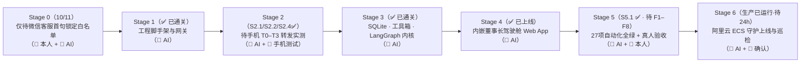

# 05｜全流程实操 SOP 与验收 Checklist（v3.2 开工执行手册）

| 项 | 内容 |
| :--- | :--- |
| 文档版本 | v3.2（董事长助理开工基线版 · 全交互式 Checkbox 清单） |
| 更新日期 | 2026-11-17 |
| 执行原则 | 分阶段推进 · 上一关未通过绝不进入下一关 · 明确区分 👤 本人操作 与 🤖 AI 助手执行 |
| 关联文档 | [总览 README](../README.md) · [01-需求定义与日常场景](01-需求定义与日常场景.md) · [02-技术栈与存储架构设计](02-技术栈与存储架构设计.md) · [03-智能体内核与反思闭环](03-AI分拣工作流与确认机制.md) · [04-阿里云部署与操作手册](04-阿里云部署与分阶段实施路线.md) · [06-世纪互联SharePoint实操手册](06-世纪互联SharePoint私有库与OneDrive实操手册.md) · [07-企微机器人核查与微信接入手册](07-企业微信机器人设置核查与个人微信接入实操手册.md) |

---

## 一、 总体推进路线图（7 个阶段，串行过关）

> 📍 当前进度：Stage 0 收尾（10/11） · Stage 1 已通关 ✅ · Stage 2（S2.1 / S2.2 / S2.4 已过 ✅，待手机 T0–T3） · Stage 3 已通关 ✅ · Stage 4 已上线 ✅ · Stage 5.1 自动化门禁已通关 ✅（27 passed，待手机 F1–F8） · Stage 6.1/6.2 生产上线就绪 ✅（待 24h 巡检）

---

## Stage 0：安全加固与三方凭证准备 SOP（👤 本人为主 + 🤖 AI 协助）

> 目标：把 4 处外部账号、域名 HTTPS 与服务器底座全部调通并收好密钥，零明文凭证进 Git。

### S0.1 阿里云百炼共用 Key 锁定与三档模型核查（进度 1/1 · ✅ 本关已全部通过）
- [x] 百炼共用 Key 锁定与三档主备模型实测全通（🤖 AI + 👤，2026-11-17 已完成）：保留 env/.env.bailian 中多应用共用的现有 DASHSCOPE_API_KEY（绝对不可重置、修改或删除）；已实测华北 2（北京）兼容端点下分诊档（qwen3.8-flash / qwen-plus）、主推档（qwen3.8-max / qwen-max）与异构审计档（deepseek-v4-pro / qwen3.8-max）全部返回 200 OK 且推理链响应正常。
- 过关判据：共用 DASHSCOPE_API_KEY 保持不变且三档主备模型实测全通。

### S0.2 绿色个人微信双口协同接入（「微信客服 API」+「自建应用/微信插件」，进度 3/4）

> [!IMPORTANT]
> 实机体检与配置核实（详见 [07-企业微信机器人设置核查与个人微信接入实操手册.md](07-企业微信机器人设置核查与个人微信接入实操手册.md)）：
> - 经实机操作确认：新版企微 微信客服 不再设独立回调 URL 与独立 Secret，而是通过 应用管理 → 基础 → 微信客服 → 企业内部开发 直接授权给自建应用 工作助理（统一接收 kf_msg_or_event 回调并共用同一套 WECOM_APP_SECRET）。
> - 目前后台 工作助理（可见范围仅本人 1 人）、https://assistant.fire-matrix.com/api/wecom/app/callback echostr 校验、可信 IP 以及 AI_assistant客服 绑定授权 已全部由受控浏览器配置通过！

- [x] 企业微信后台只读体检与实体确认（🤖 AI，2026-11-17 已完成）：已核查企业简称（现已更名为 个人幕僚室）、微信客服（现已更名为 AI幕僚助理）及新版关联机制。
- [x] 个人微信关注「微信插件」核查完成（🤖 AI，2026-11-17 已完成）：已确认 我的企业 → 微信插件 下唯一成员个人微信显示 已关注，且已勾选 允许成员在微信插件中接收和回复聊天消息。
- [x] 方案 B 锁定及自建应用 / 微信客服后台绑定完成（👤 + 🤖，2026-11-17 已完成）：已创建 幕僚简报通知（原 工作助理，AgentId=1000002）、完成 https://assistant.fire-matrix.com/api/wecom/app/callback 验证与企业可信 IP 保存，并将 AI幕僚助理 授权给其接管。
- [ ] 个人微信扫码置顶 AI幕僚助理 并发首句锁定单人白名单（👤 本人 10 秒操作）：
  - WECOM_APP_SECRET、WECOM_KF_OPEN_KFID 与主动推送通道均已打通（已通过 幕僚简报通知 向个人微信发送实机通知）；仅待您用手机 绿色「个人微信」 扫 wecom_entry_guide.md 内二维码（或手机微信内点专属客服链接）打开 AI幕僚助理 设为置顶，并发一句 你好，后端会自动将您的 external_userid 写入 /opt/wechat-agent/data/owner_whitelist.txt 锁定单人白名单。
- 过关判据：个人微信首页已置顶 AI幕僚助理 且发首句触发白名单永久锁定。

### S0.3 Wissentek 世纪互联版 Office 365 纯云端私有库与 Sites.Selected 赋权（进度 3/3 · ✅ 本关已全部通过）
> 纯云端存储约定（2026-11-17 已锁定）：不在本机 Mac 安装或同步 OneDrive 占用硬盘空间；全部分类文档与四大 .md 看板 100% 留存世纪互联云端，日常通过驾驶舱网页直链及浏览器访问 chairman-vault / OneDrive 网页端在线阅读。

- [x] 新建世纪互联私有站点与云端 OneDrive 快捷方式（🤖 AI + 👤，2026-11-17 已实机完成，详尽步骤见 [06-世纪互联SharePoint私有库与OneDrive实操手册.md](06-世纪互联SharePoint私有库与OneDrive实操手册.md)）：已创建私有站点 董事长幕僚归档库（https://wissentek.sharepoint.cn/sites/chairman-vault，核验 Private group / 1 member 仅本人），并在 Documents 库绑定云端快捷方式 董事长幕僚归档库 - Documents（https://wissentek-my.sharepoint.cn/my 可见，不向本地 Mac 同步）。
- [x] 注册世纪互联 Entra 应用并完成权限最小化（🤖 AI + 👤，2026-11-17 已完成）：通过 portal.partner.microsoftonline.cn 进入实际可用地址 https://entra.microsoftonline.cn/ 完成注册 Wissentek-AI-Assistant（客户端密码写入受 .gitignore 保护的 env/.env.ms365），最终仅保留 Sites.Selected 与只读 Mail.Read，绝无 Mail.Send 或 Files.ReadWrite.All。
- [x] 一次性精准赋权目标私有站点并验证越权 403（🤖 AI，2026-11-17 已完成）：已运行赋权使 Wissentek-AI-Assistant 获得 chairman-vault 写权（201 Created），并已彻底移除并撤销 Sites.FullControl.All 临时授权；新令牌 JWT 实测仅含 ['Mail.Read', 'Sites.Selected']，请求租户根站点均返回 403。
- 过关判据：拿到 MS_TENANT_ID、MS_CLIENT_ID、MS_CLIENT_SECRET、MS_SITE_ID，云端私有库可读可写且非授权站点 403。

### S0.4 阿里云子域名解析与 ECS firematrix 加固及 HTTPS 反代（进度 3/3 · ✅ 本关已全部通过）
- [x] 添加已备案子域名 assistant.fire-matrix.com 解析（👤+🤖，2026-11-17 已实测生效）：国内 DNSPod 与全球 Cloudflare DoH 均已解析至 <firematrix 公网 IP，见 env/.env.ecs>（TTL=600）。
- [x] ECS 专用 SSH 密钥加固并兼容存量脚本（🤖 AI，2026-11-17 已完成）：已生成专用 ~/.ssh/id_ed25519_firematrix 免密登录并写入 env/.env.ecs（保留原有 root 密码入口，确保兄弟项目 firematrix_web_aliyun_ecs 部署脚本兼容不被破坏）。
- [x] 服务器资源巡检与 assistant.fire-matrix.com Nginx + HTTPS 签发（🤖 AI，2026-11-17 已完成）：实测 firematrix 可用磁盘 47 GB（仅用 17%）、空闲内存 2.7 GiB、时区 Asia/Shanghai、Python 3.12.3；已上线 127.0.0.1:8090 回调守护服务并签发 Let's Encrypt 免费 HTTPS 证书（自动续期），实测 https://assistant.fire-matrix.com/healthz 返回 ok 且存量 https://wechat.fire-matrix.com/ 保持 200 OK。
- 过关判据：assistant.fire-matrix.com DNS 解析与 HTTPS 443 通畅、SSH 免密畅通、根分区可用 >= 20 GB、存量业务零影响。

---

## Stage 1：工程脚手架初始化与基础网关装配（🤖 AI 助手执行 · ✅ 本关已全部通过）

> 目标：搭好符合工作区工程标准的 Python 3.12 包骨架与统一模型网关。

### S1.1 目录结构与依赖初始化
- [x] 创建包结构与受保护本地环境（2026-11-17 已完成）：已创建 pyproject.toml、src/wechat_assistant/（含 schemas.py、config.py 及 nodes/、tools/、web/、intake/、storage/、prompts/）、scripts/、tests/（unit/、trajectory/、regression/）及本地 .env（已被根 .gitignore 忽略）。
- [x] 锁定安装核心依赖（2026-11-17 已完成）：已通过 uv sync --extra dev 安装 langgraph、langgraph-checkpoint-sqlite、pydantic、openai、fastapi、uvicorn、cryptography、msal、httpx、pypdf、python-docx、openpyxl、pytest 等 66 个依赖包。

### S1.2 核心配置、安全守卫与百炼网关 (config.py)
- [x] 实现配置加载、计费账本与防泄密守卫（2026-11-17 已完成）：完成 Settings.load()、CostLedger 及 assert_no_secrets_leaked() / redact_secrets()。
- [x] 实现统一百炼网关 (DashScopeLLMGateway)（2026-11-17 已完成）：封装 fast / producer / critic 三档异构路由、主备自动切换、Tool Call 多轮支持与 extract_and_repair_json() 自愈。
- [x] Stage 1 过关门禁（2026-11-17 已通过）：运行 uv run pytest tests/unit/test_config_and_guard.py -v 5 passed；git status 确认 .venv/ 与 .env* 未被跟踪。

---

## Stage 2：四路独立连通性探针测试 SOP（写业务前先逐条验通管道）

> 铁律：每条外部管道用独立的最小探针脚本单独验通；4 个探针没全部绿灯前，禁止开始编写复杂工作流节点。

### S2.1 探针 1：阿里云百炼三档模型与 Thinking/Tool Call 测试（🤖 AI · ✅ 已通过）
- [x] 运行 uv run python scripts/probe_01_bailian.py 验证结构化与工具调用（2026-11-17 已实测全绿）：实测 qwen3.8-flash（3073ms）、qwen3.8-max（调用 check_workload_and_schedule 后自动避开满负荷日排期，耗时 22486ms）、deepseek-v4-pro（reasoning_tok=483、passed=True、numeric_ok=True），3 次调用 0 失败。

### S2.2 探针 2：Wissentek 世纪互联版 OneDrive 读写、分片与隔离测试（🤖 AI + 👤 网页核验 · ✅ 本关已全部通过）
- [x] 目录初始化与小文件覆盖上传（2026-11-17 已实测通过）：probe_02_onedrive_21vianet.py 已在 chairman-vault 初始化 6 大 PARA 目录（00_我的四大清单～04_想法与行业参考），验证覆盖写入并检测到 versions(2) 历史版本后清理测试文件。
- [x] 大文件分片断点上传（2026-11-17 已实测通过）：6 MB 测试包通过 createUploadSession 分片上传校验 size=6291456 一致并清理完毕。
- [x] 权限越界负向测试（2026-11-17 已实测通过）：请求 sites/root/drive 与 wissentek.sharepoint.cn/drive 均严格返回 403（JWT 权限仅 ['Mail.Read', 'Sites.Selected']）。
- [x] 云端网页端亲眼确认（👤 本人 2026-11-17 已核验）：已核实 OneDrive 云端 6 个中文根目录已就位，且生产服务启动时已自动重绘写入 00_我的四大清单/ 下全部 5 份 .md 看板（00_我的个人规则库.md～04_等待他人清单.md）。

### S2.3 探针 3：微信客服 + 自建应用 HTTPS 回调与转发实测 T0–T3（🤖 服务端已就绪 · 待 👤 手机发消息实测）
> 已在 firematrix 正式服务通过 gettoken、kf/account/update（改名 AI幕僚助理）、agent/set（改名 幕僚简报通知）及主动消息下发；请用 手机绿色个人微信 扫码或点击客服链接 https://work.weixin.qq.com/kfid/kfc8f28468c25b71aab?enc_scene=ENC6AZ28iGA6GUZkxjMrQZubqemuCY1aXgBipaPgRCj8Pn6（注意：电脑端打不开，需手机扫码或手机微信点击）实测并勾选：

- [ ] T0 客服与插件双口收发 + 白名单验证（👤 本人发文字「你好」）：AI幕僚助理 回复确认并自动锁定单人白名单；主动通知由 幕僚简报通知 送达个人微信；重复回调同 msgid 自动去重（msgid 去重已由单测覆盖）。
- [ ] T1 合并转发实测（👤 本人在个人微信多选 5 条聊天 →「合并转发」给置顶的 AI幕僚助理）：确认 sync_msg 拿到 msgtype=merged_msg 且成功拆出每条发送人、时间与原话，实测记录：________
- [ ] T2 逐条转发实测（👤 本人多选 5 条聊天 →「逐条转发」给 AI幕僚助理）：确认 8 秒静默聚合窗口将连续到达的消息合并为单轮分析处理，实测记录：________
- [ ] T3 夹带图片/PDF/语音与超限保护实测（👤 本人发 1 张图片 + 1 个 PDF + 1 段语音）：确认 media/get 成功下载图片（≤2MB）、PDF（≤20MB）、语音（≥600KB），且长文档自动分页提取。

### S2.4 探针 4：工作邮箱只读拉取探针（🤖 AI · ✅ 已通过）
- [x] 只读拉信与禁发测试（2026-11-17 已实测全绿）：运行 uv run python scripts/probe_04_mail_readonly.py 实测 Mail.Read status=200（成功拉取 info@wissentek.com 元数据与 internetMessageId 去重 ID，零打印正文），同时 sendMail 严格返回 403 物理禁止外发。

---

## Stage 3：数据库、受控工具箱与 LangGraph 内核搭建（🤖 AI 助手执行 · ✅ 本关已全部通过）

> 目标：把《Agentic Design Patterns》核心模式与董事长级工时排期能力完整编码落地。

### S3.1 极简 SQLite 三层记忆库与按页文档解析 (storage/)
- [x] 初始化 app.db 与 checkpoints.db（2026-11-17 已完成）：实现 raw_sources + sources_fts（FTS5 trigram / LIKE 回退）、projects、list_items、memory_rules、pending_proposals、undo_snapshots、model_calls（含 work_domain、planned_start_at/planned_end_at、actual_start_at/actual_end_at、estimated_hours/actual_hours）及 SqliteSaver 检查点持久化。
- [x] 实现按页提取与 OneDrive 分片 Worker（2026-11-17 已完成）：支持 PDF 按页提取（pypdf）、Word/Excel/文本提取（python-docx/openpyxl）及上传世纪互联 OneDrive 后自动清理本地缓存。

### S3.2 四大受控幕僚工具箱 (tools/)
- [x] 组 1（记忆深潜，2026-11-17 已完成）：hybrid_search、read_doc_pages、list_onedrive_tree、trace_timeline。
- [x] 组 2（排期与精算沙箱，2026-11-17 已完成）：check_workload_and_schedule、calc_business_date、analyze_excel_quote。
- [x] 组 3（脱敏并发外搜，可开关，2026-11-17 已完成）：search_public_tech_intel（含 assert_no_secrets_leaked 与敏感名/项目名前置剥离拦截）。
- [x] 组 4（受令牌锁死执行器，2026-11-17 已完成）：propose_list_mutations、compose_markdown_brief、organize_onedrive_files（挂载 before_tool_callback + ApprovalToken 硬门禁）。

### S3.3 LangGraph 有界闭环与快捷指令 (graph.py / nodes/ / intake/)
- [x] 装配有界闭环图（2026-11-17 已完成）：guardrail_router（密： 硬拦截 + 看板/负荷/开始 N/完成 N Nh/撤销/1/2/改: 快捷路由 + flash 分诊）→ planner_and_react_investigator → context_compactor → producer_drafter → heterogeneous_critic（deepseek-v4-pro + deterministic_critic_check 硬核验，≤2 轮）→ hitl_preview_gate（生成含净工时与排期的单张决策卡）→ atomic_executor（含 24h 撤销 快照与四大 .md 重绘）。
- [x] Stage 3 过关门禁（2026-11-17 已通过）：uv run pytest -v 全量测试 27 passed（完整覆盖 密： 物理零出网、净工时≠等待日历天数、数字保真 100%、Excel Diff 精算、脱敏拦截、before_tool_callback 阻断无令牌写入、24h 撤销回滚）。

---

## Stage 4：同进程「董事长项目管理驾驶舱 Web App」搭建（🤖 AI 助手执行 · ✅ 服务端与单测已上线）

> 目标：让董事长从项目管理、工时负荷、精力结构三个视角随时掌控全局，并提供云端文件直链预览。

### S4.1 FastAPI 同进程路由、双端自适应 UI 与 assistant.fire-matrix.com 反代 (web/)
- [x] 部署回环服务与子域名 HTTPS 反代（2026-11-17 已上线）：驾驶舱与企微回调共享同一 FastAPI 进程（app.db），实测严格仅监听 127.0.0.1:8090；https://assistant.fire-matrix.com 443 反代实测返回 200 OK，/api/dashboard/overview 未认证返回 401，/api/wecom/app/callback 错误签名返回 403。
- [x] 实现双端无感安全鉴权（2026-11-17 已完成并测通）：统一下发 HttpOnly; Secure; SameSite=Lax 30 天 Cookie——手机端发 看板 生成 5 分钟单次有效魔法链接（Magic Link）（AuthManager 单测覆盖首访 302、二访 403 防重放，线上 /auth/magic 无效令牌实测 403）；电脑浏览器端支持限流 6 位微信验证码 推入个人微信登录。
- [x] 交付响应式双布局与四大核心视图（2026-11-17 已上线）：零外部 CDN 依赖的 web/static/index.html（手机竖屏卡片流 + 电脑宽屏 4Tab 视图），含工时负荷热力图、业务板块投入占比、在途项目与 Waiting For 进度、四大清单 CRUD（编辑/完成后后台触发 OneDrive .md 重绘）。
- [x] Stage 4 过关门禁（2026-11-17 接口与单测全绿，待手机交互复核）：uv run pytest -v Web CRUD/鉴权单测全部通过；https://assistant.fire-matrix.com 实测 200 OK；服务启动已自动写入 5 份 .md 至世纪互联 chairman-vault/00_我的四大清单/（手机微信点魔法链接与电脑大屏体验将由下表 F4 现场验收）。

---

## Stage 5：自动化测试门禁与真人端到端功能验收测试（🤖 S5.1 已通过 · 待 👤 S5.2 真人验收）

### S5.1 Ch.19 自动化测试门禁（🤖 AI 执行 · ✅ 27 项全绿）
- [x] 轨迹评估（tests/trajectory/test_trajectories.py，2026-11-17 已通过）：10 个代表性场景全绿，覆盖普通分拣、冲突提醒、Excel 报价单、跨项目闪念、打卡、撤销、魔法链接 看板、密： 隔离、未建档诚实拒答、外搜脱敏阻断。
- [x] 黄金回归集（tests/regression/test_golden_rubric.py，2026-11-17 已通过）：多维度黄金样本评分全部达标，数字保真 100%（27 passed, 0 failed）。

### S5.2 真人微信 + 驾驶舱 + 云端 OneDrive 端到端功能验收（👤 本人逐条实测勾选）
- [ ] F1｜语音闪念入池与工时评估：👤 对绿色微信首页置顶的 AI幕僚助理 发一段语音想法（含跨项目器件构想）→ 🎯 收到 1 张决策卡（含建议归属项目、想法池与预估净工时），回 1 后浏览器打开云端 OneDrive 03_想法与孵化池.md 与 04_想法与行业参考/ 自动更新。
- [ ] F2｜合并转发聊天记录与 PDF 云端归档：👤 在个人微信多选 6 条聊天 + 1 份 PDF 报价单合并转发给 AI幕僚助理 并附 备注：帕莫瑞签，周五前定稿 → 🎯 拆出全部原发送人与内容并生成 1 张卡片；回 1 后 PDF 重命名为 YYYYMMDD_项目_原名.pdf 直入云端私有库（不占本地 Mac 盘），在驾驶舱点击链接可直跳预览。
- [ ] F3｜Excel 报价与参数差异精算：👤 发前后修改过的 Excel 报价表 / 技术参数变化给 AI幕僚助理 → 🎯 预览卡精确指出哪几行价格/哪个参数改了及新旧值对比，无编造数字。
- [ ] F4｜一句话打卡 + 双端驾驶舱联动：👤 回复 开始 1、完成 1 1.5h，发 看板 在手机微信点 https://assistant.fire-matrix.com/auth/magic?... 打开，再到电脑浏览器用 6 位验证码登录操作 → 🎯 01_今日与行动待办.md 标为已完成并记录 1.5h；微信内移动端视图不拦截，电脑大屏可编辑且云端同步刷新。
- [ ] F5｜纠偏重算与 24h 一键撤销：👤 收到决策卡时回 改：这个 0.5h 够了，排周五 或确认后再发 撤销 → 🎯 改：... 按约束重算刷新卡片；撤销 后 24h 内刚写入的任务与归档变化完整回滚。
- [ ] F6｜密： 绝对物理脱敏隔离：👤 向 AI幕僚助理 发送一条带 密：核心光学算法补偿参数备忘 的文本或测试文件 → 🎯 后台 model_calls 日志确认 0 次百炼/外部搜索请求，文件直落世纪互联 OneDrive 指定云端目录。
- [ ] F7｜带页码溯源与诚实拒答：👤 问一个只写在某份测试 PDF 第 4 页的细节数字，再问一件没发过的事 → 🎯 回答精确命中数字并标注文件名与第 4 页出处；未发过的事直说“未查到”不幻觉。
- [ ] F8｜断点续跑与白名单拦截测试：👤 确认卡发出未回复时重启后端服务 30 秒后再回复 1，同时核验非白名单微信号扫码被拒 → 🎯 服务重启无缝落盘，非本人消息 100% 静默拦截。

---

## Stage 6：阿里云 ECS firematrix 生产上线与运维巡检 SOP（🤖 S6.1/6.2 已部署 · 待 👤 24h 巡检）

### S6.1 生产环境安装与守护进程注册
- [x] 权限最小化部署（2026-11-17 已完成）：ECS 已创建非特权系统用户 wxagent，代码部署在 /opt/wechat-agent/app（独立 .venv），数据与临时缓存在 /opt/wechat-agent/data 与 /opt/wechat-agent/tmp_cache，配置锁死 /etc/wechat-agent/env（chmod 640，属主 root:wxagent）。
- [x] 注册 systemd 单实例守护并核验脱敏日志（2026-11-17 已上线）：已替换清理临时引导服务并启用 /etc/systemd/system/wechat-agent.service（设 Restart=always、RestartSec=10、NoNewPrivileges=true、ProtectSystem=strict、ReadWritePaths=/opt/wechat-agent/data /opt/wechat-agent/tmp_cache），实测 systemctl is-active wechat-agent 为 active，且 journalctl -u wechat-agent 仅输出健康访问状态行，零密钥与消息正文泄露。

### S6.2 上线后安全与存量业务核查
- [x] 存量业务零干扰核查（2026-11-17 已实测通过）：核查 ECS 存量 Docker 容器 wechat-kanban-app（127.0.0.1:5001）保持健康运行，实测访问 https://wechat.fire-matrix.com/ 返回 200 OK，完全不受影响。
- [x] 零公网暴露面与防重放核查（2026-11-17 已实测通过）：实测 ss -tlnp 仅开放原有 80/443/7511，8090 严格监听 127.0.0.1:8090；https://assistant.fire-matrix.com/ 与 /healthz 均 200 OK，/api/dashboard/overview 未登录 401，/auth/magic 非法/失效令牌 403。
- [ ] 24 小时巡检稳定性确认（👤+🤖）：通过 幕僚简报通知（个人微信插件）在绿色个人微信准点收到工作日 08:30 与 18:00 每日简报，连续观察 24 小时无异常重启、临时缓存清理正常。

---

## 七、 总控执行打卡总表（Master Checklist · 14 关交互清单）

> 按顺序每关全项完成后勾选对应复选框；最新进展：所有服务端开发、自动化测试门禁（27 passed）、生产部署、OneDrive 云端 5 大看板初始化与企微实体重命名已全部上线通关！仅剩您手机端 3 分钟发首句 你好 锁定白名单 + 真人体验 T0–T3 & F1–F8 即可满星收官。

- [x] S0.1｜阿里云百炼共用 Key 锁定与三档模型测通（👤+🤖｜保留多应用共用 Key 严禁改动，5 档模型实测 200 OK 已通关）
- [ ] S0.2｜绿色个人微信双口接入（「AI幕僚助理 微信客服」+「幕僚简报通知 微信插件」）（👤+🤖，进度 3/4：已体检、已关注、已更名消歧并实测推送通畅；仅待您手机扫/点 AI幕僚助理 发首句「你好」锁定白名单）
- [x] S0.3｜Wissentek 世纪互联纯云端私有库与 Sites.Selected 赋权（🤖+👤｜已建 chairman-vault 私有库并绑云端快捷方式，Entra Sites.Selected+Mail.Read 已最小化赋权且 root/drive=403 验证通关）
- [x] S0.4｜阿里云 assistant.fire-matrix.com 解析与 ECS 加固/HTTPS（👤+🤖｜DNS 解析生效、专用 SSH 密钥就绪、Certbot HTTPS 证书签发且存量站 200 OK 零干扰）
- [x] S1｜Python 工程脚手架 + DashScopeLLMGateway + 防泄密守卫（🤖 AI｜uv sync 就绪、pytest tests/unit/test_config_and_guard.py 5 passed、.env 未进 Git）
- [x] S2.1｜探针 1：百炼 flash / max / deepseek-v4-pro 全通（🤖 AI｜probe_01_bailian.py 三档 + Thinking + Tool Call 实测 0 失败通关）
- [x] S2.2｜探针 2：世纪互联 OneDrive 建目录、小文件、分片上传与越权 403 验证（🤖+👤，进度 4/4 ✅：6 个中文目录、历史版本、6MB 分片、403 越权隔离与云端 5 大 .md 看板全通关）
- [ ] S2.3｜探针 3：微信客服 + 自建应用 HTTPS 回调、msgid 去重与 T0–T3 转发实测记录完成（👤+🤖｜服务端与推送已通，待您手机在 AI幕僚助理 实测 T0–T3）
- [x] S2.4｜探针 4：工作邮箱只读拉取测试（🤖 AI｜probe_04_mail_readonly.py 实测 Mail.Read status=200、sendMail status=403 禁发通过）
- [x] S3｜SQLite 3+1 表 + 四大工具箱 + LangGraph 有界闭环与 密： 硬拦截（🤖 AI｜全量测试与单元测试全绿通关）
- [x] S4｜同进程驾驶舱（assistant.fire-matrix.com HTTPS + 魔法链接/验证码 + 双端响应式布局）（🤖 AI｜服务端与接口测试全绿上线，已初始化云端 5 大 .md 看板）
- [x] S5.1｜Ch.19 自动化门禁（Trajectory Eval + 黄金集 + 数字保真 100%）（🤖 AI｜uv run pytest -v 27 passed）
- [ ] S5.2｜真人微信 + 驾驶舱 + 云端 OneDrive F1–F8 全量验收通过（👤+🤖｜待您在 AI幕僚助理 与驾驶舱完成 F1–F8 实测后勾选）
- [ ] S6｜阿里云 ECS wxagent 守护上线、存量官网/端口/简报准点率巡检（🤖+👤｜生产服务已 active 稳定运行且零明文/零公网暴露，待 24 小时早晚简报准点观察后最终打勾）
