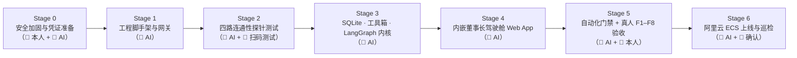

# 05｜全流程实操 SOP 与验收 Checklist（v3.2 开工执行手册）

| 项 | 内容 |
| :--- | :--- |
| 文档版本 | v3.2（董事长助理开工基线版） |
| 更新日期 | 2026-11-17 |
| 执行原则 | **分阶段推进 · 上一关未通过绝不进入下一关 · 明确区分 👤 本人操作 与 🤖 AI 助手执行** |
| 关联文档 | [总览 README](../README.md) · [01-需求定义与日常场景](01-需求定义与日常场景.md) · [02-架构与世纪互联OneDrive](02-整体架构与SQLite清单及OneDrive归档设计.md) · [03-智能体内核与反思闭环](03-AI分拣工作流与确认机制.md) · [04-阿里云部署与操作手册](04-阿里云部署与分阶段实施路线.md) |

---

## 一、 总体推进路线图（7 个阶段，串行过关）



---

## Stage 0：安全加固与三方凭证准备 SOP（👤 本人为主 + 🤖 AI 协助）

> **目标**：把 4 处外部账号、权限与服务器底座全部调通并收好密钥，**零明文凭证进 Git**。

### S0.1 阿里云百炼 API Key 轮换与模型核查（👤 本人）
1. 打开阿里云百炼控制台（<https://bailian.console.aliyun.com/>），地域锁定 **华北 2（北京）**。
2. 在「模型广场」确认以下 6 个模型额度已开通（主备三档）：
   - 分诊档：`qwen3.8-flash` / `qwen-plus`
   - 主推档：`qwen3.8-max` / `qwen-max`
   - 异构审计档：`deepseek-v4-pro` / `qwen3.8-max`
3. 在「API-KEY 管理」新建专用 Key（建议命名 `wechat-assistant-prod`），填入本机 `.env`；**删除/作废此前在旧仓库暴露过的旧 Key**（见 `env/.env.bailian` 顶部提示）。
4. 在阿里云费用中心设置月度消费预警（如 `50 元 / 月`）。
- **过关判据**：拿到全新有效的 `DASHSCOPE_API_KEY`，旧泄露 Key 已失效。

### S0.2 企业微信 API 长连接与个人微信扫码置顶（👤 本人）
1. 电脑浏览器打开 <https://work.weixin.qq.com>，用你手机上刚新建好实体账号的**蓝色「企业微信 App」**扫码登录管理后台。
2. 进入 **「应用管理」→「智能机器人」**：
   - 点开你添加的机器人（如手机建的是普通问答模式且无法改模式，直接在网页点 **「创建机器人 → 切换到 API 模式创建」** 新建一个 `工作助理`）；
   - **可见范围**：仅勾选**你自己 1 个人**；
   - **接入方式**：选择 **「使用长连接（WebSocket）」**（勿选 URL 回调）；
   - 保存并复制 **`BotID`**（`WECOM_BOT_ID`）和长连接 **`Secret`**（`WECOM_BOT_SECRET`）。
3. 在同一管理后台顶部点击 **「我的企业」→ 左侧「微信插件」**，找到 **「邀请关注」二维码**。
4. 拿起手机打开日常使用的 **绿色「个人微信」** → 右上角 `+` → **「扫一扫」** → 扫电脑屏幕上的微信插件二维码 → 点击 **「关注」**。
5. 打开手机**个人微信**底部的 **「通讯录」→「我的企业及企业联系人」** → 点进你的企业名称 → 打开 **`工作助理`**，发一句 `你好`（激活主动推送权限），并长按聊天框 **「置顶该聊天」**。
- **过关判据**：个人微信首页已置顶 `工作助理`；本地安全收好 `BotID` 与 `Secret`。

### S0.3 Wissentek 世纪互联版 Office 365 私有库与 `Sites.Selected` 赋权（👤 本人 + 🤖 AI）
1. **新建私有站点与文档库（👤 本人）**：
   - 登录 Wissentek 世纪互联 SharePoint（`https://<tenant>.sharepoint.cn`），新建 1 个私有团队站点（建议命名 `董事长幕僚归档库`），成员**只留你自己 1 人**。
   - 点上方工具栏 **「添加到 OneDrive 快捷方式」**（或「同步」），在 Mac Finder 确认能看见该同步文件夹。
2. **注册 Entra 应用（👤 本人）**：
   - 管理员登录世纪互联 Entra 管理中心 <https://entra.partner.microsoftonline.cn> → 「应用注册」→ 新建 `Wissentek-AI-Assistant`。
   - 记录 **`MS_TENANT_ID`**、**`MS_CLIENT_ID`**，并在「证书和密码」生成并记录 **`MS_CLIENT_SECRET`**。
   - 在「API 权限 → 添加权限 → Microsoft Graph → 应用程序权限」添加 **`Sites.Selected`**（若第二阶段用同租户拉工作邮件，同时提前勾选只读 **`Mail.Read`**，**绝不勾选 `Mail.Send` 或 `Files.ReadWrite.All`**），点击 **「代表 Wissentek 授予管理员同意」**。
3. **【关键避坑步】一次性赋权目标私有站点（👤 本人临时授权 + 🤖 AI 跑脚本）**：
   - 刚注册的 `Sites.Selected` 应用默认对所有站点都返回 `403`（它不能自己给自己授权）。
   - 由管理员用一次性脚本 `scripts/grant_site_permission_once.py`（通过临时持有的 `Sites.FullControl.All` 管理员令牌或世纪互联 PnP PowerShell）查出目标站点的 `MS_SITE_ID`，然后向 `https://microsoftgraph.chinacloudapi.cn/v1.0/sites/{MS_SITE_ID}/permissions` 发送 POST：
     ```json
     {
       "roles": ["write"],
       "grantedToIdentities": [{ "application": { "id": "<MS_CLIENT_ID>", "displayName": "Wissentek-AI-Assistant" } }]
     }
     ```
   - 赋权完成后立即撤销临时管理员脚本的令牌，生产环境仅凭 `Wissentek-AI-Assistant` 的 `Sites.Selected` 最小权限运行。
- **过关判据**：拿到 `MS_TENANT_ID`、`MS_CLIENT_ID`、`MS_CLIENT_SECRET`、`MS_SITE_ID`，Mac Finder 已挂载该私有库。

### S0.4 阿里云 ECS `firematrix` 加固与 Nginx HTTPS 现状检查（👤 本人 + 🤖 AI）
1. 生成专用 SSH 密钥并在 ECS 添加公钥，登录验证免密成功后修改旧 `root` 密码、关闭 SSH 密码登录（参见 `env/.env.ecs` 提示）。
2. 检查服务器现状与现有备案 HTTPS 域名，确认不干扰存量官网：
   ```bash
   uptime && free -h && df -h /
   timedatectl | grep "Time zone"      # 须为 Asia/Shanghai
   pm2 list                            # 确认 firematrix-web 在线
   nginx -t && ls /etc/nginx/sites-enabled/   # 确认已有已备案 HTTPS 域名与证书状态
   ```
3. 确认当前根分区可用空间 `>= 20 GB`，空闲内存足以承载轻量 Python 进程（约 `150–300 MB`），且明确用于反向代理驾驶舱的已备案子路径或子域名（如 `https://<已备案域名>/assistant`）。
- **过关判据**：SSH 密钥登录畅通、旧密码已废、`nginx -t` 正常且已备案 HTTPS 域名就绪、`firematrix-web` 正常。

---

## Stage 1：工程脚手架初始化与基础网关装配（🤖 AI 助手执行）

> **目标**：搭好符合工作区工程标准的 Python 3.12 包骨架与统一模型网关。

### S1.1 目录结构与依赖初始化
- 在项目目录下创建 `pyproject.toml`、包目录 `src/wechat_assistant/`（含 `nodes/`、`tools/`、`web/`、`intake/`、`storage/`、`prompts/`）、`scripts/`、`tests/`（`unit/`、`trajectory/`、`regression/`）及本地 `.env`（**加入 `.gitignore` 严禁提交**）。
- 安装核心依赖：`langgraph`、`langgraph-checkpoint-sqlite`、`pydantic`、`openai`、`fastapi`、`uvicorn`、`websockets`、`msal`、`httpx`、`pypdf`、`python-docx`、`openpyxl`、`pytest`。

### S1.2 核心配置、安全守卫与百炼网关 (`config.py`)
- 实现 `Settings.load()`（缺失关键密钥直接 fail-fast 报错）、`CostLedger`（统计三档模型 Token 与耗时）、`assert_no_secrets_leaked()`（扫描输出与日志防泄密断言）；
- 实现 `DashScopeLLMGateway`：封装三档异构路由（`fast` / `producer` / `critic`）、主备模型切换、指数退避重试、以及针对截断/非法控制字符的 JSON 自愈修复。
- **过关判据**：运行 `pytest tests/unit/test_config_and_guard.py` 全绿；本地执行 `git status` 确认无 `.env` 被跟踪。

---

## Stage 2：四路独立连通性探针测试 SOP（写业务前先逐条验通管道）

> **铁律**：每条外部管道用独立的最小探针脚本单独验通；**4 个探针没全部绿灯前，禁止开始编写复杂工作流节点**。

### S2.1 探针 1：阿里云百炼三档模型与 Thinking/Tool Call 测试（🤖 AI）
- 运行 `python scripts/probe_01_bailian.py`，依次验证：
  1. `qwen3.8-flash` 意图分类 JSON 返回耗时 `< 2s`；
  2. `qwen3.8-max` 在开启 Thinking 思考链的同时调用模拟工具并交回 Pydantic 结构化输出；
  3. `deepseek-v4-pro` 独立审计文本输出正常、JSON 解析无误。
- **过关判据**：3 档模型全部返回 `200 OK` 并通过 Pydantic Schema 校验。

### S2.2 探针 2：Wissentek 世纪互联版 OneDrive 读写、分片与隔离测试（🤖 AI + 👤 眼见为实）
- 运行 `python scripts/probe_02_onedrive_21vianet.py`（使用 Authority `https://login.partner.microsoftonline.cn/{MS_TENANT_ID}`，Scope `https://microsoftgraph.chinacloudapi.cn/.default`），验证：
  1. **目录初始化**：自动在 `MS_SITE_ID` 私有库下创建 `00_我的四大清单`、`00_原件收件箱`、`01_项目归档`、`02_产品与研发`、`03_公司运营`、`04_想法与行业参考` 根目录；
  2. **小文件直传与覆盖**：上传测试文件 `00_我的四大清单/_probe_test.md`，再次上传确认覆盖成功且版本历史保留；
  3. **大文件分片上传**：生成一个 `6 MB` 随机二进制测试包，验证 `createUploadSession` 分片断点上传成功且校验云端 `size` 一致后删除本地测试包；
  4. **权限越界负向测试（必测！）**：尝试请求 Wissentek 租户下的其他默认站点或 `/users/{you}/drive`，**必须返回 `403 Access Denied`**（证明权限已硬件级锁死在单库）。
- 👤 **本人确认**：在自己 Mac Finder 的 OneDrive 同步目录里亲眼看到 `_probe_test.md` 自动出现（验证完删掉测试文件）。

### S2.3 探针 3：企微长连接收发与微信转发实测 T1–T3（🤖 AI + 👤 本人操作）
- 在阿里云 ECS（或本机临时调试）启动 `python scripts/probe_03_wecom_ws.py`（日志**脱敏**，仅打印 `msgid`、`msgtype`、耗时与字节数）。
- 👤 **本人拿起手机在个人微信 `工作助理` 窗口完成以下 4 项实测**，并把结果回填进下表：

| 实测项 | 操作步骤 | 期望结果与记录内容（实测后回填） | 通过 |
| :--- | :--- | :--- | :---: |
| **T0 收发与去重** | 发文字「你好」 | 机器人 3 秒内回「已收到」，重复推送同 `msgid` 不产生两条记录 | [ ] |
| **T1 合并转发** | 找一段 5 条聊天，长按多选 → **合并转发** 给机器人 | 记录服务端收到的 `msgtype`、是否含每条原发送人与原文：[　　　　] | [ ] |
| **T2 逐条转发** | 找一段 5 条聊天，长按多选 → **逐条转发** 给机器人 | 记录各条到达服务器的时间间隔（最大间隔约 `___` 秒，据此定静默时间） | [ ] |
| **T3 夹带文件/语音** | 逐条转发里带 1 张图片 + 1 个 PDF + 发 1 段语音 | 确认顺序一致、图片与 PDF 可从回调地址完整下载、语音已带转写文本 | [ ] |

### S2.4 探针 4：工作邮箱只读拉取探针（第二阶段开启前执行）（🤖 AI）
- 运行 `python scripts/probe_04_mail_readonly.py`：拉取最近 3 封非广告测试邮件（含 1 封带 PDF 附件），确认正文提取、`Message-ID` 去重及附件保存正常；同时尝试调用发信接口确认被微软/邮箱权限拒绝（`403`）。
- **过关判据**：只读收信通畅，外发物理禁止。

---

## Stage 3：数据库、受控工具箱与 LangGraph 内核搭建（🤖 AI 助手执行）

> **目标**：把《Agentic Design Patterns》核心模式与董事长级工时排期能力完整编码落地。

### S3.1 极简 SQLite 三层记忆库与按页文档解析 (`storage/`)
- 初始化 `app.db`（`raw_sources` + `sources_fts` FTS5 `trigram`、`projects`、`list_items`、`memory_rules`、`model_calls`，含 `work_domain`、`planned_start_at`/`planned_end_at`、`actual_start_at`/`actual_end_at`、`estimated_hours`/`actual_hours`）与 `checkpoints.db`。
- 实现 PDF 按页文本提取（`pypdf`）、Office（`docx`/`xlsx`/`pptx`）文本提取与 OneDrive 分片上传异步 Worker。

### S3.2 四大受控幕僚工具箱 (`tools/`)
- 组 1（记忆深潜）：`hybrid_search`、`read_doc_pages`、`list_onedrive_tree`、`trace_timeline`；
- 组 2（排期与精算沙箱）：`check_workload_and_schedule`、`calc_business_date`、`analyze_excel_quote`；
- 组 3（脱敏外部并发外搜，可开关）：`search_public_tech_intel`（含敏感词/客户名剥离拦截）；
- 组 4（受令牌锁死执行器）：`propose_list_mutations`、`compose_markdown_brief`、`organize_onedrive_files`（挂载 `before_tool_callback`）。

### S3.3 LangGraph 有界闭环与快捷指令 (`graph.py` / `nodes/` / `intake/`)
- 装配 `guardrail_router`（`密：` 硬拦截 + 打卡/查询快速路 + `flash` 分诊）→ `planner_and_react_investigator` → `context_compactor` → `producer_drafter` → `heterogeneous_critic`（`deepseek-v4-pro` + 硬核验，≤2 轮）→ `hitl_preview_gate`（`interrupt()` 发 1 张含净工时与排期的决策卡）→ `atomic_executor`（含 24h `撤销` 快照与四大 `.md` 重绘）。
- **过关判据**：`pytest tests/unit/` 全部通过（涵盖 `密：` 物理零出网、净工时≠等待日历天数、数字保真 100%、Excel Diff 精算、脱敏拦截、`before_tool_callback` 阻断无令牌写入）。

---

## Stage 4：同进程「董事长项目管理驾驶舱 Web App」搭建（🤖 AI 助手执行）

> **目标**：让董事长从项目管理、工时负荷、精力结构三个视角随时掌控全局。

### S4.1 FastAPI 同进程路由、双端自适应 UI 与 Nginx HTTPS 反代 (`web/`)
- 挂载与智能体共享同一 `app.db` 的 Web 路由，**严格仅监听 `127.0.0.1:8090`**；在 `firematrix` 现有 Nginx 中配置 `/assistant/`（或子域名）HTTPS 反代，启用 `fail2ban` 与登录频率限制。
- 实现双端无感安全鉴权（`HttpOnly; Secure; SameSite=Lax` 30 天 Cookie）：
  - **手机微信端**：发 `看板`（或简报链接）生成 **5 分钟单次有效魔法链接（Magic Link）**，微信内置浏览器点击免输密码直登；
  - **电脑浏览器端**：打开书签点击「发送 6 位登录码到我的微信」（或输入强口令）完成登录。
- 交付**响应式双布局（手机竖屏卡片流 + 电脑宽屏多栏大屏）**及四大核心视图：
  1. **个人每日/每周净工时负荷热力图**（超过 `DAILY_CAPACITY_HOURS=6.0h` 标红提示可顺延事项）；
  2. **业务板块与项目精力占比分析图**（研发 / 销售 / 交付 / 供应链 / 公司治理工时分布与预估偏差率）；
  3. **在途项目甘特时间轴与 `Waiting For` 卡点图**（电脑宽屏支持鼠标横向拖拽起止周期，手机竖屏自动切为竖向进度条卡片）；
  4. **四大清单互动看板**（网页端调整排期/工时/想法转正立项，保存后自动重绘世纪互联 OneDrive `.md`）。
- **过关判据**：Web 接口测试全绿；手机微信内点魔法链接可直接滑出移动端页面不触发微信拦截，电脑大屏浏览器通过 6 位验证码登录后四张视图渲染无报错，网页修改一条任务后 OneDrive 对应 `.md` 文件在 10 秒内同步刷新。

---

## Stage 5：自动化测试门禁与真人端到端功能验收测试（🤖 AI + 👤 本人验收）

### S5.1 Ch.19 自动化测试门禁（🤖 AI 执行，全绿方可进入真人验收）
1. **轨迹评估（`tests/trajectory/`）**：Mock 工具运行 10 个代表性场景，验证智能体均按预期调用 `hybrid_search`、`check_workload_and_schedule`、`analyze_excel_quote` 等工具；
2. **`LLM-as-a-Judge` 黄金回归集（`tests/regression/`）**：用脱敏黄金集验证切分、工时周期分离、冲突检出与带页码问答平均分达标且数字保真 100%。

### S5.2 真人微信 + 驾驶舱 + Mac OneDrive 端到端功能验收（👤 本人逐条测试打勾）

| 用例编号 | 验收场景（你亲自操作） | 必须同时看到的验收结果 | 通过 |
| :--- | :--- | :--- | :---: |
| **F1** | 对置顶 `工作助理` 发一段语音想法（含一个跨项目器件构想） | 收到 **1 张决策卡**（含建议归属项目、放入想法池、预估净工时）；回 `1` 后，Mac Finder 里的 `03_想法与孵化池.md` 与 `04_想法与行业参考/` 自动更新 | [ ] |
| **F2** | 多选 6 条微信聊天 + 1 份 PDF 报价单转发，紧跟一句 `备注：帕莫瑞签，周五前定稿` | 60 秒内合并处理为 **1 张卡片**；回 `1` 后，PDF 重命名为 `YYYYMMDD_项目_原名.pdf` 同步到 Mac，项目纪要 `.md` 附带摘要与原话出处 | [ ] |
| **F3** | 发一封或两份前后修改过的 Excel 报价表 / 技术参数变化描述 | 预览卡精确指出**哪几行价格/哪个参数改了、新旧值对比**，无编造数字 | [ ] |
| **F4** | 微信回复 `开始 1`、`完成 1 1.5h`，再发 `看板` 点魔法链接在手机微信内打开；随后在家里电脑浏览器用 6 位微信验证码登录操作 | `01_今日与行动待办.md` 标为已完成并记录 `1.5h`；手机微信内直接滑出移动端卡片视图不拦截；电脑大屏可拖拽甘特图且两边与 OneDrive 实时同步 | [ ] |
| **F5** | 在收到决策卡时回 `改：这个 0.5h 够了，排周五`；或确认后再发 `撤销` | `改：...` 按约束重算刷新卡片；`撤销` 后 24h 内刚写入的任务与归档变化完整回滚 | [ ] |
| **F6** | 发送一条带 `密：核心光学算法补偿参数备忘` 文本或测试文件 | 后台日志（`model_calls`）确认 **0 次百炼/外部搜索请求**，文件直接安全落入世纪互联 OneDrive 指定目录 | [ ] |
| **F7** | 在微信问一个只写在某份测试 PDF 第 4 页的细节问题 | 回答精确命中该数字，明确标注**文件名与第 4 页出处**；问一件没发过的事直说“未查到” | [ ] |
| **F8** | 确认卡发出未回复时重启后端服务，30 秒后再回复 `1` | 重启后不重发确认消息、不重跑大模型，回复 `1` 后无缝完成落盘 | [ ] |

---

## Stage 6：阿里云 ECS `firematrix` 生产上线与运维巡检 SOP（🤖 AI + 👤 确认）

### S6.1 生产环境安装与守护进程注册
1. 在 ECS 创建非特权系统用户 `wxagent`，代码部署至 `/opt/wechat-agent/app`，数据放 `/opt/wechat-agent/data`，配置锁死在 `/etc/wechat-agent/env`（`chmod 640`，属主 `root:wxagent`）。
2. 注册并启用单实例 `/etc/systemd/system/wechat-agent.service`（设 `Restart=always`、`RestartSec=10`、`NoNewPrivileges=true`、`ProtectSystem=strict`、`ReadWritePaths=/opt/wechat-agent/data /opt/wechat-agent/tmp_cache`）。
- **过关判据**：`systemctl is-active wechat-agent` 为 `active`，`journalctl -u wechat-agent` 显示企微长连接订阅成功且**日志中搜索不到任何消息正文或密钥**。

### S6.2 上线后安全与存量业务核查
1. 运行 `pm2 list` 与访问官网确认 `firematrix-web` 不受任何影响；
2. 运行 `ss -tlnp` 与检查阿里云安全组，确认**公网零新增入站监听端口**（`8090` 仅监听 `127.0.0.1`），驾驶舱通过已有 `443` Nginx HTTPS 反代且旧魔法链接二次打开立即失效；
3. 开启工作日 `08:30` 与 `18:00` 每日简报推送，连续观察 24 小时无异常重启、60G 磁盘临时缓存清理正常。

---

## 七、 总控执行打卡总表（Master Checklist）

> 每完成一步就在 `[ ]` 里打勾 `[x]`，按顺序推进：

| 阶段 | 检查项 | 负责人 | 核心过关标准 | 状态 |
| :---: | :--- | :---: | :--- | :---: |
| **S0.1** | 百炼新 Key 创建、三档模型开通、旧 Key 作废、消费预警 | 👤 本人 | 新 Key 可用，旧泄露 Key 已删 | [ ] |
| **S0.2** | 企微电脑后台切换 API 长连接、绿色个人微信扫「微信插件」并置顶 | 👤 本人 | 拿到 `BotID/Secret`，个人微信已置顶并发送「你好」 | [ ] |
| **S0.3** | 世纪互联建私有库、Entra 注册 `Sites.Selected`、一次赋权并同步 Mac | 👤+🤖 | 拿到 4 个 MS 凭证，Mac Finder 可见私有库 | [ ] |
| **S0.4** | ECS `firematrix` SSH 密钥加固、改密码、查资源与 Nginx 备案 HTTPS | 👤+🤖 | 免密 SSH 稳定、剩余磁盘 ≥20GB、HTTPS 反代就绪 | [ ] |
| **S1** | Python 工程脚手架 + `DashScopeLLMGateway` + `CostLedger` + 防泄密守卫 | 🤖 AI | 基础单测全绿、`.env` 未进 Git | [ ] |
| **S2.1** | 探针 1：百炼 `flash` / `max` / `deepseek-v4-pro` 全通 | 🤖 AI | 三档模型 Pydantic 结构化输出全通 | [ ] |
| **S2.2** | 探针 2：世纪互联 OneDrive 建目录、小文件、分片上传与越权 `403` 验证 | 🤖+👤 | Mac Finder 可见测试文件，非授权库返回 `403` | [ ] |
| **S2.3** | 探针 3：企微长连接收发、`msgid` 去重与 **T1–T3 转发实测记录完成** | 👤+🤖 | T1–T3 表格填写完毕，静默时长已定 | [ ] |
| **S2.4** | 探针 4：工作邮箱只读拉取测试（第二阶段启用时必过） | 🤖 AI | 能拉正文附件，发信权限返回 `403` | [ ] |
| **S3** | SQLite 3+1 表 + 四大工具箱 + LangGraph 有界闭环与 `密：` 硬拦截 | 🤖 AI | 全部单元测试绿灯 | [ ] |
| **S4** | 同进程驾驶舱（Nginx HTTPS + 魔法链接/验证码 + 双端响应式布局） | 🤖 AI | 微信内直开不拦截，电脑大屏可拖拽，联动更新 `.md` | [ ] |
| **S5.1** | Ch.19 自动化门禁（Trajectory Eval + 黄金集 + 数字保真 100%） | 🤖 AI | 回归测试全部达标 | [ ] |
| **S5.2** | 真人微信 + 驾驶舱 + Mac OneDrive **F1–F8 全量验收通过** | 👤+🤖 | F1 至 F8 全部 `[x]` 通过 | [ ] |
| **S6** | 阿里云 ECS `wxagent` 守护上线、存量官网/端口/简报准点率巡检 | 🤖+👤 | 7×24 稳定运行，零明文泄露，公网零新增端口 | [ ] |
