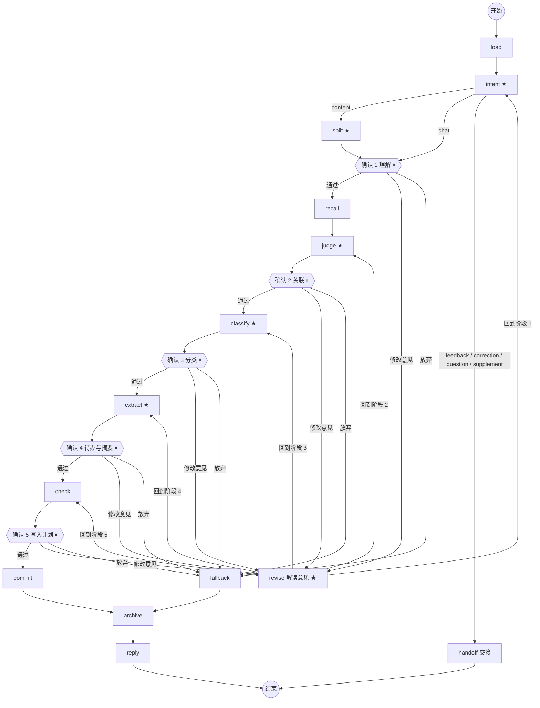

# 片段处理图

| 项 | 内容 |
| :--- | :--- |
| 文档 | 工作流系列之二 |
| 版本 | 1.4 |
| 日期 | 2026-10-31 |
| 系列 | [04-工作流总览.md](04-工作流总览.md)、[05-片段处理图.md](05-片段处理图.md)、[06-纠正查询与清单.md](06-纠正查询与清单.md)、[07-上下文提示词与核验.md](07-上下文提示词与核验.md)、[08-选型与实施.md](08-选型与实施.md)、[09-对象清单.md](09-对象清单.md)、[10-历史检索与上下文.md](10-历史检索与上下文.md) |
| 依据 | [00-工作流设计系统提示词.md](00-工作流设计系统提示词.md) 0.6、[01-需求说明.md](01-需求说明.md) 0.7 |
| 状态 | 草案，供确认后实施。只做架构设计，不含代码 |

| 版本 | 修订内容 |
| :--- | :--- |
| 1.4 | judge 的关系改为重复 / 补充 / 修订 / 演进 / 矛盾，修订和矛盾附双方原文并核验；judge 工具加 `get_object`、`get_history_chain`、`get_segment`，上限 8 次；写入计划包含旧值取代和未定标记（10） |
| 1.3 | 关联、待办、写入计划三个阶段加入项目和产品对象：召回、识别与新建、字段变化、清单页重新生成（09） |
| 1.2 | 改为五个阶段逐一确认：每个阶段结束停下等本人通过，有意见就按意见重做（可回退到更早阶段），直到通过；写入只在「写入计划」通过后发生。原 ask 节点并入阶段确认 |
| 1.1 | 附件读取与存档按 00 第 3.6 节 |
| 1.0 | 首版 |

这是系统的主图。每个收齐的片段启动一个线程，线程编号 `seg:<片段编号>`。本文先说明五个阶段和通用的确认机制（第 1、2 节），再逐个说明节点（第 4 节）。上下文和提示词在 [07](07-上下文提示词与核验.md)。

## 1. 五个阶段

按 [00](00-工作流设计系统提示词.md) 第 3.7 节，节点按本人能看懂的阶段分组，每个阶段结束停下确认。

| 阶段 | 包含节点 | 发给本人确认的内容 |
| :--- | :--- | :--- |
| 1 理解 | load、intent、split | 这段是什么（工作内容 / 闲聊）；切成几件事，每件是哪几条消息、标题是什么；哪条是你的备注、哪几条与事项无关 |
| 2 关联 | recall、judge | 每件事里提到的名字对应哪个已有标签，还是新的；这件事关于哪些项目、哪些产品，有没有要新建的项目、产品及其上级、客户、关联（[09](09-对象清单.md)）；这件事和以前的记录是什么关系：新事、重复、补充、修订、演进、矛盾（附旧事的日期和标题；修订和矛盾附双方原话，[10](10-历史检索与上下文.md) 第 4.4 节） |
| 3 分类 | classify | 每件事的领域、次领域、是否留档、关键字段 |
| 4 待办与摘要 | extract | 新建哪些待办、更新哪条已有待办、哪条已有待办标为完成；决定；摘要；项目和产品的变化（状态、关键日期、参数），各附依据 |
| 5 写入计划 | check | 将要执行的全部写入：条目、待办、标签和别名、项目和产品的新建与变更、关联、归档到哪个文件夹、附件放哪、哪些清单页会更新 |

阶段 5 通过后才执行 commit、archive、reply。闲聊在阶段 1 确认后直接进入阶段 5，只写原文。

## 2. 图



★ 模型节点（内部是一个 Pydantic AI Agent），⏸ 确认点（`interrupt()`），其余是代码节点。模型节点判断失败（重做 2 次仍不过核验）也走 fallback。

## 3. 确认机制

五个确认点用同一个 review 节点实现，参数是阶段号。

### 3.1 review 节点（代码，中断点）

1. 本线程已设「全部通过」，或这个阶段在配置里关闭了确认：直接通过。
2. 否则按模板把阶段结果写成确认消息（第 3.3 节），写入 `reviews` 表，状态「排队」。
3. 调用 `interrupt()`，线程暂停。
4. 恢复时拿到本人的回复，按下表走：

| 回复 | 下一步 |
| :--- | :--- |
| 通过 | 下一阶段 |
| 全部通过 | 状态里记 `auto_approve`，进入下一阶段，之后的确认点都直接通过 |
| 修改意见 | revise 节点 |
| 放弃 | fallback：不写分析结果，原件和当日完整对话记录已在，整段进「未归类」 |

### 3.2 排队与回复的对应

- **一次只发一条确认。** 发送器（接入层的代码）保证同一时刻最多一条确认处于「已发送、未回复」状态。其他线程到了确认点就在 `reviews` 表里排队，按到达顺序，前一条处理完才发下一条。这样本人的任何回复都只对应当前这一条。
- **回复怎么认：**
  - 「通过」「确认」「可以」「好」「OK」「全部通过」「放弃」：整条消息精确匹配，代码直接恢复当前确认的线程。
  - 以「改：」开头：代码直接把后面的文字作为修改意见。
  - 其他自由文本：照常收成片段，由新片段的 intent 判断是对当前确认的意见（`feedback`），还是新的工作内容。是意见就恢复当前确认的线程；是新内容就正常处理，在后面排队。
- **没有超时。** 本人不回复，确认就一直等着，原件不受影响。每日清单列出当前等待确认的这一条和排队数。

### 3.3 确认消息

由代码按模板生成，不让模型写。例：

```text
确认 #31 · 第 2 步 / 共 5 步 · 关联
① 某科技二期方案
   「某科技」= 已有客户「某某科技」（拿不准：简称，未见过这种写法）
   补充 10 月 20 日「某某科技二期需求」
   修订 10 月 28 日「二期报价」：交期「11 月 5 日」→「11 月 6 日」
② 下周面试时间
   新事
回复：通过 ／ 全部通过 ／ 改：你的意见 ／ 放弃
```

重做之后的确认消息在开头加一行「按你的意见改了：……」，内容来自模型输出的 `applied_feedback`。

### 3.4 revise 解读意见（模型）

| 契约 | 内容 |
| :--- | :--- |
| 任务 | 判断本人的意见针对哪个阶段，把它整理成重做时的指示，能明确成取值的整理成约束 |
| 上下文 | 当前阶段号和各已完成阶段的结果；本人这条意见；本线程之前的意见 |
| 输出 | `target_stage`（不晚于当前阶段）；`instruction`（一句话，忠实于本人原意）；`constraints[]`：字段路径、要求的值，例如 `items[1].domain = delivery`、`items` 数量 = 3、`todos[0].due = 2026-11-05` |
| 工具 | 无 |
| 核验 | `target_stage` 不晚于当前阶段；约束里的字段路径在目标阶段的输出结构里存在；取值合法（领域在代码表内、日期合法） |

之后由代码：

1. 把意见和约束追加到状态的 `feedback[target_stage]`；
2. 把 `target_stage` 及之后各阶段的结果标为作废；
3. 跳回目标阶段的第一个模型节点重做（阶段 2 跳到 judge，不重跑 recall，除非意见涉及召回范围）；
4. 目标阶段之后的阶段照常执行，并重新逐个确认。

例：在阶段 4 说「面试那件不用记」，这是对切分的意见，`target_stage` = 1，约束是「消息 5–6 记为无关」。重做阶段 1，然后 2、3、4 重新确认（第 2–4 阶段只剩一件事，内容会短很多）。

### 3.5 带着意见重做

- 被跳回的模型节点额外看到两块上下文：【上一版结果】和【本人的意见】（这一阶段的全部意见，按时间顺序）。提示词要求：以本人意见为准；只改意见涉及的部分；在 `applied_feedback` 里说明改了什么。
- 约束由代码核验（[07](07-上下文提示词与核验.md) 第 3 节）：重做结果不满足约束，就作为核验错误发回模型再改，不发给本人。
- 重做没有次数上限，直到本人通过或放弃。同一阶段第 3 次及以后的确认消息末尾加一句「也可以直接告诉我正确结果」。

## 4. 节点

### 4.1 load（代码）

- 从业务库读出片段的全部消息。识别 `备注：` 前缀。
- 计算正文归一化哈希（去空白、去标点、全半角统一）。与 30 天内已分析片段相同，记 `exact_duplicate_of`。这是确定性的「原样重发」检测；换了说法的重复由 judge 判断。原样重发在阶段 1 的确认消息里直接说明「这段 10 月 28 日已收过」，本人通过后只记一条重复关联。
- 附件：原件在收到时已由接入层存进原件库（[00](00-工作流设计系统提示词.md) 第 3.6 节），这里只读取。PDF、Office、纯文本的文字由接入层在收到时提取；语音用企业微信的转写文本。送给模型的是「〔文档：报价单V3.pdf〕」加提取文本的开头部分，全文留在提取文本文件里，模型需要时用 `get_attachment_text` 工具查。
- 图片（第三期）：图里是什么、有哪些文字，由一个看图的模型节点在 load 之后、intent 之前完成，结果作为图片消息的文字描述写回状态和提取文本文件。

### 4.2 intent 意图（模型）

| 契约 | 内容 |
| :--- | :--- |
| 任务 | 判断本人发来这段的目的 |
| 上下文 | 片段原文；当前等待确认的那一条（若有）；机器人最近 3 次回执的要点；可识别的纠正类型清单 |
| 输出 | `kind`：`content` 工作内容 / `chat` 闲聊 / `feedback` 对当前确认的意见 / `correction` 对已写入结果的纠正 / `question` 提问 / `supplement` 补充上一段。附带参数（纠正的对象和改动、提问原句、补充的目标片段）。`confidence` |
| 工具 | 无 |
| 核验 | 引用的编号必须出现在上下文里；没有等待中的确认时不能输出 `feedback`；`correction` 的改动类型必须在清单里 |

判断原则：

- 有确认在等待，本人发来的短句明显在评论那条确认的内容（「第一件不对」「面试那件不用记」）：`feedback`。
- 转发的对话后面跟一句「这是 A 项目的」：`content`，那句是备注。
- 单独一句「这是项目交付」，针对的是已经写入的结果：`correction`。
- 拿不准时按 `content`：误当内容的代价是多一次确认，本人放弃即可；误当意见会改坏正在确认的结果。

`feedback`、`correction`、`question`、`supplement` 是交接：写一条交接记录，由接入层恢复当前确认的线程、或启动纠正图、问答图、或把本片段并入上一段，本线程结束。路由本身不单独确认，因为下一个确认消息会把理解结果展示给本人。

### 4.3 split 切分（模型）

| 契约 | 内容 |
| :--- | :--- |
| 任务 | 把片段切成若干件互不相干的事，标出本人备注 |
| 上下文 | 片段原文（带序号）；同一会话最近 3 个片段的标题；重做时的上一版结果和本人意见 |
| 输出 | `items[]`：消息范围、20 字以内的标题、提到的名字（原样）；`owner_notes[]`；`unrelated[]`；重做时 `applied_feedback` |
| 工具 | 无 |
| 核验 | 范围不越界、不重叠；事项、备注、无关合起来覆盖全部消息；提到的名字必须在对应范围的原文里；满足本人意见的约束 |

### 4.4 recall 召回候选（代码）

宁多勿漏，结论交给 judge。每个事项分别召回：

| 召回什么 | 怎么召回 | 上限 |
| :--- | :--- | :--- |
| 标签 | 每个提到的名字：别名表精确命中；与标签名或别名互相包含；FTS5 `trigram` 子串匹配 | 每个名字 5 个 |
| 历史条目 | 命中标签下最近 90 天的条目；按事项标题和名字全文检索最近 90 天；同一会话最近 3 个片段的条目 | 共 15 条 |
| 未完成待办 | 命中标签下的未完成和待确认待办；最近 30 天新建的未完成待办 | 共 20 条 |
| 项目、产品 | 提到的名字与对象名称和别名做精确、包含、全文匹配；命中对象连同其上级和直接下级一起召回；命中客户标签下状态不是已结束的项目 | 共 10 个 |

### 4.5 judge 历史判断（模型，可查询）

| 契约 | 内容 |
| :--- | :--- |
| 任务 | 每个事项：提到的每个名字对应哪个已有标签，还是新对象；这件事和历史条目是什么关系 |
| 上下文 | 事项原文；候选标签（附实体卡片）、候选历史条目的摘要卡；相关的本人规则；重做时的上一版结果和本人意见 |
| 输出 | 每个名字：`tag_id` / `new`（附种类）/ `unsure`，加理由。每个事项：`objects[]`，关于哪些项目和产品，每个是已有对象编号，或新对象（类型、名称、上级、客户、关联产品）；`relations[]`，每条是历史条目编号、关系（`restates` / `supplements` / `revises` / `advances` / `conflicts`）、修订和矛盾的 `changed_facts`、置信度、理由，没有关系的为新事。重做时 `applied_feedback`。关系定义见 [10](10-历史检索与上下文.md) 第 4 节 |
| 工具 | `lookup_entities`、`get_object`、`search_records`、`get_item`、`get_history_chain`、`get_segment`、`get_attachment_text`，只读，最多 8 次。候选不够时自己往深处查（[10](10-历史检索与上下文.md) 第 3 节） |
| 核验 | 引用的编号必须在候选或本次查询结果里；`revises`、`conflicts` 必须有 `changed_facts`，旧说法原文是旧条目的子串、新说法原文是本次原文的子串；理由不能为空；新对象的上级必须同类型且不超过层数上限（项目两层、产品三层）；满足本人意见的约束 |

新建项目要满足 [09](09-对象清单.md) 第 2 节「什么算项目」，拿不准时不建，在确认消息里写「（拿不准）要不要建为项目」。

`unsure` 和低置信度的关系不单独发问，在阶段 2 的确认消息里标「（拿不准）」，本人通过即视为认可模型的倾向，有意见就改。

### 4.6 classify 分类（模型）

| 契约 | 内容 |
| :--- | :--- |
| 任务 | 每个事项的主领域、次领域、是否值得留档，以及该领域的必抽字段 |
| 上下文 | 领域定义和判断原则；本人规则；事项原文和本人备注；阶段 2 确认过的标签及实体卡片；有关系的历史条目的领域；重做时的上一版结果和本人意见 |
| 输出 | `domain`、`sub_domain`、`is_record`、`fields`、`confidence`、`uncertain_reason`；重做时 `applied_feedback` |
| 工具 | 无 |
| 核验 | 领域代码在代码表内；字段里的数字、日期、料号必须在原文或备注中出现；必抽字段要么有值要么有空值原因；满足本人意见的约束 |

### 4.7 extract 抽取（模型）

| 契约 | 内容 |
| :--- | :--- |
| 任务 | 每个事项：下一步要做什么，和已有待办是什么关系；有没有已拍板的决定；值得留档的写摘要 |
| 上下文 | 事项原文和本人备注；阶段 3 确认过的分类；候选未完成待办；阶段 2 确认过的关系及有关系的条目摘要；今天的日期；重做时的上一版结果和本人意见 |
| 输出 | `todos[]`：标题、负责人、截止日期、`due_derived_from`、`same_as`、置信度。`completed[]`：已有待办编号和依据的消息序号。`decision`。`summary`。`object_updates[]`：阶段 2 确认过的项目或产品的字段变化（状态、关键日期、参数），附依据的消息序号。重做时 `applied_feedback` |
| 工具 | 无 |
| 核验 | 数字保真；`due_derived_from` 必须是原文子串（本人意见里给出的日期除外）；`same_as`、`completed` 的编号必须在候选待办里；同一编号不能既 `same_as` 又 `completed`；`object_updates` 的对象必须是阶段 2 确认过的，字段和状态值必须合法，参数数字必须在原文中出现；满足本人意见的约束 |

「我要干一个工作」之后又说「我要把这个工作做完」：extract 看到候选里有第一条待办，填 `same_as`，不新建。说「这个工作做完了」：填 `completed`。两种都在阶段 4 的确认消息里写明，本人可以改。

### 4.8 check 写入计划（代码）

把前四个阶段确认过的结果翻译成 `plan`：要新建的条目、待办、标签、别名，要新建或变更的项目和产品，要更新和标完成的待办，要建立的关联（事项与对象、项目与产品、事项与历史条目的关系），修订要取代的旧值和矛盾要标「未定」的字段（[10](10-历史检索与上下文.md) 第 4.3 节），事项文件夹路径，每个附件的归处，会重新生成的清单页。同时做全局检查：两个事项不能让同一条已有待办既更新又完成；每个附件都有归处或明确记为「未归类」。检查不过时，把问题写进阶段 5 的确认消息，由本人决定。

因为每一步都经过本人确认，原方案里「置信度低于阈值的待办自动转为待确认」不再需要：本人看过并通过的，就按通过的结果写入。

### 4.9 commit、archive、reply（代码）

- **commit**：在一个数据库事务里执行 `plan`，同时写变更记录，供「撤销」使用。幂等键是线程编号。
- **archive**：按 [02](02-技术路线.md) 第 8.2 节，每个事项建一个文件夹，写对话记录和摘要；附件按所在消息归入对应事项、按种类分子目录，以硬链接指向原件库。核验每个链接都指向存在的原件。
- **清单**：更新受影响对象的统计字段，重新生成这些对象的页面、项目清单、产品清单和文件夹结构清单（[09](09-对象清单.md) 第 5 节）。
- **fallback 的存档**：整段写入当日 `未归类/` 下的一个文件夹，附件照样链接进去。
- **reply**：一句话回执「已写入：2 件事、2 条待办，归档在 sales/0931-某科技二期方案」。详细内容本人在确认时都看过，不再重复。

## 5. 失败与恢复

| 情况 | 处理 |
| :--- | :--- |
| 百炼接口超时、限流、5xx | 模型节点配 LangGraph 的重试策略：最多 3 次，指数退避 |
| 输出不符合结构、核验不过、不满足本人意见的约束 | Pydantic AI 把错误原因发回模型重做，最多 2 次 |
| 重做 2 次仍不过 | 发给本人的确认消息改为「这一步没整理好：失败原因」，选项为「改：你的意见」或「放弃」；本人给意见则带着意见再做 |
| 进程崩溃或重启 | 从最后一个检查点继续。停在确认点的线程保持暂停，确认消息若已发出不重发；写入只在阶段 5 通过后发生，所以中途崩溃不留半截数据 |
| 图陷入循环 | 图的递归上限兜底。本人反复提意见形成的循环不计入上限，每次恢复是一次新的执行 |

## 6. 一段内容走一遍

本人转发 6 条：客户王经理问二期方案什么时候给、本人答周五前；然后另一个人问下周面试时间。紧接着发「备注：某科技的，方案优先做」。

| 步骤 | 系统 | 本人 |
| :--- | :--- | :--- |
| 阶段 1 | 「工作内容，2 件事：① 消息 1–4 某科技二期方案 ② 消息 5–6 下周面试时间；第 7 条是你的备注」 | 通过 |
| 阶段 2 | 「①『某科技』= 某某科技（拿不准），补充 10 月 20 日『某某科技二期需求』 ② 新事」 | 通过 |
| 阶段 3 | 「① 客户与销售，次领域项目交付 ② 人事行政」 | 改：第一件主领域是项目交付 |
| revise | 目标阶段 3，约束 `items[0].domain = delivery` | — |
| 阶段 3 重做 | 「按你的意见改了：① 主领域改为项目交付，次领域改为客户与销售。① 项目交付 ② 人事行政」 | 通过 |
| 阶段 4 | 「① 新建待办：周五前给某某科技二期方案（截止 11 月 6 日，依据『周五前』）② 新建待办：确认下周面试时间」 | 全部通过 |
| 阶段 5 | 已设全部通过，不再停下 | — |
| 写入 | 写库、建两个事项文件夹、别名「某科技」→「某某科技」；回执「已写入：2 件事、2 条待办」 | — |

阶段 3 的意见记一条纠正记录（涉及某某科技，领域 sales → delivery）。同类意见再出现一次，就会收到规则提议（[06](06-纠正查询与清单.md) 第 3 节）。
