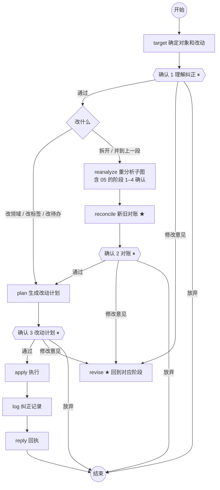

# 纠正、问答、规则提议与每日清单

| 项 | 内容 |
| :--- | :--- |
| 文档 | 工作流系列之三 |
| 版本 | 1.4 |
| 日期 | 2026-10-31 |
| 系列 | [04-工作流总览.md](04-工作流总览.md)、[05-片段处理图.md](05-片段处理图.md)、[06-纠正查询与清单.md](06-纠正查询与清单.md)、[07-上下文提示词与核验.md](07-上下文提示词与核验.md)、[08-选型与实施.md](08-选型与实施.md)、[09-对象清单.md](09-对象清单.md)、[10-历史检索与上下文.md](10-历史检索与上下文.md) |
| 依据 | [00-工作流设计系统提示词.md](00-工作流设计系统提示词.md) 0.6、[01-需求说明.md](01-需求说明.md) 0.7 |
| 状态 | 草案，供确认后实施。只做架构设计，不含代码 |

| 版本 | 修订内容 |
| :--- | :--- |
| 1.4 | 问答图加召回、时间线和长文阅读工具，输出加 `scope`、`conflicts`；纠正类型加改关系、裁决冲突；新增「定 #N」指令；每日清单列出未定冲突（10） |
| 1.3 | 纠正类型加项目和产品的改关联、改上级、改状态、加关联、合并；「查」支持对象；新增「项目清单」「产品清单」指令；问答工具加对象查询 |
| 1.2 | 纠正图、规则提议图接入阶段确认（05 第 3 节的同一套机制）；明确哪些事不需要确认；固定指令加「通过」「全部通过」「放弃」「改：」；清单列出等待确认的事项 |
| 1.1 | 存档跟随纠正 |
| 1.0 | 首版 |

主图之外的三张图和两件纯代码的事。阶段确认的机制（排队、回复识别、按意见重做、回退）与 [05](05-片段处理图.md) 第 3 节完全相同，本文只说明每张图分几个阶段。

## 0. 什么需要确认，什么不需要

| 情况 | 是否确认 | 理由 |
| :--- | :--- | :--- |
| 系统分析出的结果（切分、关联、分类、待办、对账、规则草稿）以及据此要做的写入 | 确认 | 这是系统的判断，本人通过才算数 |
| 本人直接下达的确定性指令：「完成 3」「忽略 3」「查 某某」「好了」「撤销」 | 不确认，直接执行 | 指令本身就是本人的决定，没有需要本人再看的判断 |
| 问答的回答 | 不进确认队列 | 不写任何数据；追问作为新的提问处理 |
| 每日清单 | 不确认 | 只读汇总 |

## 1. 纠正图

线程编号 `fix:<纠正编号>`。处理对**已写入结果**的纠正。写入前的修改意见走 [05](05-片段处理图.md) 第 3.4 节，不走这张图。

### 1.1 阶段

| 阶段 | 发给本人确认的内容 |
| :--- | :--- |
| 1 理解纠正 | 「我理解为：把 10 月 31 日『某科技二期方案』的主领域从客户与销售改为项目交付。」对象有歧义时列出候选让本人选 |
| 2 对账（仅拆开 / 合并） | 重分析后新旧待办的对应关系：哪条旧待办对应哪条新待办，哪些旧待办作废，哪些新建；已完成、已忽略的保持原状 |
| 3 改动计划 | 将要执行的全部改动：数据库字段改前改后、事项文件夹从哪移到哪、哪些文件夹改名为 `.已替换` |

拆开、合并的重分析以子图方式运行片段处理图的 split 到 extract，[05](05-片段处理图.md) 的阶段 1–4 照常逐个确认。状态里带 `mode`（拆开 / 合并）和上次结果；拆开时 split 要求至少切成 2 件；合并时先由代码把两个片段的消息按时间合并。

### 1.2 输入

| 来源 | 例子 | 对象和改动由谁确定 |
| :--- | :--- | :--- |
| 固定指令 | 「拆开」「并到上一段」「改成 项目交付」「3 改成 项目交付」 | 代码：「上一段」是最近一个已写入的片段；数字是回执里的条目序号 |
| 自然语言 | 「这是项目交付」「第二个待办不用做了」「某科技不是某某科技，是某某电子」 | 片段处理图的 intent 节点，交接时带上对象和改动类型 |

改动类型是固定清单：改领域、改标签或别名、待办完成 / 忽略 / 改截止、拆开、并到上一段，以及项目和产品的改关联、改上级、改状态、加关联、合并重复对象，以及条目之间的改关系、裁决冲突（[10](10-历史检索与上下文.md) 第 4.4 节）（[09](09-对象清单.md) 第 7 节）。合并对象时，改动计划里列出要转移的记录、待办、关联和要改名的对象页。

### 1.3 对账：新旧待办是不是同一件事

重分析后旧待办有的已完成、有的已忽略，新结果里的待办要和它们对上，否则已完成的事会又冒出来。这是语义判断，交给模型，结果经本人确认。

| 契约 | 内容 |
| :--- | :--- |
| 任务 | 把新待办和旧待办一一配对：哪些是同一件事 |
| 上下文 | 旧待办：编号、标题、状态、来源事项标题。新待办：临时编号、标题、来源事项标题。对应事项的原文。重做时的上一版结果和本人意见 |
| 输出 | `pairs[]`：旧编号、新临时编号、理由；未配对的旧编号、新编号各自列出；重做时 `applied_feedback` |
| 核验 | 每个编号最多出现一次；编号都来自输入；满足本人意见的约束 |

apply 按确认过的配对写入（代码）：

- 配上的：保留旧编号和状态；已完成、已忽略的不复活；未完成的更新标题、截止日期、来源。
- 旧的没配上：标「已替换」，不删除。
- 新的没配上：新建。
- 旧条目标「已替换」，旧事项文件夹改名加 `.已替换` 后缀保留；按新结果重建事项文件夹，附件按新的消息归属重新链接。原件库不动。

### 1.4 纠正记录

log 节点写一条纠正记录：类型、对象、改前、改后、涉及标签、来源（写入后的纠正，或写入前的确认意见）。[05](05-片段处理图.md) 阶段确认时的修改意见也写进同一张表。两种来源一起参与规则提议的计数。

## 2. 问答图

线程编号 `ask:<片段编号>`。处理自然语言提问，例如「上周和某某科技谈到哪一步了」「这个月有哪些没回的报价」。「查 某某」是固定指令，不走这张图。

| 契约 | 内容 |
| :--- | :--- |
| 任务 | 回答本人的问题，结合全部历史，只用查到的记录。检索流程见 [10](10-历史检索与上下文.md) 第 6 节 |
| 上下文 | 问题原句；今天的日期；相关的本人规则；上一轮问答（若本人是在追问）；recall 按问题召回的对象摘要和条目摘要卡 |
| 输出 | `answer`、`cited[]`（引用的条目、待办、对象编号，附消息序号或页码）、`scope`（查过的范围）、`conflicts[]`（用到的未定冲突）、`not_found` |
| 工具 | [10](10-历史检索与上下文.md) 第 3.2 节全部只读工具，包括 `get_history_chain`（时间线）和 `read_long`（读长附件，只交回结论和引用），最多 15 次 |
| 核验 | `cited` 里的编号必须出现在本次工具结果里；回答里的数字必须出现在本次工具结果里；有未定冲突就必须写进 `conflicts`；`scope` 不能为空；`not_found` 为真时回答不能编造内容 |

回答默认用最新有效的说法；问变化就按时间线答。正文不超过 500 字直接发，更长的整理写成文件发送（[10](10-历史检索与上下文.md) 第 6 节第 5 步）。

问答不写数据，不进确认队列，回答直接发出。本人觉得不对就继续追问（「再查一下上个月的」），intent 判为 `question`，上下文带上一轮问答。

## 3. 规则提议图

线程编号 `rule:<提议编号>`。让本人的纠正变成以后自动生效的规则。

### 3.1 触发

- 纠正记录按结构化字段分组：改动类型相同、涉及标签相同、改后的值相同。同组达到 2 条，且该组没有已确认的规则或被拒绝的提议，启动本图。分组用的是记录里的字段，是确定性的。
- 本人直接发「规则：涉及某某科技的都归项目交付」：固定前缀，启动本图。规则原文是本人说的，但触发条件和冲突检查是模型整理的，仍要确认一次。

### 3.2 节点与阶段

| 节点 | 类型 | 做什么 |
| :--- | :--- | :--- |
| draft | 模型 | 把这组纠正写成一句规则，给出触发条件（标签或关键词）；对照已有规则，指出与哪条冲突。核验：触发条件里的标签必须存在；冲突规则的编号必须存在；满足本人意见的约束 |
| 确认 1 规则 | 确认 | 「你两次把某某科技的内容改成了项目交付。规则：涉及某某科技的内容主领域归项目交付。触发：标签某某科技。」有冲突时附上将被覆盖的旧规则。本人可以「通过」「放弃」，或「改：只限二期项目」，后者按意见重写规则后再确认 |
| save | 代码 | 通过：写入规则表，状态已确认，冲突的旧规则标「已覆盖」。放弃：记为已拒绝，同组不再提议 |

规则在 [07](07-上下文提示词与核验.md) 第 1 节规定的位置注入 judge、classify、extract 的上下文。规则改的是数据，不是提示词文件。

## 4. 固定指令（纯代码，不用图）

接入层对整条消息精确匹配。匹配上就直接执行或启动对应的图；匹配不上就当普通消息进片段。

| 指令 | 动作 |
| :--- | :--- |
| 「通过」「确认」「可以」「好」「OK」 | 当前确认通过 |
| 「全部通过」 | 当前确认通过，该线程后续确认不再停下 |
| 「放弃」 | 当前确认所在的线程放弃（[05](05-片段处理图.md) 第 3.1 节） |
| 「改：…」 | 作为当前确认的修改意见 |
| 「好了」「完」 | 当前收集中的片段立即收齐 |
| 「完成 N」「忽略 N」 | 改待办状态（N 是清单或回执里的序号） |
| 「查 某某」 | 名字是项目或产品时，回对象摘要：客户、状态、上下级、关联、最近 5 条记录、未完成待办；是标签时，按标签和别名查最近 10 条条目和未完成待办，回标题、日期、领域 |
| 「项目清单」「产品清单」 | 清单摘要：按状态分组的名称和最近动态（[09](09-对象清单.md) 第 7 节） |
| 「撤销」 | 撤回最近一次写入（见下） |
| 「定 #N 取值」「定 #N 以新为准」「定 #N 以旧为准」 | 裁决一条未定冲突：按取值写入，另一方记为未采纳，旧值进字段历史（[10](10-历史检索与上下文.md) 第 4.4 节） |
| 「拆开」「并到上一段」「改成 X」「N 改成 X」 | 启动纠正图 |
| 「规则：…」 | 启动规则提议图 |

没有确认在等待时，「通过」「放弃」「改：…」回复「现在没有待确认的事」。收到指令时如果有收集中的片段，先把它收齐，再执行指令。

**撤销**：每次写入都有变更记录。「撤销」恢复 24 小时内最近一次写入造成的全部变化（包括被移动的事项文件夹回到原路径、新建的条目和待办标为已撤销），回执列出恢复了什么。所有写入都经本人确认过，撤销是给「确认时看漏了」留的退路。

## 5. 每日清单（纯代码）

工作日 18:00（可配置），进程内定时任务查库、按模板渲染、推送。不调模型。清单不占用确认队列。

内容顺序：

1. 未完成待办，按领域分组，过期的排前；
2. 今日新增存档；
3. 今日记录的决定；
4. 等待确认：当前这一条的编号和阶段，以及排队中的数量；
5. 待确认的规则提议数量；未定的冲突，附双方说法，回复「定 #编号 取值」裁决；
6. 每周一次：60 天没有动态的项目，问「要结束吗」（[09](09-对象清单.md) 第 6 节）；
7. 运行情况一行：今日片段数、放弃数、失败数。

当天没有新内容时照常推送，写「今天没有新的待办」。
