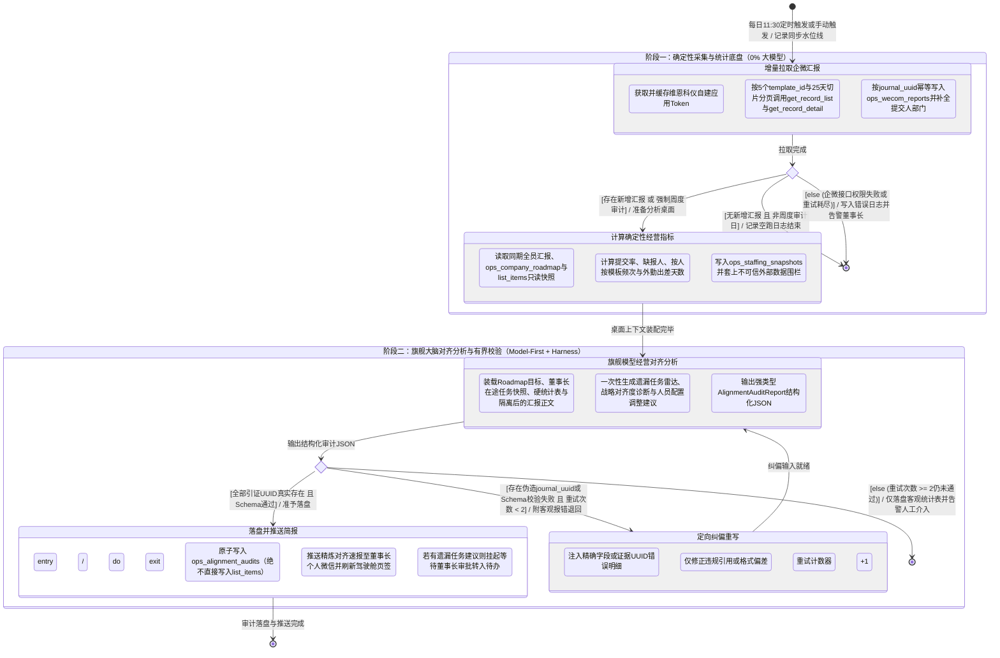

# 企业微信全员汇报数字化采集、任务漏项核查与公司战略对齐分析引擎 — 可行性调研与架构设计方案（V1.0）

> **文档状态**：Slice 0 已上线实测通过（近 30 天 181 份真实汇报已入库 `firematrix`）；业务需求已正式结构化定稿见 [02_PRD_STRATEGIC_ALIGNMENT_AND_AI_TRANSFORMATION.md](./02_PRD_STRATEGIC_ALIGNMENT_AND_AI_TRANSFORMATION.md)  
> **创建日期**：2026-11-27  
> **所属工程**：`wechat_AI_assistant/wecom_report_agentic_analysis/`（独立子模块，与董事长私人助理主干解耦）  
> **架构宪章**：严格遵循「**大模型优先 + 确定性底盘（Model-First + Harness & Loop Engineering）**」「**OMG UML 2.5 行为状态机图标准**」与「**个人独立开发者生产级交付宪章**」

---

## 一、 业务目标与战略价值

将企业微信（`维恩科仪`）中每日高频沉淀的全员一线工作汇报自动拉取、结构化入库，并与董事长个人 AI 助理任务库（`list_items`）及公司战略路线图（`ops_company_roadmap`）持续进行数字化对照，实现四大管理闭环：

1. **信息零遗漏（盲区雷达）**：自动比对全员汇报 vs 董事长 AI 助理在途任务，精准发现“下面已发生但您看板遗漏的事项”与“您挂着 P0/P1 但团队连续多日未推进的事项”。
2. **战略高度对齐（Alignment Audit）**：以公司明确的阶段目标与 Roadmap 为标尺，量化全公司精力投向，区分“战略核心攻坚”与“临时救火/非核心杂务”。
3. **人员配置与负荷优化**：基于每日 10 分钟日报、晨会简报、现场出差日报与返厂维修日报的客观频次与内容，识别超负荷救火工程师与人力缺口项目，辅助调整人员配置与工作安排。
4. **公司目标与 Roadmap 数字化迭代**：建立可追溯的季度/年度目标与里程碑台账，通过周度/月度经营诊断持续校准公司发展方向。

---

## 二、 现状实机摸底（2026-11-27 实证核查）

### 2.1 阿里云 ECS 现网服务排查结论：**目前两台主机均未跑通企微汇报拉取**

| 阿里云 ECS 主机 | 当前运行服务 | 是否拉取企微汇报 | 实测核查依据 |
| :--- | :--- | :---: | :--- |
| **主机 A：`39.104.202.152`** （`wissentek` 共享机，对应 `wecom_addon_dev`） | Odoo / Umami / 金蝶同步 + 考勤审计容器 `attendance_audit_integration`（绑定 `Hermes Agent` `1000016`） | ❌ **未运行** | 经核查 `wecom_addon_dev` 最新代码（`wecom_api.py:176-200`）与 `STATUS.md`： ① 代码误用了非官方路径 `/cgi-bin/oa/getreportdata`（实际官方汇报接口为两步的 `oa/journal/get_record_list` + `oa/journal/get_record_detail`）； ② 服务器 `.env` 未配置 `WECOM_DAILY_REPORT_TEMPLATE_ID`，每次自动跳过返回空； ③ 企微后台“汇报 API 授权白名单”未勾选 `Hermes Agent`。 |
| **主机 B：`39.104.79.172`** （`firematrix`，**已 SSH 只读实测**） | ① **`wechat-agent.service`**（董事长 AI 助理与驾驶舱，SQLite `/opt/wechat-agent/data/app.db` 现存 15 条在途任务、14 个项目） ② **`wechat-kanban-app`**（Docker 容器，绑定 `Project Kanban` `1000014`） | ❌ **未运行** | `wechat-kanban-app` 的 `wecom.py` 仅调用通讯录、OAuth 与消息发送接口，未调用任何汇报 API；`wechat-agent` 绑定在董事长私人专属企微组织，尚未接入 `维恩科仪` 汇报数据。 |

### 2.2 企业微信管理后台实机盘点（`维恩科仪`，`CorpID: ww9238966755b26e48`）

经 Chrome 只读核查确认：**目标汇报全部规范存在于原生「应用管理 → 汇报」中**（审批、文档、打卡中无重复报告源），共计 **5 个正式模板**，且已全部拍板纳入采集范围：

| 序号 | 汇报模板名称 | 内部 ID | 官方 API `template_id` | 填报人范围 | 频率与近 30 天活跃度 |
| :---: | :--- | :---: | :--- | :--- | :--- |
| 1 | **晨会简报** | `40001105` | `3WNhb5shbwE39YGY3xP8Uds7zUQCF8kNxKkYyWaP` | 孔紫初（1 人） | 工作日 11:00 前；近 30 天 14 份（最新 11/26） |
| 2 | **每日10分钟工作日报** | `40001104` | `C4c9RoeekLMSRRcqyurjgee3x7c6MUgPqN96rLmFr` | 全员 15 人（免交白名单：徐宏玮） | 工作日每日提交；近 30 天 6 页（最新 11/27） |
| 3 | **现场技术支持工作日报** | `40001101` | `C4ZW7hqyqemoDeSFqoGAyEoGMB1HdvfE78qzTv58B` | 7 位外勤/出差工程师（李文颖、牛海庆、石志同、王楠、赵勇成、吕旭东、王旭） | 每日含节假日；近 30 天 3 页（最新 11/26） |
| 4 | **现场技术支持工作日报（后补）** | `40001102` | `C4c5FCnCK487vAdZ1mpe6gNMeFabs6zPTSHWmV5Dr` | 同上 7 位外勤工程师 | 出差补交模板；近 30 天 2 页（最新 11/21） |
| 5 | **研发产品性能测试和客户返厂维护维修设备日报** | `40001103` | `3WN63QNme5LesazCsN6TrsJsF4G5ZGW6wNt5ryB8` | 7 位研发/售后人员 | 每日含节假日；近 30 天 3 份（最新 11/23） |

- **当前后台授权现状**：`应用管理 → 汇报 → 可调用接口的应用` 目前为 **0 个已授权应用**（`Project Kanban` 与 `Hermes Agent` 均未勾选）。
- **天然同机优势**：`wechat_AI_assistant` 与 SQLite (`app.db`) 运行在 **`39.104.79.172`（`firematrix`）**，与 `维恩科仪` 已有可信 IP `39.104.79.172` 完全一致——**无需新购 ECS、无需跨机数据同步**。

---

## 三、 已锁定的核心架构决策

| 决策维度 | 已拍板方案 | 工程依据 |
| :--- | :--- | :--- |
| **纳入采集的汇报模板** | **全部 5 个模板全量纳入** | 兼顾晨会总览、全员 10 分钟日报、出差现场日报、补交出差日报与研发返厂测试日报，消除信息盲区。 |
| **SQLite 存储位置与隔离策略** | 写入 `firematrix` 现有 `/opt/wechat-agent/data/app.db` 的**独立 `ops_*` 前缀新表** | 复用每日 `02:00` 自动备份脚本；支持 SQL 直接与 `list_items` / `projects` 联合查询对比；**物理不改写原有 `list_items` 表**（任何遗漏任务仅生成待确认建议，经董事长批准才建卡）。 |
| **子模块代码组织** | 独立存放于 `wechat_AI_assistant/wecom_report_agentic_analysis/` | 红区契约、提示词、采集器与分析引擎物理隔离，避免污染私人微信助理主流程。 |
| **企微 API 授权应用** | **已拍板方式 2（极速开通）**：在 `维恩科仪` 企微后台「汇报 → 可调用接口的应用」勾选复用现有 **`Project Kanban`（AgentId `1000014`，可信 IP 已为 `39.104.79.172`）**；代码层通过独立环境变量 `WECOM_OPS_CORP_ID` / `WECOM_OPS_APP_SECRET` 解耦，后续随时可零代码改造平滑切换至独立只读自建应用 | 30 秒极速打通、复用既有机上可信 IP 与 Secret；同时架构保持完全解耦。 |

---

## 四、 技术方案与 OMG UML 2.5 状态机设计

### 4.1 企业微信官方汇报 API 确定性底盘规范

1. **标准两步拉取**：
   - 第一步：`POST https://qyapi.weixin.qq.com/cgi-bin/oa/journal/get_record_list`（入参：`starttime`、`endtime`、`cursor`、`limit<=100`、`filters=[{"key": "template_id", "value": "..."}]`）。
   - 第二步：`POST https://qyapi.weixin.qq.com/cgi-bin/oa/journal/get_record_detail`（入参：`journaluuid`），获取完整表单控件列表、文本、数字、日期、提交人 `userid` 与附件 `media_id`。
   - 人员补全：`GET https://qyapi.weixin.qq.com/cgi-bin/user/list` 定时同步 `userid → 姓名 / 部门 / 岗位` 映射表（吸收历史 `userid` 漂移）。
2. **生产级防御基线（确定性代码强保证）**：
   - **时间窗自动切片**：因企微限制单次拉取跨度 ≤ 1 个月，历史回溯与增量同步自动按 **25 天切片** + `cursor` 分页；
   - **幂等防重**：以企微全局唯一 `journal_uuid` 为主键 `INSERT ... ON CONFLICT(journal_uuid) DO NOTHING`，支持任意重跑；
   - **显式超时与有界退避**：所有 HTTP 请求强制 `timeout=15s`，网络/5xx 指数退避最多 2 次，企微限频（600 次/分）自动节流，Token 过期 `42001` 自动刷新重取 1 次；零静默吞错；
   - **不可信外部数据隔离**：所有员工汇报正文在拼入大模型上下文前，强制包裹 `[UNTRUSTED_EXTERNAL_DATA_START: WECOM_REPORT]` / `[UNTRUSTED_EXTERNAL_DATA_END]` 物理围栏，防范员工汇报内含意外文本干扰指令。

### 4.2 系统运行状态机（OMG UML 2.5 标准 `stateDiagram-v2`）

---

## 五、 SQLite 独立表结构设计（写入 `/opt/wechat-agent/data/app.db`）

所有新表统一使用 **`ops_`** 前缀，**绝对只读引用**原有 `list_items` 与 `projects` 表，确保私人任务数据零污染、每日 `02:00` 备份脚本自动全量保护：

1. **`ops_wecom_reports`（全量汇报原件与结构化解析表）**
   - 主键：`journal_uuid TEXT PRIMARY KEY`（幂等防重）
   - 核心列：`template_id`, `template_name`, `report_type`（`morning_brief` / `daily_10min` / `field_support` / `field_support_backfill` / `rd_test_repair`）, `submitter_userid`, `submitter_name`, `department`, `report_date`（`YYYY-MM-DD`）, `submitted_at`, `parsed_fields_json`（按控件标题清洗的键值对）, `plain_text`（供全文检索与分析）, `attachment_media_ids_json`, `raw_payload_json`, `synced_at`
   - 索引：`(report_date, report_type)`、`(submitter_name, report_date)`
2. **`ops_wecom_users`（公司花名册与部门映射缓存表）**
   - 主键：`userid TEXT PRIMARY KEY`
   - 核心列：`name`, `department_names_json`, `position`, `is_active`, `updated_at`
3. **`ops_company_roadmap`（公司战略目标与 Roadmap 主表）**
   - 主键：`id INTEGER PRIMARY KEY AUTOINCREMENT`
   - 核心列：`goal_code`（如 `G1-CORE-PRODUCT`）, `horizon`（`Q4-2026` / `2027-H1` / `2027-ANNUAL`）, `category`（`核心产品研发` / `重点客户交付` / `市场拓展` / `降本与供应链` / `组织能力`）, `title`, `target_outcomes`, `key_milestones_json`, `target_effort_share_pct`（预期人力占比 %）, `owner_names_json`, `priority`（`P0`/`P1`/`P2`）, `status`（`active`/`paused`/`completed`）, `updated_at`
4. **`ops_alignment_audits`（每日/每周对齐分析与遗漏审计归档表）**
   - 主键：`id INTEGER PRIMARY KEY AUTOINCREMENT`
   - 核心列：`audit_kind`（`daily` / `weekly`）, `period_start`, `period_end`, `reports_analyzed_count`, `alignment_score`（0–100 战略对齐指数）, `missed_tasks_json`（对比 `list_items` 抓出的遗漏项清单 + 关联 `journal_uuid` 证据）, `stalled_chairman_tasks_json`（董事长挂单但一线连续未提及的任务）, `goal_effort_breakdown_json`（实际精力占比 vs 预期占比）, `staffing_recommendations_json`（按人/按项目的负荷与人员配置调整建议）, `executive_brief_md`, `created_at`

---

## 六、 大脑 vs 底盘职责切分（防范过度硬编码）

| 职责归属 | 负责事项 |
| :--- | :--- |
| **🛡️ 确定性底盘（100% 硬编码）** | • 企微两步汇报 API 拉取、25 天切片、分页、限频与幂等入库； • 员工提交率、缺报人名单、出差天数、按人/模板统计硬数字； • `ops_wecom_reports` 正文 `[UNTRUSTED_EXTERNAL_DATA]` 围栏封装； • 输出审计后置客观核查（校验大脑引用的每一条 `journal_uuid` 与 `#task_id` 100% 真实存在、禁止擅自修改 `list_items`）； • 董事长一键点击「采纳遗漏建议」后，走现有 `list_items` 原子建卡与撤销快照。 |
| **🧠 旗舰大模型大脑（0% 语义硬编码）** | • 阅读全员口语化汇报，自动归纳跨模板的同一项目/客户推进（如孔紫初晨会 + 工程师现场日报 + 10 分钟日报互相印证）； • 语义比对全员汇报 vs 董事长 `list_items` 识别真实遗漏与“挂着没动”的任务； • 将零散日常工作归因到 `ops_company_roadmap` 战略目标，识别“救火挤占战略研发”的结构性偏差； • 结合人员负荷与出差频次，提出可执行的人员配置与排期调整建议。 |

---

## 七、 垂直薄切片分阶段实施计划（每片 150–300 行，TDD 先红后绿）

- **Slice 0（红区契约 + 只读拉取探针）**：定义 `schemas.py`、`prompts.py`、SQLite `ops_*` 建表与 `wecom_journal_client.py`；在企微授权开通后，实测拉取 `维恩科仪` 近 30 天真实 5 类汇报入库并核验控件字段解析准确率。
- **Slice 1（确定性经营指标 + 旗舰大脑对齐分析引擎）**：实现 `alignment_analyzer.py` 与客观 `journal_uuid` 溯源硬校验；先用历史 30 天真实汇报对比当前 `list_items` 跑出首份**《维恩科仪全员汇报与任务遗漏/精力分布基线诊断报告》**，辅助您据此敲定第一版公司 `ops_company_roadmap`。
- **Slice 2（驾驶舱独立页签 + 微信定时速报 + 一键收编遗漏任务）**：在 `https://assistant.fire-matrix.com` 增加「公司战略与汇报」页面（Roadmap CRUD、全员汇报按人/模板检索、目标对齐与人员负荷看板、遗漏建议一键转入待办），并接入每日 `11:30` 微信精炼速报与每周五深度经营诊断。
