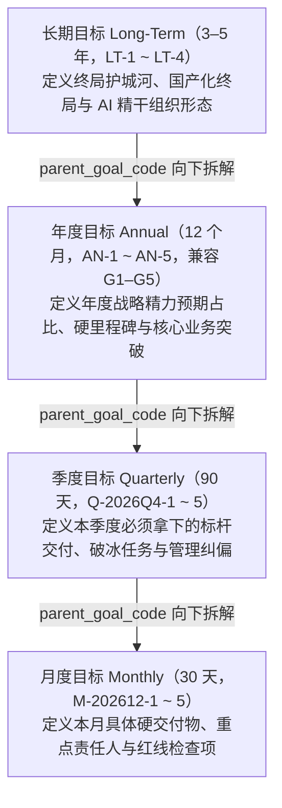

# 05｜四层战略目标体系、全量/增量采集机制、多周期滚动对比架构与目录规划

> **文档编号**：`WECOM-OPS-ARCH-V2.1`  
> **创建日期**：2026-11-27  
> **关联配置文件**：[strategic_goals.json](../config/strategic_goals.json)（董事长可直接编辑补充细节的四层战略目标唯一真理源）  
> **关联架构与图纸**：[04_WORKFLOW_AUDIT_AND_PDF_TEMPLATE_DESIGN.md](./04_WORKFLOW_AUDIT_AND_PDF_TEMPLATE_DESIGN.md) · [UML 2.5 状态机图（PNG）](../diagrams/04_WORKFLOW_AUDIT_AND_UML25_ARCHITECTURE.png) · [Draw.io 原图](../diagrams/04_WORKFLOW_AUDIT_AND_UML25_ARCHITECTURE.drawio)

---

## 一、 项目目录与文件规划（彻底解耦、一目了然）

本项目已确定**不再集成到 `wechat_AI_assistant` 的网页 Dashboard**，改为独立定期运行并输出 PDF 报告经由 Cyber Griffin 邮件投递。为消除文件平铺杂乱，将 `wechat_AI_assistant/wecom_report_agentic_analysis/` 规划为 **五大功能目录 + 核心模块层**（同时保留在 `wechat_AI_assistant/` 下以无缝复用现有 `.venv` 依赖，并保持对 `firematrix` SQLite 中 `list_items` 的严格只读比对；未来若完全脱离现有 Python 环境，也可整目录一键提升至顶层独立仓库）：

```text
wechat_AI_assistant/wecom_report_agentic_analysis/
│
├── config/                                      # 🔴 业务战略配置区（董事长随时编辑，无需改代码）
│   └── strategic_goals.json                     # ★ 四层战略目标（长期/年度/季度/月度）+ 采集与滚动窗口策略
│
├── docs/                                        # 📚 需求、架构、审计与规划文档（统一归口）
│   ├── 01_FEASIBILITY_AND_ARCHITECTURE_BLUEPRINT.md
│   ├── 02_PRD_STRATEGIC_ALIGNMENT_AND_AI_TRANSFORMATION.md
│   ├── 04_WORKFLOW_AUDIT_AND_PDF_TEMPLATE_DESIGN.md
│   └── 05_FOUR_TIER_GOALS_AND_ROLLING_HORIZON_DESIGN.md   # ★ 本文档
│
├── diagrams/                                    # 📐 OMG UML 2.5 状态机架构图与确定性制图脚本
│   ├── gen_uml25_workflow_drawio.py             # 一键重生成 Draw.io XML 的确定性脚本
│   ├── 04_WORKFLOW_AUDIT_AND_UML25_ARCHITECTURE.drawio
│   ├── 04_WORKFLOW_AUDIT_AND_UML25_ARCHITECTURE.png
│   └── 04_WORKFLOW_AUDIT_AND_UML25_ARCHITECTURE.pdf
│
├── reports/                                     # 📊 历次分析产出归档（Markdown 基线 + 每周 PDF 副本）
│   └── 03_BASELINE_30D_ALIGNMENT_DIAGNOSIS_2026_11.md
│   └── (后续自动归档) 维恩科仪经营战略对齐与AI提效周报_YYYYMMDD.pdf
│
├── tests/                                       # 🧪 独立黑盒契约测试套件
│   ├── test_slice0_journal_and_storage.py
│   └── test_slice1_alignment_analyzer.py
│
└── [核心代码层 — 严格物理隔离红区契约与编排执行]
    ├── schemas.py                               # 🔴 红区：Pydantic 强类型数据契约与客观验钞函数
    ├── prompts.py                               # 🔴 红区：集中化系统提示词
    ├── storage.py                               # SQLite ops_* 四张主表 + 新增 ops_sync_watermarks 同步水位表
    ├── wecom_journal_client.py                  # 企微官方汇报两步拉取引擎（首次全量 + 后续永久增量）
    ├── alignment_analyzer.py                    # 确定性四时间窗硬趋势矩阵 + 旗舰大脑分析引擎
    ├── sync_cli.py / analyze_cli.py             # CLI 入口
    ├── graph.py / langgraph.json                # (下一阶段) LangGraph StateGraph + Studio 图形界面入口
    ├── pdf_renderer.py                          # (下一阶段) 高管级 PDF 报告确定性排版渲染
    └── email_delivery.py                        # (下一阶段) Cyber Griffin 邮箱发信 + 防重发幂等锁
```

> **董事长日常使用极简分工**：
> - 想改战略目标、补充客户名单/营收指标/本月重点任务 → **只需编辑 [config/strategic_goals.json](../config/strategic_goals.json)**；
> - 想看架构与设计文档 → 看 [docs/](./)；
> - 想审阅工作流图 → 打开 [diagrams/04_WORKFLOW_AUDIT_AND_UML25_ARCHITECTURE.png](../diagrams/04_WORKFLOW_AUDIT_AND_UML25_ARCHITECTURE.png) 或 `.drawio`；
> - 想翻历史报告与每周 PDF 留档 → 看 [reports/](../reports/)。

---

## 二、 四层战略目标体系（长期 / 年度 / 季度 / 月度）设计规范

传统单层静态目标只能回答“本周像不像目标”，无法回答**“公司是不是在持续纠偏、真正往好的方向走”**。因此我们建立 **四层向下级联、向上对齐（Cascading Alignment）** 的目标模型，全部固化在 [config/strategic_goals.json](../config/strategic_goals.json) 中：



### 2.1 四层目标与 JSON 字段填写指南（方便您后续补充细节）

在 [config/strategic_goals.json](../config/strategic_goals.json) 中，我们已经根据您此前确认的 5 大方向与首份 30 天基线报告，为您预填了完整的四层结构骨架，并专门预留了 `【待董事长补充：...】` 占位符。您后续只需按以下清单补充细节即可（随时保存立即生效，下一次运行自动加载）：

| 目标层级 | JSON 节点路径 | 建议您后续重点补充的业务细节 | 大模型分析时如何运用 |
| :--- | :--- | :--- | :--- |
| **长期目标（3–5 年）** | `goals.long_term[]` | 细分市场终局地位、目标毛利率红线、国产化整机替代时间表、人均产值/AI 自动化替代率终局指标 | 对照全量历史演化轨迹，审视公司长期方向是否跑偏、核心壁垒是在变厚还是变薄 |
| **年度目标（12 个月）** | `goals.annual[]` | 年度预期人力占比（`target_effort_share_pct`）、年度签约台套数/合同额、关键客户标杆清单、李文颖研发专注度底线（默认 `≥75%`） | 对照**近 1 年滚动窗口（按季度切片）**，量化各产品线年度真实人力结构偏差与里程碑兑现度 |
| **季度目标（90 天）** | `goals.quarterly[]` | 本季度必须闭环的标杆项目、研发样机节点、销售破冰目标（如半导体/CCS 客户名单） | 对照**近 1 个季度滚动窗口（按月切片）**，验证上月指出的问题本季度是否真正收敛 |
| **月度目标（30 天）** | `goals.monthly[]` | 本月硬交付物（如前放 v2.0 打样测试日、五彩湾 DCS 收口、联合燃料电池合同用印、杨震汇报整改） | 对照**近 1 个月滚动窗口（按周切片 + 完整汇报原文）**，逐条核对一线执行落点与卡点 |

---

## 三、 企微汇报采集机制升级：首次全量历史拉取 → 后续永久增量拉取

为支撑“往前推 1 个月、1 个季度、1 年乃至长期”的真实纵向对比，采集底盘从“只拉近 30 天”升级为**「首次全量回溯 + 后续永久增量」**的双模状态机：

### 3.1 新增确定性同步水位表（`ops_sync_watermarks`）
在 SQLite 中为 5 个企业微信汇报模板分别维护独立水位记录：
- `template_id`（主键）
- `full_backfill_completed`（`0` = 尚未完成首次全量回溯；`1` = 已完成全量，自动切入永久增量模式）
- `backfill_cursor_date`（断点续传水位：全量拉取每完成一个 25 天切片即实时落盘，中途断网重启可从断点无缝续跑）
- `earliest_report_date`（本模板在企微中实际拉到的最早汇报日期，供大模型准确知晓数据跨度边界）
- `last_synced_at`（最近一次成功增量同步的时间戳）

### 3.2 两种运行模式严格确定性执行（0% 大模型）
1. **模式 A · 首次全量历史拉取（`full_backfill_completed == 0`）**：
   - 从 `config/strategic_goals.json` 中 `initial_backfill_start_date`（默认 `2023-01-01`，可按公司启用企微汇报的实际年份微调）开始，按企微 API 硬限制自动切分为连续 **≤25 天时间窗**，逐片分页拉取全部 5 类模板的历史汇报；
   - 空时间窗仅需 1 次 `get_record_list` 即可秒过；遇到新 `journal_uuid` 再调用 `get_record_detail` 解析控件并幂等入库（`INSERT OR IGNORE`）；
   - 加入企微限频节流（远低于 600 次/分钟红线）与显式超时/退避重试；全部切片跑完后将 `full_backfill_completed` 置为 `1`。
2. **模式 B · 后续永久增量拉取（`full_backfill_completed == 1`）**：
   - 每次定时或手动触发时，自动计算增量起止窗：`start = last_synced_at - 7 天`，`end = now`；
   - **为什么回看 7 天？** 维恩科仪存在专门的「现场技术支持工作日报（后补）」模板，工程师出差归来常延迟 2–5 天补交上周日报。7 天安全重叠窗可 100% 捕获所有迟交补报；
   - 拉取 UUID 列表后，先与本地 `ops_wecom_reports` 已有主键集合做差集——**已入库的汇报直接跳过，零重复调用 `get_record_detail`，常规周度增量仅需 2–5 秒即可跑完**！

---

## 四、 四时间窗滚动对比分析引擎（动态判断公司是否持续向好）

以每次分析的基准日期 `today` 为锚点，系统自动构建**四个嵌套滚动时间窗**，分别对齐**四层战略目标**：

| 滚动窗口 | 时间跨度（以 `today` 为基准） | 趋势切片粒度 | 对标目标层级 | 交给旗舰大脑的桌面信息形态（防上下文爆炸设计） |
| :--- | :--- | :---: | :---: | :--- |
| **窗口 1 · 近 1 个月** | `today - 30 天 ~ today` | 按周（4 周） | **月度目标** | **完整清洗后的汇报原文**（短号 `R-001` + 不可信物理围栏）+ 周度硬统计表 + 董事长在途任务快照 |
| **窗口 2 · 近 1 个季度** | `today - 90 天 ~ today` | 按月（3 个月） | **季度目标** | **确定性月度对比硬趋势表**（每人/每模板/出差/后补/李文颖研发频次 3 个月变化曲线）+ 历次月度/周度审计归档摘要 |
| **窗口 3 · 近 1 年** | `today - 365 天 ~ today` | 按季（4 个季度） | **年度目标** | **确定性季度对比硬趋势表**（4 个季度全公司精力结构、活跃度、出差与研发频次演化）+ 历史归档结论摘要 |
| **窗口 4 · 长期演化** | `earliest_report_date ~ today` | 按半年/年 | **长期目标** | **全量历史跨期总趋势表** + 各年度/季度战略对齐分与研发专注度历史曲线 |

### 为什么这套设计完全符合 `07` / `08` / `09` 规范且不爆上下文？
1. **绝不把 1 年 2,000 份汇报原文硬塞给大模型**：
   - 近 30 天给“显微镜级全文”；近 1 季 / 近 1 年 / 长期由 **确定性 Python 底盘预先算出精确的多期趋势矩阵**（0 幻觉、0 估算、极省 Token），搭配历史沉淀的审计摘要，让大模型一眼看清 3 个月和 1 年的宏观走向。
2. **配合 ReAct 乒乓球只读工具（上限 ≤6 步）实现“发现异常拐点 → 精准下钻原始历史”**：
   - 例如大模型从 90 天趋势表发现：“上个月李文颖的返厂维修汇报从 1 份飙升到 3 份，而今年 Q2 时他曾连续两月专注研发”，大模型可主动调用只读工具 `search_historical_reports(staff="李文颖", start_date=..., end_date=...)` 调出历史关键原文进行因果印证，而不是凭空猜测！
3. **输出标准化的「动态向好判定（Trajectory Verdict）」**：
   - 针对**月度 / 季度 / 年度 / 长期**四层目标，大模型必须分别给出五档明确方向灯号与实证依据：
     - `持续向好 ↗` / `稳步推进 →` / `波动反复 ↔` / `偏离恶化 ↘` / `基线初建 ○`
   - 并在 PDF 报告中专门呈现一张 **《四层战略目标 × 四周期动态演进评估总表》**，让董事长一眼看清：哪些目标正在持续改善、哪些管理指令落地了、哪些顽疾跨季度仍反复恶化需要下狠手！

---

## 五、 配套 PDF 报告模板与 UML 2.5 架构图同步升级

1. **PDF 报告模板升级**（在 [04_WORKFLOW_AUDIT_AND_PDF_TEMPLATE_DESIGN.md](./04_WORKFLOW_AUDIT_AND_PDF_TEMPLATE_DESIGN.md) 9 页结构基础上）：
   - **第 1 页执行摘要**：顶部 KPI 增加「四层目标动态趋势灯号（月 ↗ / 季 ↔ / 年 ↘ / 长期 →）」；
   - **第 3 页升级为「四层战略目标 × 多周期滚动演进评估」**：同时展示 `近 1 个月 vs 月度目标`、`近 1 季度（3 个月趋势）vs 季度目标`、`近 1 年（4 季度趋势）vs 年度目标` 与 `长期演化 vs 长期目标` 的动态对比图与演进定性；
   - 其余章节（15 人硬统计、李文颖专项穿透、产品线×职能矩阵、董事长任务双向雷达、人员调优、AI 提效替代清单、溯源附录）完整保留并补入环比/跨月变化。
2. **OMG UML 2.5 架构图已同步更新**：
   - 请审阅最新图纸：[04_WORKFLOW_AUDIT_AND_UML25_ARCHITECTURE.png](../diagrams/04_WORKFLOW_AUDIT_AND_UML25_ARCHITECTURE.png)（阶段一已体现「首次全量 + 后续永久增量水位」与「加载四层目标 JSON + 四时间窗滚动趋势矩阵」；阶段二/三已体现「四层目标多周期动态评估 + 全量历史下钻」）。
